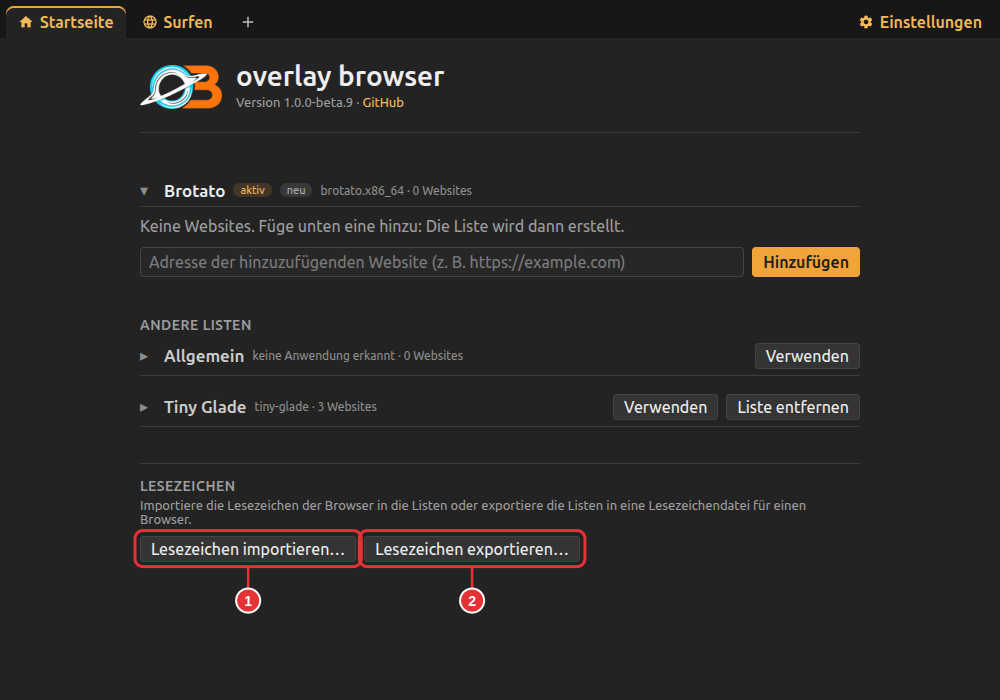
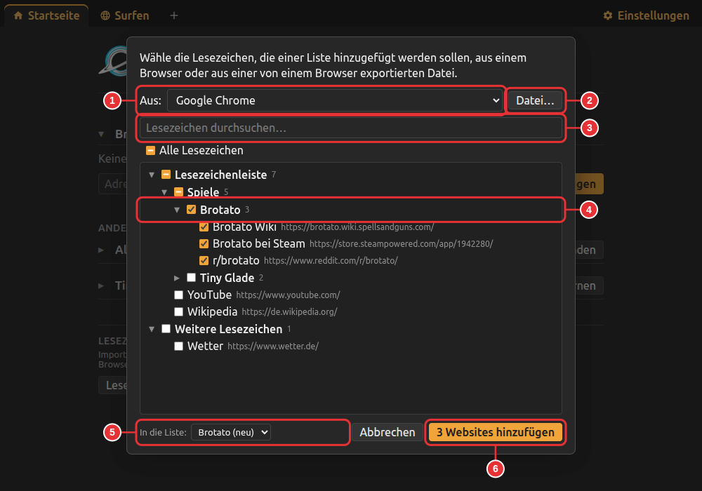
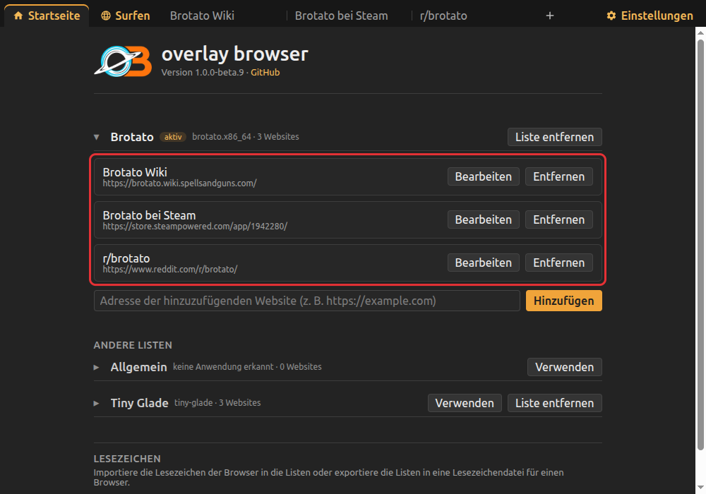
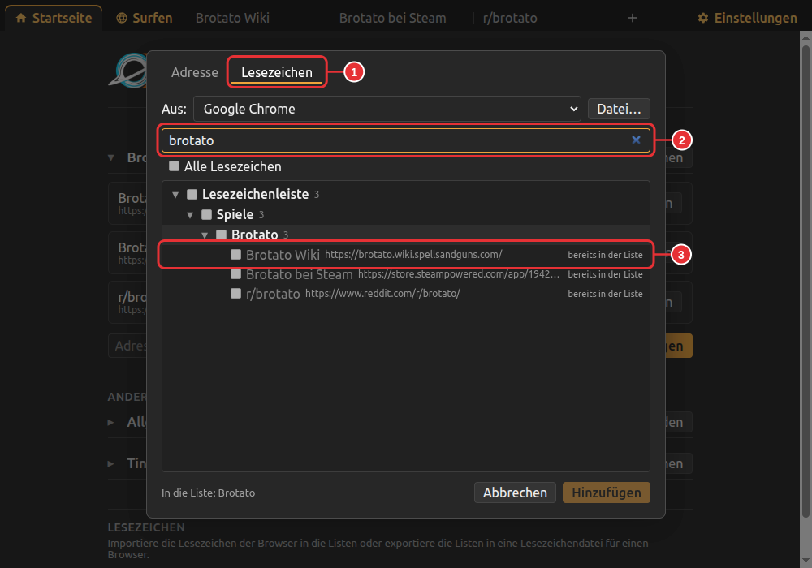
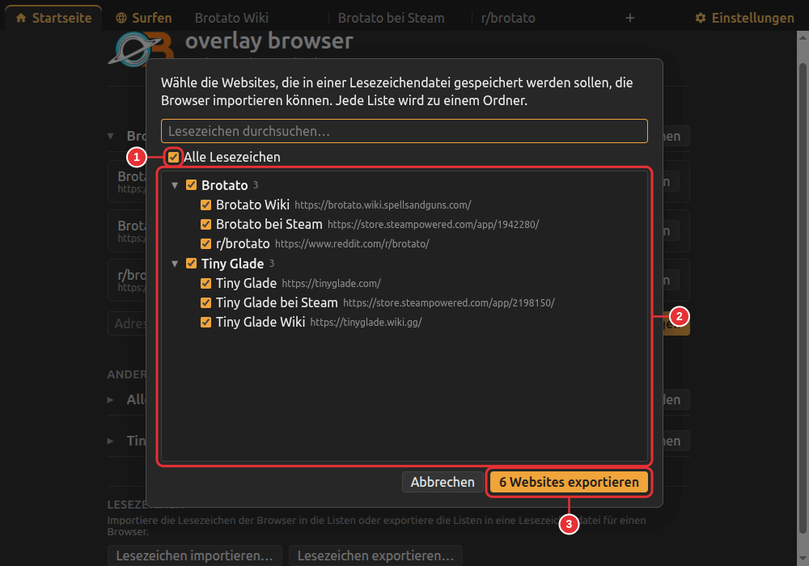

# Lesezeichen importieren und exportieren

Sind die Websites zu deinen Spielen schon in deinem Browser gespeichert? Du kannst die Lesezeichen direkt in die Listen von Overlay Browser übernehmen und die Listen als Lesezeichendatei für andere Browser exportieren.

Hier ist das Overlay über **Brotato** geöffnet. Diese Liste ist noch leer. Die Liste für **Tiny Glade** enthält bereits drei Websites. Siehe [Eine Liste pro Spiel](lists-per-game.md).

In den Screenshots sind die im Text genannten Elemente rot umrahmt; Nummern wie ❶ im Text verweisen auf das Element mit derselben Nummer im Screenshot.

## 1. Lesezeichen auf der Startseite

Unten auf der **Startseite** findest du den Abschnitt *Lesezeichen* mit **Lesezeichen importieren…** ❶ und **Lesezeichen exportieren…** ❷.

## 2. Lesezeichen für den Import auswählen

Klicke auf **Lesezeichen importieren…**. Im Fenster findest du diese Optionen.

- **Aus** ❶ wählt ein Browserprofil. Das Overlay erkennt Chrome, Edge, Brave, Opera, Vivaldi, Chromium, Firefox, LibreWolf und ähnliche Browser automatisch. Firefox kann geöffnet bleiben. Beim nächsten Import wird das zuletzt gewählte Profil angeboten.
- **Datei…** ❷ liest eine HTML-Datei, die du in der Lesezeichenverwaltung eines Browsers exportiert hast. Unter macOS erfolgt der Import über diesen Weg.
- **Lesezeichen durchsuchen…** ❸ findet Lesezeichen und Ordner nach Namen oder Adresse.
- Mit den **Kontrollkästchen** ❹ wählst du einzelne Lesezeichen oder ganze Ordner aus. *Alle Lesezeichen* wählt alles aus. Hier markieren wir den Ordner *Brotato*.
- **In die Liste** ❺ bestimmt die Zielliste. Anfangs ist die aktive Liste ausgewählt. Ist sie wie hier bei Brotato noch *neu*, wird sie mit den importierten Websites angelegt.
- Die Schaltfläche **3 Websites hinzufügen** ❻ zeigt die Anzahl der Websites.

Die Lesezeichen erscheinen mit ihren Namen als Websites in der Liste.

## 3. Über „+“ importieren

Öffne **+** in der Leiste und wähle **Lesezeichen** ❶ neben *Adresse*. Die Websites werden in die aktive Liste übernommen. Mit **Lesezeichen durchsuchen…** ❷ findest du die gewünschten Einträge. Adressen, die **bereits in der Liste** ❸ sind, sind ausgegraut und lassen sich nicht erneut auswählen. So entstehen keine Duplikate.

## 4. Listen exportieren

**Lesezeichen exportieren…** im Abschnitt *Lesezeichen* der Startseite speichert die Websites in einer HTML-Datei, die Browser importieren können. Jede Liste wird zu einem Ordner. Anfangs sind **Alle Lesezeichen** ❶ ausgewählt. In der **Liste** ❷ kannst du Ordner oder Websites abwählen. Die Schaltfläche **6 Websites exportieren** ❸ öffnet den Speicherdialog.

