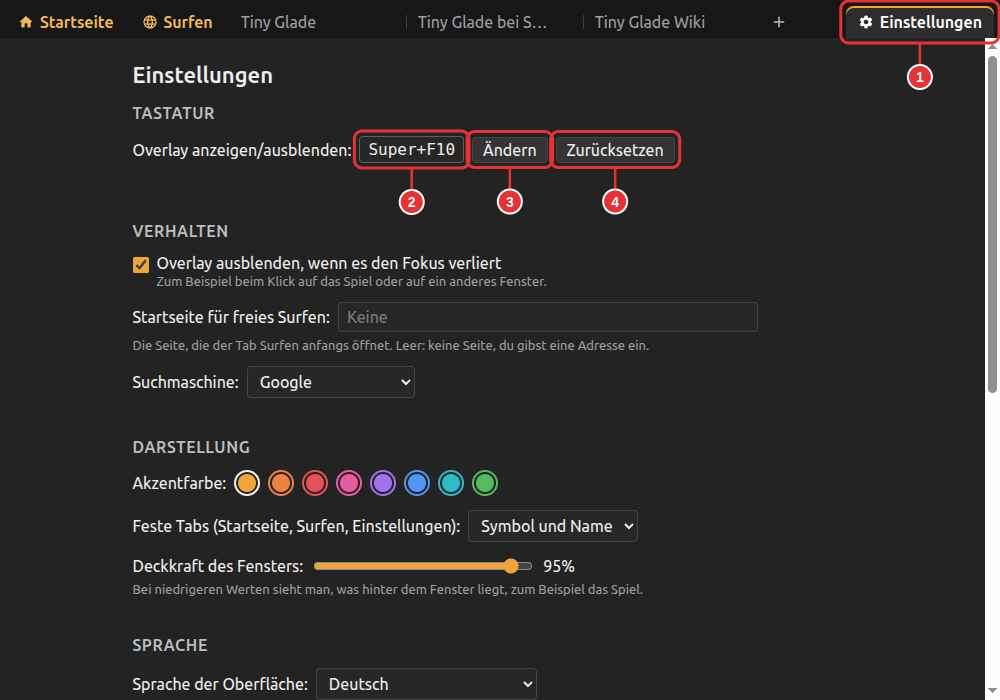
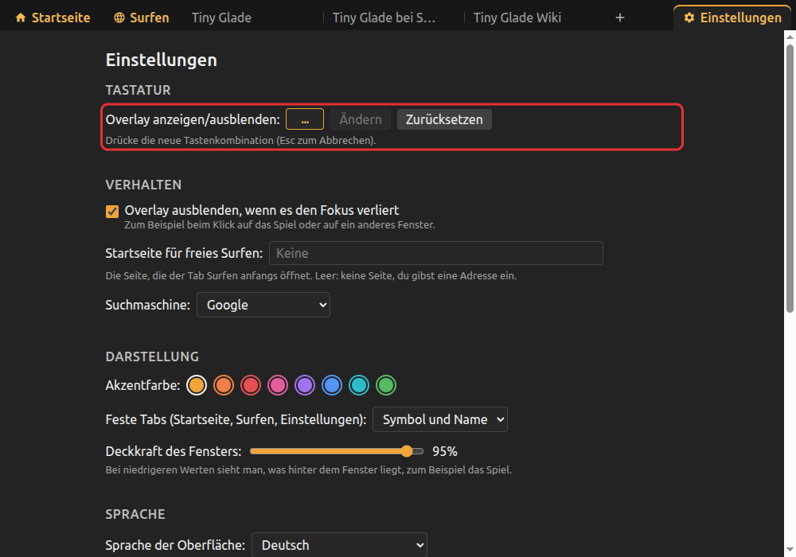
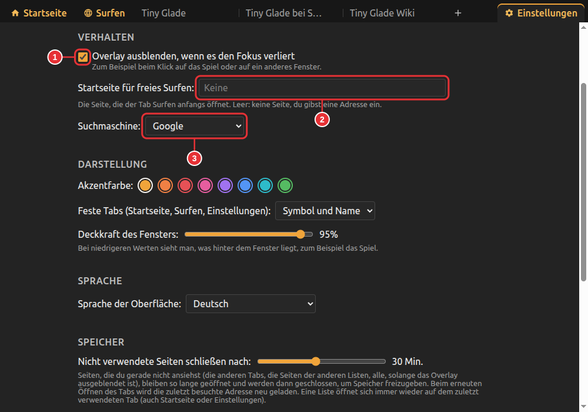
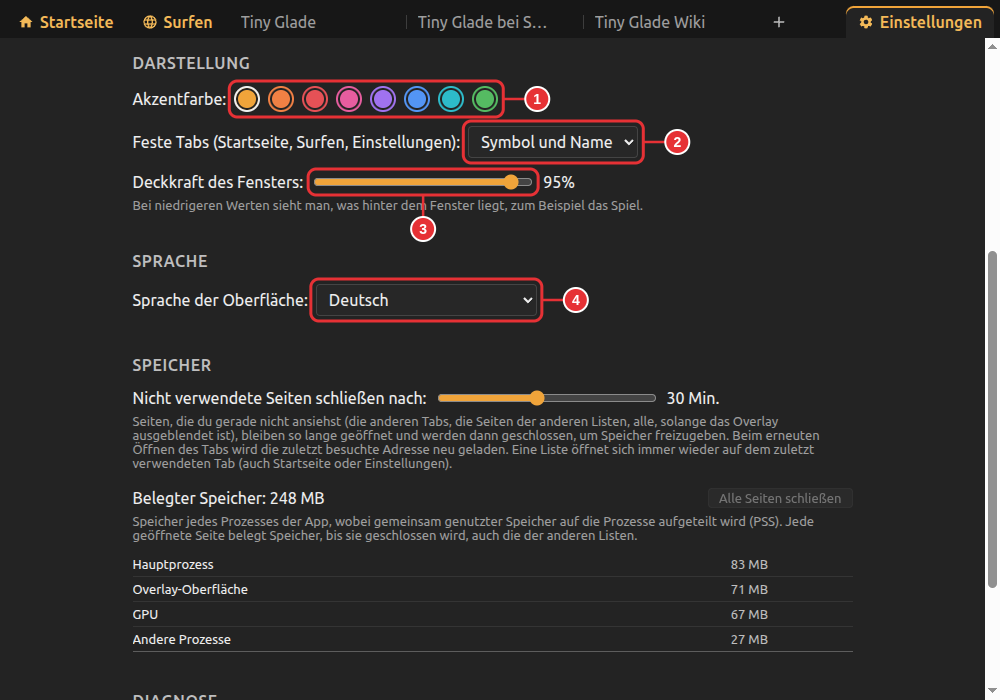
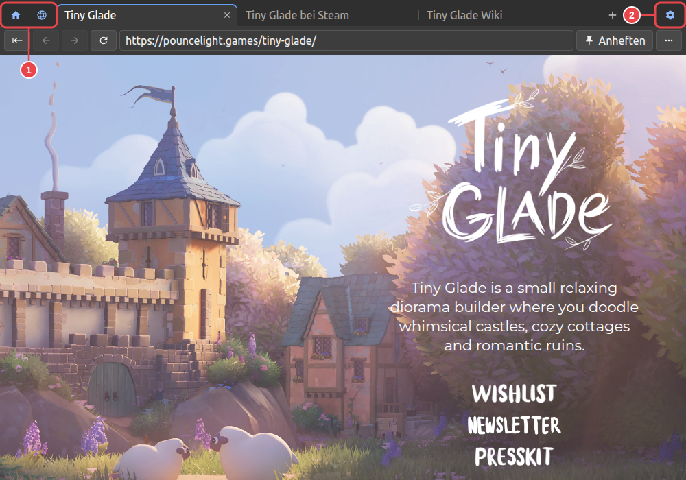

# Overlay anpassen

In den **Einstellungen** legst du Tastenkombination, Verhalten, Darstellung und Sprache fest. Änderungen gelten sofort und werden gespeichert.

In den Screenshots sind die im Text genannten Elemente rot umrahmt; Nummern wie ❶ im Text verweisen auf das Element mit derselben Nummer im Screenshot.

## 1. Tastenkombination

Öffne oben rechts **Einstellungen** ❶ oder wähle *Einstellungen* im Menü des Symbols im Infobereich. Im Abschnitt *Tastatur* steht die **aktuelle Tastenkombination** ❷ zum Ein- und Ausblenden. Mit **Ändern** ❸ erfasst du eine neue Kombination. **Zurücksetzen** ❹ stellt die Standardkombination wieder her (Win+F10, Super+F10 unter Linux, Cmd+Shift+Leertaste unter macOS).

Drücke nach **Ändern** deine gewünschte Kombination, etwa `Ctrl+Shift+O`. Mit Esc brichst du ab.

F1 bis F24 kannst du einzeln verwenden. Andere Tasten kombinierst du mit Strg, Alt, Umschalt oder Win (Super unter Linux, Cmd unter macOS). Ist die Kombination bereits belegt, erscheint eine Meldung und die bisherige Kombination bleibt aktiv.

> **Beim Spielen:** Auch das Spiel empfängt die Tastenkombination. Wähle eine, der im Spiel kein Befehl zugeordnet ist. Sonst löst du beim Öffnen des Overlays zugleich diesen Befehl aus.

## 2. Verhalten

Im Abschnitt *Verhalten* findest du diese Optionen.

- **Overlay ausblenden, wenn es den Fokus verliert** ❶ ist standardmäßig aktiv. Beim Klick auf das Spiel oder ein anderes Fenster blendet sich das Overlay aus. Deaktiviere die Option, wenn das Overlay beim Spielen sichtbar bleiben soll. Mit der Tastenkombination kannst du es weiterhin ausblenden. Die Option steht auch im Menü des Symbols im Infobereich.
- **Startseite für freies Surfen** ❷ legt fest, welche Seite der Tab Surfen zuerst öffnet. Lässt du das Feld leer, öffnet sich der Tab ohne Seite. Siehe [Freies Surfen](free-browsing.md).
- **Suchmaschine** ❸ bestimmt, wie der Tab Surfen nach Text sucht. Du kannst Google, Bing, DuckDuckGo, Brave Search, Ecosia, Startpage oder *Benutzerdefiniert* wählen. In einer eigenen Suchadresse steht `%s` für den Suchbegriff.

Mit *Nach neuen Versionen suchen* erhältst du auf der Startseite einen Hinweis auf neue Versionen. Bei der Microsoft-Store-Version laufen Updates über den Store.

## 3. Darstellung und Sprache

Im Abschnitt *Darstellung* findest du diese Optionen.

- **Akzentfarbe** ❶ bestimmt die Farbe der festen Tabs, der wichtigsten Schaltflächen und weiterer Elemente.
- **Feste Tabs** ❷ zeigt Startseite, Surfen und Einstellungen mit Symbol und Name an. *Nur Symbol* lässt mehr Platz für Website-Tabs.
- **Deckkraft des Fensters** ❸ reicht von 30 % bis 100 %. Bei niedrigeren Werten scheint das Spiel hinter dem Fenster durch.

Im Abschnitt *Sprache* stellst du die **Sprache der Oberfläche** ❹ ein. Standardmäßig gilt die *Systemsprache*, sofern sie unterstützt wird (Italienisch, Englisch, Französisch, Portugiesisch, Russisch, Spanisch und Deutsch). Andernfalls erscheint die App auf Englisch.

Hier siehst du das Overlay mit blauer Akzentfarbe und **festen Tabs mit Symbolen** ❶ ❷. Der Screenshot erfasst nur das Fenster, daher siehst du das Spiel hinter dem Fenster und die Transparenz hier nicht.

## Weitere Abschnitte

Unter *Speicher* siehst du den Speicherverbrauch und kannst einstellen, wann ungenutzte Seiten geschlossen werden. Unter *Diagnose* sammelst du Informationen für eine Fehlermeldung.
