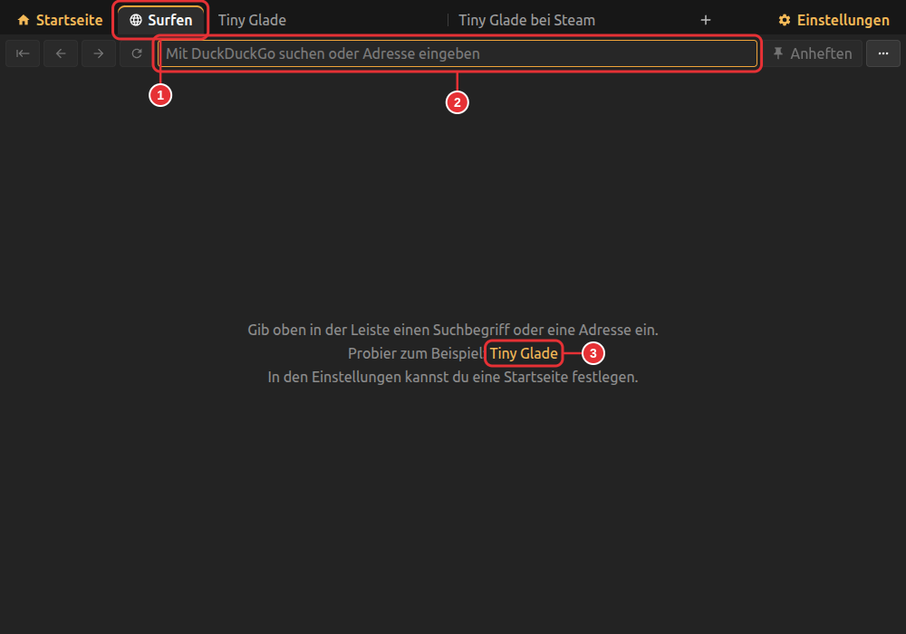
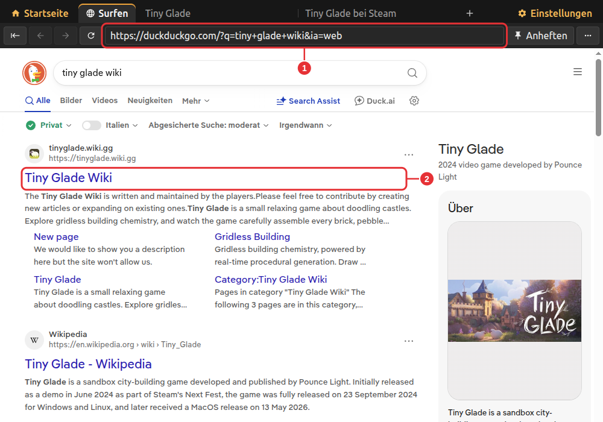
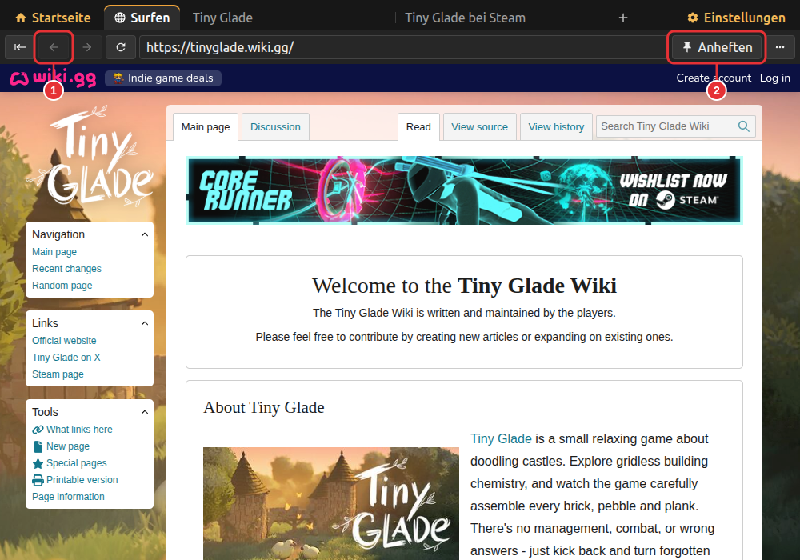
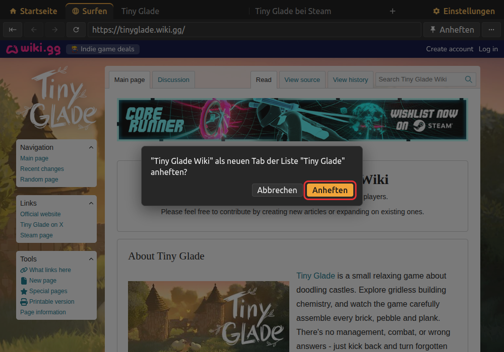
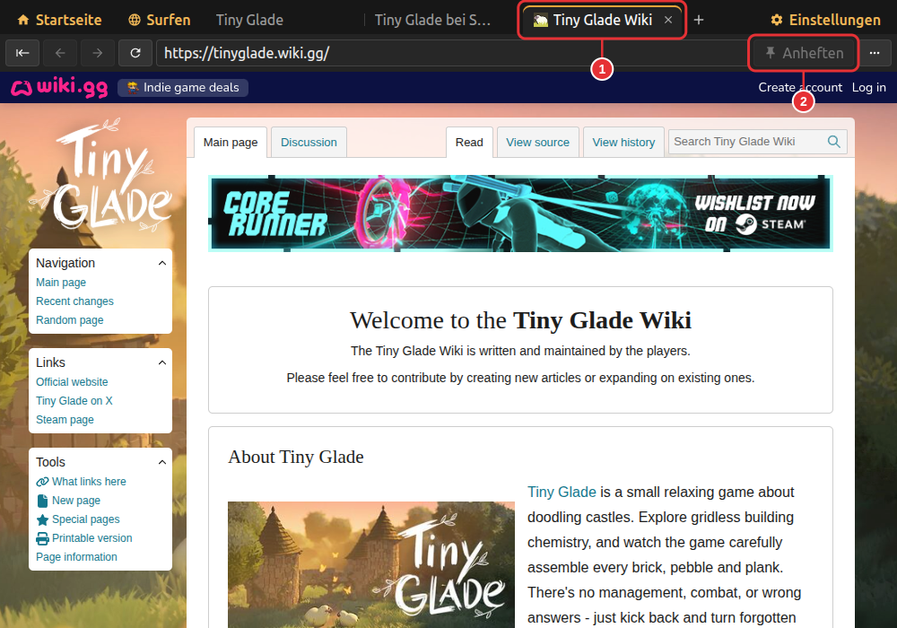
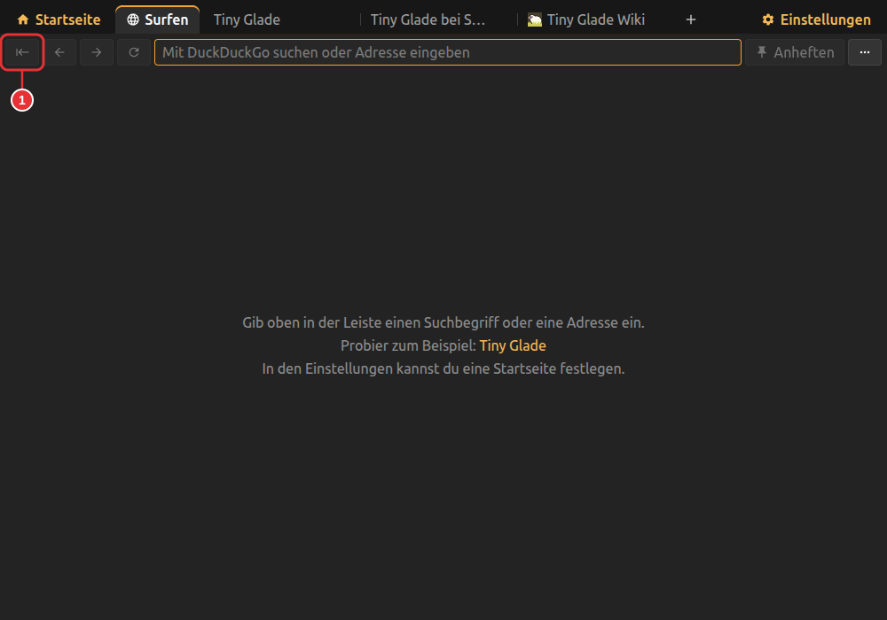

# Freies Surfen – suchen, finden, anheften

Im Tab **Surfen** kannst du beliebige Seiten suchen und öffnen. Möchtest du eine Seite behalten, macht **Anheften** daraus einen Tab in der Liste des Spiels.

Hier geht das Beispiel aus [Erste Schritte](getting-started.md) weiter. Das Overlay ist über **Tiny Glade** geöffnet. Die Liste enthält bereits zwei Websites. Jetzt suchen wir ein Wiki zum Spiel.

In den Screenshots sind die im Text genannten Elemente rot umrahmt; Nummern wie ❶ im Text verweisen auf das Element mit derselben Nummer im Screenshot.

## 1. Tab Surfen öffnen

Klicke gleich neben der Startseite auf **Surfen** ❶. Gib im **Adressfeld** ❷ eine Adresse (etwa `example.com`) oder einen Suchbegriff ein. Als Beispiel schlägt das Overlay den **Namen des Spiels** ❸ vor. Klicke darauf, um danach zu suchen.

## 2. Suchen

Gib `tiny glade wiki` ein und drücke Enter. Die Ergebnisse öffnen sich im Tab. Das **Adressfeld** ❶ zeigt die Adresse der Ergebnisseite.

Die Suchmaschine wählst du in den Einstellungen unter *Verhalten*. Zur Auswahl stehen Google, Bing, DuckDuckGo, Brave Search, Ecosia, Startpage und eine benutzerdefinierte Adresse. Hier verwenden wir DuckDuckGo.

Klicke auf das gewünschte Ergebnis, hier **Tiny Glade Wiki** ❷.

## 3. Seite anheften

Die Seite öffnet sich im Tab Surfen und funktioniert wie im Browser. Mit **Zurück** ❶ gelangst du zu den Suchergebnissen. Klicke auf **Anheften** ❷, um die Seite zu behalten.

Bestätige mit **Anheften**.

## 4. Die Seite wird zum Tab der Liste

Die Seite wird mit ihrem Verlauf zum **neuen Tab** ❶ am Ende der Liste von Tiny Glade. Wenn du das Overlay über dem Spiel öffnest, findest du sie dort. **Anheften** ❷ ist jetzt deaktiviert, da die Seite bereits in der Liste steht.

Du kannst auch in einem Website-Tab eine Seite anheften. Der neue Tab erscheint direkt hinter dem ursprünglichen Tab. Ist die Seite bereits als Tab vorhanden, wird dieser hervorgehoben und Anheften ist deaktiviert.

## 5. Der Tab Surfen ist wieder frei

Wenn du zu **Surfen** zurückkehrst, ist der Tab bereit für eine neue Suche. Die angeheftete Seite hat jetzt einen eigenen Tab. Beim Surfen schließt **Zurück zur Startseite** ❶ die offene Seite und zeigt wieder die leere Ansicht.

In den Einstellungen unter *Verhalten* kannst du eine **Startseite für freies Surfen** festlegen, die anstelle der leeren Ansicht erscheint.

## Adressen anderer Websites in Website-Tabs eingeben

Auch in Website-Tabs kannst du das Adressfeld bearbeiten. Adressen derselben Website öffnen sich im aktuellen Tab. Eine andere Website oder eine Suche öffnet sich nach Bestätigung im Tab Surfen. Der ursprüngliche Tab behält seine Seite.
