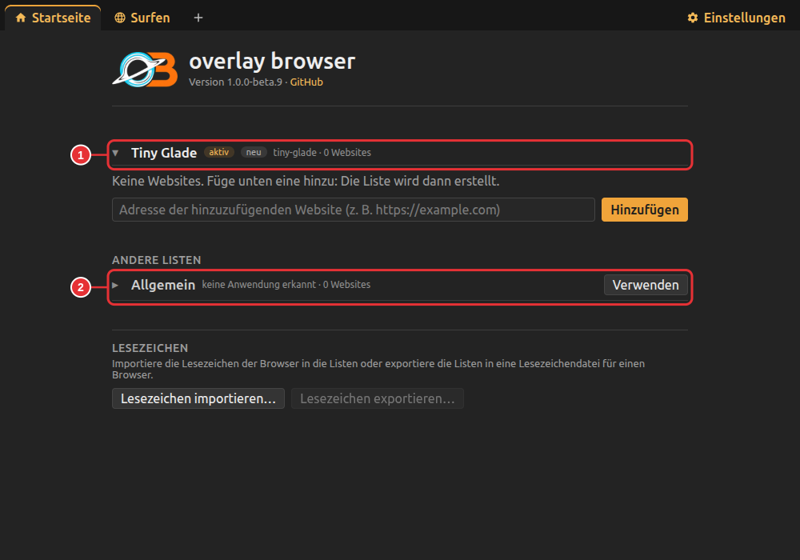
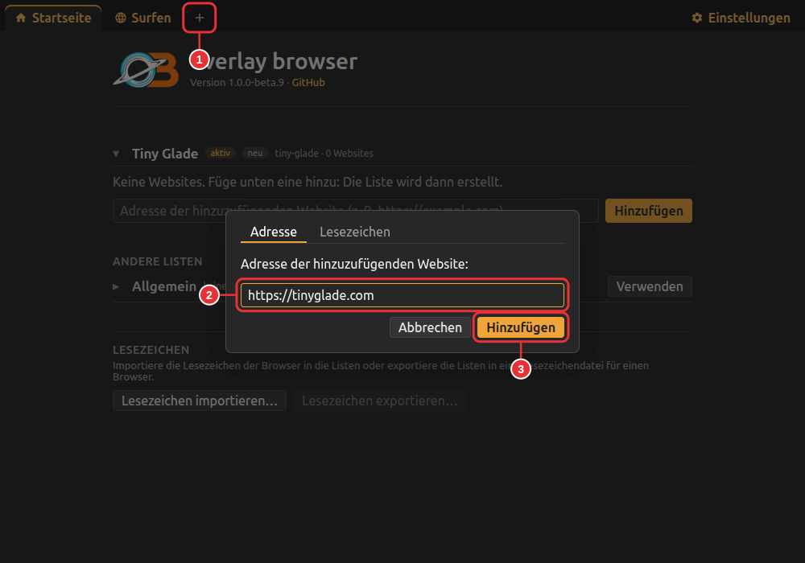
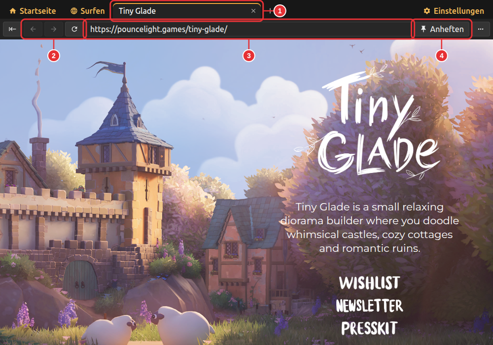
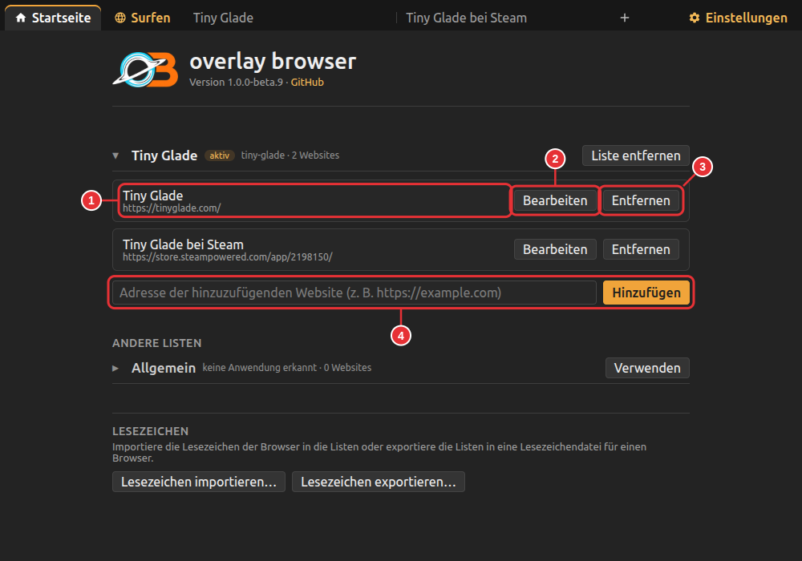
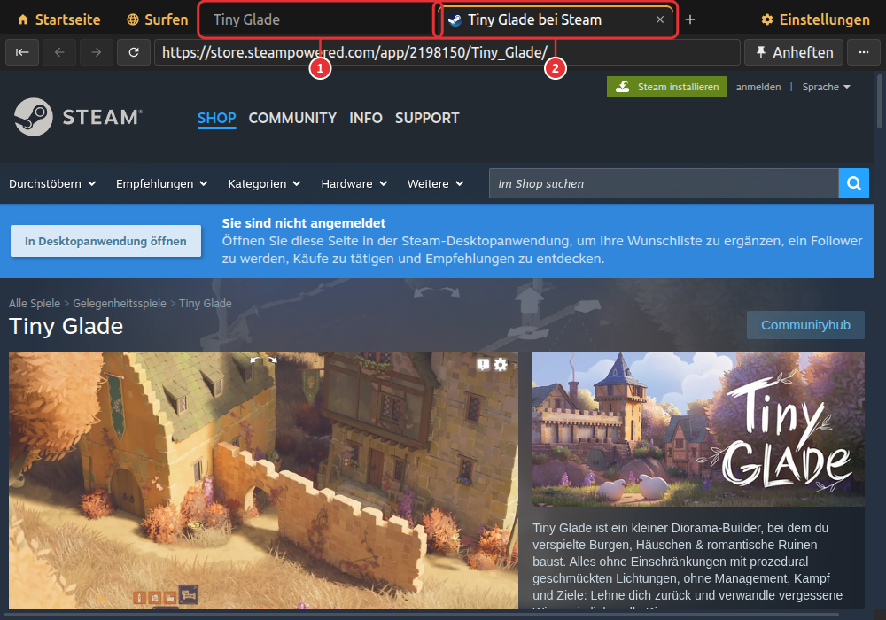

# Erste Schritte – die Websites zu deinem Spiel griffbereit

In dieser Anleitung öffnest du Overlay Browser beim Spielen von **Tiny Glade**, fügst zwei nützliche Websites hinzu und lernst, sie einzublenden und auszublenden, ohne das Spiel zu verlassen.

In den Screenshots sind die im Text genannten Elemente rot umrahmt; Nummern wie ❶ im Text verweisen auf das Element mit derselben Nummer im Screenshot.

## 1. App starten

Starte Overlay Browser. Das Fenster **bleibt ausgeblendet**. Die App wartet im Infobereich neben der Uhr. In der Taskleiste und unter Alt+Tab erscheint sie nicht.

Starte dann das Spiel im Fenster oder im randlosen Fenstermodus.

## 2. Overlay über dem Spiel öffnen

Drücke im Spiel **Win+F10** (Super+F10 unter Linux, Cmd+Shift+Leertaste unter macOS). Das Overlay erscheint über dem Spiel und öffnet die **Startseite**.

Das Overlay hat das Spiel erkannt. Oben steht die Liste **Tiny Glade** ❶. Sie ist *aktiv* und noch *neu*. Jedes Spiel hat eine eigene Liste, die beim Hinzufügen der ersten Website angelegt wird. Unter *Andere Listen* findest du **Allgemein** ❷. Diese Liste ist aktiv, wenn kein Spiel geöffnet ist. Mit **Verwenden** wählst du sie manuell aus.

## 3. Website hinzufügen

Klicke oben auf **+** ❶, gib die **Adresse** ❷ ein (es genügt `tinyglade.com`) und klicke auf **Hinzufügen** ❸.

Die Website öffnet sich sofort in ihrem **Tab** ❶, der den Seitentitel übernimmt. Das **×** schließt ihn. Darunter findest du die Navigationsleiste wie in einem Browser. Mit **Zurück**, **Vorwärts** und **Neu laden** ❷ steuerst du die Seite. In das **Adressfeld** ❸ kannst du eine andere Adresse eingeben und Enter drücken. Mit **Anheften** ❹ machst du aus der gerade besuchten Seite einen neuen Tab.

## 4. Weitere Websites auf der Startseite hinzufügen

Auf der **Startseite** siehst du die Websites der Liste. Klicke auf einen **Namen** ❶, um die Website zu öffnen. **Bearbeiten** ❷ ändert die Adresse (Enter speichert, Esc bricht ab). **Entfernen** ❸ nimmt die Website aus der Liste. Gib eine weitere Adresse in das **Feld unter der Liste** ❹ ein und klicke auf *Hinzufügen*. Hier haben wir die Steam-Seite des Spiels hinzugefügt.

## 5. Zwischen Websites wechseln

Jede Website hat einen eigenen Tab. Hier siehst du die **offizielle Website** ❶ und die gerade geöffnete **Steam-Seite** ❷. Wenn du zu einem Tab zurückkehrst, findest du die Seite dort wieder, wo du sie verlassen hast.

## 6. Zurück zum Spiel

Drücke erneut **Win+F10**, um das Overlay auszublenden, oder klicke auf das Spielfenster. Standardmäßig blendet sich das Overlay aus, wenn es den Fokus verliert. Das kannst du in den Einstellungen abschalten.

Beim nächsten Öffnen über Tiny Glade erscheint dessen Liste mit dem zuletzt verwendeten Tab. Über einem anderen Spiel siehst du dessen Liste.
