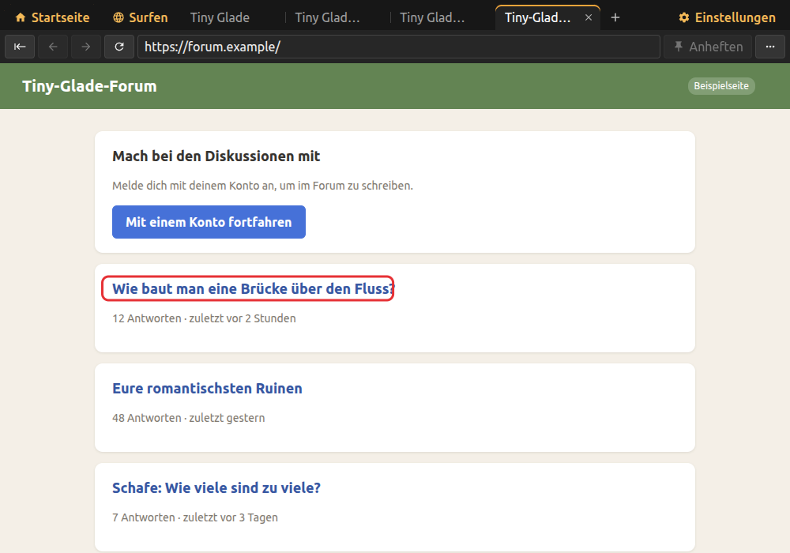
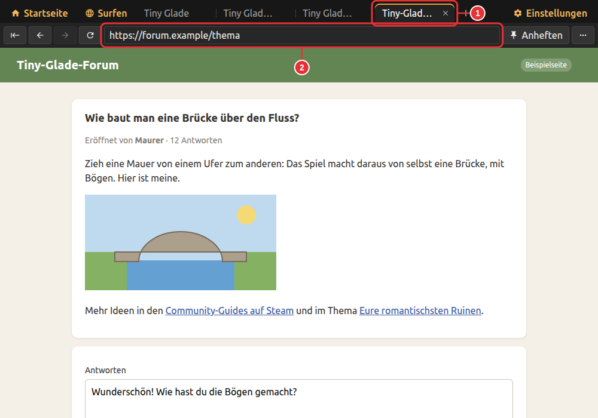
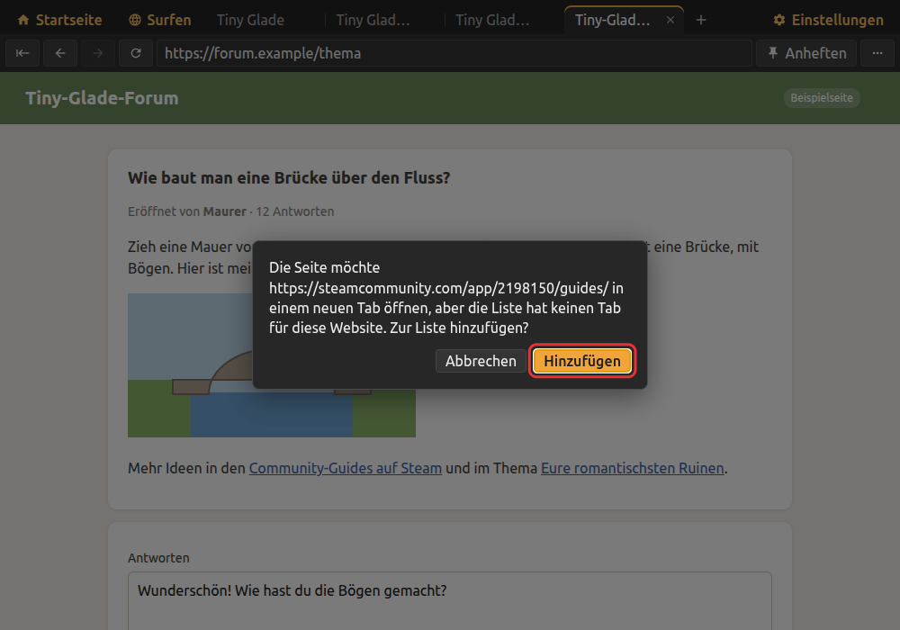
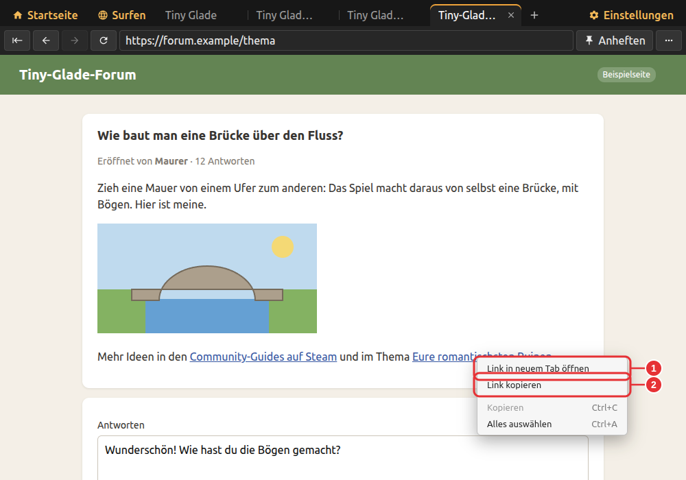
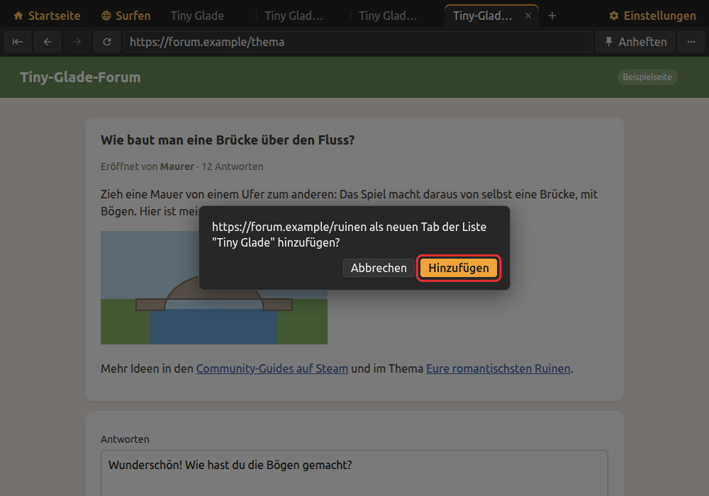
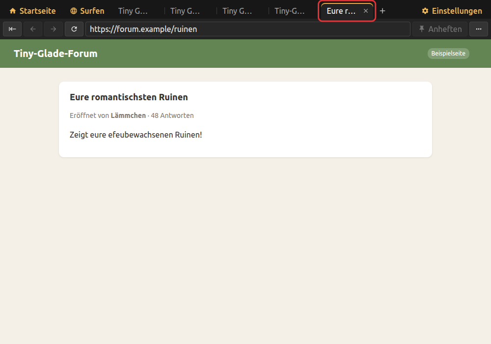
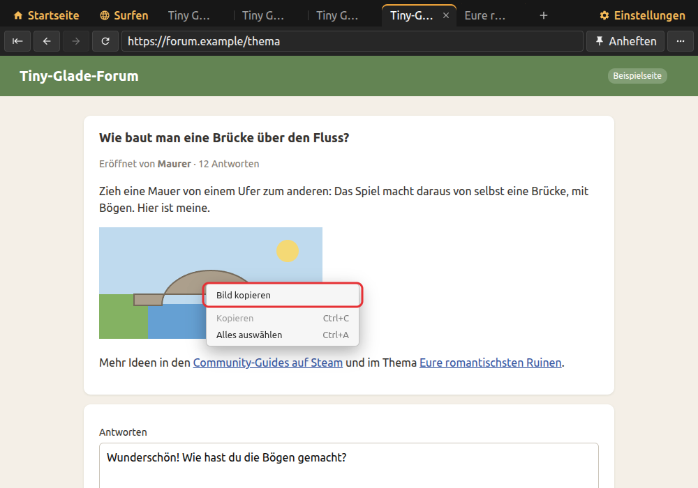
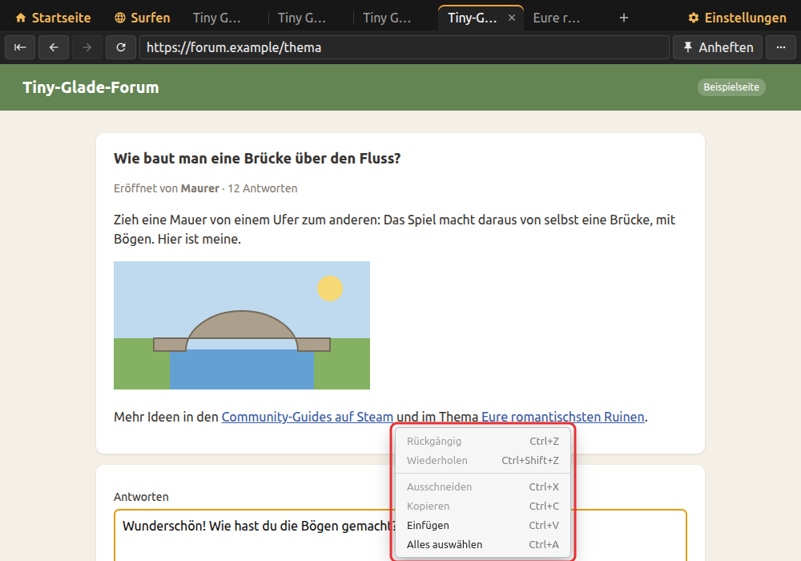

# Links, neue Tabs und das Kontextmenü

Viele Links öffnen sich im Browser in einem neuen Tab. Im Overlay entsprechen die Tabs den Websites der Liste. Solche Links öffnen sich im Tab der ursprünglichen Website oder nach einer Rückfrage in einem neuen Tab. Mit einem Rechtsklick kannst du Links gezielt in neuen Tabs öffnen und Links, Bilder oder Text kopieren.

Die Liste für **Tiny Glade** enthält ein Forum als **Beispielseite** für diese Anleitung. Siehe [Bei einer Website anmelden und Cookies löschen](signing-in.md).

In den Screenshots sind die im Text genannten Elemente rot umrahmt; Nummern wie ❶ im Text verweisen auf das Element mit derselben Nummer im Screenshot.

## 1. Ein Link, den die Website in einem neuen Tab öffnet

Einige Links sind für neue Tabs vorgesehen, etwa dieser Link zu einem Forenthema. Dasselbe gilt für Klicks mit gedrückter Strg-Taste oder mit der mittleren Maustaste.

## 2. Dieselbe Website öffnet sich in ihrem Tab

Führt der Link zur selben Website, ersetzt die Zielseite die bisherige Seite im **Tab der Website** ❶. Im **Adressfeld** ❷ steht jetzt die Adresse des Themas. Mit **Zurück** kommst du zur vorherigen Seite.

Gibt es mehrere Tabs derselben Website, öffnet sich der Link in dem Tab, in dem du ihn angeklickt hast.

## 3. Rückfrage bei einer anderen Website

Führt der Link zu einer Website ohne eigenen Tab in der Liste, hier zu den Community-Guides auf Steam, fragt das Overlay nach. **Hinzufügen** nimmt die Website in die Liste auf und öffnet sie. **Abbrechen** belässt dich auf der aktuellen Seite.

Links aus dem Tab **Surfen** bleiben im Tab Surfen. Siehe [Freies Surfen](free-browsing.md).

## 4. Rechtsklick auf einen Link

Mit einem Rechtsklick öffnest du das Menü mit **Link in neuem Tab öffnen** ❶ und **Link kopieren** ❷. Letzteres kopiert die Adresse des Links.

**Link in neuem Tab öffnen** fragt nach, bevor der Link in die Liste aufgenommen wird. Klicke auf **Hinzufügen**.

Der Link öffnet sich in einem **neuen Tab** direkt hinter dem ursprünglichen Tab. Gibt es bereits einen Tab mit dieser Adresse, wechselt das Overlay dorthin.

## 5. Rechtsklick auf Bilder und Text

Mit **Bild kopieren** kannst du ein Bild etwa in einem Chat einfügen. Auf Seitentext findest du **Kopieren** für den markierten Text und **Alles auswählen**.

In Textfeldern wie dem Antwortfeld des Forums oder dem Adressfeld stehen **Rückgängig**, **Wiederholen**, **Ausschneiden**, **Kopieren**, **Einfügen** und **Alles auswählen** zur Verfügung. Gerade nicht verfügbare Befehle sind ausgegraut, zum Beispiel *Kopieren* ohne Textauswahl.

