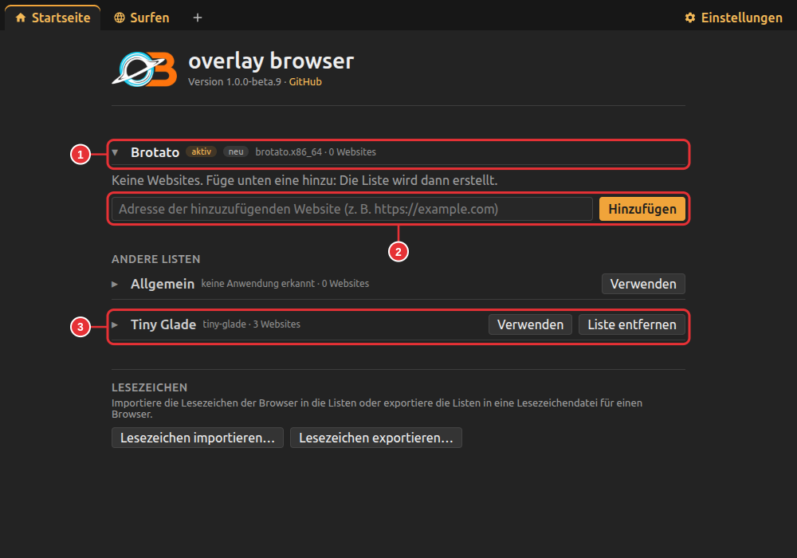
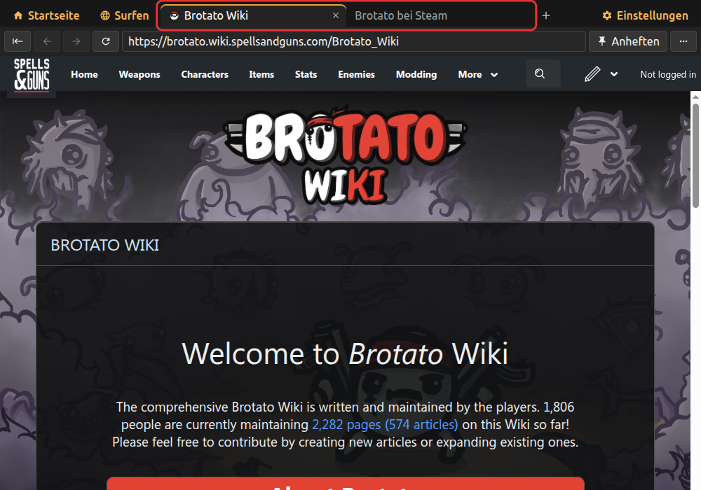
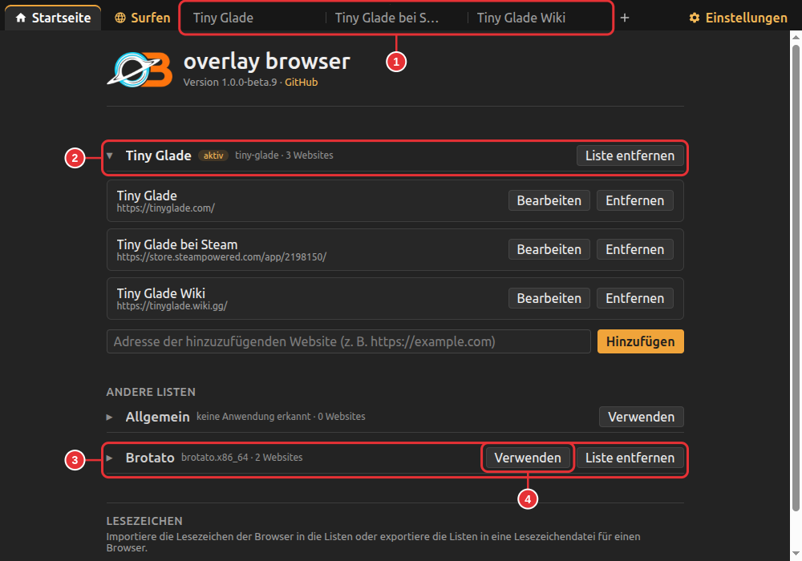
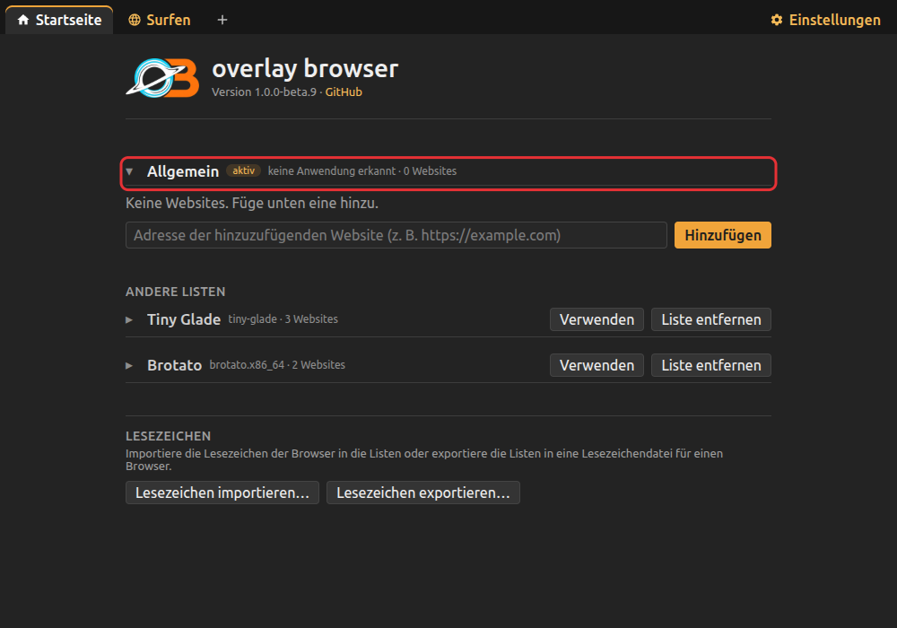
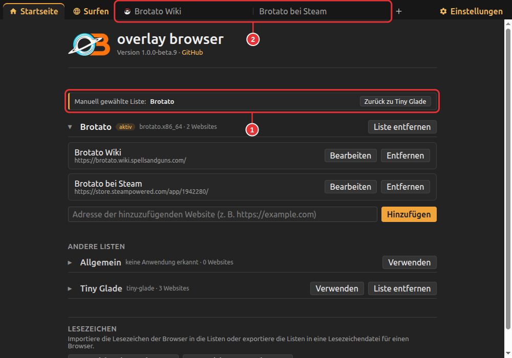
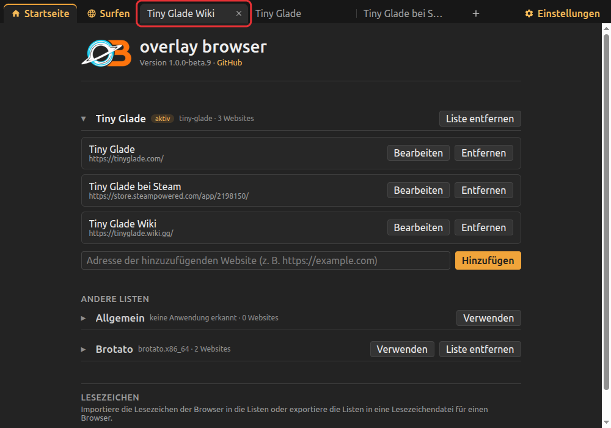
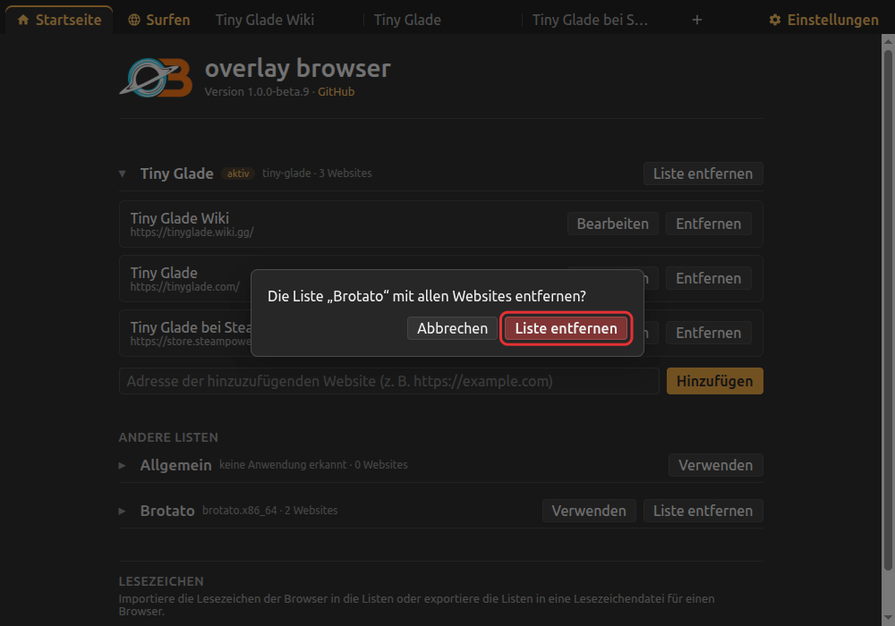

# Eine Liste pro Spiel

Overlay Browser erkennt, über welchem Spiel du es öffnest, und zeigt die zugehörigen Websites. Jedes Spiel hat seine eigene **Liste**. Nach [Erste Schritte](getting-started.md) und [Freies Surfen](free-browsing.md) hat die Liste für **Tiny Glade** bereits drei Websites. Jetzt spielen wir **Brotato**.

In den Screenshots sind die im Text genannten Elemente rot umrahmt; Nummern wie ❶ im Text verweisen auf das Element mit derselben Nummer im Screenshot.

## 1. Ein neues Spiel, eine neue Liste

Öffne das Overlay beim Spielen von Brotato. Oben auf der Startseite steht die **Liste für Brotato** ❶. Sie ist *aktiv* und noch *neu*. Neben dem Namen siehst du das erkannte Programm und die Zahl der Websites. Füge im **Feld unter der Liste** ❷ oder über **+** eine Website hinzu. Dabei wird die Liste angelegt. Die **Liste für Tiny Glade** ❸ ist unter *Andere Listen* eingeklappt. Klicke darauf, um ihre Websites zu sehen.

Hier fügen wir das Wiki und die Steam-Seite von Brotato hinzu. In der Leiste erscheinen jetzt die beiden Tabs für Brotato.

## 2. Jedes Spiel findet seine eigenen Websites

Wechsle zu Tiny Glade zurück und öffne das Overlay. In der Leiste stehen die **Tabs für Tiny Glade** ❶ und die **Liste für Tiny Glade** ❷ ist aktiv. Die **Liste für Brotato** ❸ steht jetzt unter *Andere Listen*. Mit **Verwenden** ❹ kannst du sie manuell aktivieren (siehe Schritt 4). Jede Liste öffnet sich wieder auf dem zuletzt verwendeten Tab.

## 3. Die Liste Allgemein

Das Overlay bietet für jedes Programm eine Liste an. Erkennt es keine Anwendung, ist die **Liste Allgemein** aktiv. Hier passen Websites hinein, die zu keinem bestimmten Programm gehören. Die Liste funktioniert wie die anderen und lässt sich nicht entfernen.

## 4. Liste manuell auswählen

Du möchtest zum Beispiel das Wiki von Brotato lesen, während Tiny Glade geöffnet ist. Klicke neben der gewünschten Liste auf **Verwenden** (❹ im Screenshot von Schritt 2).

Die Liste wird aktiv und bleibt **manuell gewählt** ❶, auch wenn du das Overlay über anderen Spielen öffnest. Mit **Zurück zu Tiny Glade** wechselst du zur Liste des gerade erkannten Spiels zurück. In der Leiste stehen die **Tabs der gewählten Liste** ❷.

## 5. Tabs und Websites umsortieren

Ziehe einen Tab an die gewünschte Stelle. Hier rückt das Tiny Glade Wiki an die erste Position.

Die Websites auf der Startseite kannst du genauso verschieben. Beide Ansichten verwenden dieselbe Reihenfolge.

## 6. Liste entfernen

Mit **Liste entfernen** neben dem Listennamen löschst du die Liste samt Websites nach einer Bestätigung.

Wenn du später beim Spielen von Brotato eine Website hinzufügst, wird die Liste neu angelegt.
