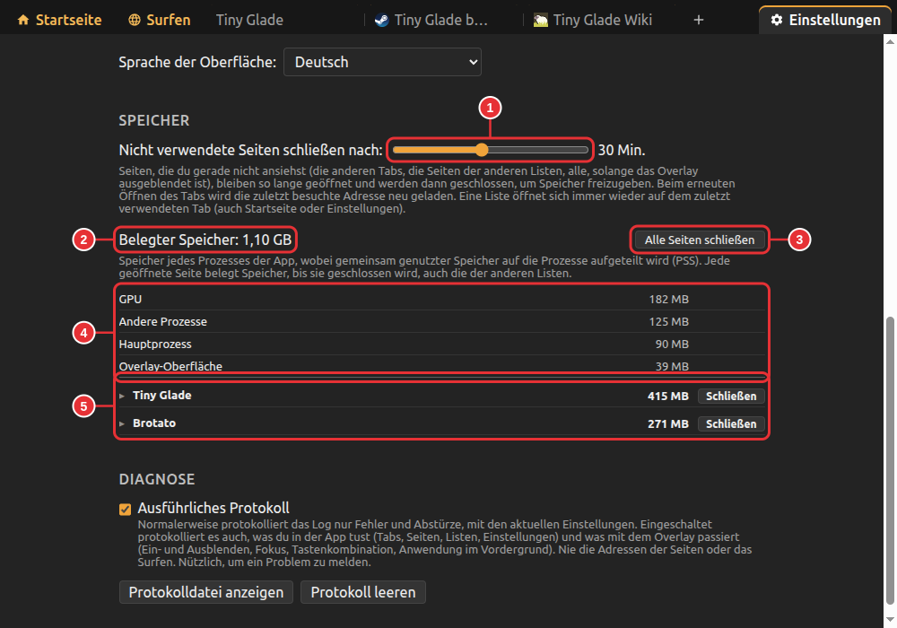
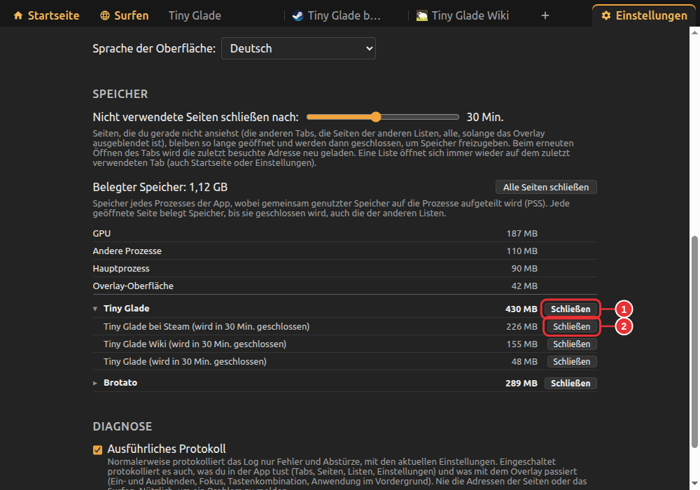
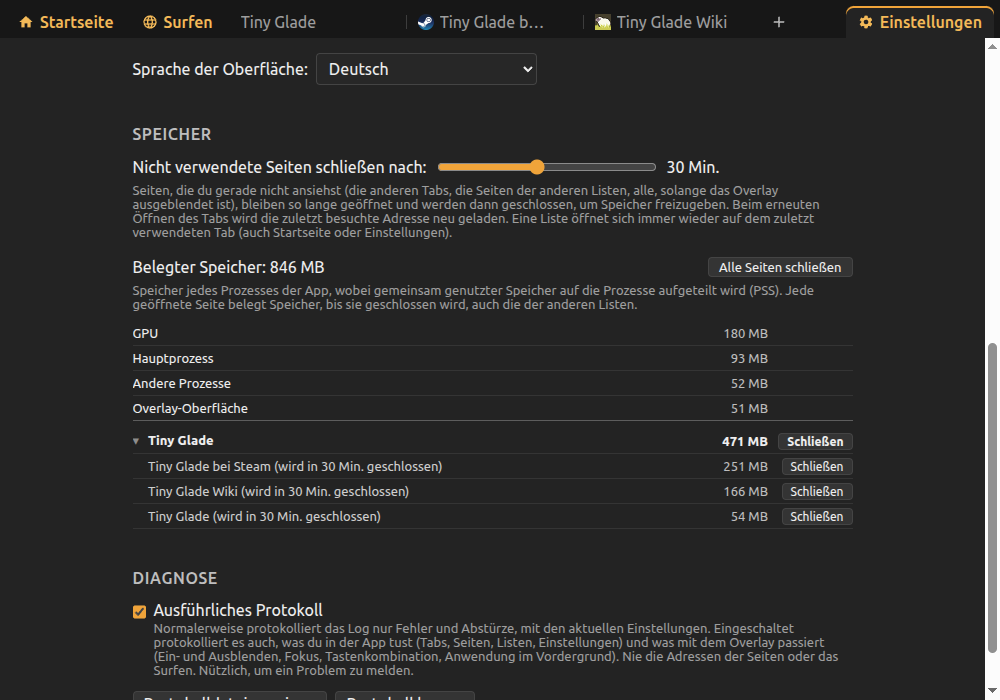

# Speicher und geschlossene Seiten

Jede geöffnete Seite beansprucht wie im Browser Speicher, auch wenn du sie gerade nicht siehst. Das gilt ebenso für Seiten anderer Listen. Damit dem Spiel Speicher bleibt, **schließt das Overlay länger ungenutzte Seiten automatisch**. In den Einstellungen siehst du den Verbrauch und kannst Seiten manuell schließen.

Hier sind mehrere Seiten in den Listen für **Tiny Glade** und **Brotato** geöffnet. Siehe [Eine Liste pro Spiel](lists-per-game.md).

In den Screenshots sind die im Text genannten Elemente rot umrahmt; Nummern wie ❶ im Text verweisen auf das Element mit derselben Nummer im Screenshot.

## 1. Warum eine Seite neu lädt

Seiten, die du gerade nicht betrachtest, bleiben eine Weile offen und werden dann geschlossen. Das betrifft andere Tabs, andere Listen und bei ausgeblendetem Overlay alle Seiten. Beim erneuten Öffnen des Tabs **lädt die zuletzt besuchte Adresse neu**. Die Seite ist wieder da. Scrollposition oder teilweise ausgefüllte Formulare können verloren gehen.

Die gerade angezeigte Seite bleibt geöffnet.

## 2. Der Abschnitt Speicher

Öffne die **Einstellungen** und scrolle zum Abschnitt *Speicher*.

- **Nicht verwendete Seiten schließen nach** ❶ legt fest, wann ungenutzte Seiten geschlossen werden. Wähle 5 bis 60 Minuten. Der Standardwert ist 30 Minuten. Bei wenig freiem Speicher oder anspruchsvollen Spielen ist eine kürzere Dauer sinnvoll.
- **Belegter Speicher** ❷ zeigt den Speicherverbrauch der gesamten App.
- **Alle Seiten schließen** ❸ schließt sofort alle geöffneten Seiten aller Listen.
- **Prozesse der App** ❹ umfasst Overlay-Oberfläche, Hauptprozess, Grafik (GPU) und andere Prozesse. Dieser Speicherbedarf besteht immer.
- **Seiten nach Liste** ❺ zeigt den Speicher der geöffneten Seiten je Liste. Mit **Schließen** schließt du alle Seiten dieser Liste.

## 3. Die Seiten einer Liste

Klicke auf den Namen einer Liste, um ihre offenen Seiten samt Speicherverbrauch und verbleibender Zeit zu sehen. **Schließen** neben der Liste ❶ schließt alle ihre Seiten. **Schließen** neben einer Seite ❷ schließt nur diese.

Einige Seiten teilen sich einen Prozess, etwa wenn dieselbe Website in verschiedenen Listen geöffnet ist. Sie stehen in einer gemeinsamen Zeile außerhalb der Gruppen. Sie werden zusammen geschlossen, da ihr Speicher erst frei wird, wenn sie alle geschlossen sind.

## 4. Nach dem Schließen

Hier wurden die Seiten für Brotato geschlossen. Die Gruppe ist verschwunden und der Speicherverbrauch ist gesunken. Die Tabs bleiben in der Liste und laden ihre Seiten beim nächsten Öffnen neu.

