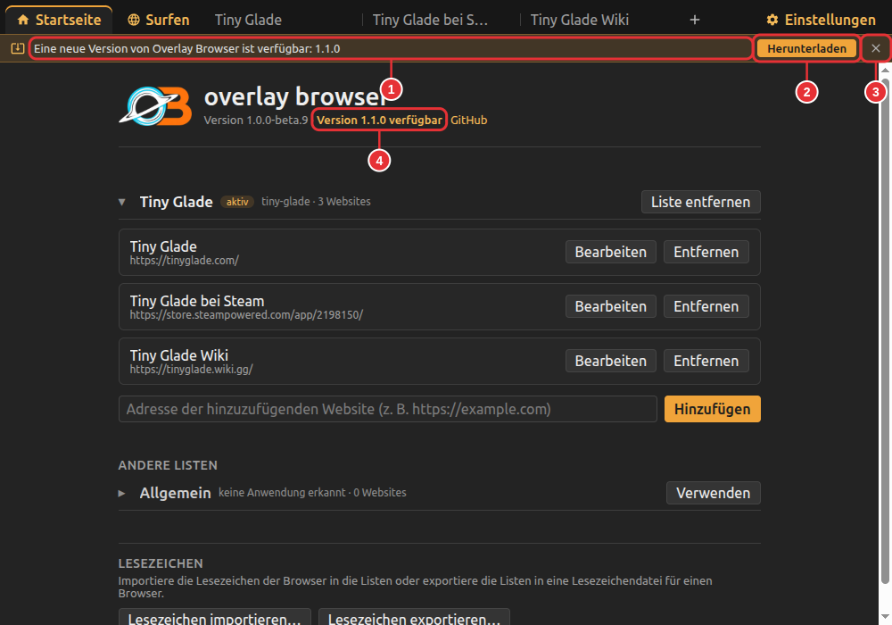
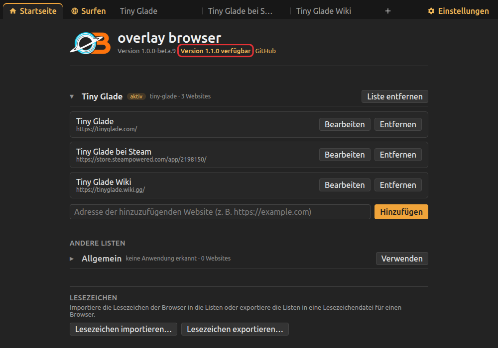
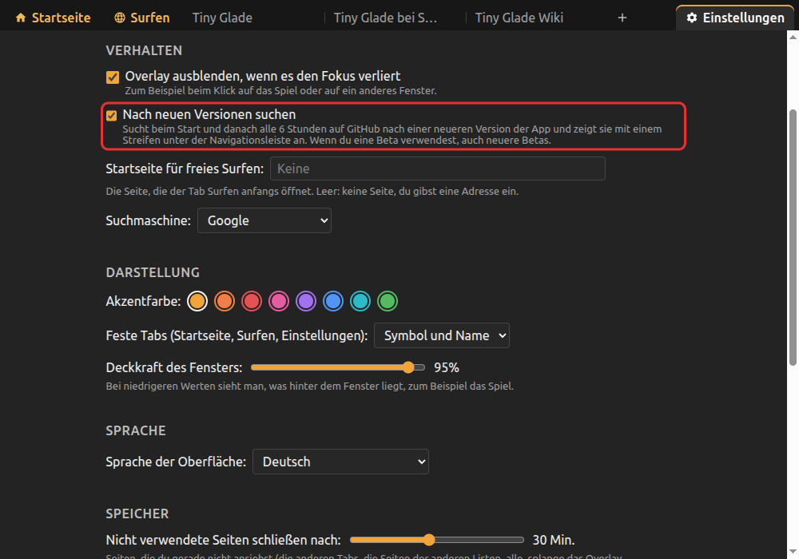

# Neue Versionen

Overlay Browser prüft automatisch, ob eine neue Version verfügbar ist, und zeigt einen Hinweis an. Du entscheidest, wann du die neue Version herunterlädst und installierst.

In den Screenshots sind die im Text genannten Elemente rot umrahmt; Nummern wie ❶ im Text verweisen auf das Element mit derselben Nummer im Screenshot.

## 1. Hinweis auf eine neue Version

Sobald eine neue Version verfügbar ist, erscheint unter der Leiste ein **Hinweisstreifen** ❶ mit ihrer Nummer. **Herunterladen** ❷ öffnet die Seite der neuen Version im Systembrowser. Dort lädst du die Datei für dein Betriebssystem herunter. Siehe Installation in der [README](../../README.md). Das **×** ❸ schließt den Streifen für diese Version dauerhaft.

Die neue Version steht auch oben auf der **Startseite** ❹ neben der installierten Version. Ein Klick darauf öffnet dieselbe Seite.

Nach dem Schließen des Streifens bleibt die neue Version bis zur Installation auf der Startseite sichtbar.

## 2. Wann die App prüft

Die App prüft kurz nach dem Start und danach alle sechs Stunden die GitHub-Veröffentlichungen des Projekts. Mit einer Beta erhältst du auch Hinweise auf neuere Betas. Andernfalls meldet die App nur stabile Versionen.

Wenn du keine Hinweise möchtest, deaktiviere **Nach neuen Versionen suchen** in den **Einstellungen** unter *Verhalten*. Bei der Microsoft-Store-Version kommen die Updates aus dem Store, deshalb fehlt dort diese Option.

