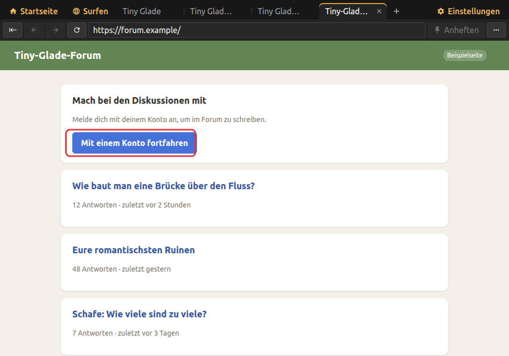
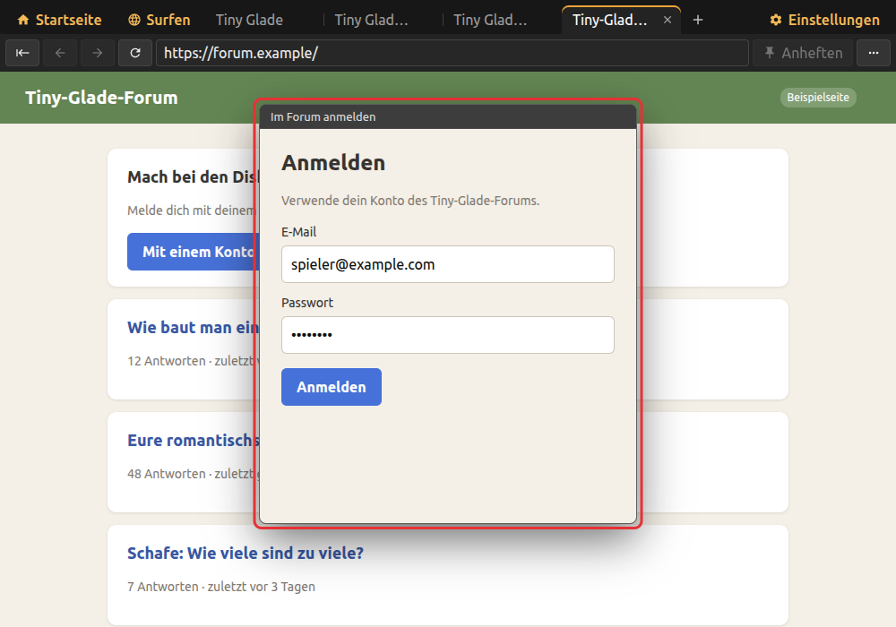
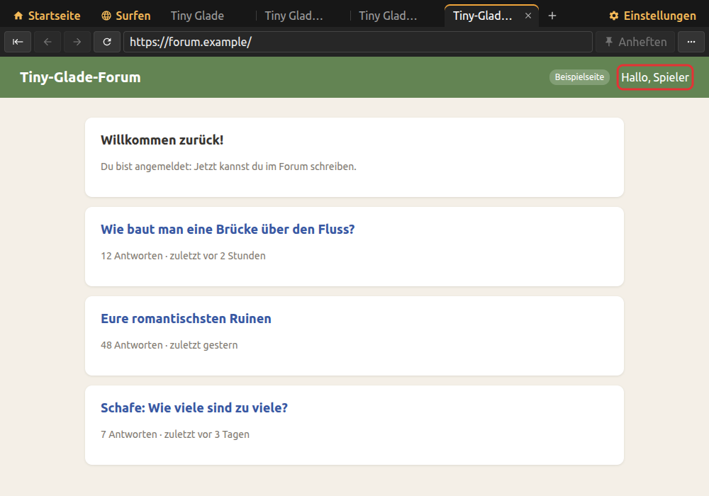
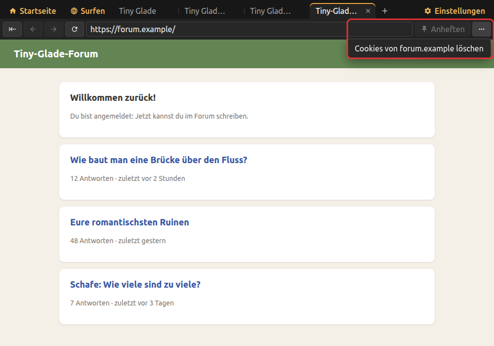
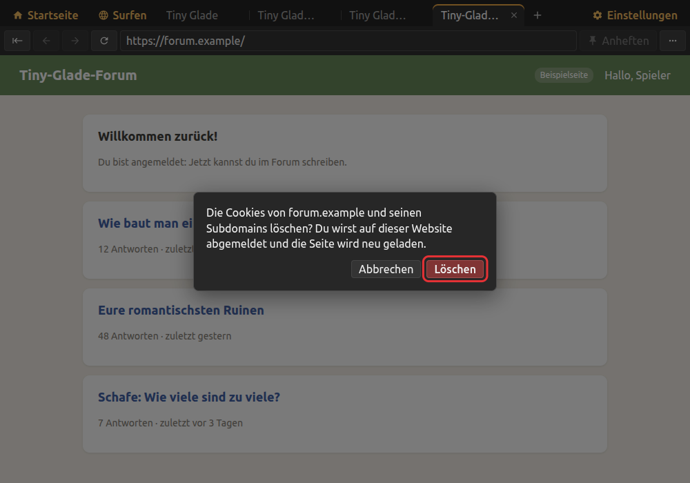

# Bei einer Website anmelden und Cookies löschen

Viele Websites zu Spielen, etwa Foren, Wikis oder Build-Planer, bieten mit einem Konto mehr Funktionen oder setzen eine Anmeldung voraus. Im Overlay meldest du dich wie im Browser an. Die Anmeldung bleibt gespeichert. Funktioniert eine Website nicht mehr richtig oder möchtest du dich abmelden, kannst du ihre Cookies löschen.

In der Liste für **Tiny Glade** gibt es auch ein Forum. Die **Beispielseite** wurde für diese Anleitung erstellt. Die Anmeldung funktioniert wie auf echten Websites, etwa mit *Mit Google fortfahren*.

In den Screenshots sind die im Text genannten Elemente rot umrahmt; Nummern wie ❶ im Text verweisen auf das Element mit derselben Nummer im Screenshot.

## 1. Mit deinem Konto anmelden

Öffne den Tab der Website und klicke auf die Schaltfläche zur Anmeldung, hier **Mit einem Konto fortfahren**.

Die Website öffnet ihr **Anmeldefenster** über dem Overlay. Gib deine Daten ein und bestätige.

Das Anmeldefenster gehört zum Overlay. Es bleibt darüber und wird zusammen mit ihm ein- und ausgeblendet. Du kannst zwischen den Fenstern wechseln, ohne dass sie ausgeblendet werden. Wenn das Anmeldefenster schließt, ist das Overlay wieder aktiv.

## 2. Die Anmeldung bleibt gespeichert

Nach der Anmeldung schließt sich das Fenster. Die Website zeigt dein **Konto** an.

Du bleibst auch angemeldet, wenn du das Overlay schließt oder die App neu startest. Die Anmeldung gilt für dieselbe Website in allen Listen.

## 3. Cookies einer Website löschen

Cookies speichern Daten, mit denen eine Website dich wiedererkennt, etwa deine Anmeldung. Lösche sie, um dich **abzumelden**, etwa für einen Kontowechsel, oder wenn die Website **nicht mehr richtig funktioniert**.

Klicke im Tab rechts neben der Adresse auf **…** (*Weitere Aktionen*) und wähle **Cookies von forum.example löschen**.

Bestätige mit **Löschen**. Die Cookies der Website und ihrer Subdomains werden gelöscht. Andere Websites bleiben angemeldet.

## 4. Die Seite lädt neu

Nach dem Löschen lädt die Seite neu. Du bist abgemeldet und kannst dich auf der Website erneut **anmelden**.

