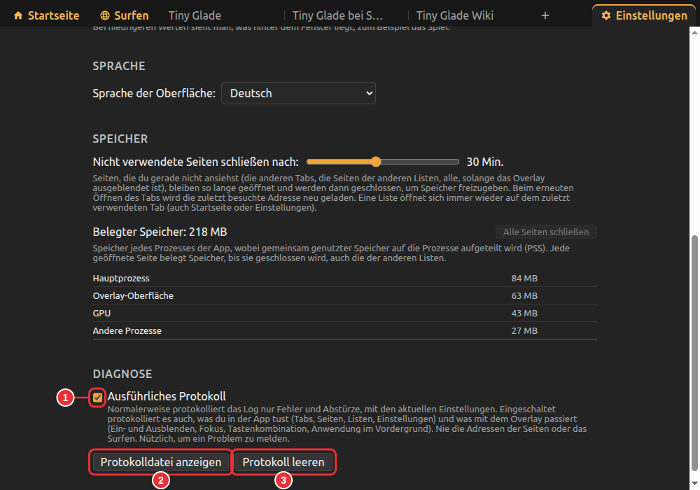
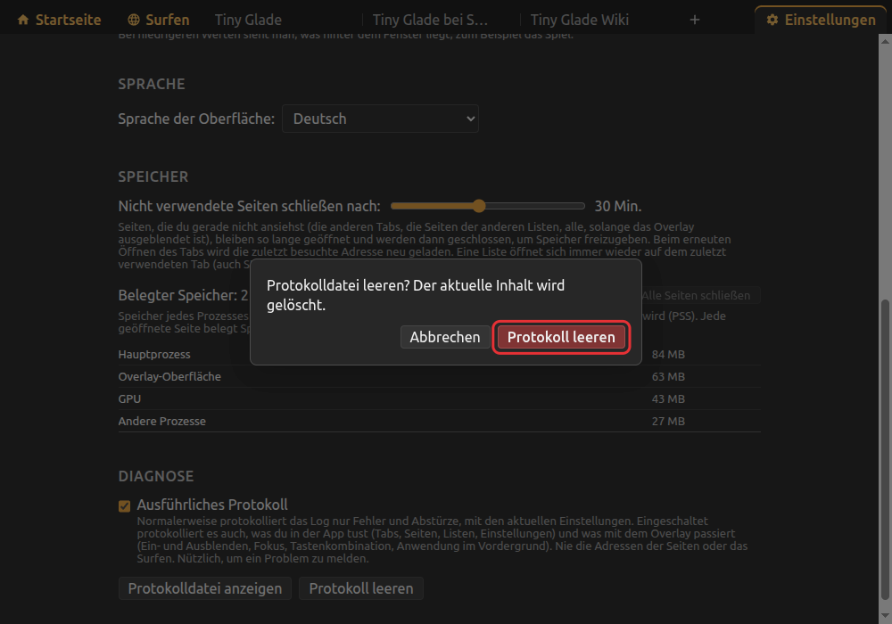

# Probleme beheben

Hier findest du Lösungen für häufige Probleme und erfährst, wie du Informationen für eine Fehlermeldung sammelst. Einzelheiten zu Windows, Linux und macOS stehen in der [README](../../README.md).

In den Screenshots sind die im Text genannten Elemente rot umrahmt; Nummern wie ❶ im Text verweisen auf das Element mit derselben Nummer im Screenshot.

## 1. Die Tastenkombination funktioniert nicht

- **Ein anderes Programm verwendet sie bereits.** Wenn du sie in den Einstellungen auswählst, meldet das Overlay „ungültige Kombination oder bereits belegt“. Die bisherige Kombination bleibt aktiv. Wähle eine andere. Siehe [Overlay anpassen](customizing.md).
- **Das Spiel verwendet sie für einen Befehl.** Auch das Spiel empfängt die Tastenkombination. Wähle eine, die im Spiel nichts auslöst.
- **Linux mit Wayland.** Bei aktivem nativem Wayland-Fenster wird die Kombination nicht erkannt. Verwende eine X11-Sitzung. Siehe *Linux* in der [README](../../README.md#linux).
- **Funktionstasten unter macOS.** Standardmäßig steuern F1 bis F12 etwa Helligkeit und Lautstärke. Drücke dazu **fn**, um sie als Funktionstasten zu verwenden, oder ändere die Tastatureinstellung. Siehe *macOS* in der [README](../../README.md#macos).

Du kannst das Overlay jederzeit über das Symbol im Infobereich öffnen.

## 2. Ich finde das App-Symbol nicht

Die App steht im Infobereich neben der Uhr. Sie erscheint weder in der Taskleiste noch unter Alt+Tab.

- **Windows** – Klicke auf **^**, wenn das Symbol verborgen ist. Ziehe es auf die Taskleiste, damit es sichtbar bleibt.
- **Linux mit GNOME** – Du brauchst die Erweiterung *AppIndicator and KStatusNotifierItem Support*. Öffnet ein Klick auf das Symbol ein Menü, wähle darin *Anzeigen*.
- **macOS** – Das Symbol steht oben rechts in der Menüleiste.

## 3. Das Overlay erscheint nicht über dem Spiel oder ist undurchsichtig

- **Das Spiel verdeckt das Overlay.** Manche Spiele im exklusiven Vollbildmodus verdecken alle Fenster. Stelle das Spiel auf *randloses Fenster* um.
- **Das Fenster ist unter Linux undurchsichtig.** Transparenz braucht einen Fenstermanager mit aktivem Compositing, etwa Cinnamon, KDE, GNOME oder Xfce mit aktiviertem Compositing.

## 4. Eine Website funktioniert nicht richtig oder lädt neu

- **Eine Website funktioniert nicht mehr richtig oder du möchtest dich abmelden.** Lösche ihre Cookies über das Menü **…**. Siehe [Bei einer Website anmelden und Cookies löschen](signing-in.md).
- **Die Seite lädt beim Zurückwechseln zum Tab neu.** Ungenutzte Seiten werden nach einer Weile geschlossen, um Speicher freizugeben. Siehe [Speicher und geschlossene Seiten](memory.md).
- **Du möchtest neu anfangen.** Beende die App und lösche die Einstellungsdatei. Siehe *Preferences and uninstalling* in der [README](../../README.md#preferences-and-uninstalling).

## 5. Informationen für eine Fehlermeldung sammeln

Melde ein anhaltendes Problem auf der [Issues-Seite des Projekts](https://github.com/siculo/overlay-browser/issues). Die Protokolldatei hilft bei der Fehlersuche.

Öffne in den **Einstellungen** den Abschnitt *Diagnose*.

- **Ausführliches Protokoll** ❶ – Standardmäßig zeichnet das Protokoll Fehler und Abstürze mit den aktuellen Einstellungen auf. Aktiviert erfasst es auch deine Aktionen in der App (Tabs, Websites, Listen und Einstellungen) und Ereignisse des Overlays (Ein- und Ausblenden, Fokus, Tastenkombination und Vordergrundanwendung). Schalte es ein und wiederhole die Schritte, die das Problem auslösen.
- **Protokolldatei anzeigen** ❷ öffnet den Ordner mit `overlay.log`. Hänge die Datei an die Fehlermeldung an.
- **Protokoll leeren** ❸ löscht den Inhalt, etwa um nur das zu meldende Problem aufzuzeichnen.

Das Protokoll speichert weder Tastendrücke noch deinen Browserverlauf, Seitenadressen oder Seitentitel. Es erfasst Websites nur anhand ihrer Position in der Liste.

**Protokoll leeren** fragt vor dem Löschen nach.

