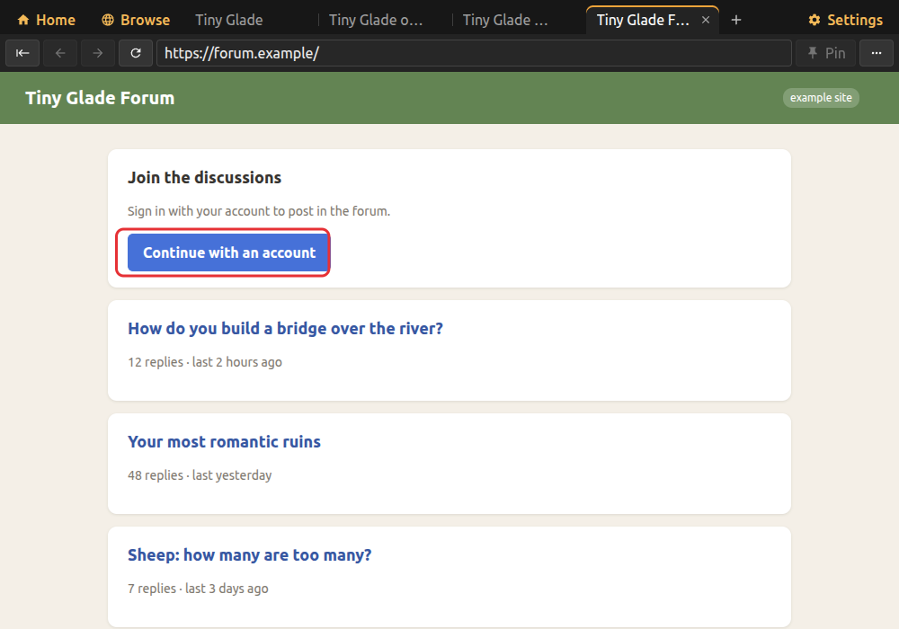
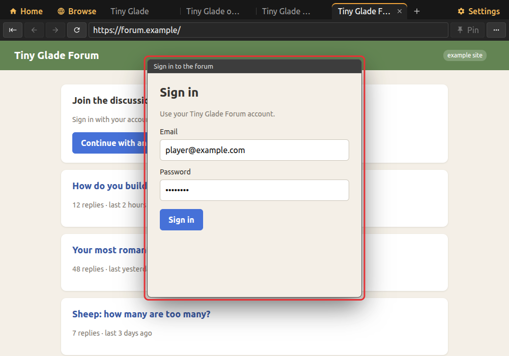
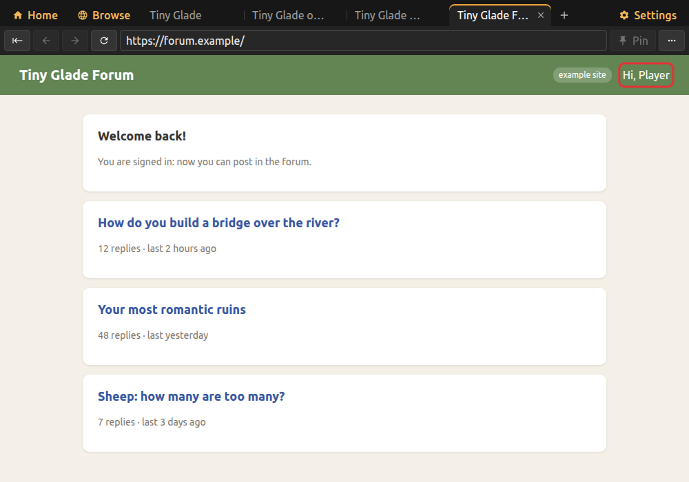
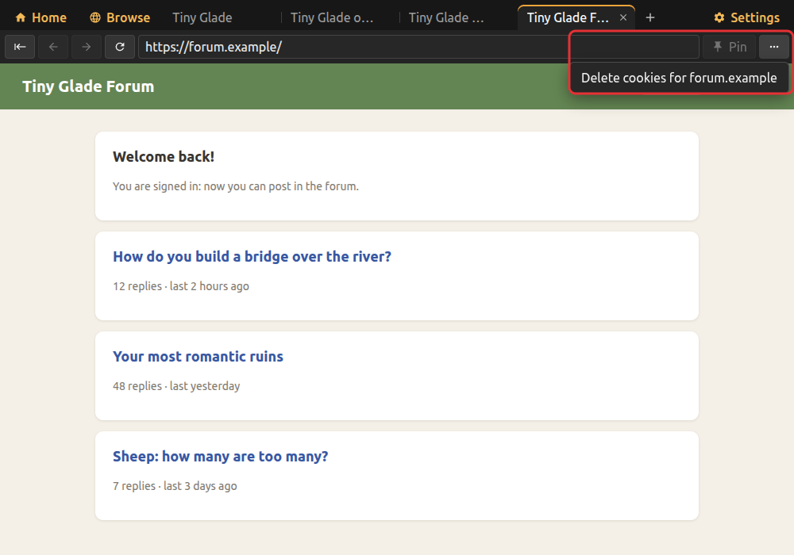
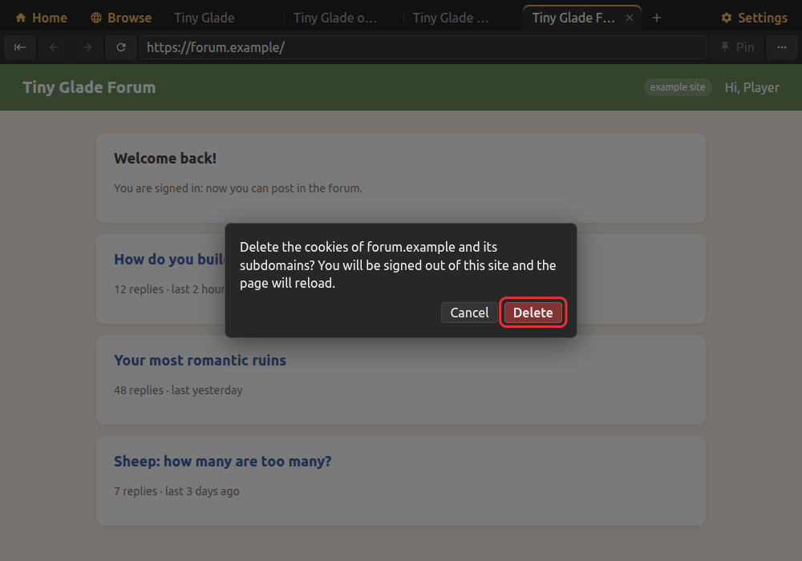

# Signing in to a site and cookies

Many game sites (forums, wikis, build tools) work better, or only, if you sign in with your account. In the overlay you sign in as in a browser, and the sign-in is remembered. If a site no longer works well, or you want to sign out of the account, you can delete its cookies.

Here **Tiny Glade**'s list also has a forum. The forum is an **example site**, made for this guide: its sign-in works like the one of real sites, for example *Continue with Google*.

In the screenshots the elements mentioned in the text are highlighted in red; numbers like ❶ in the text point to the element with the same number in the screenshot.

## 1. Sign in with your account

Open the site's tab and click the button to sign in, here **Continue with an account**.

The site opens its **sign-in window** over the overlay, as in a browser. Enter your details and confirm.

The sign-in window is part of the overlay: it stays over it, hides and shows again together with the overlay, and moving from one to the other does not hide it. When it closes, at the end of the sign-in, the overlay is active again.

## 2. The sign-in is remembered

Once signed in, the window closes and the site shows your **account**.

The sign-in stays even when you close the overlay or restart the app, as in a browser. The sites are the same for all the lists: if you sign in to a site in a game's list, you are already signed in in the other lists that have that site too.

## 3. Delete a site's cookies

Cookies are the data a site saves to remember you, including the sign-in. Deleting them is useful to **sign out of an account** (for example to sign in with another one) or when a site **no longer works well**.

In the site's tab click **…** (*More actions*), right of the address, and choose **Delete cookies for forum.example**.

The overlay asks for confirmation: click **Delete**. The cookies of the site and of its subdomains are deleted, not those of other sites.

## 4. The page reloads

After the deletion the page reloads: you are no longer signed in and the site offers to **sign in** again.

