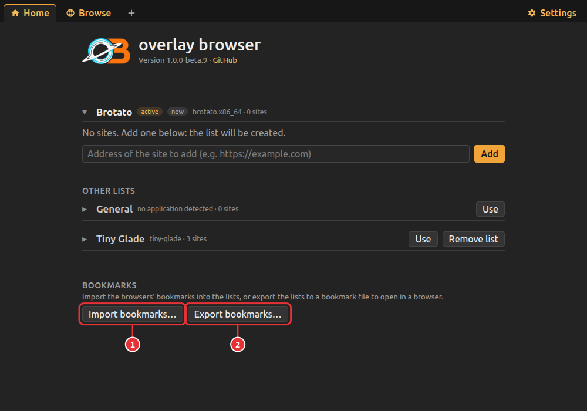
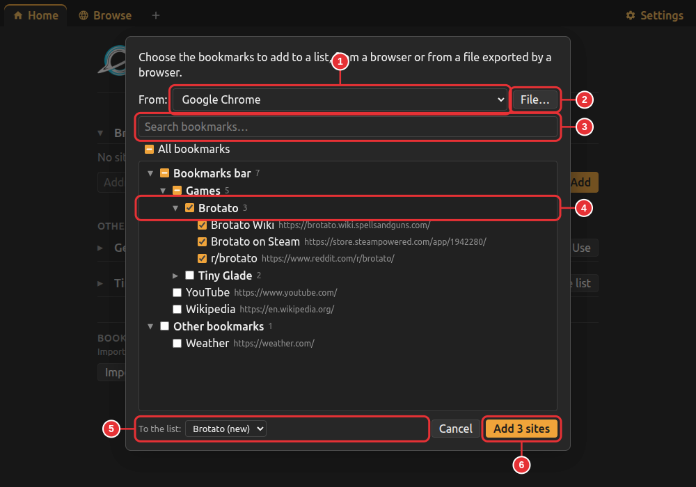
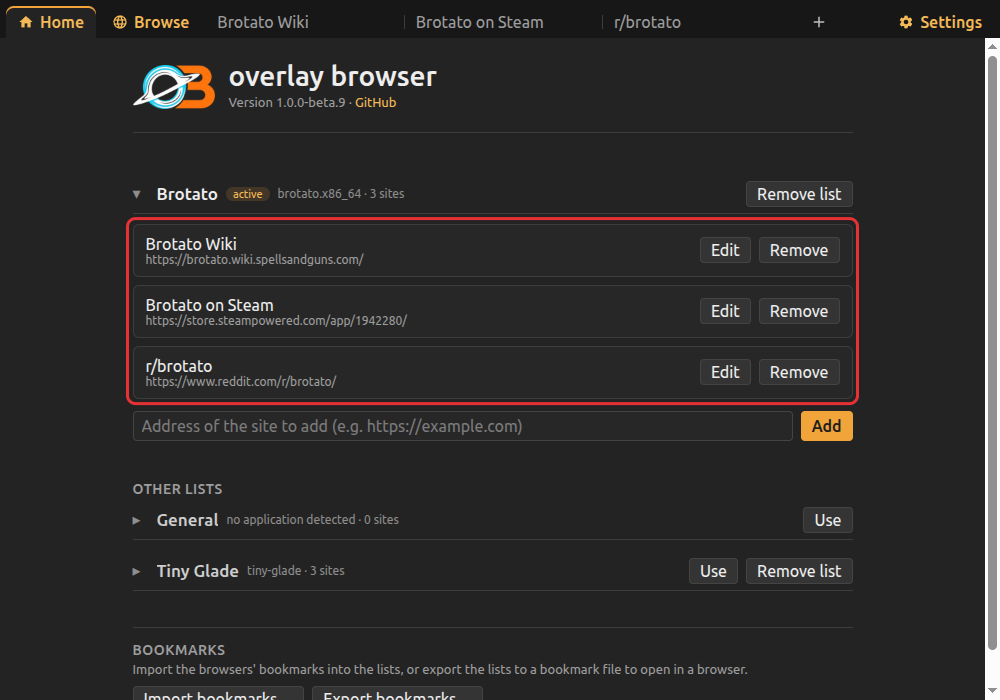
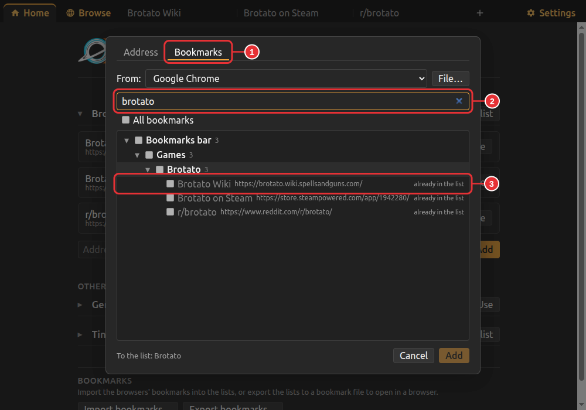
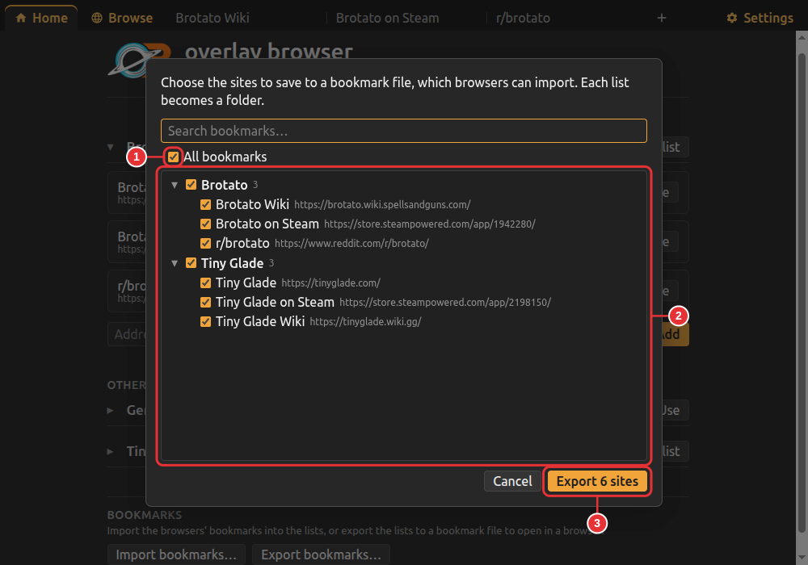

# Importing and exporting bookmarks

Do you already have your games' sites among your browser's bookmarks? You can import them into Overlay Browser's lists without typing them again, and export the lists to a bookmark file to open in any browser.

Here the overlay is open over **Brotato**, whose list is still empty, and **Tiny Glade**'s list already has three sites (see [One list per game](lists-per-game.md)).

In the screenshots the elements mentioned in the text are highlighted in red; numbers like ❶ in the text point to the element with the same number in the screenshot.

## 1. The Bookmarks section of the Home

At the bottom of the **Home** there is the *Bookmarks* section, with **Import bookmarks…** ❶ and **Export bookmarks…** ❷.

## 2. Choose the bookmarks to import

Click **Import bookmarks…**. In the window:

- **From** ❶: the browser to read the bookmarks from, one per profile. The overlay finds them by itself: Chrome, Edge, Brave, Opera, Vivaldi, Chromium, Firefox, LibreWolf and other similar browsers; Firefox can stay open. Next time it offers again the browser chosen last.
- **File…** ❷: imports instead an HTML bookmark file, exported from any browser's bookmark manager. On macOS it is the only way: export the bookmarks from the browser first.
- **Search** ❸: finds bookmarks and folders by name or address.
- **The checkboxes** ❹: tick single bookmarks or whole folders; *All bookmarks* selects them all. Here we tick the *Brotato* folder.
- **To the list** ❺: the list to add them to, at first the active one. If it is still *new*, like Brotato's here, it is created with the imported sites.
- **Add** ❻: the button says how many sites you will add.

The bookmarks become sites of the list, with their names:

## 3. Import from the "+"

You can also import from the **+** in the top bar, in the **Bookmarks** tab ❶, next to *Address*: here the sites always go to the active list. **Search** ❷ finds the bookmarks; those whose address is **already in the list** ❸ are grayed out and cannot be chosen, so importing twice creates no duplicates.

## 4. Export the lists

**Export bookmarks…**, in the *Bookmarks* section of the Home, saves the lists' sites to an HTML bookmark file that any browser can import. Each list becomes a folder. At first **all bookmarks** ❶ are chosen; in the **list** ❷ you can leave out lists or sites. **Export** ❸ asks where to save the file.

