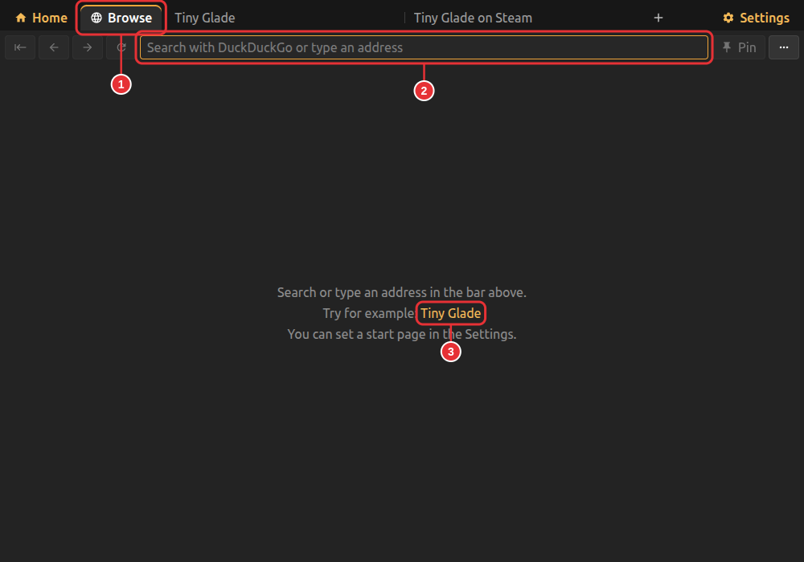
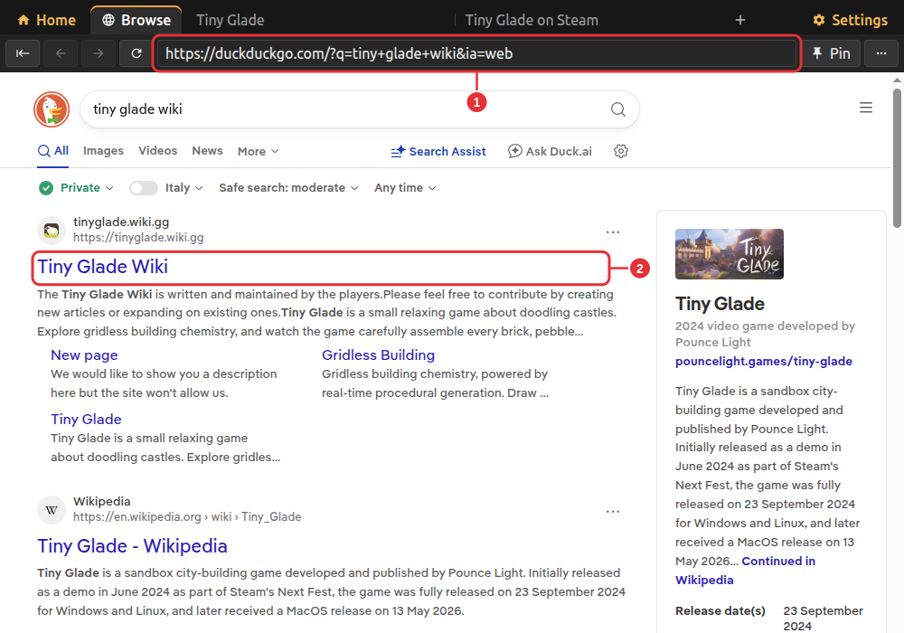
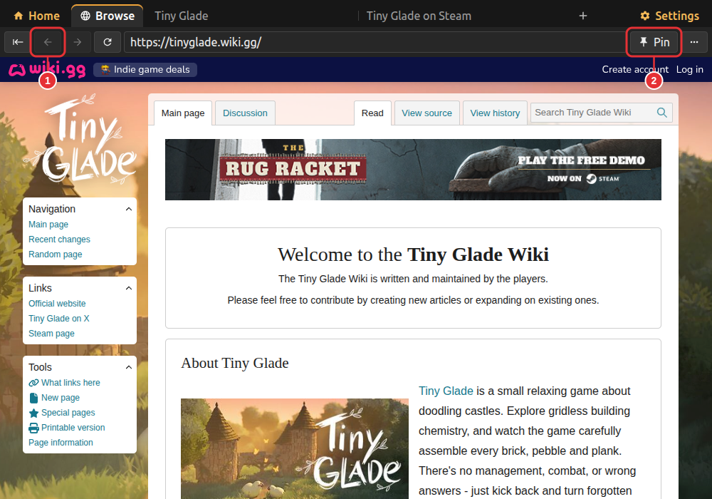
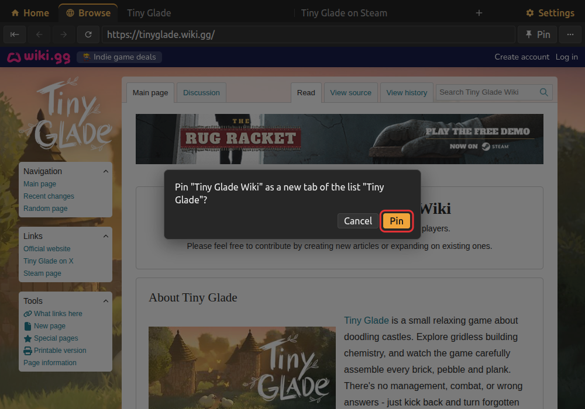
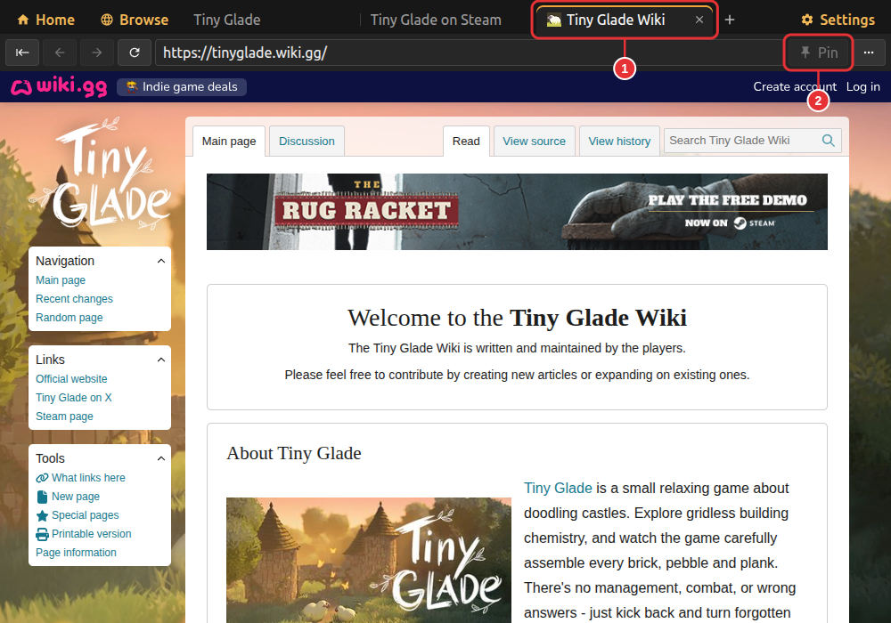
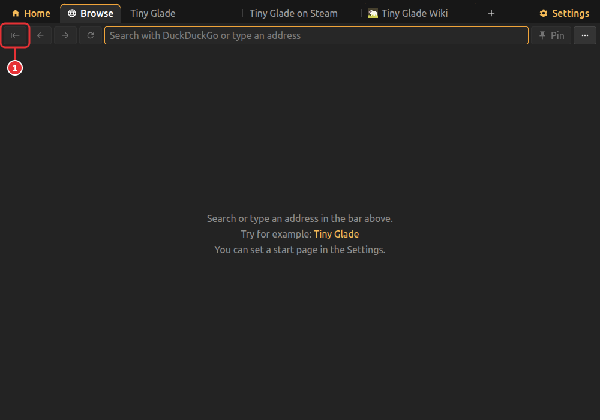

# Free browsing: search, find, pin

The **Browse** tab is for searching and opening any page without adding it to the list. When you find a page you want to keep, **Pin** turns it into a tab of the game's list.

Here we continue the example of [Getting started](getting-started.md): the overlay is open over **Tiny Glade**, whose list already has two sites, and we look for a wiki of the game.

In the screenshots the elements mentioned in the text are highlighted in red; numbers like ❶ in the text point to the element with the same number in the screenshot.

## 1. Open the Browse tab

Click **Browse** ❶, right after Home. In the **address field** ❷ you can type an address (`example.com` is enough) or any text to search for. As an example the overlay suggests the **game's name** ❸: click it to search for it.

## 2. Search

Type `tiny glade wiki` and press Enter. The search opens in the tab, and the **address field** ❶ shows the address of the results page.

You choose the search engine in the Settings (*Behavior* section): Google, Bing, DuckDuckGo, Brave Search, Ecosia, Startpage or a custom address. Here we use DuckDuckGo.

Click the result you want, here **Tiny Glade Wiki** ❷.

## 3. Pin the page

The page opens in the Browse tab and you can use it as in a browser: **Back** ❶ takes you back to the search results. To keep it, click **Pin** ❷.

The overlay asks for confirmation: click **Pin**.

## 4. The page is a tab of the list

The page, with its history, becomes a **new tab** ❶ at the end of Tiny Glade's list, and from now on you find it whenever you open the overlay over the game. **Pin** ❷ is now disabled: the page is already in the list.

Pin also works in the sites' tabs: if from a site you reach a page you want to keep separately, Pin adds it as a new tab right after the site's tab. When a page is already one of the list's tabs, that tab is highlighted and Pin is disabled.

## 5. The Browse tab is free again

When you go back to **Browse** you find it empty, ready for a new search: the pinned page has moved to its own tab. While browsing, the **Back to the start page** button ❶ closes the open page and goes back to the empty page.

In the Settings (*Behavior* section) you can also choose a **start page** for the Browse tab, opened instead of the empty page.

## Addresses of other sites from the sites' tabs

You can type in the address field of the sites' tabs too. An address on the same site opens in the tab; an address on another site, or a search, opens instead in the Browse tab, after a confirmation, so the site's tab keeps its page.
