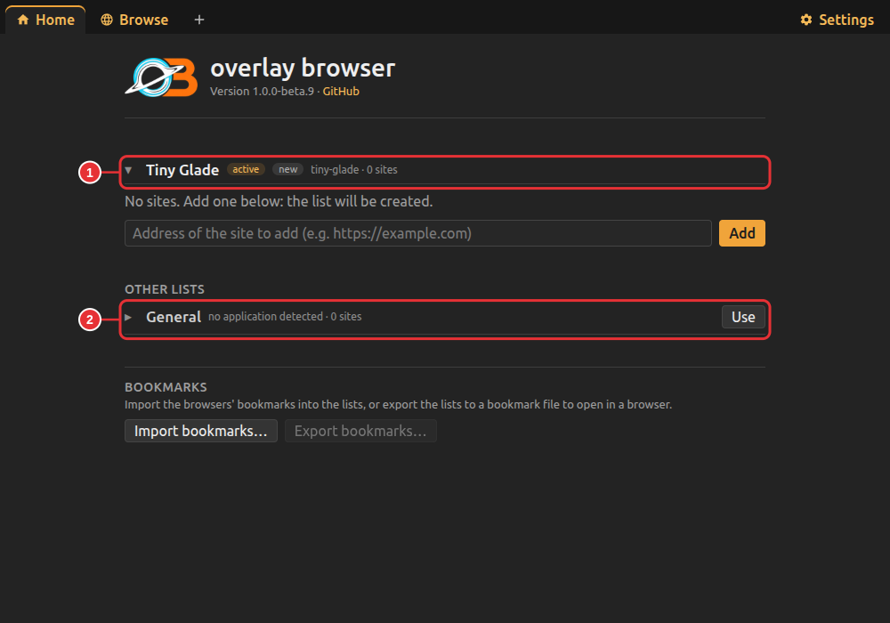
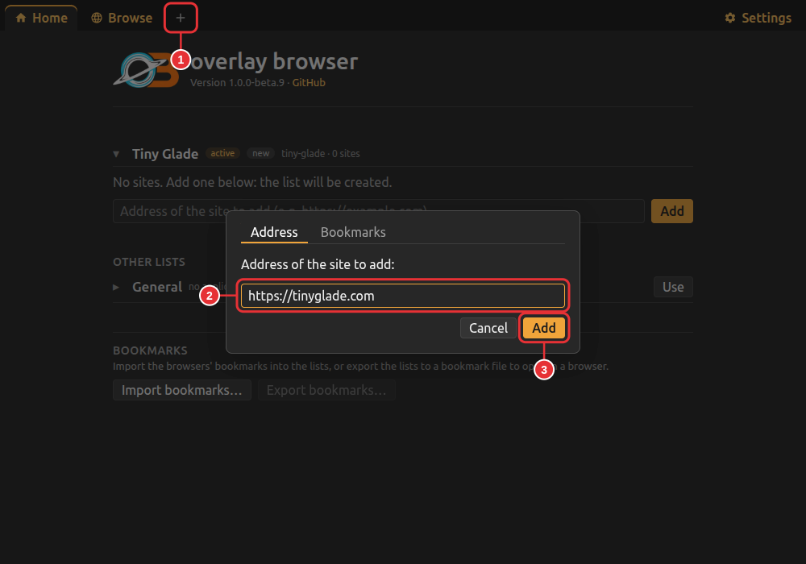
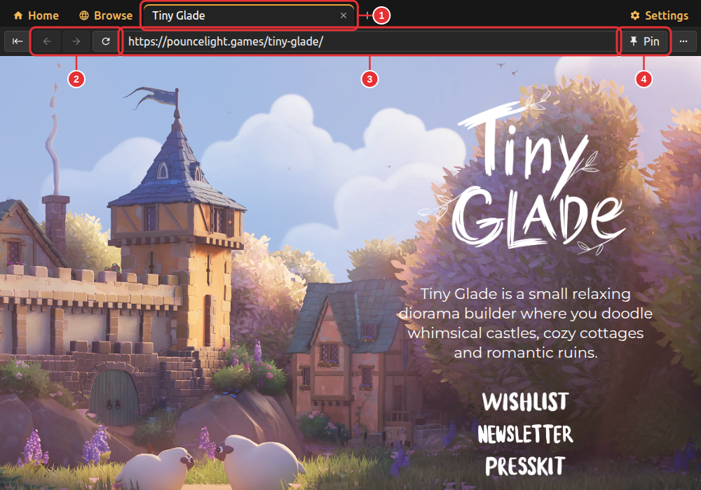
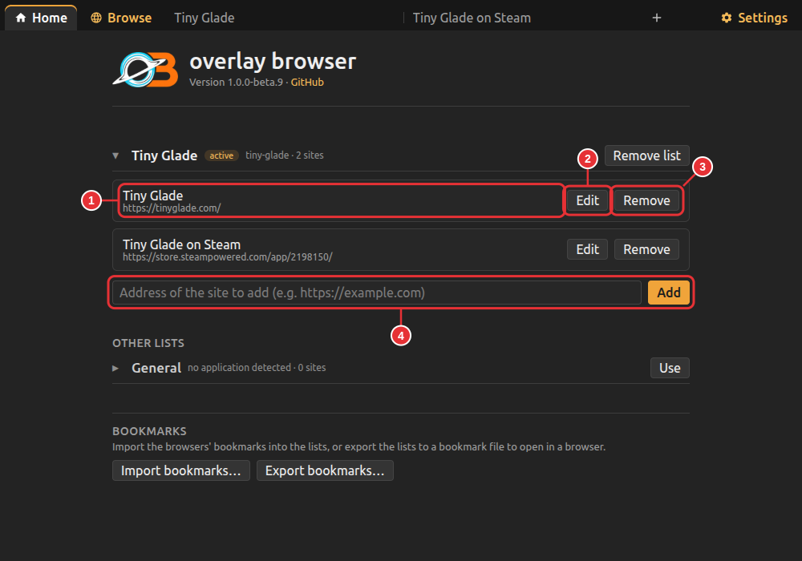
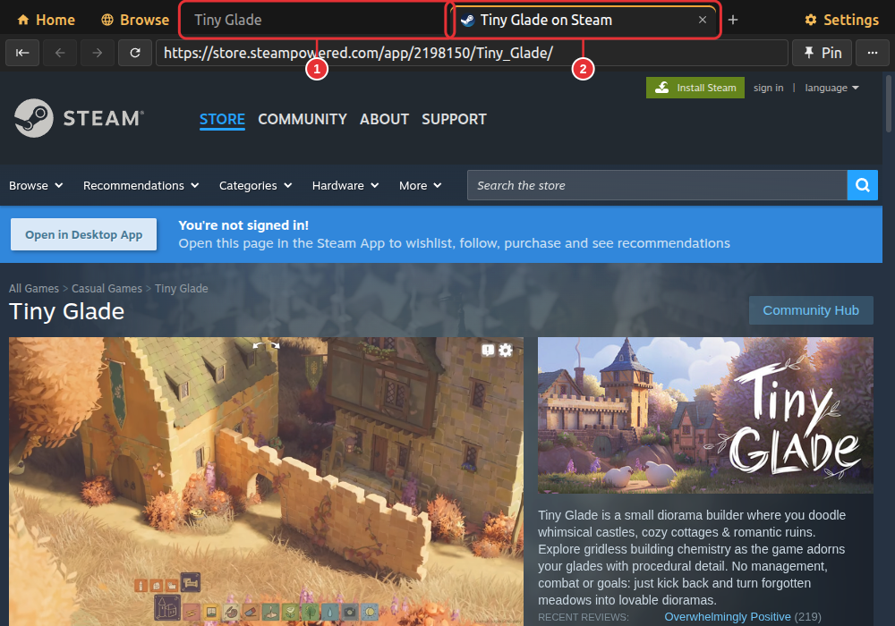

# Getting started: your game's sites at hand

In this guide you open Overlay Browser while playing (here **Tiny Glade**), add a couple of useful sites and learn to show and hide them without leaving the game.

In the screenshots the elements mentioned in the text are highlighted in red; numbers like ❶ in the text point to the element with the same number in the screenshot.

## 1. Start the app

Start Overlay Browser: the window **stays hidden** and the app waits in the notification area, near the clock. It does not appear in the taskbar or in Alt+Tab.

Then start the game, in windowed or borderless window mode.

## 2. Open the overlay over the game

While playing, press **Win+F10** (Super+F10 on Linux, Cmd+Shift+Space on macOS). The overlay appears over the game and opens on the **Home**.

The overlay has recognized the game: at the top there is the **Tiny Glade** list ❶, *active* and still *new*. Each game has its own list of sites, created when you add its first site. Among the *Other lists* there is the **General** list ❷, used when no game is open; **Use** makes it active by hand.

## 3. Add a site

Click **+** ❶ in the top bar, type the site's address ❷ (`tinyglade.com` is enough) and press **Add** ❸.

The site opens right away in its **tab** ❶, named after the page's title; the **×** closes it. Below is the navigation bar, as in a browser: **back, forward and reload** ❷, the page's **address** ❸ (you can type another one and press Enter) and **Pin** ❹, which turns a page you reached while browsing into a new tab.

## 4. Add more from the Home

Go back to the **Home**: here you see the list's sites. Click a **site's name** ❶ to open it, **Edit** ❷ to change its address (Enter to save, Esc to cancel) or **Remove** ❸ to take it off the list. To add a site, type its address in the **field below the list** ❹ and press *Add*: here we added the game's Steam page.

## 5. Switch between sites

Each site has its own tab in the bar: here the **official site** ❶ and the **Steam page** ❷, the one open now. When you switch tabs and come back, you find the page exactly where you left it.

## 6. Back to the game

Press **Win+F10** again to hide the overlay, or click the game's window: by default the overlay hides by itself when it loses focus (you can turn this off in the Settings).

Next time you open the overlay over Tiny Glade you find its list, open on the last tab you were looking at. Over another game you will see that game's list instead.
