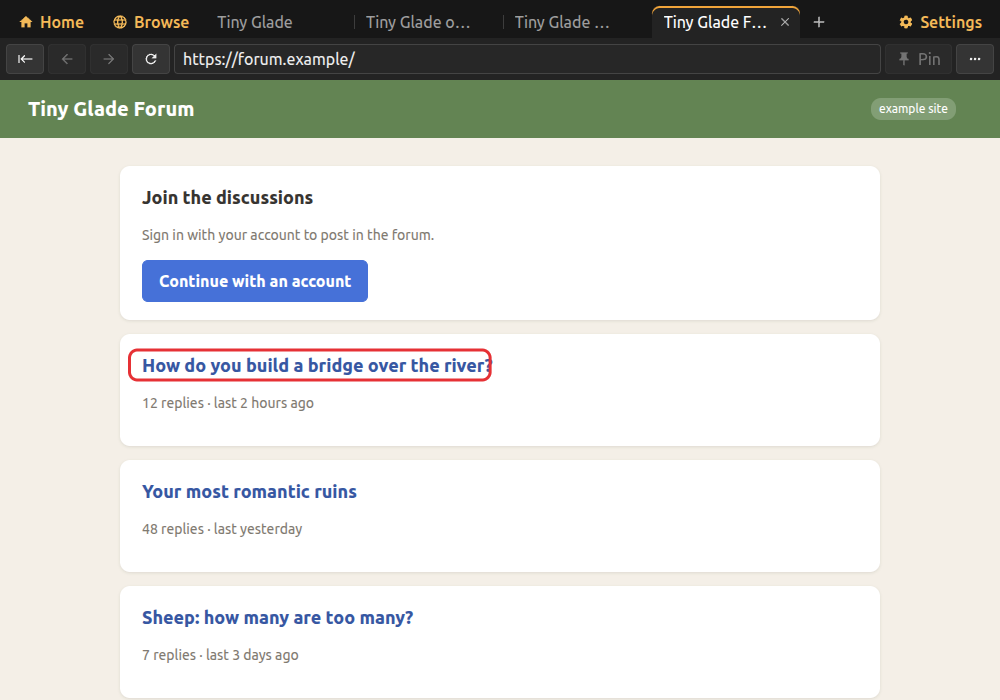
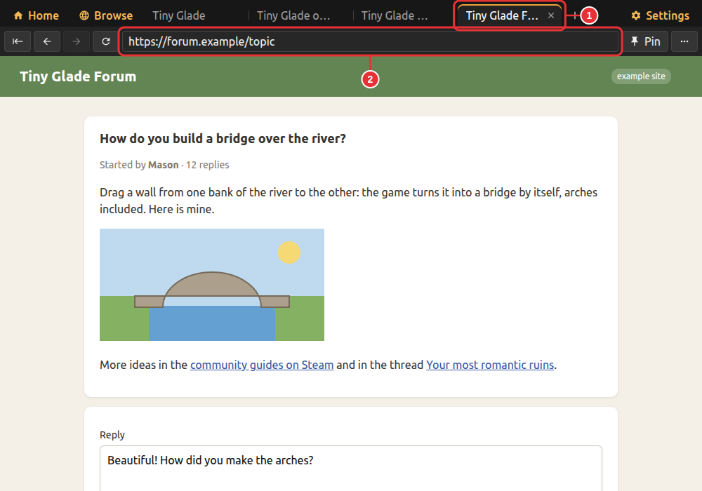
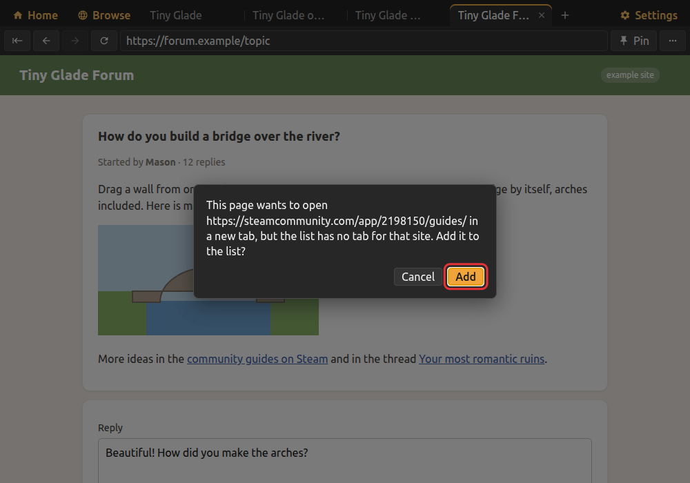
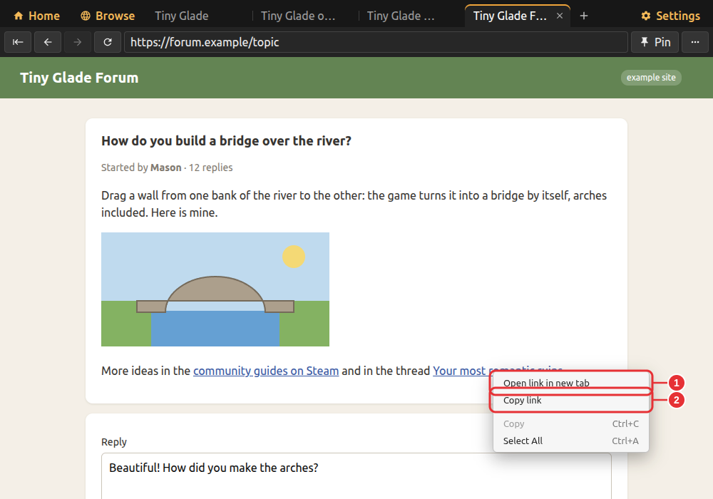
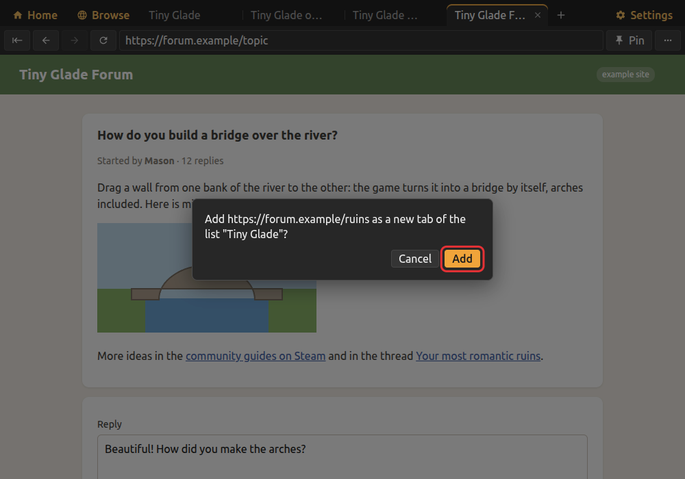
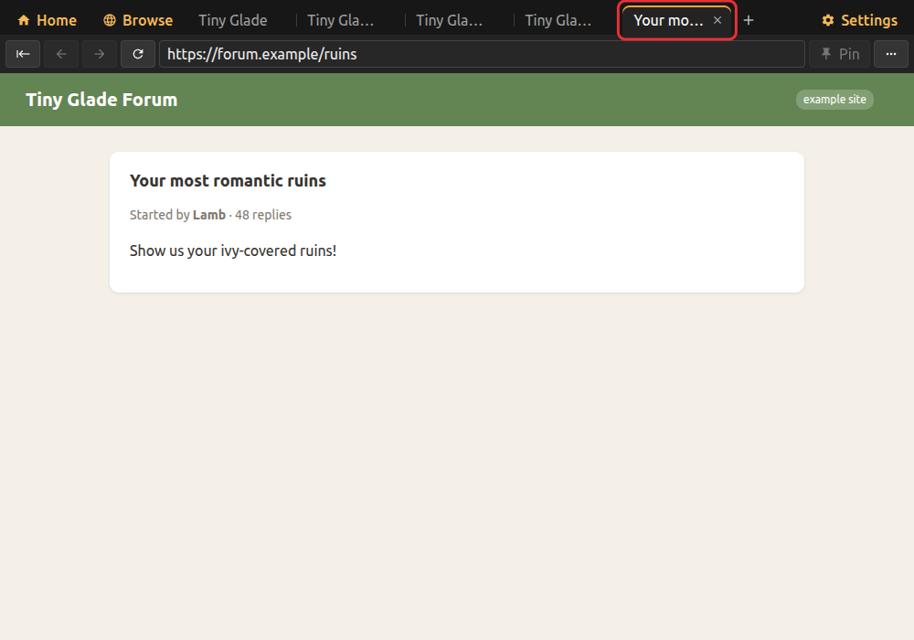
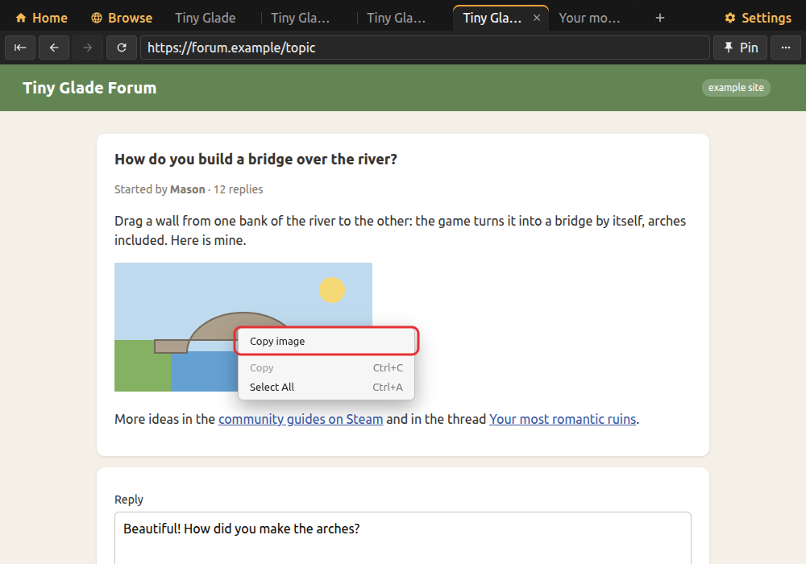
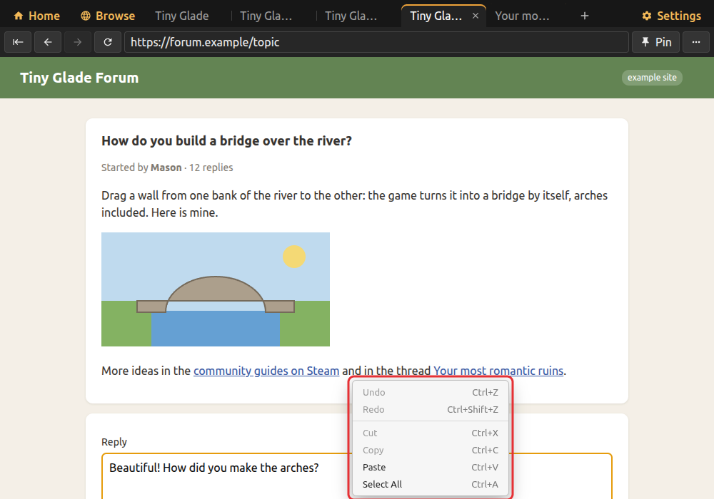

# Links, new tabs and the context menu

In a browser many links open in a new tab. In the overlay the tabs are the list's sites, so these links go where they are useful: into the tab of the site they come from, or, after a question, into a new tab. The right click opens the menu to open a link in a new tab and to copy links, images and text.

Here **Tiny Glade**'s list also has a forum, an **example site** made for this guide (see [Signing in to a site and cookies](accedere-ai-siti.md)).

In the screenshots the elements mentioned in the text are highlighted in red; numbers like ❶ in the text point to the element with the same number in the screenshot.

## 1. A link the site opens in a new tab

Some links are made to open in a new tab, like this forum thread. The same goes for links clicked with Ctrl or with the middle mouse button.

## 2. The same site: in its tab

If the link leads to the same site, it opens in the **site's tab** ❶, in place of the previous page: the **address** ❷ now is the thread's. With **Back** you go back to the previous page.

If the list has several tabs of the same site, the link opens in the one it comes from.

## 3. Another site: the question

If the link leads to a site that has no tab in the list, here the community guides on Steam, the overlay asks whether to add it to the list: **Add** adds it as a new site and opens it; **Cancel** leaves everything as it is.

Links opened from the **Browse** tab stay instead in the Browse tab (see [Free browsing](navigazione-libera.md)).

## 4. Right click on a link

A right click on a link opens the menu with **Open link in new tab** ❶ and **Copy link** ❷, which copies the link's address.

**Open link in new tab** asks for confirmation before adding the link to the list: click **Add**.

The link becomes a **new tab**, right after the one it comes from, and opens. If a tab of the list is already on that address, the overlay shows that tab instead of adding another one.

## 5. Right click on images and text

On an image the menu has **Copy image**, to paste it elsewhere, for example in a chat. On a page's text there are **Copy**, for the selected text, and **Select All**.

In text fields, like the forum's reply field or the tabs' address, the menu has **Undo**, **Redo**, **Cut**, **Copy**, **Paste** and **Select All**. The items not useful at that moment, for example *Copy* with no text selected, are grayed out.

