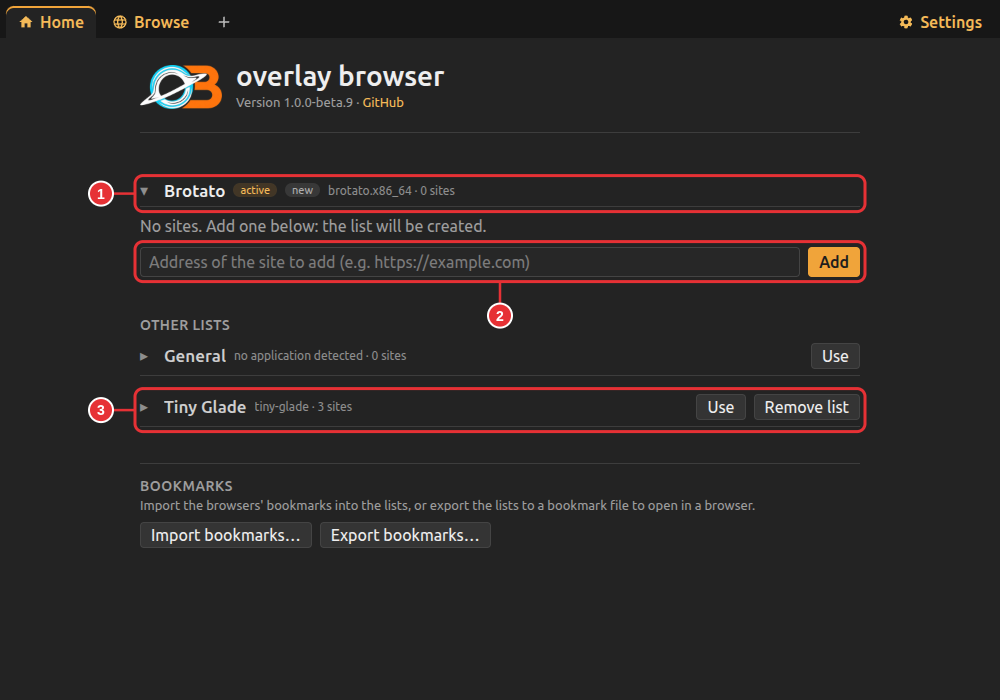
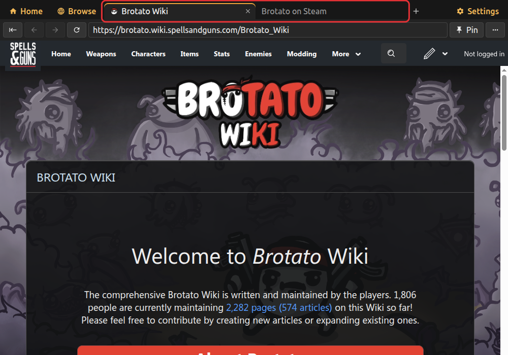
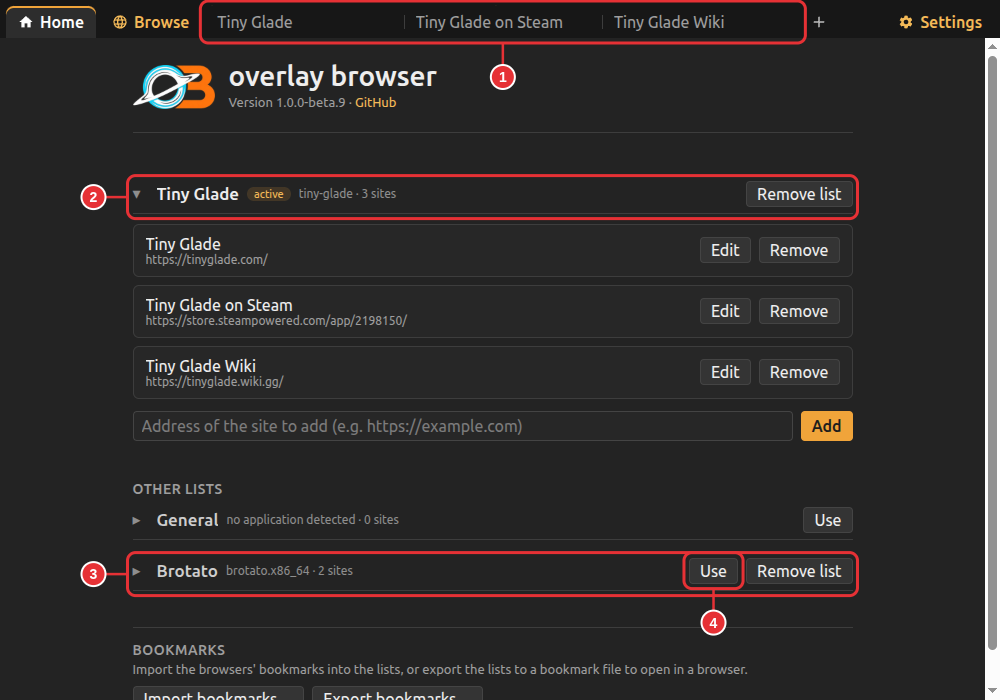
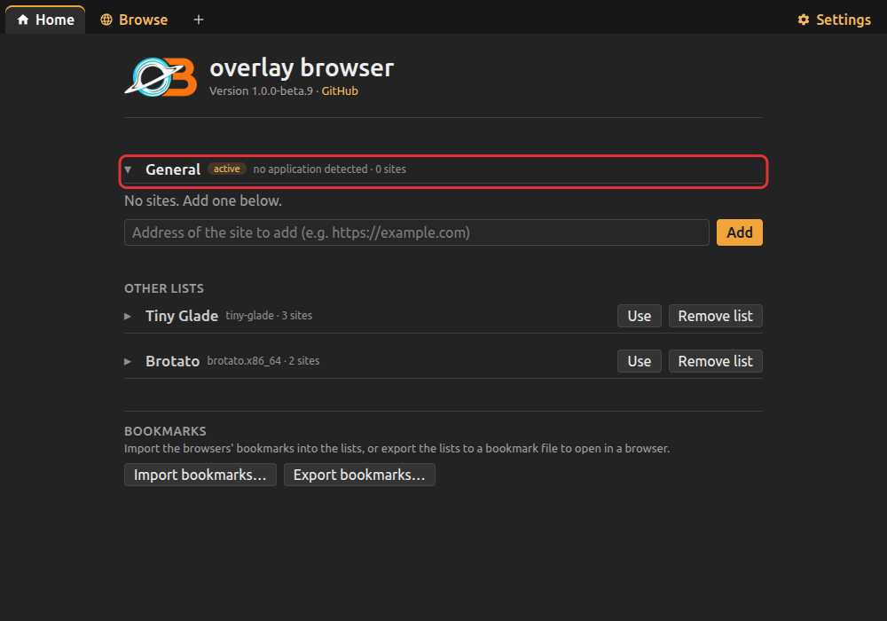
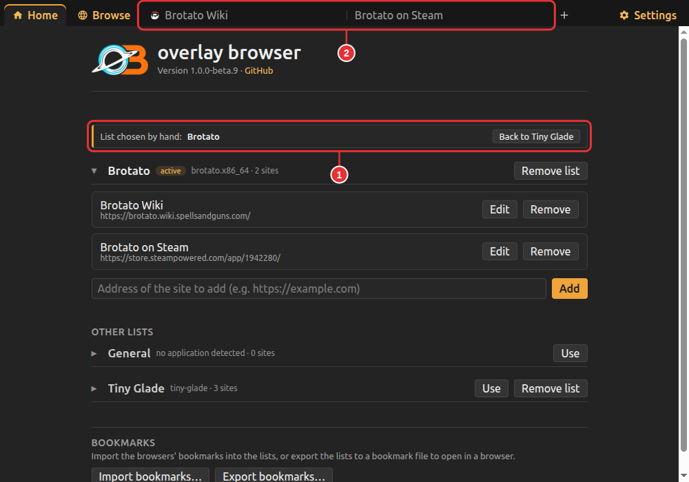
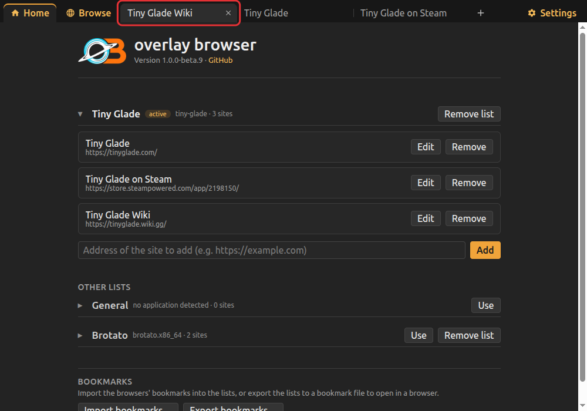
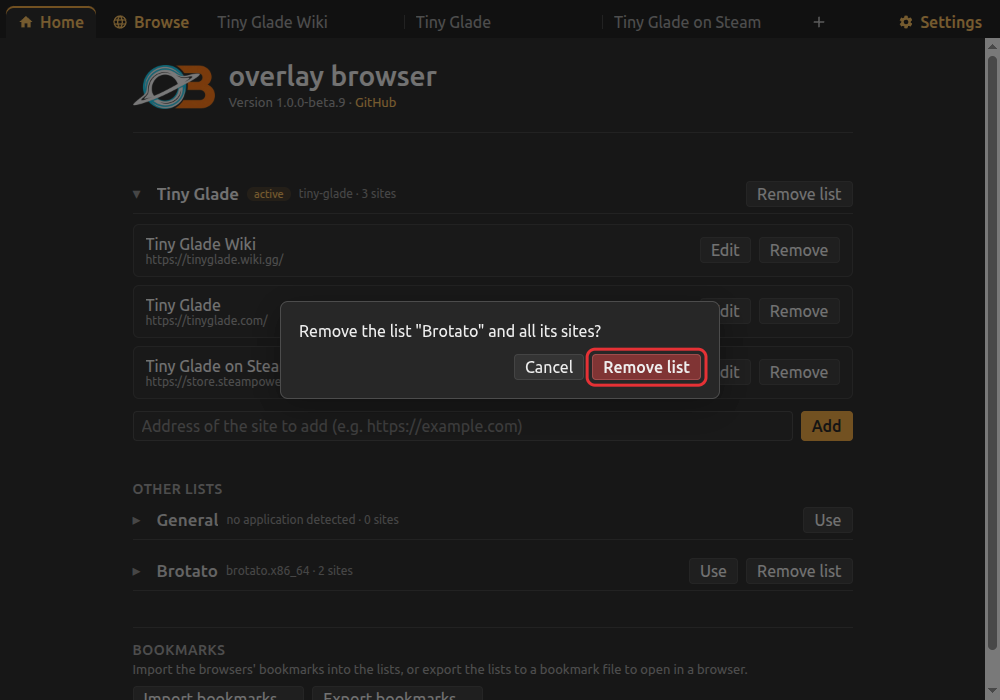

# One list per game

Overlay Browser recognizes the game you open it over and shows that game's sites: each game has its own **list**. In this guide, after [Getting started](primo-avvio.md) and [Free browsing](navigazione-libera.md), **Tiny Glade**'s list already has three sites; now we play **Brotato**.

In the screenshots the elements mentioned in the text are highlighted in red; numbers like ❶ in the text point to the element with the same number in the screenshot.

## 1. A new game, a new list

Open the overlay while playing Brotato. At the top of the Home there is **Brotato's list** ❶, *active* and still *new*: next to its name you see the program recognized and the number of sites. Add a site in the **field below the list** ❷ (or with the **+** in the top bar): the list is created with its first site. **Tiny Glade's list** ❸ is among the *Other lists*, collapsed: click it to see its sites.

Here we add Brotato's wiki and its Steam page. The bar now has their tabs, and only those: Tiny Glade's sites do not appear.

## 2. Each game finds its own sites

Go back to Tiny Glade and open the overlay: the bar has **Tiny Glade's tabs** ❶, and **Tiny Glade's list** ❷ is the active one. **Brotato's list** ❸ has moved among the *Other lists*; **Use** ❹ would make it active by hand (see step 4). Each list opens again on the last tab you were looking at.

## 3. The General list

Lists are not only for games: the overlay offers a list for any program you open it over. When it recognizes no application, the **General list** is active, a place for sites not tied to a specific program. It works like the others, but cannot be removed.

## 4. Choose a list by hand

Sometimes you want another game's sites: for example you are reading Brotato's wiki while Tiny Glade is open. Click **Use** next to the list you want (❹ in the screenshot of step 2).

The list becomes active and stays the one **chosen by hand** ❶ even when you open the overlay over other games, until you click **Back to Tiny Glade**, where Tiny Glade is the game the overlay is open over at that moment. The bar has the **tabs of the chosen list** ❷.

## 5. Reorder tabs and sites

Drag a tab in the bar to move it: here the Tiny Glade Wiki is moved to the first place.

In the same way you can drag the sites in the Home: the order of the Home and of the tabs is the same.

## 6. Remove a list

**Remove list**, next to a list's name, deletes it with all its sites, after a confirmation:

If you then add a site while playing Brotato again, its list is created from scratch.
