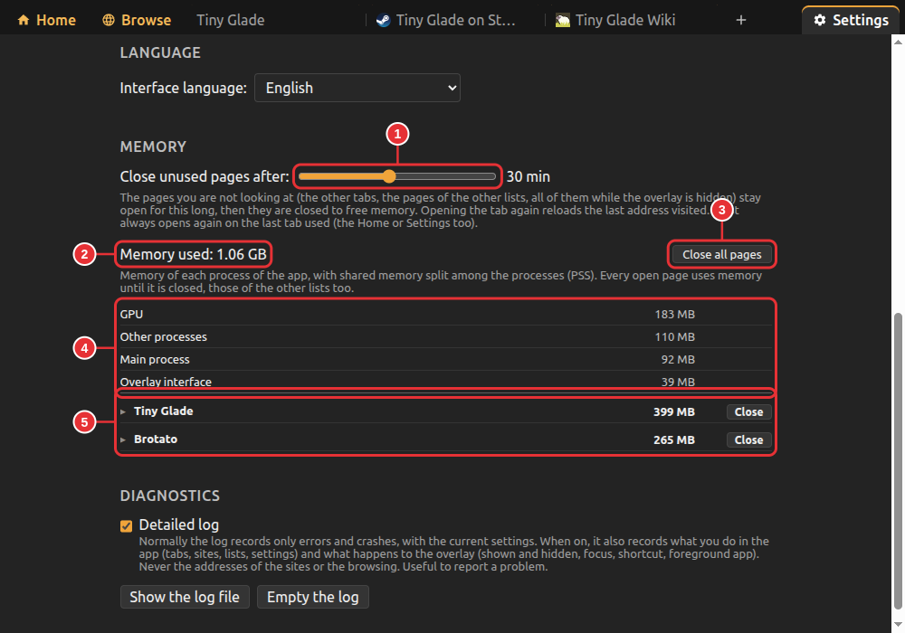
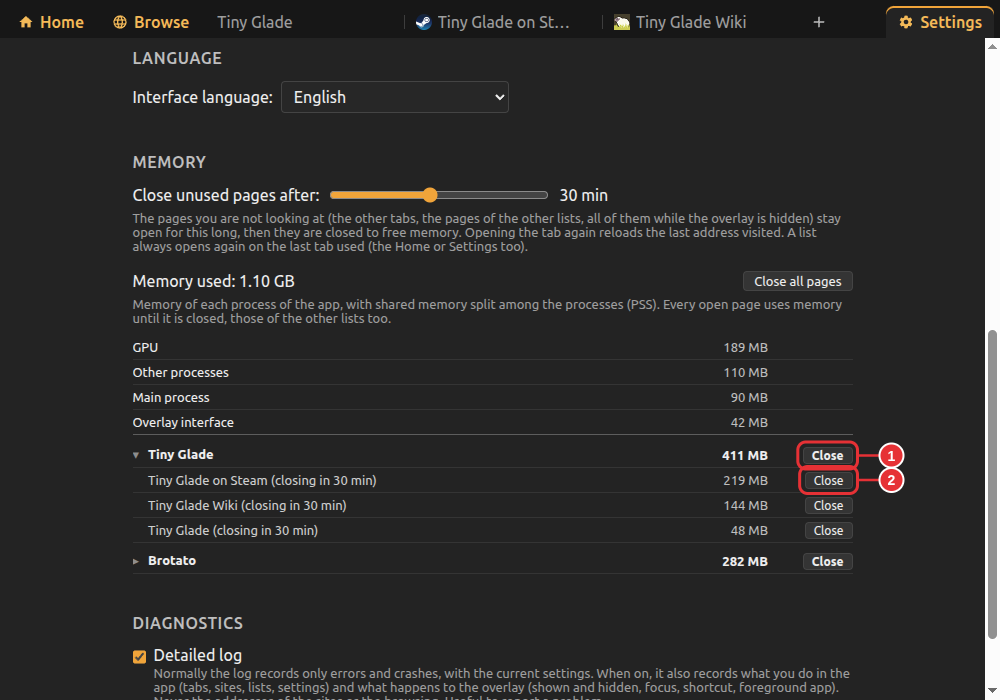
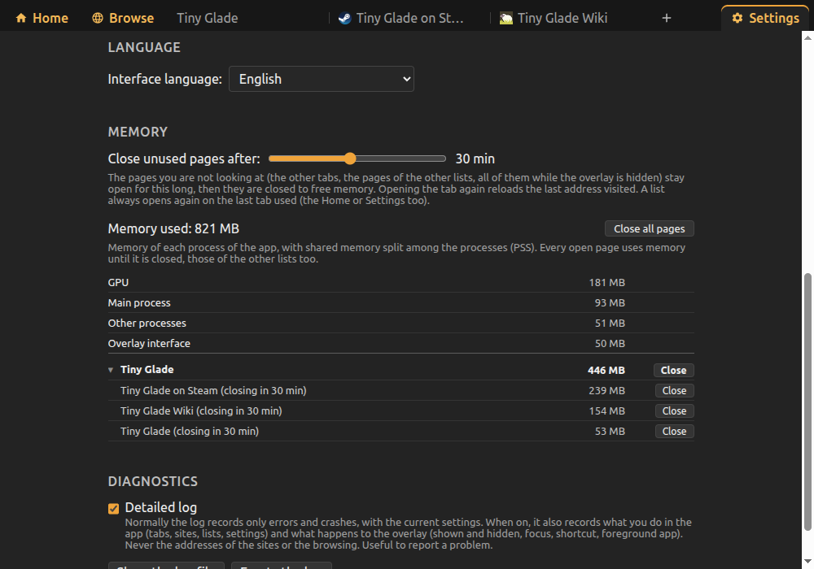

# Memory and closed pages

Every page open in Overlay Browser uses memory, as in a browser, even when you are not looking at it: the pages of the other lists stay open until they are closed. Not to take memory away from the game, the overlay **closes by itself the pages you have not used for a while**, and in the Settings you can see how much memory it uses and close them by hand.

Here the lists of **Tiny Glade** and **Brotato** have several open pages (see [One list per game](liste-per-gioco.md)).

In the screenshots the elements mentioned in the text are highlighted in red; numbers like ❶ in the text point to the element with the same number in the screenshot.

## 1. Why a page reloads

The pages you are not looking at (the other tabs, the pages of the other lists, and all of them while the overlay is hidden) stay open for a while, then they are closed. When you open the tab again, the page **reloads from the last address visited**: you find the page again, but not, for example, the point you had scrolled to or a half-filled form.

The page you are looking at is never closed.

## 2. The Memory section

Open the **Settings** and scroll down to the *Memory* section:

- **Close unused pages after** ❶: the time after which an unused page is closed, from 5 to 60 minutes (30 by default). With less free memory, or with heavy games, a shorter time is better.
- **Memory used** ❷: the memory of the whole app.
- **Close all pages** ❸: closes right away all the open pages, of all the lists.
- **The app's processes** ❹: the overlay interface, the main process, the graphics (GPU) and the other processes. This memory is always there.
- **The pages, grouped by list** ❺: for each list, the memory of its open pages. **Close** closes all the pages of that list.

## 3. The pages of a list

Click a list's name to see its open pages, each with the memory it uses and the time left before it closes. **Close** next to the list ❶ closes all its pages; **Close** next to a page ❷ closes only that one.

Some pages share the same process, for example pages of the same site in different lists: they appear in a single row, outside the groups, and are closed together, because the memory is freed only when all of them are closed.

## 4. After closing

Here we closed Brotato's pages: its group is gone and the memory used went down. Brotato's tabs stay in its list: next time you open them, the pages reload.

