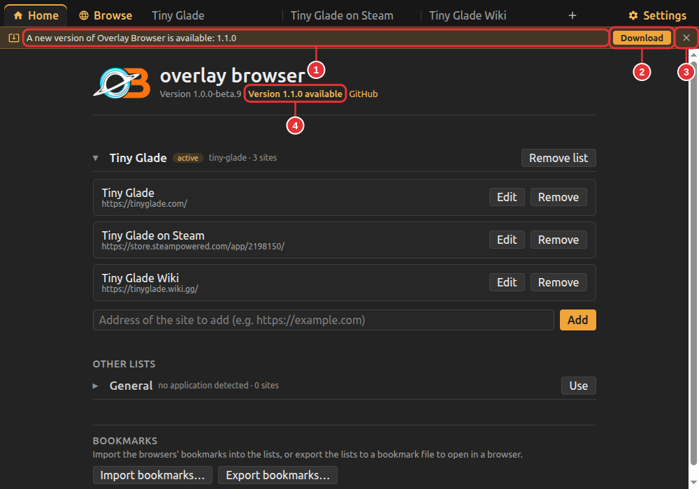
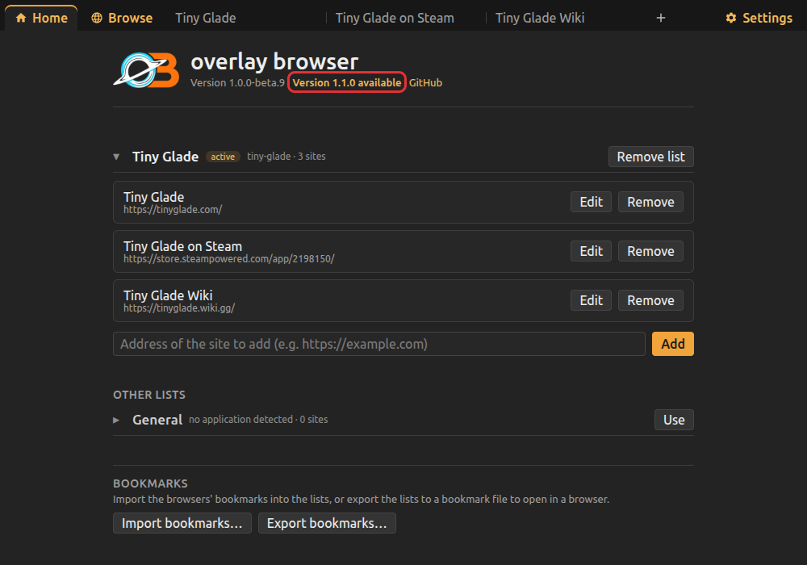
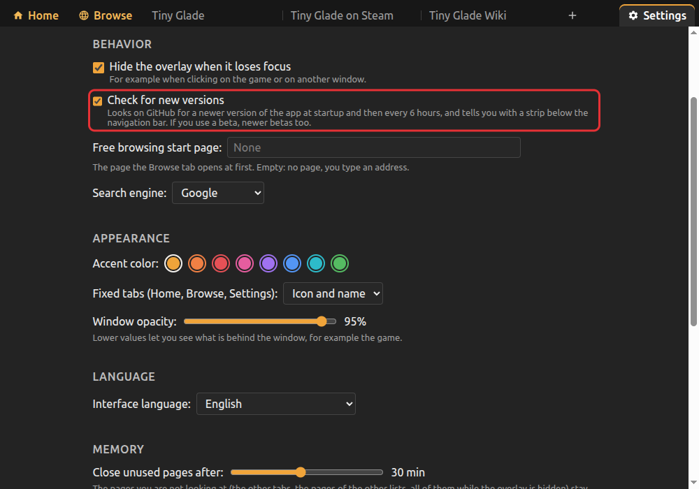

# New versions

Overlay Browser checks by itself whether a new version is out and tells you; it does not update by itself: you download the new version when you want.

In the screenshots the elements mentioned in the text are highlighted in red; numbers like ❶ in the text point to the element with the same number in the screenshot.

## 1. The notice of a new version

When a new version is out, a **strip** ❶ with its number appears below the top bar. **Download** ❷ opens in the system browser the new version's page, where you download the file for your system (see the installation in the [README](../../README.md)). The **×** ❸ closes the strip: for that version it does not come back.

The new version is also shown at the top of the **Home** ❹, next to the version you are using: click it to open the same page.

After you close the strip, the new version stays on the Home until you install the update:

## 2. When it checks

The app checks shortly after starting and then every 6 hours, on the project's releases on GitHub. If you use a beta version, it also tells you about newer betas; otherwise only about final versions.

Not to receive the notices, turn off **Check for new versions** in the **Settings**, *Behavior* section. The Microsoft Store version does not have the option: its updates come from the Store.

