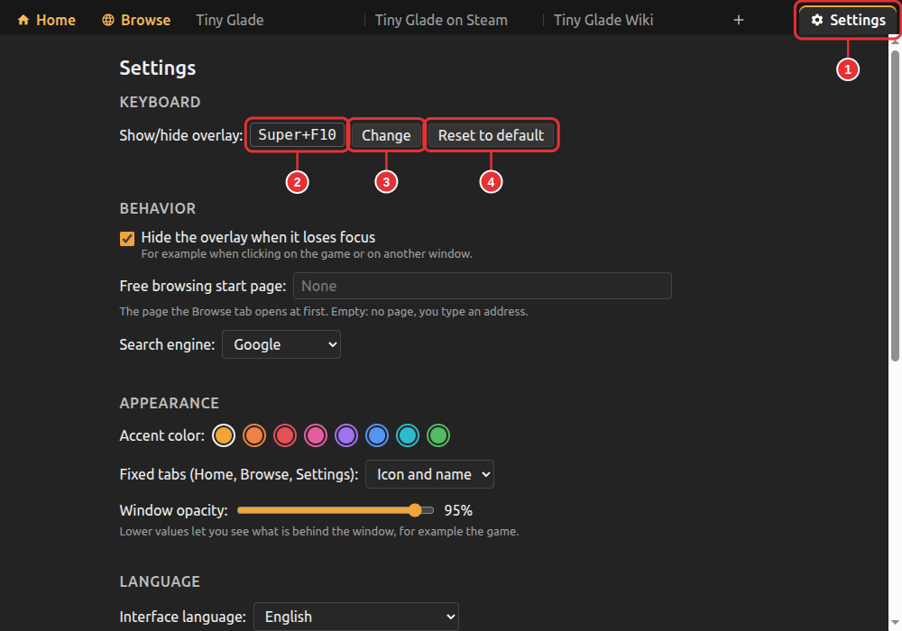
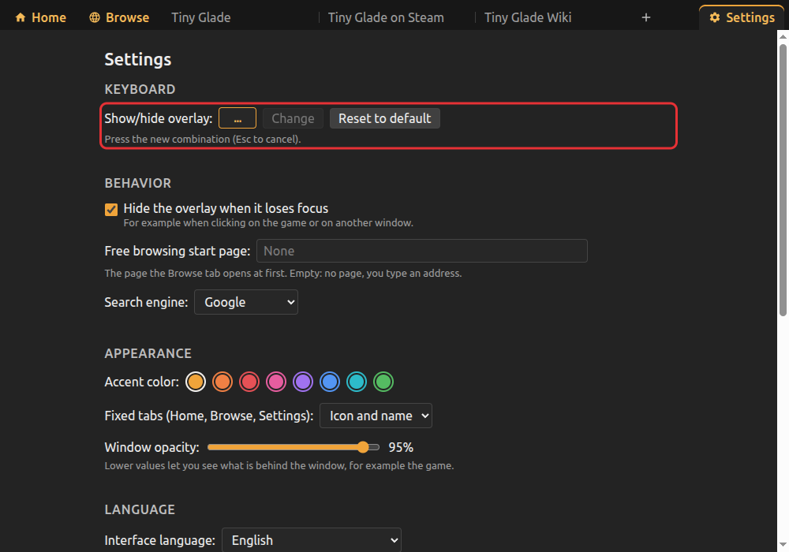
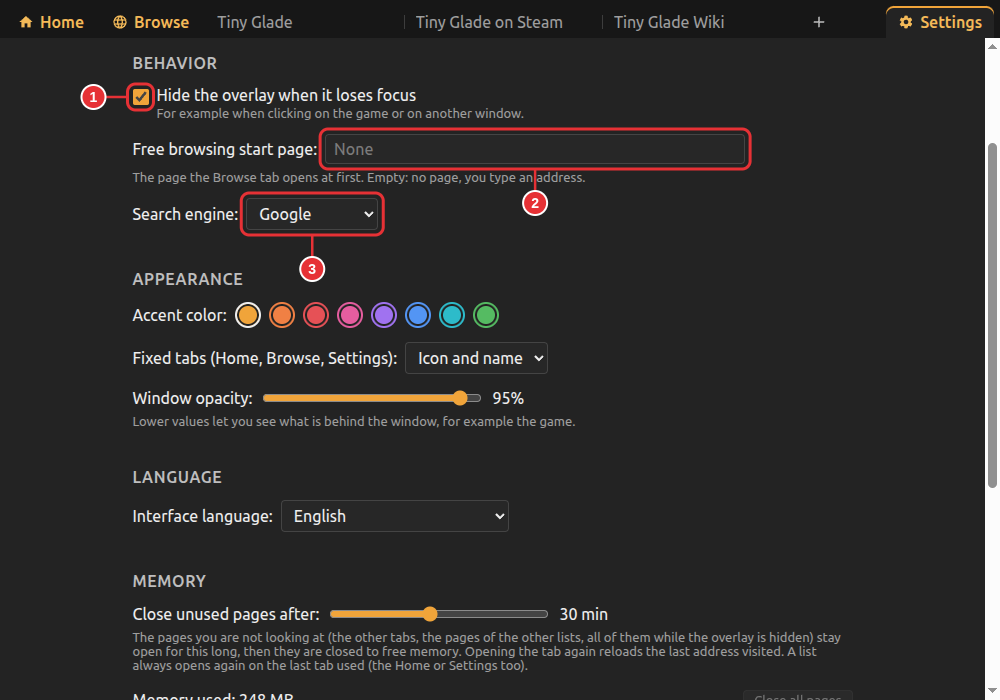
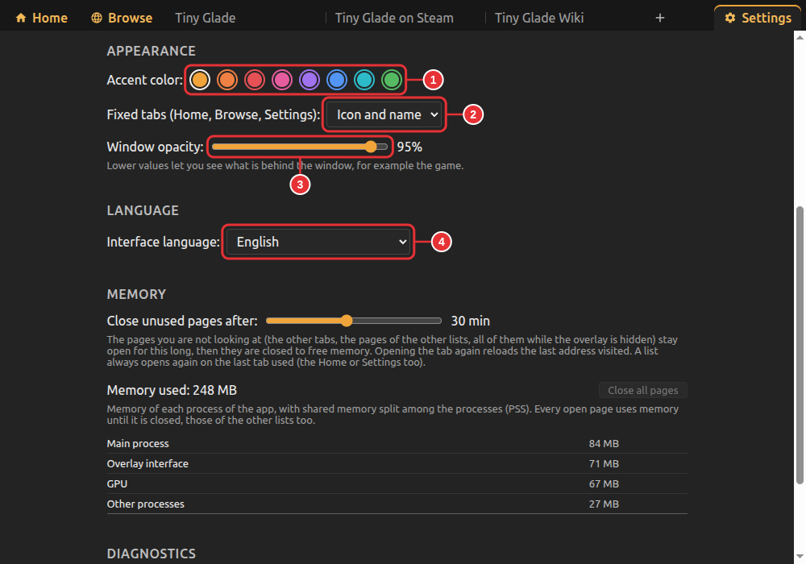
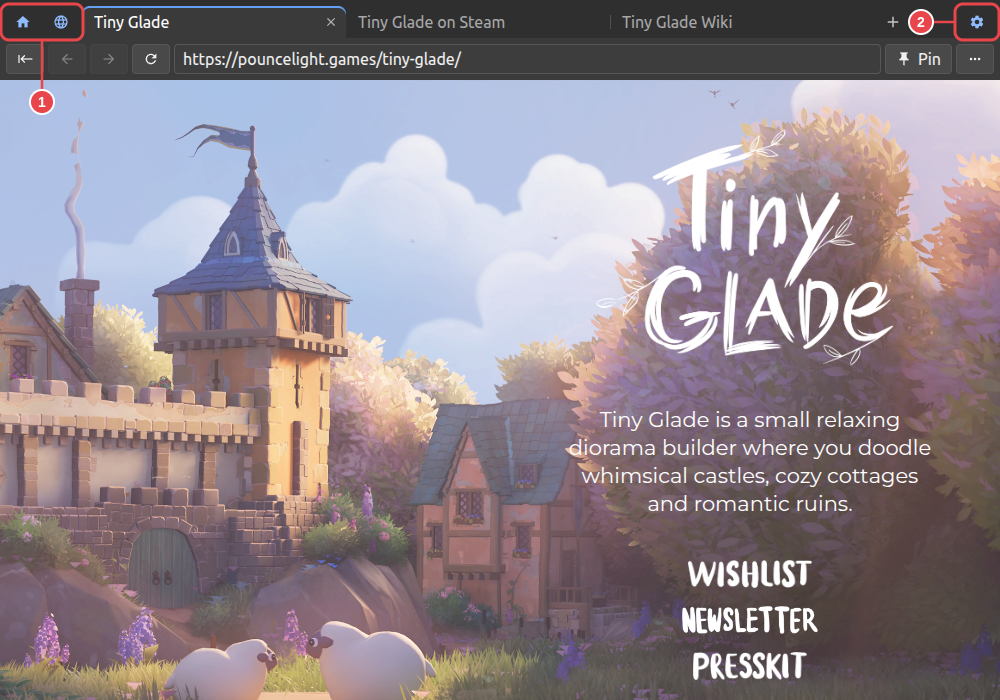

# Customizing the overlay

From the **Settings** page you choose the key combination, how the overlay behaves, its appearance and its language. Every change applies right away and is remembered.

In the screenshots the elements mentioned in the text are highlighted in red; numbers like ❶ in the text point to the element with the same number in the screenshot.

## 1. The key combination

Open the **Settings** tab ❶, top right (or *Settings* from the menu of the notification area icon). In the *Keyboard* section you see the **current combination** ❷ that shows and hides the overlay. **Change** ❸ records a new one; **Reset to default** ❹ goes back to the default one (Win+F10, Super+F10 on Linux, Cmd+Shift+Space on macOS).

After **Change**, press the combination you prefer, for example `Ctrl+Shift+O`; Esc cancels.

F1–F24 are allowed alone, otherwise any key together with Ctrl, Alt, Shift or Win (Super on Linux, Cmd on macOS). If the combination is already used by another program a message appears and the previous one stays.

> **Careful in game:** the combination also reaches the game, not only the overlay. Choose one that the game does not assign to any command, otherwise opening the overlay will trigger that command too.

## 2. Behavior

In the *Behavior* section:

- **Hide the overlay when it loses focus** ❶: on by default, the overlay hides by itself when you click the game or another window. Turn it off if you want to keep it visible while playing; it then hides only with the key combination. The same option is also in the menu of the notification area icon.
- **Free browsing start page** ❷: the page the Browse tab opens at first. Empty: no page (see [Free browsing](navigazione-libera.md)).
- **Search engine** ❸: the one the Browse tab uses for texts that are not addresses: Google, Bing, DuckDuckGo, Brave Search, Ecosia, Startpage, or *Custom*, a search address with `%s` in place of the searched text.

Here there is also *Check for new versions*, which tells you on the Home when a new version comes out (not in the Microsoft Store version, which updates by itself).

## 3. Appearance and language

In the *Appearance* section:

- **Accent color** ❶: the color of the fixed tabs, of the main buttons and of the interface's details.
- **Fixed tabs** ❷: Home, Browse and Settings with icon and name, or *Icon only* to leave more room for the sites' tabs.
- **Window opacity** ❸: with lower values the window becomes transparent and you can see the game behind it (from 30% to 100%, that is opaque).

In the *Language* section, **Interface language** ❹: by default *System language*, that is the system's language if the app has it (Italian, English, French, Portuguese, Russian, Spanish and German), otherwise English.

Here is the overlay with the blue accent color and the **fixed tabs with the icon only** ❶ ❷. The opacity does not show in the screenshot, which captures only the window and not the game behind it.

## The other sections

Further down, the *Memory* section tells how much memory the app uses and after how long to close the pages you are not looking at; the *Diagnostics* section helps collect information to attach to a problem report.
