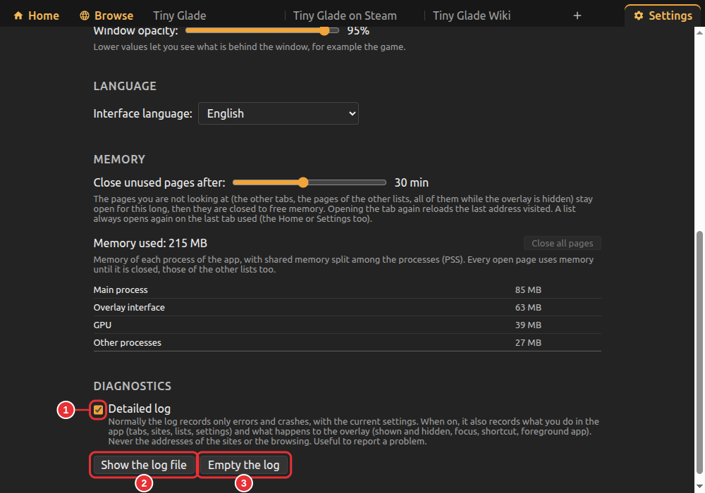
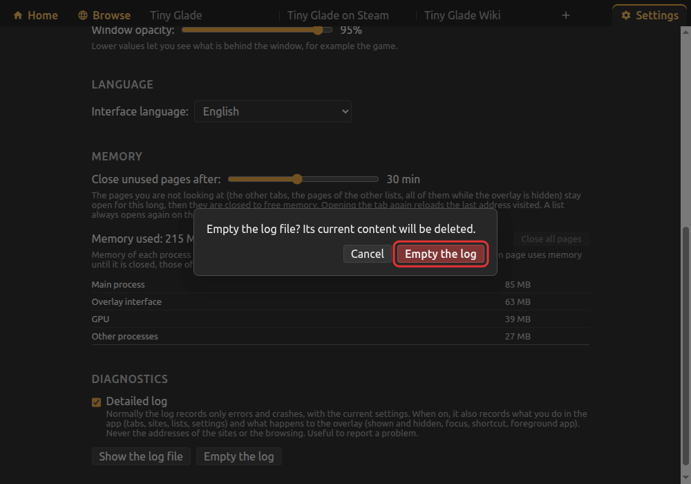

# Troubleshooting

Here you find the solutions to the most common problems and how to collect the information useful to report one. For each system's details (Windows, Linux, macOS) the guide refers to the [README](../../README.md).

In the screenshots the elements mentioned in the text are highlighted in red; numbers like ❶ in the text point to the element with the same number in the screenshot.

## 1. The key combination does not work

- **It is already used by another program.** If you choose it in the Settings, the overlay tells you («invalid combination or already in use») and the previous one stays: choose another one (see [Customizing the overlay](personalizza.md)).
- **The game uses it for one of its commands.** The combination also reaches the game: choose one that does nothing in the game.
- **Linux with Wayland.** The combination is not seen while a native Wayland window is active: an X11 session is needed (see *Linux* in the [README](../../README.md#linux)).
- **macOS and function keys.** By default F1–F12 control brightness, volume and so on: press them together with **fn**, or change the keyboard setting (see *macOS* in the [README](../../README.md#macos)).

You can always show the overlay from the notification area icon as well.

## 2. I cannot find the app's icon

The app does not appear in the taskbar or in Alt+Tab: it is in the notification area, near the clock.

- **Windows:** if you do not see it, click the **^** arrow and drag the icon onto the taskbar to keep it always visible.
- **Linux with GNOME:** the *AppIndicator and KStatusNotifierItem Support* extension is needed. In some environments clicking the icon opens the menu instead of showing the window: use the *Show* item.
- **macOS:** the icon is in the menu bar, top right.

## 3. The overlay does not appear over the game, or is not transparent

- **The game covers the overlay.** Some games in "exclusive" fullscreen cover any window: set the game to *borderless window* mode.
- **The window is not transparent (Linux).** Transparency needs a window manager with compositing on (Cinnamon, KDE, GNOME, Xfce with compositing): without it, the window stays opaque.

## 4. A site does not work well or a page reloads

- **A site no longer works well, or you want to sign out of an account:** delete the site's cookies from the **…** menu (see [Signing in to a site and cookies](accedere-ai-siti.md)).
- **A page reloads when you go back to its tab:** unused pages are closed after a while to free memory (see [Memory and closed pages](memoria.md)).
- **You want to start over:** quit the app and delete the preferences file (see *Preferences and uninstalling* in the [README](../../README.md#preferences-and-uninstalling)).

## 5. Collect the information for a report

If a problem persists, you can report it on the [project's issues page](https://github.com/siculo/overlay-browser/issues). The app's log file helps understand what happened.

In the **Settings**, *Diagnostics* section:

- **Detailed log** ❶: normally the log records only errors and crashes, with the current settings. When on, it also records what you do in the app (tabs, sites, lists, settings) and what happens to the overlay (shown and hidden, focus, key combination, foreground app). Turn it on, then repeat what causes the problem.
- **Show the log file** ❷: opens the folder with the `overlay.log` file, to attach to the report.
- **Empty the log** ❸: deletes the log's content, for example to record only the problem to report.

The log never contains the keys you press or your browsing: no addresses or page titles. Sites are identified only by their position in the list.

**Empty the log** asks for confirmation before deleting it:

