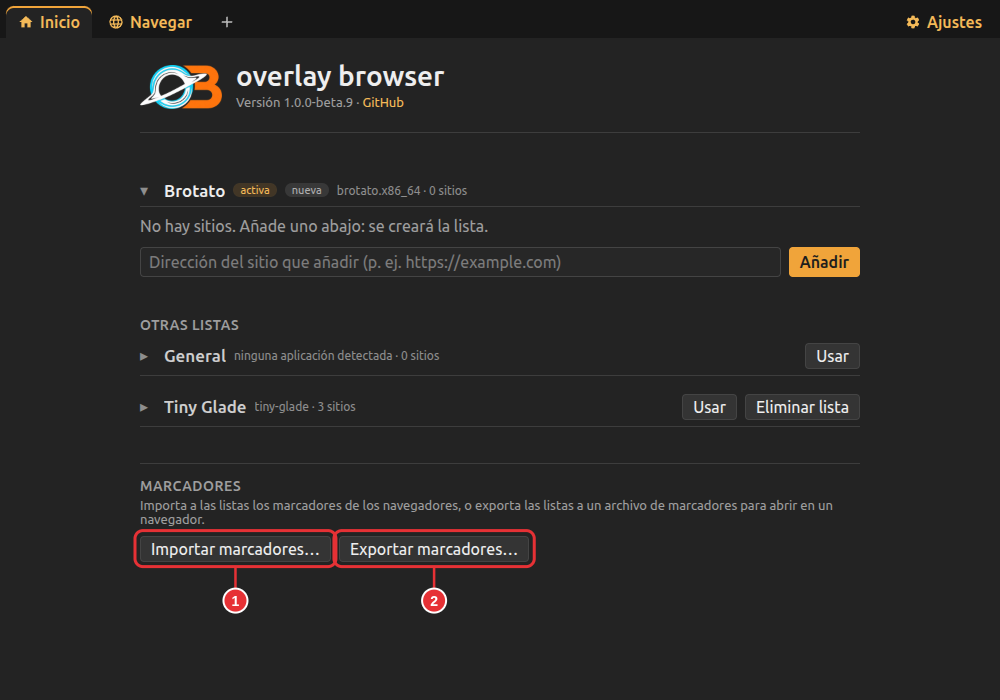
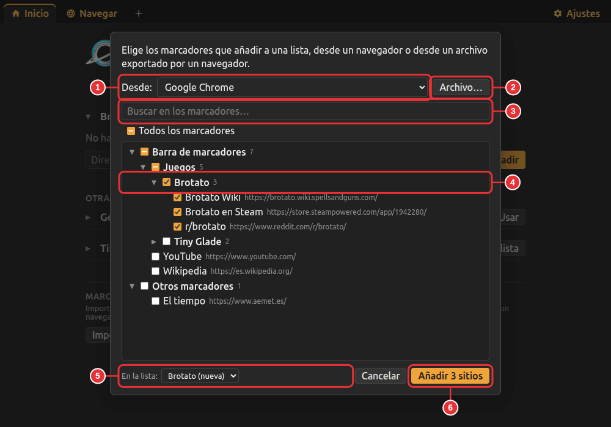
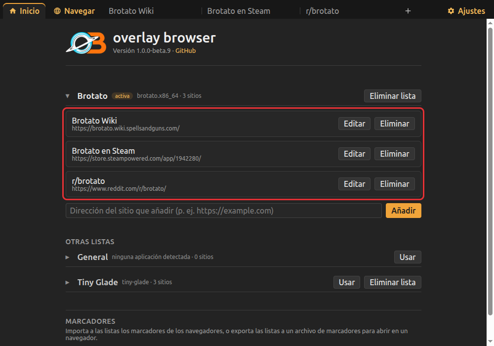
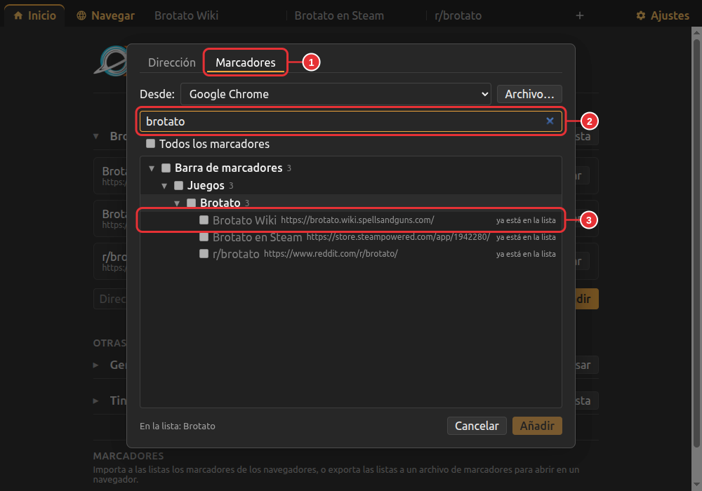
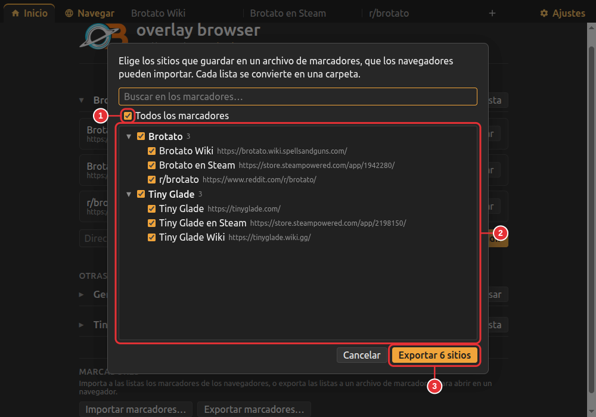

# Importar y exportar marcadores

Si ya guardas los sitios de tus juegos en el navegador, puedes importarlos a las listas de Overlay Browser sin volver a escribir las direcciones. También puedes exportar las listas a un archivo de marcadores que puedes importar en cualquier navegador.

Aquí el overlay está abierto sobre **Brotato**, cuya lista sigue vacía. La de **Tiny Glade** ya tiene tres sitios. Consulta [Una lista por juego](lists-per-game.md).

En las capturas de pantalla, los elementos citados en el texto están resaltados con un recuadro rojo; los números como ❶ en el texto indican el elemento con el mismo número en la captura.

## 1. Los marcadores en Inicio

Al final de **Inicio** está la sección *Marcadores*, con **Importar marcadores…** ❶ y **Exportar marcadores…** ❷.

## 2. Elige qué marcadores importar

Haz clic en **Importar marcadores…**. En la ventana aparecen estas opciones.

- **Desde** ❶ elige el perfil del navegador del que se leerán los marcadores. El overlay detecta Chrome, Edge, Brave, Opera, Vivaldi, Chromium, Firefox, LibreWolf y navegadores similares. Firefox puede seguir abierto. La próxima vez se propone el último perfil elegido.
- **Archivo…** ❷ permite importar un archivo HTML exportado desde el gestor de marcadores de cualquier navegador. En macOS es el único método, así que primero exporta los marcadores desde el navegador.
- **Buscar en los marcadores…** ❸ encuentra marcadores y carpetas por nombre o dirección.
- Con las **casillas** ❹ puedes seleccionar marcadores sueltos o carpetas completas. *Todos los marcadores* los selecciona todos. Aquí marcamos la carpeta *Brotato*.
- **En la lista** ❺ indica dónde se añadirán. Al principio está seleccionada la lista activa. Si todavía es *nueva*, como la de Brotato, se crea al importar los sitios.
- El botón **Añadir 3 sitios** ❻ muestra cuántos sitios se añadirán.

Los marcadores se convierten en sitios de la lista y conservan sus nombres.

## 3. Importa desde «+»

También puedes importar desde **+** en la barra superior. Abre la pestaña **Marcadores** ❶, al lado de *Dirección*. Desde aquí los sitios se añaden a la lista activa. **Buscar en los marcadores…** ❷ permite encontrar los que buscas. Los que **ya están en la lista** ❸ aparecen atenuados y no se pueden seleccionar. Así evitas duplicados.

## 4. Exporta las listas

**Exportar marcadores…**, en la sección *Marcadores* de Inicio, guarda los sitios en un archivo HTML que puedes importar en cualquier navegador. Cada lista se convierte en una carpeta. Al principio están seleccionados **Todos los marcadores** ❶. En la **lista** ❷ puedes desmarcar listas o sitios. **Exportar 6 sitios** ❸ te pregunta dónde guardar el archivo.

