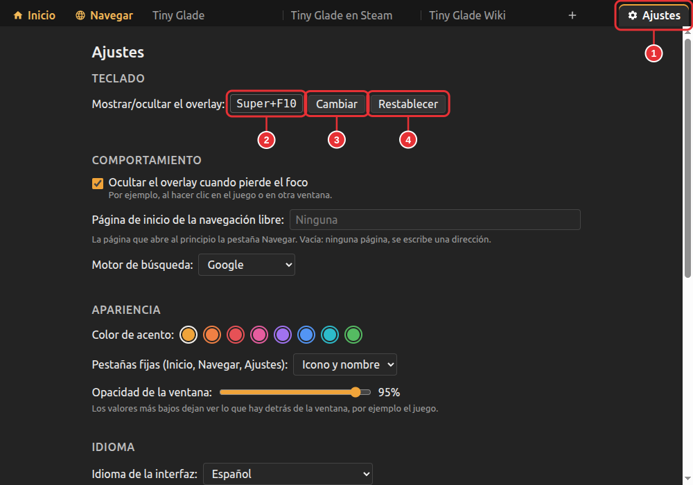
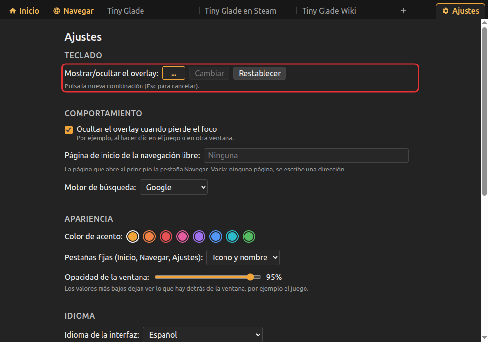
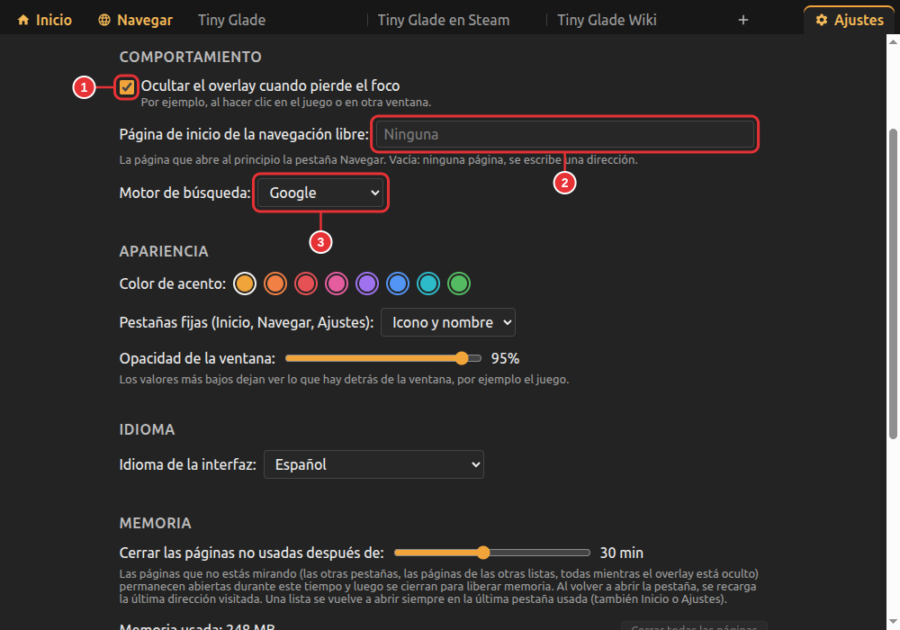
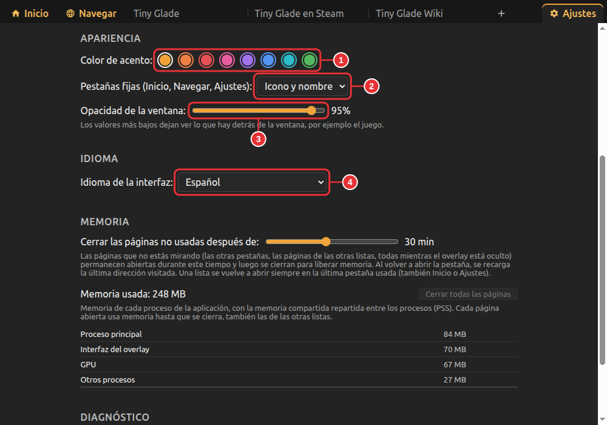
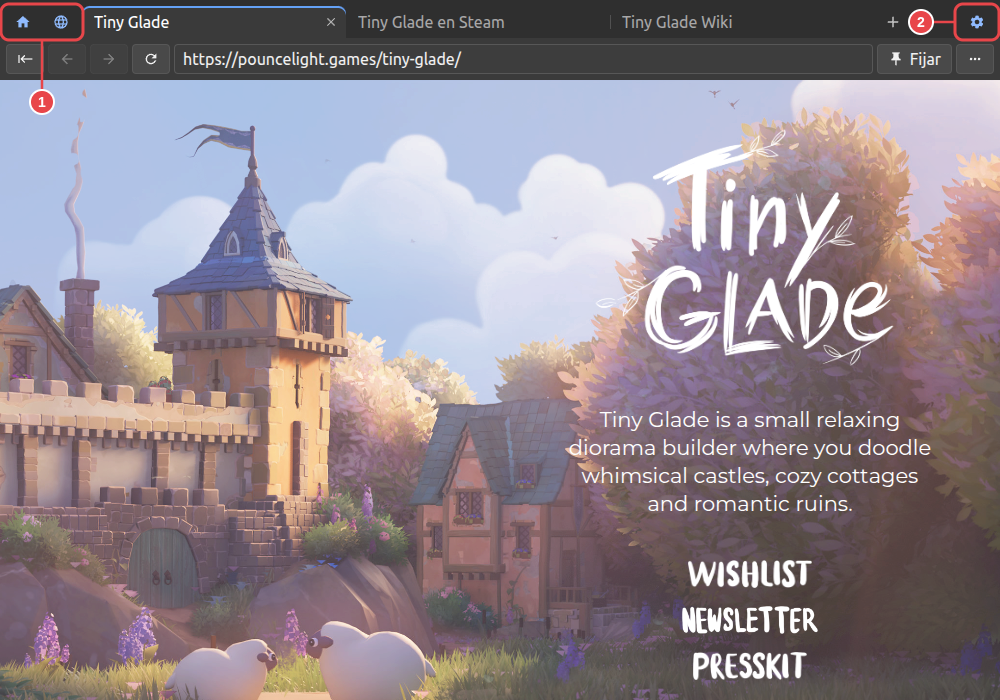

# Personaliza el overlay

En **Ajustes** eliges la combinación de teclas, el comportamiento, la apariencia y el idioma. Cada cambio se aplica al instante y queda guardado.

En las capturas de pantalla, los elementos citados en el texto están resaltados con un recuadro rojo; los números como ❶ en el texto indican el elemento con el mismo número en la captura.

## 1. La combinación de teclas

Abre **Ajustes** ❶ arriba a la derecha o desde el menú del icono del área de notificación. En *Teclado* verás la **combinación actual** ❷ para mostrar y ocultar el overlay. **Cambiar** ❸ registra otra. **Restablecer** ❹ recupera la predeterminada (Win+F10, Super+F10 en Linux, Cmd+Mayús+Espacio en macOS).

Después de pulsar **Cambiar**, pulsa la combinación que prefieras, por ejemplo `Ctrl+Shift+O`. Con Esc cancelas el cambio.

Puedes usar F1 a F24 solas o combinar una tecla con Ctrl, Alt, Mayús o Win (Super en Linux, Cmd en macOS). Si la combinación ya la usa otro programa, aparece un aviso y se mantiene la anterior.

> **Durante el juego.** El juego también recibe la combinación. Elige una que no esté asignada a ningún comando del juego para evitar activarlo cuando abras el overlay.

## 2. Comportamiento

En *Comportamiento* tienes estas opciones.

- **Ocultar el overlay cuando pierde el foco** ❶ viene activada. El overlay se oculta al hacer clic en el juego o en otra ventana. Desactívala si quieres que siga visible mientras juegas. Puedes seguir ocultándolo con la combinación. La opción también está en el menú del icono del área de notificación.
- **Página de inicio de la navegación libre** ❷ es la página que se abre al entrar en Navegar. Si dejas el campo vacío, no se abre ninguna página. Consulta [Navegación libre](free-browsing.md).
- **Motor de búsqueda** ❸ elige dónde buscar el texto introducido en Navegar. Puedes elegir Google, Bing, DuckDuckGo, Brave Search, Ecosia, Startpage o *Personalizado*. En una dirección personalizada, `%s` se sustituye por el texto de la búsqueda.

*Buscar nuevas versiones* te avisa en Inicio cuando sale una versión nueva. La edición de Microsoft Store se actualiza desde la tienda.

## 3. Apariencia e idioma

En *Apariencia* tienes estas opciones.

- **Color de acento** ❶ cambia el color de las pestañas fijas, los botones principales y otros detalles.
- **Pestañas fijas** ❷ muestra Inicio, Navegar y Ajustes con icono y nombre. *Solo icono* deja más espacio a las pestañas de los sitios.
- **Opacidad de la ventana** ❸ va del 30 % al 100 %. Con valores más bajos, la ventana deja ver el juego detrás.

En *Idioma*, **Idioma de la interfaz** ❹ es por defecto el *Idioma del sistema* si está disponible (italiano, inglés, francés, portugués, ruso, español y alemán). En los demás casos se usa el inglés.

Aquí se ve el overlay con el color de acento azul y las **pestañas fijas con solo el icono** ❶ ❷. La captura solo muestra la ventana, de modo que no se ve el juego detrás ni se aprecia la opacidad.

## Las demás secciones

Más abajo, *Memoria* muestra cuánta memoria usa la aplicación y cuándo se cierran las páginas que no estás usando. *Diagnóstico* ayuda a recopilar información para comunicar un problema.
