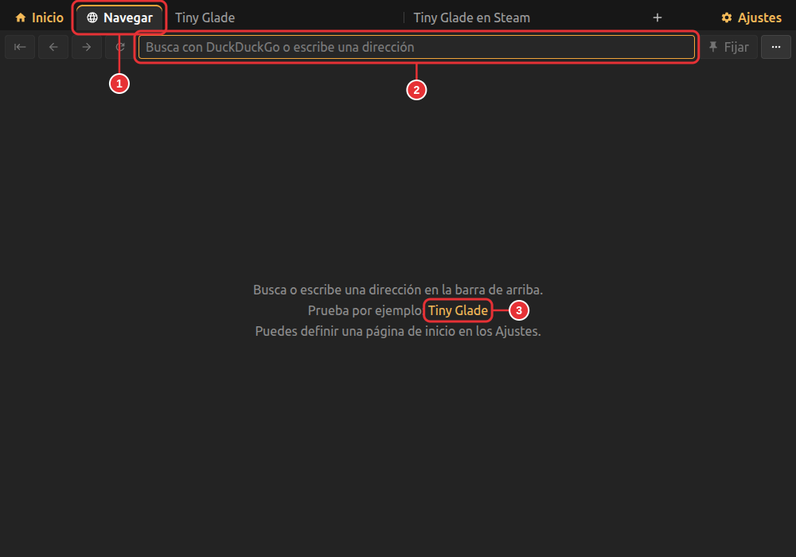
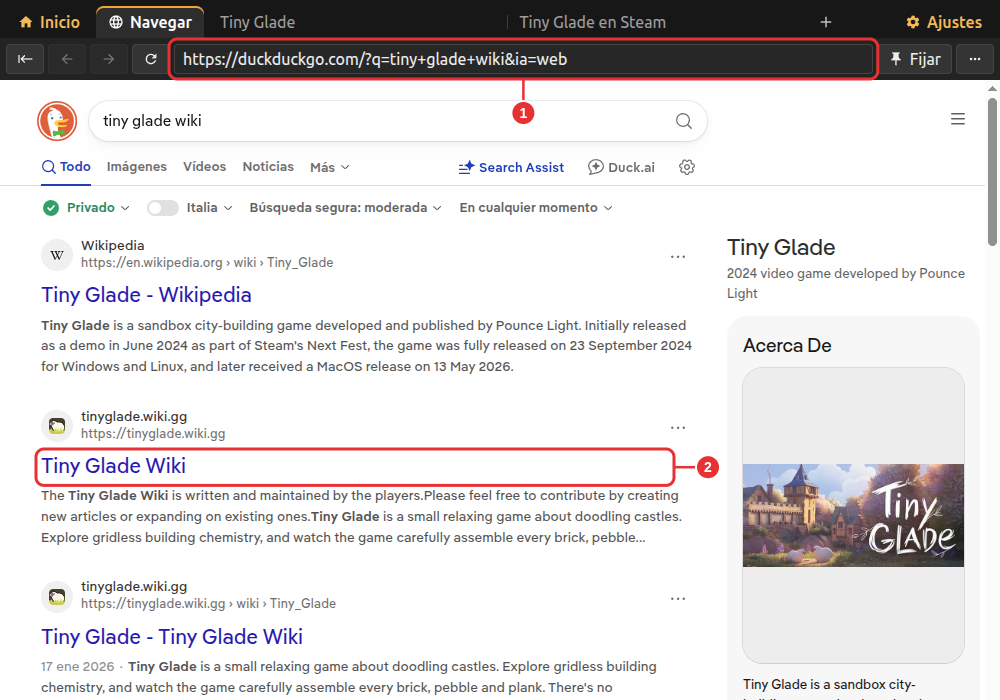
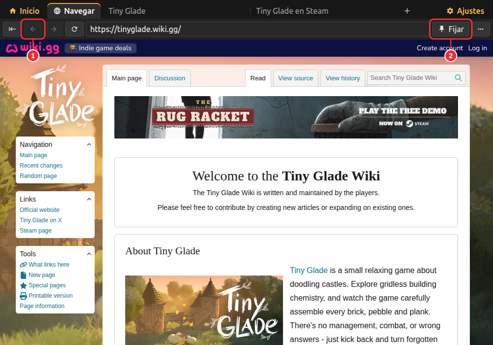
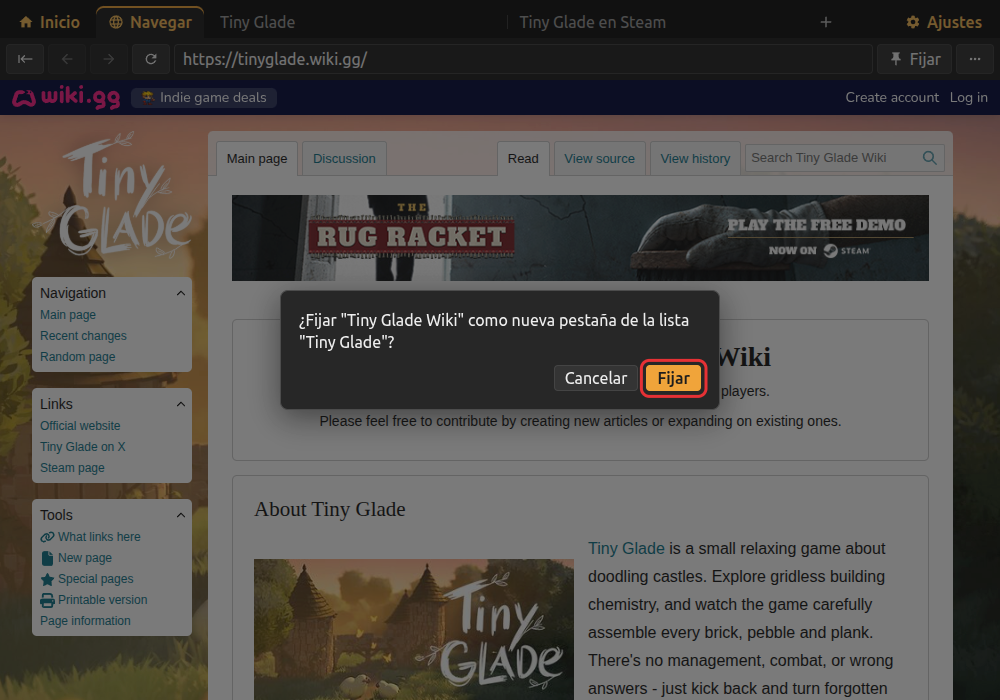
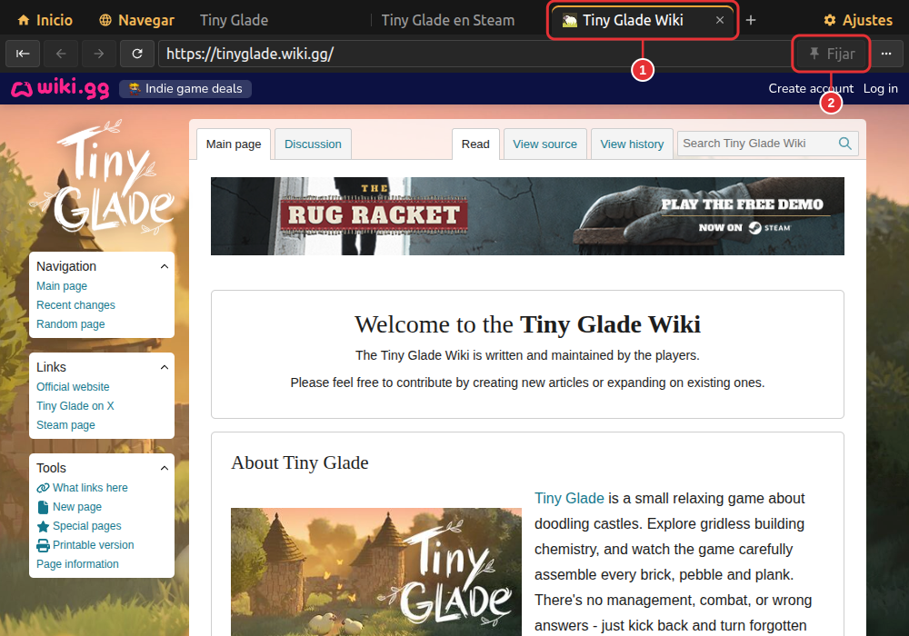
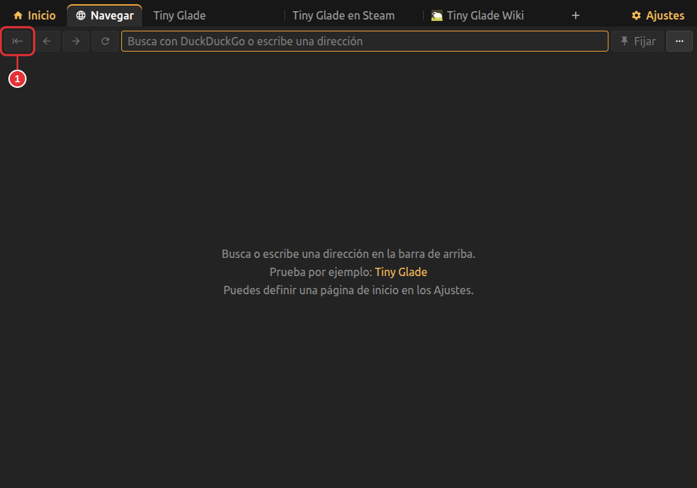

# Navegación libre para buscar, encontrar y fijar páginas

En la pestaña **Navegar** puedes buscar y abrir cualquier página sin añadirla a la lista. Si quieres conservarla, **Fijar** la convierte en una pestaña de la lista del juego.

Seguimos con el ejemplo de [Primeros pasos](getting-started.md). El overlay está abierto sobre **Tiny Glade**, su lista ya contiene dos sitios y vamos a buscar una wiki del juego.

En las capturas de pantalla, los elementos citados en el texto están resaltados con un recuadro rojo; los números como ❶ en el texto indican el elemento con el mismo número en la captura.

## 1. Abre la pestaña Navegar

Haz clic en **Navegar** ❶, justo al lado de Inicio. Escribe en el **campo de dirección** ❷ una dirección (basta con `example.com`) o el texto que quieras buscar. El overlay sugiere como ejemplo el **nombre del juego** ❸. Haz clic en él para buscarlo.

## 2. Busca

Escribe `tiny glade wiki` y pulsa Intro. Los resultados se abren en la pestaña. El **campo de dirección** ❶ muestra la dirección de la página de resultados.

Elige el motor de búsqueda en Ajustes, en *Comportamiento*. Puedes usar Google, Bing, DuckDuckGo, Brave Search, Ecosia, Startpage o una dirección personalizada. Aquí usamos DuckDuckGo.

Haz clic en el resultado que quieras, en este caso **Tiny Glade Wiki** ❷.

## 3. Fija la página

La página se abre en Navegar y puedes usarla como en un navegador. **Atrás** ❶ vuelve a los resultados. Para conservar la página, pulsa **Fijar** ❷.

El overlay pide confirmación. Pulsa **Fijar**.

## 4. La página pasa a la lista

La página y su historial pasan a una **pestaña nueva** ❶ al final de la lista de Tiny Glade. La encontrarás ahí cada vez que abras el overlay sobre el juego. **Fijar** ❷ queda desactivado porque la página ya está en la lista.

También puedes fijar páginas desde las pestañas de sitios. La pestaña nueva queda justo después de la original. Si la página ya está en una pestaña de la lista, esa pestaña se resalta y Fijar queda desactivado.

## 5. La pestaña Navegar queda libre

Cuando vuelvas a **Navegar**, la encontrarás vacía, lista para otra búsqueda. La página fijada ya tiene su propia pestaña. Mientras navegas, **Volver a la página inicial** ❶ cierra la página abierta y vuelve a mostrar la vista vacía.

En Ajustes, en *Comportamiento*, puedes elegir una **Página de inicio de la navegación libre** para que se abra en lugar de la vista vacía.

## Abre otras direcciones desde las pestañas de sitios

También puedes escribir en el campo de dirección de una pestaña de sitio. Una dirección del mismo sitio se abre en esa pestaña. Una dirección de otro sitio o una búsqueda se abre en Navegar tras una confirmación. La pestaña del sitio conserva su página.
