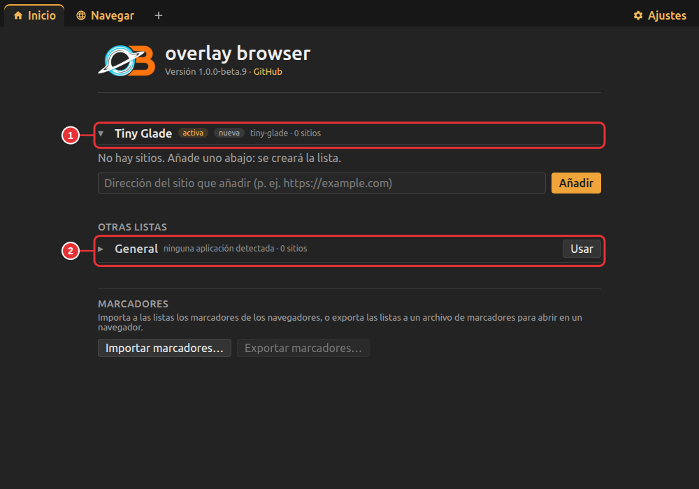
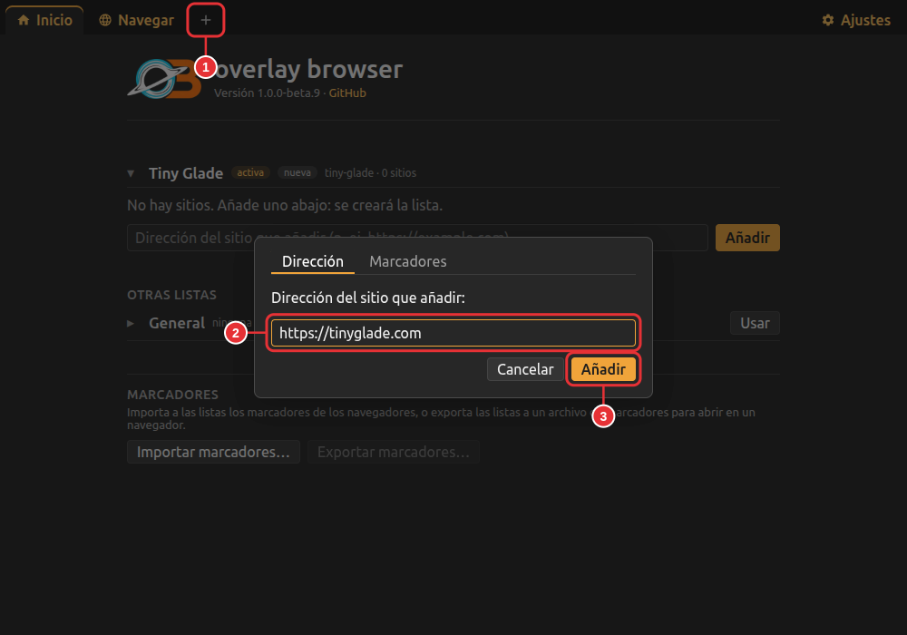
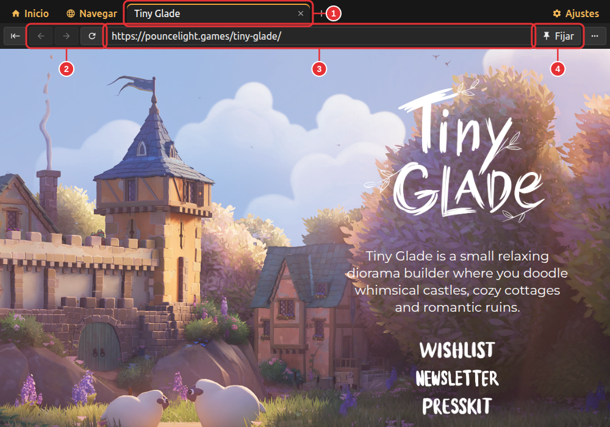
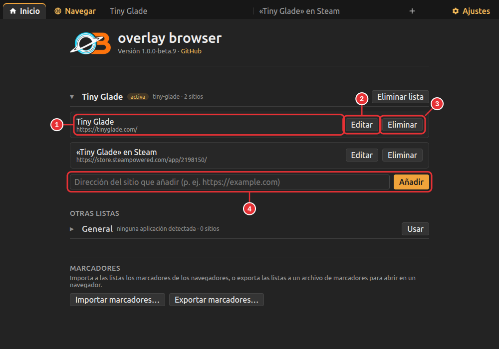
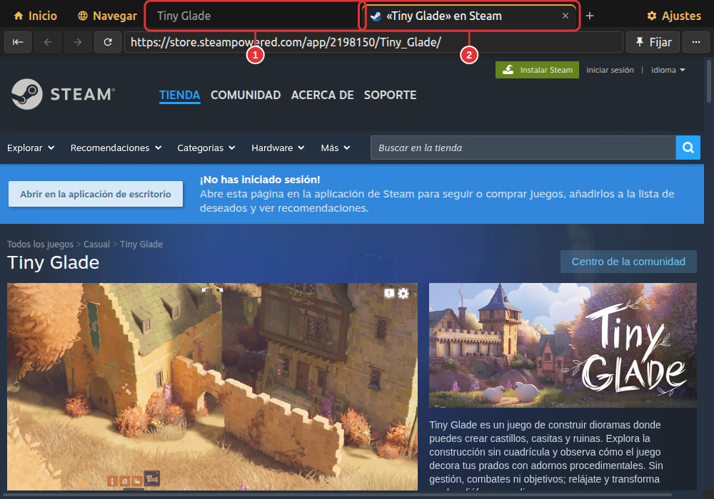

# Primeros pasos para tener a mano los sitios de tu juego

En esta guía abres Overlay Browser mientras juegas a **Tiny Glade**, añades un par de sitios útiles y aprendes a mostrarlos y ocultarlos sin salir del juego.

En las capturas de pantalla, los elementos citados en el texto están resaltados con un recuadro rojo; los números como ❶ en el texto indican el elemento con el mismo número en la captura.

## 1. Inicia la aplicación

Inicia Overlay Browser. La ventana **permanece oculta** y la aplicación queda en el área de notificación, junto al reloj. No aparece en la barra de tareas ni en Alt+Tab.

A continuación, inicia el juego en modo ventana o ventana sin bordes.

## 2. Abre el overlay sobre el juego

Mientras juegas, pulsa **Win+F10** (Super+F10 en Linux, Cmd+Mayús+Espacio en macOS). El overlay aparece sobre el juego y muestra **Inicio**.

El overlay ha reconocido el juego. Arriba está la lista **Tiny Glade** ❶, *activa* y aún *nueva*. Cada juego tiene su propia lista de sitios, que se crea al añadir el primero. En *Otras listas* está **General** ❷, la lista que se usa cuando no hay ningún juego abierto. Pulsa **Usar** para activarla manualmente.

## 3. Añade un sitio

Haz clic en **+** ❶ en la barra superior, escribe la **dirección** del sitio ❷ (basta con `tinyglade.com`) y pulsa **Añadir** ❸.

El sitio se abre enseguida en su **pestaña** ❶, que toma el título de la página. Ciérrala con **×**. Debajo está la barra de navegación, como en un navegador, con los botones **Atrás**, **Adelante** y **Recargar** ❷. En el campo de **dirección** ❸ puedes escribir otra y pulsar Intro. **Fijar** ❹ convierte la página a la que has llegado en una pestaña nueva.

## 4. Añade más sitios desde Inicio

Vuelve a **Inicio** para ver los sitios de la lista. Haz clic en el **nombre de un sitio** ❶ para abrirlo, en **Editar** ❷ para cambiar la dirección (Intro guarda y Esc cancela) y en **Eliminar** ❸ para quitarlo de la lista. Para añadir un sitio, escribe su dirección en el **campo debajo de la lista** ❹ y pulsa *Añadir*. Aquí hemos añadido la página del juego en Steam.

## 5. Cambia de sitio

Cada sitio tiene su pestaña. Aquí están el **sitio oficial** ❶ y la **página de Steam** ❷, que es la que está abierta. Al volver a una pestaña encuentras la página donde la dejaste.

## 6. Vuelve al juego

Pulsa de nuevo **Win+F10** para ocultar el overlay o haz clic en la ventana del juego. Por defecto, el overlay se oculta al perder el foco. Puedes desactivar esta opción en Ajustes.

La próxima vez que abras el overlay sobre Tiny Glade encontrarás su lista en la última pestaña que estabas usando. Si lo abres sobre otro juego, verás la lista de ese juego.
