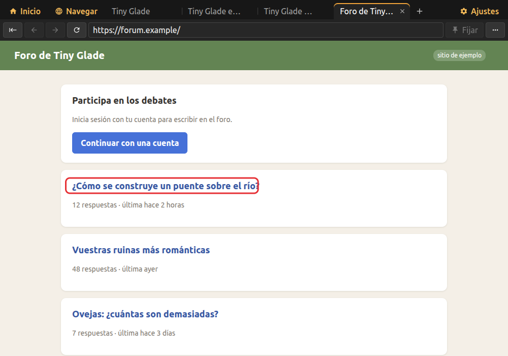
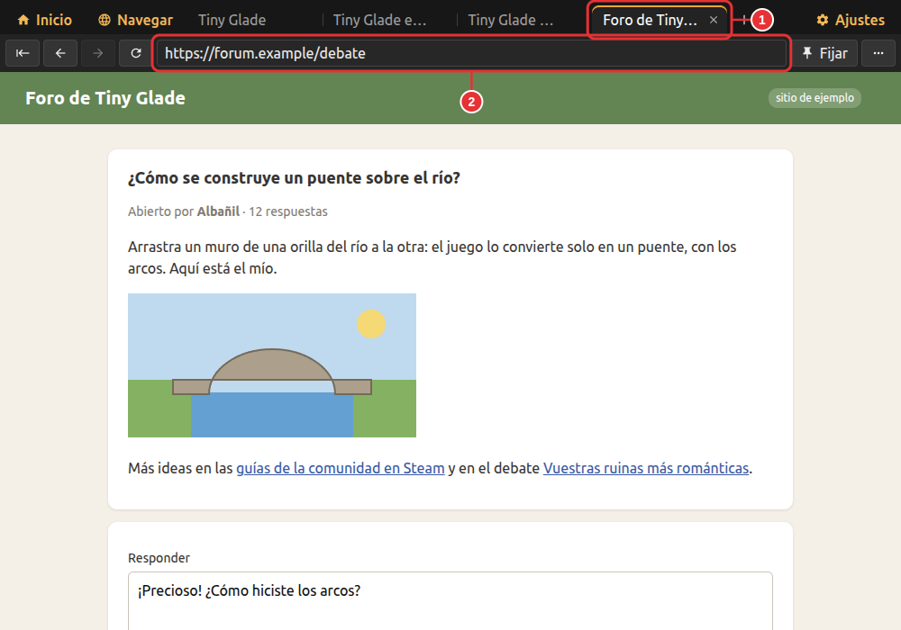
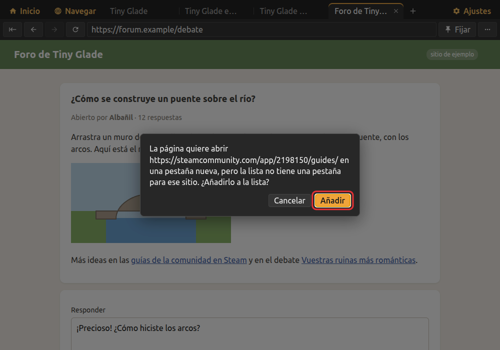
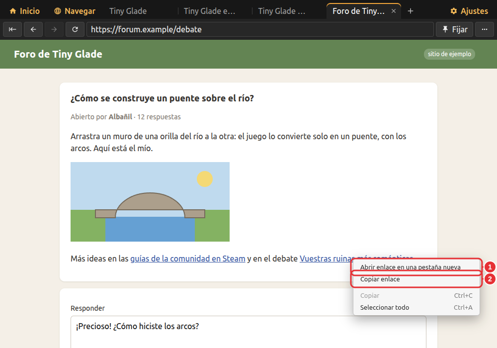
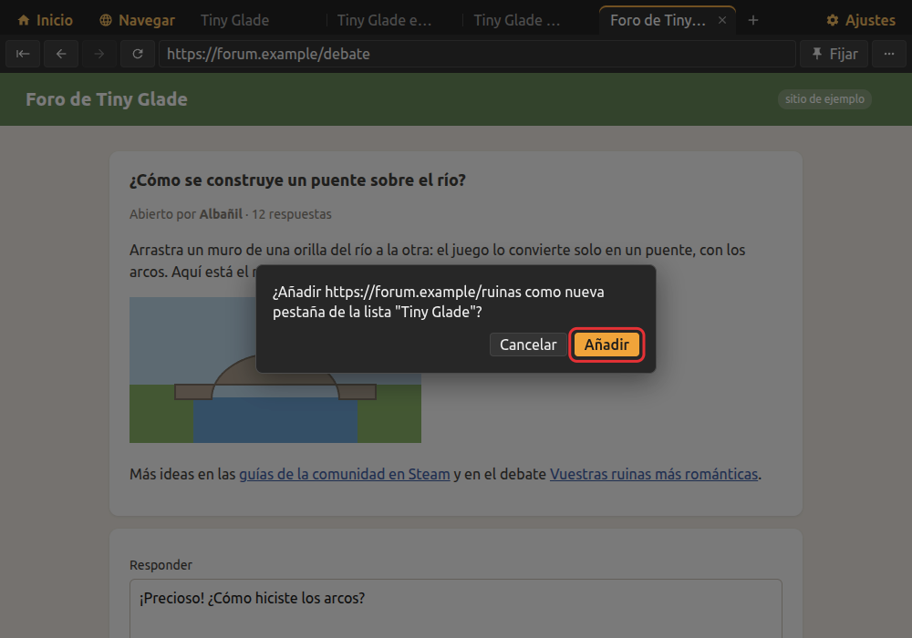
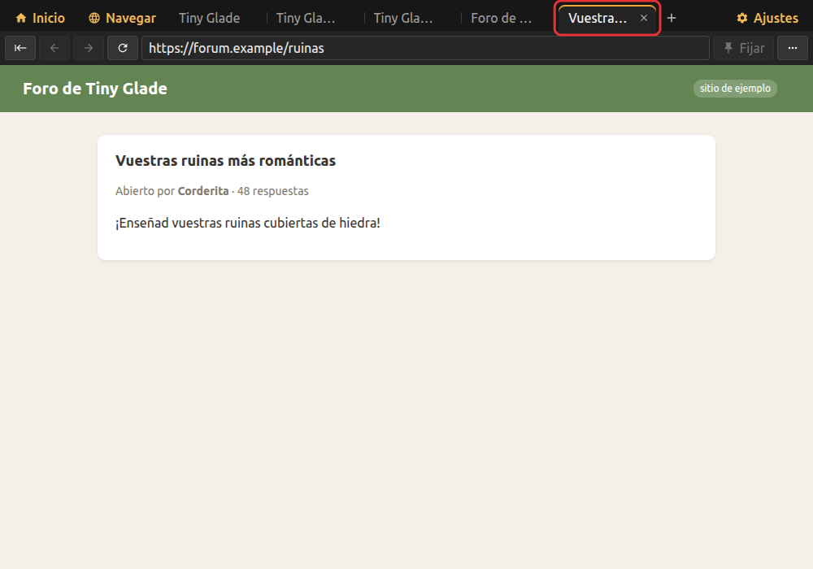
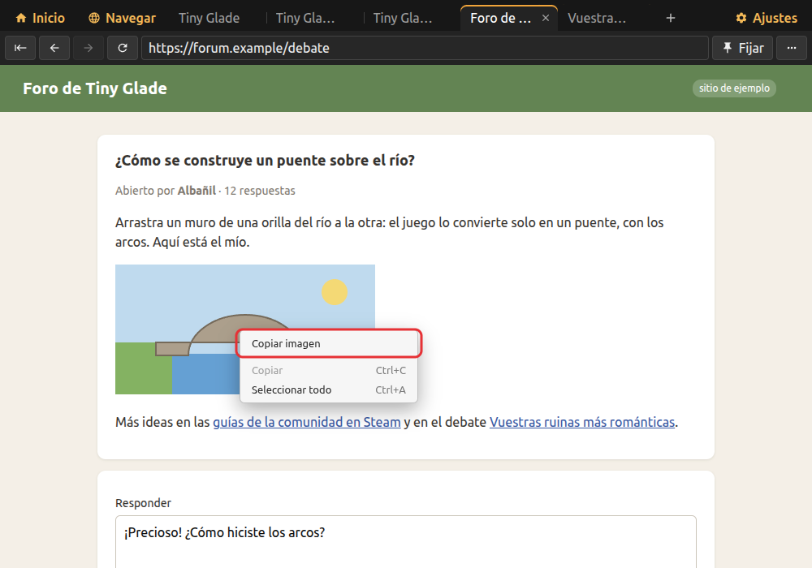
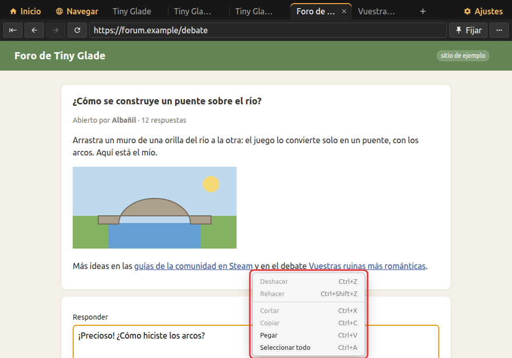

# Enlaces, pestañas nuevas y menú contextual

En un navegador muchos enlaces se abren en una pestaña nueva. En el overlay, las pestañas corresponden a los sitios de la lista. Estos enlaces se abren en la pestaña del sitio de origen o, tras una confirmación, en una nueva. Con el botón derecho puedes abrir un enlace en otra pestaña o copiar enlaces, imágenes y texto.

La lista de **Tiny Glade** incluye un foro, un **sitio de ejemplo** creado para esta guía. Consulta [Iniciar sesión en un sitio y eliminar sus cookies](signing-in.md).

En las capturas de pantalla, los elementos citados en el texto están resaltados con un recuadro rojo; los números como ❶ en el texto indican el elemento con el mismo número en la captura.

## 1. Un enlace que el sitio abre en otra pestaña

Algunos enlaces se crean para abrirse en una pestaña nueva, como el de este debate. Lo mismo ocurre al pulsar un enlace con Ctrl o con el botón central del ratón.

## 2. El mismo sitio se abre en su pestaña

Si el enlace lleva al mismo sitio, se abre en la **pestaña del sitio** ❶ en lugar de la página anterior. Ahora la **dirección** ❷ es la del debate. **Atrás** recupera la página anterior.

Si hay varias pestañas del mismo sitio en la lista, el enlace se abre en la pestaña de origen.

## 3. Otro sitio requiere confirmación

Si el enlace lleva a un sitio que no tiene pestaña, como las guías de la comunidad en Steam, el overlay pregunta si quieres añadirlo a la lista. **Añadir** agrega el sitio y lo abre. **Cancelar** te deja en la página actual.

Los enlaces abiertos desde **Navegar** se quedan en esa pestaña. Consulta [Navegación libre](free-browsing.md).

## 4. Botón derecho sobre un enlace

Al hacer clic con el botón derecho en un enlace, el menú muestra **Abrir enlace en una pestaña nueva** ❶ y **Copiar enlace** ❷, que copia su dirección.

**Abrir enlace en una pestaña nueva** pide confirmación antes de añadirlo a la lista. Pulsa **Añadir**.

El enlace se abre en una **pestaña nueva**, justo después de la pestaña de origen. Si ya hay una pestaña con esa dirección en la lista, el overlay la muestra.

## 5. Botón derecho sobre imágenes y texto

Sobre una imagen aparece **Copiar imagen** para pegarla, por ejemplo, en un chat. Sobre el texto de una página aparecen **Copiar**, para el texto seleccionado, y **Seleccionar todo**.

En campos de texto, como el de respuesta del foro o el de dirección, aparecen **Deshacer**, **Rehacer**, **Cortar**, **Copiar**, **Pegar** y **Seleccionar todo**. Las opciones que no se pueden usar en ese momento aparecen atenuadas, como *Copiar* si no hay texto seleccionado.

