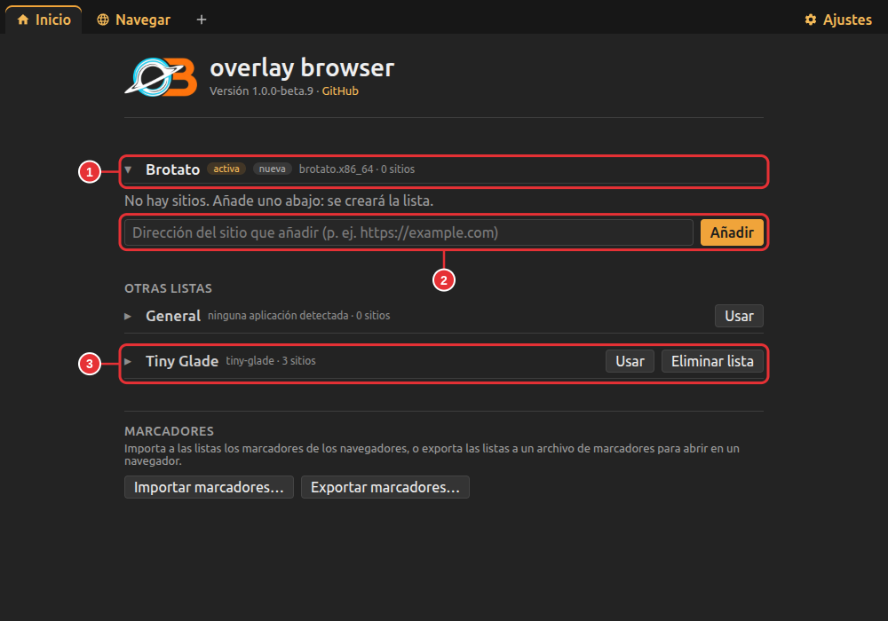
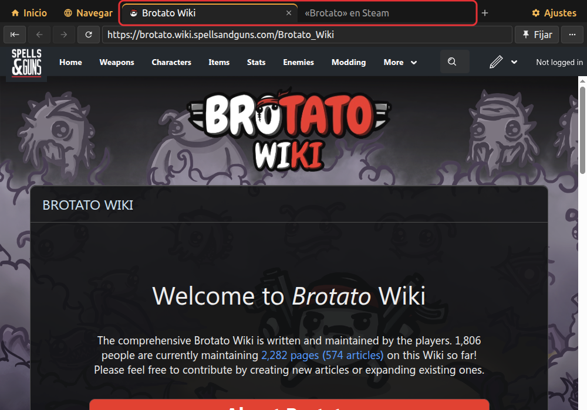
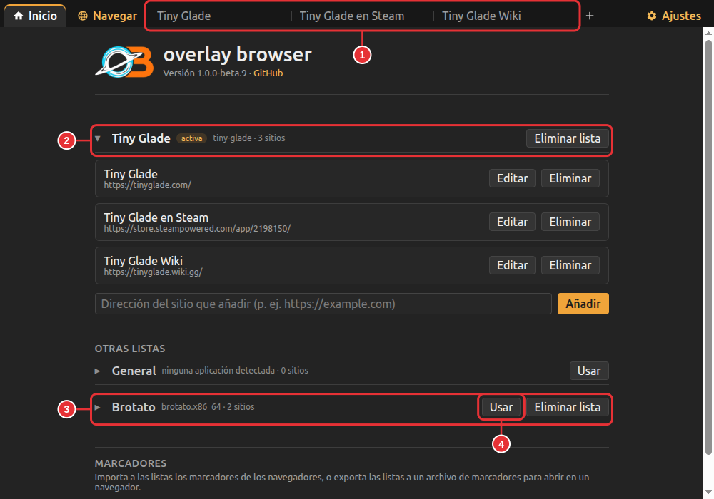
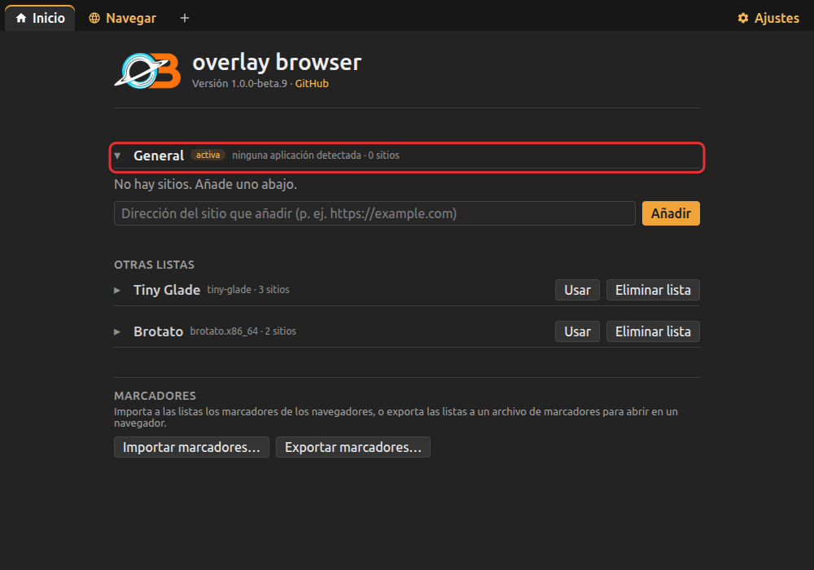
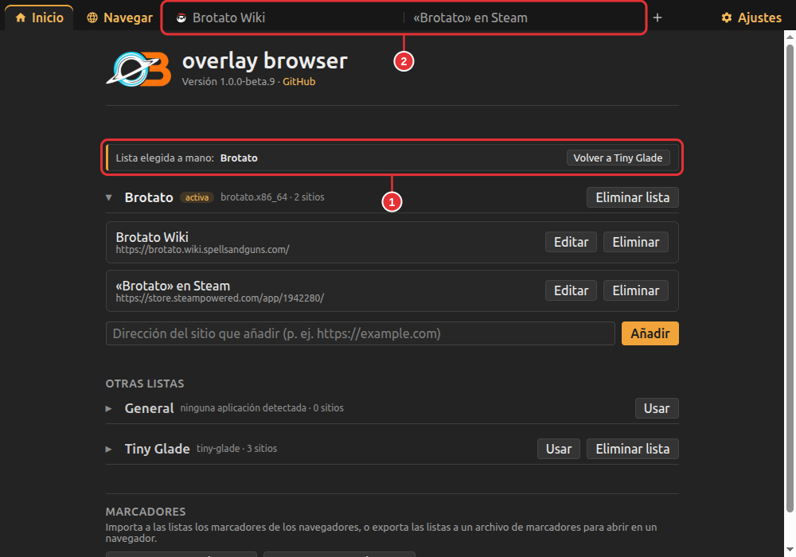
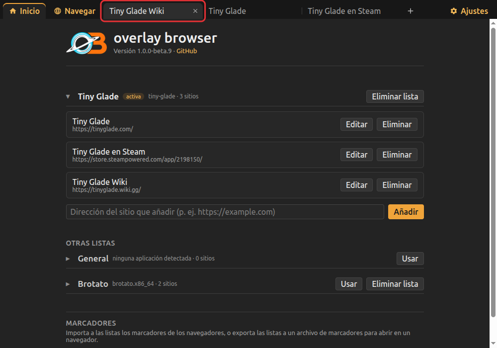
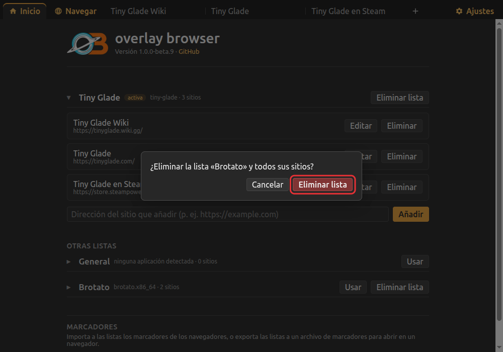

# Una lista por juego

Overlay Browser reconoce el juego sobre el que lo abres y muestra sus sitios. Cada juego tiene su propia **lista**. Tras [Primeros pasos](getting-started.md) y [Navegación libre](free-browsing.md), la lista de **Tiny Glade** ya tiene tres sitios. Ahora vamos a jugar a **Brotato**.

En las capturas de pantalla, los elementos citados en el texto están resaltados con un recuadro rojo; los números como ❶ en el texto indican el elemento con el mismo número en la captura.

## 1. Un juego nuevo, una lista nueva

Abre el overlay mientras juegas a Brotato. Arriba en Inicio está la **lista de Brotato** ❶, *activa* y aún *nueva*. Junto al nombre verás el programa reconocido y el número de sitios. Añade un sitio en el **campo debajo de la lista** ❷ o desde **+** en la barra superior. La lista se crea al añadir el primer sitio. La **lista de Tiny Glade** ❸ está plegada en *Otras listas*. Haz clic en ella para ver sus sitios.

Aquí añadimos la wiki de Brotato y su página de Steam. La barra muestra solo las pestañas de Brotato.

## 2. Cada juego recupera sus sitios

Vuelve a Tiny Glade y abre el overlay. La barra muestra las **pestañas de Tiny Glade** ❶ y la **lista de Tiny Glade** ❷ es la activa. La **lista de Brotato** ❸ ha pasado a *Otras listas*. Con **Usar** ❹ puedes activarla manualmente (véase el paso 4). Cada lista vuelve a abrirse en la última pestaña que estabas usando.

## 3. La lista General

El overlay ofrece una lista para cualquier programa sobre el que lo abras. Cuando no reconoce ninguna aplicación, la **lista General** queda activa. Sirve para sitios que no están ligados a un programa concreto. Funciona como las demás y no se puede eliminar.

## 4. Elige una lista a mano

Puede que quieras consultar los sitios de otro juego, por ejemplo la wiki de Brotato mientras tienes abierto Tiny Glade. Pulsa **Usar** junto a la lista que quieras (❹ en la captura del paso 2).

La lista queda activa como **Lista elegida a mano** ❶ incluso si abres el overlay sobre otros juegos. Pulsa **Volver a Tiny Glade** para recuperar la lista del juego sobre el que está abierto en ese momento. La barra muestra las **pestañas de la lista elegida** ❷.

## 5. Reordena pestañas y sitios

Arrastra una pestaña en la barra para moverla. Aquí la pestaña de Tiny Glade Wiki pasa a la primera posición.

También puedes arrastrar los sitios en Inicio. El orden es el mismo en ambos sitios.

## 6. Elimina una lista

**Eliminar lista**, junto a su nombre, borra la lista y todos sus sitios tras pedirte confirmación.

Si vuelves a añadir un sitio mientras juegas a Brotato, su lista se crea de nuevo.
