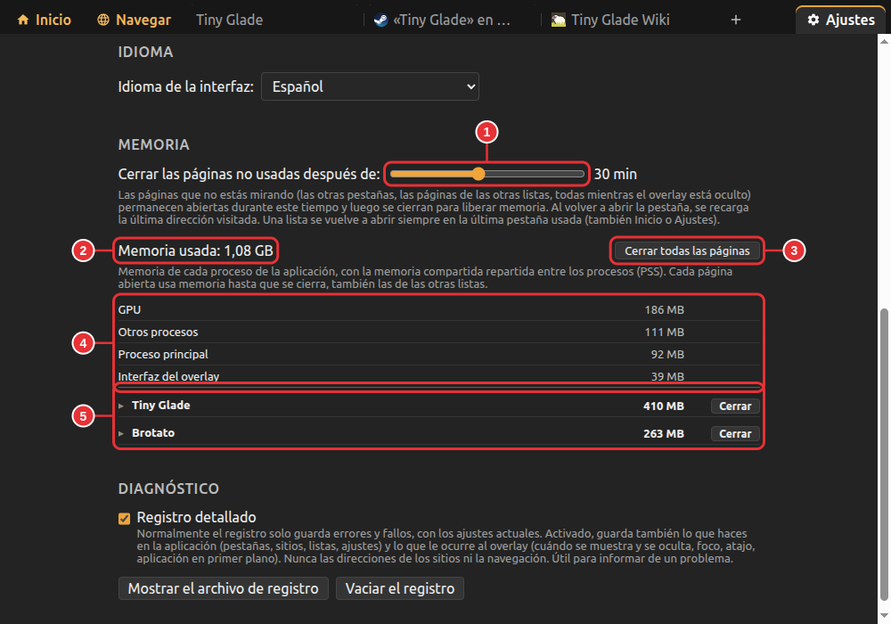
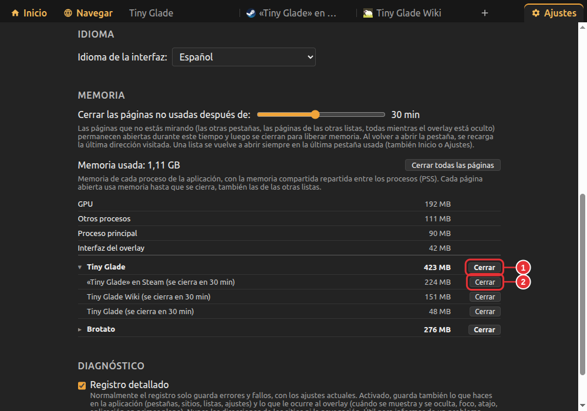
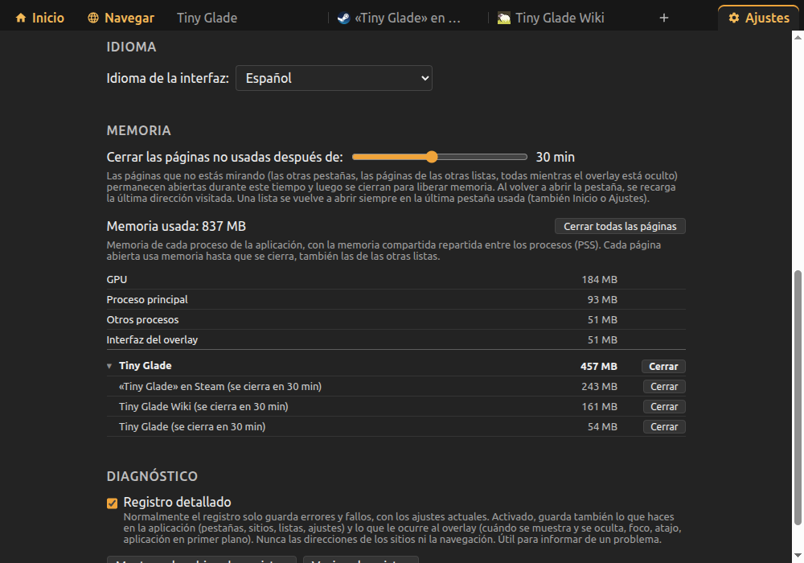

# Memoria y páginas cerradas

Cada página abierta en Overlay Browser usa memoria, como en un navegador, aunque no la estés viendo. Las páginas de otras listas también siguen abiertas. Para dejar memoria al juego, el overlay **cierra automáticamente las páginas que llevas un rato sin usar**. En Ajustes puedes consultar cuánta memoria usa y cerrar páginas a mano.

Aquí hay varias páginas abiertas en las listas de **Tiny Glade** y **Brotato**. Consulta [Una lista por juego](lists-per-game.md).

En las capturas de pantalla, los elementos citados en el texto están resaltados con un recuadro rojo; los números como ❶ en el texto indican el elemento con el mismo número en la captura.

## 1. Por qué se vuelve a cargar una página

Las páginas que no estás viendo quedan abiertas un rato y después se cierran. Esto incluye las demás pestañas, las páginas de otras listas y todas las páginas cuando el overlay está oculto. Al volver a abrir la pestaña, la página **se recarga desde la última dirección visitada**. Recuperas la página, aunque puedes perder la posición de desplazamiento o un formulario a medio rellenar.

La página que estás viendo sigue abierta.

## 2. La sección Memoria

Abre **Ajustes** y baja hasta *Memoria*.

- **Cerrar las páginas no usadas después de** ❶ fija el tiempo de espera entre 5 y 60 minutos. El valor inicial es 30 minutos. Si tienes poca memoria libre o el juego usa mucha, conviene reducirlo.
- **Memoria usada** ❷ muestra la memoria de toda la aplicación.
- **Cerrar todas las páginas** ❸ cierra de inmediato las páginas abiertas de todas las listas.
- **Procesos de la aplicación** ❹ incluye la interfaz, el proceso principal, los gráficos (GPU) y otros procesos. Estos usan memoria siempre.
- **Páginas agrupadas por lista** ❺ muestra la memoria de las páginas abiertas de cada lista. **Cerrar** cierra todas las páginas de esa lista.

## 3. Las páginas de una lista

Haz clic en el nombre de una lista para ver sus páginas abiertas, la memoria que usa cada una y el tiempo que le queda. **Cerrar** junto a la lista ❶ cierra todas sus páginas. **Cerrar** junto a una página ❷ cierra solo esa.

Algunas páginas comparten proceso, por ejemplo las del mismo sitio en listas distintas. Aparecen en una sola fila, fuera de los grupos. Se cierran juntas porque la memoria solo se libera cuando todas se cierran.

## 4. Después del cierre

Aquí cerramos las páginas de Brotato. Su grupo desaparece y baja la memoria usada. Las pestañas siguen en la lista y las páginas se recargan la próxima vez que las abras.

