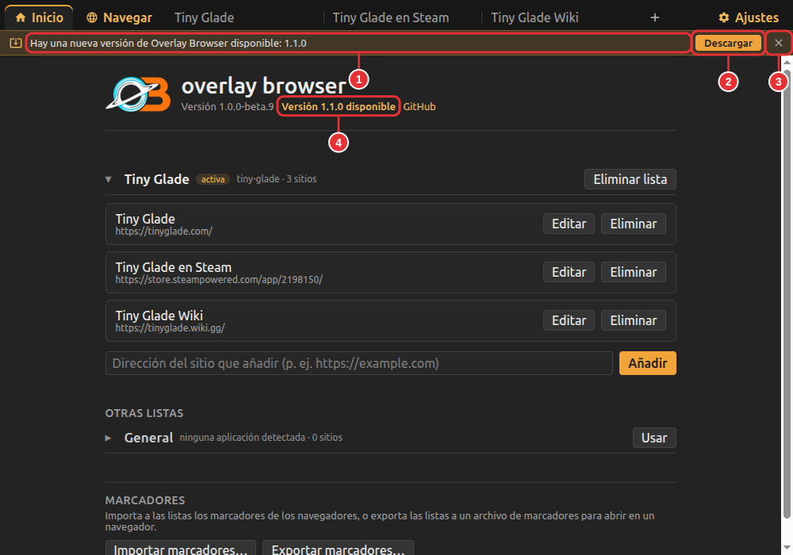
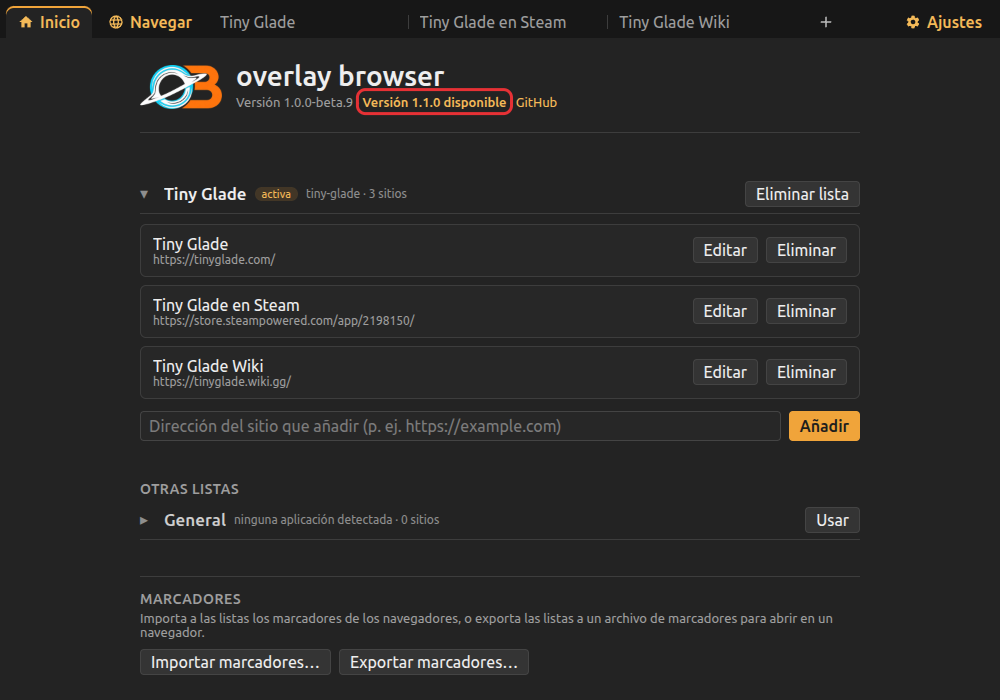
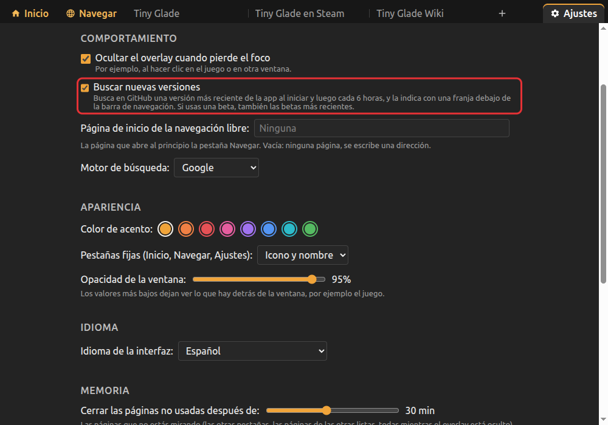

# Nuevas versiones

Overlay Browser comprueba si hay una versión nueva y te avisa. Tú eliges cuándo descargarla e instalarla.

En las capturas de pantalla, los elementos citados en el texto están resaltados con un recuadro rojo; los números como ❶ en el texto indican el elemento con el mismo número en la captura.

## 1. Aviso de una nueva versión

Cuando sale una versión nueva, aparece una **franja** ❶ bajo la barra superior con su número. **Descargar** ❷ abre en el navegador del sistema la página donde puedes descargar el archivo para tu sistema. Consulta la instalación en el [README](../../README.md). Pulsa **×** ❸ para cerrar la franja de esa versión de forma permanente.

La nueva versión también aparece arriba en **Inicio** ❹, junto a la que usas. Haz clic en ella para abrir la misma página.

Al cerrar la franja, la versión nueva sigue apareciendo en Inicio hasta que instales la actualización.

## 2. Cuándo se comprueba

La aplicación consulta las publicaciones del proyecto en GitHub poco después de arrancar y luego cada seis horas. Si usas una beta, también te avisa de las betas posteriores. En los demás casos solo te avisa de versiones finales.

Para dejar de recibir avisos, desactiva **Buscar nuevas versiones** en **Ajustes**, en *Comportamiento*. La edición de Microsoft Store recibe las actualizaciones desde la tienda y carece de esta opción.

