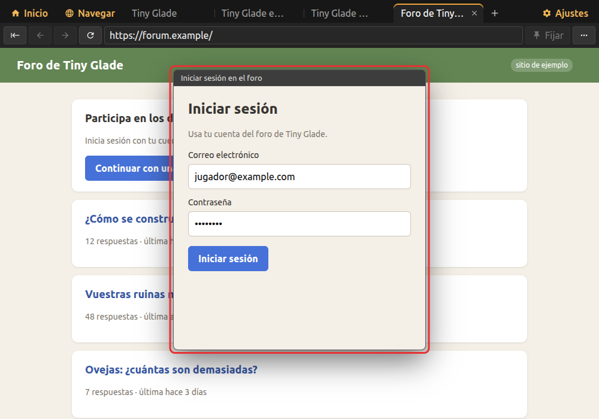
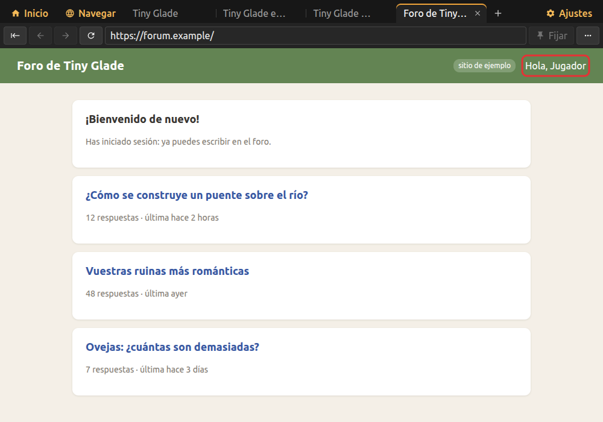
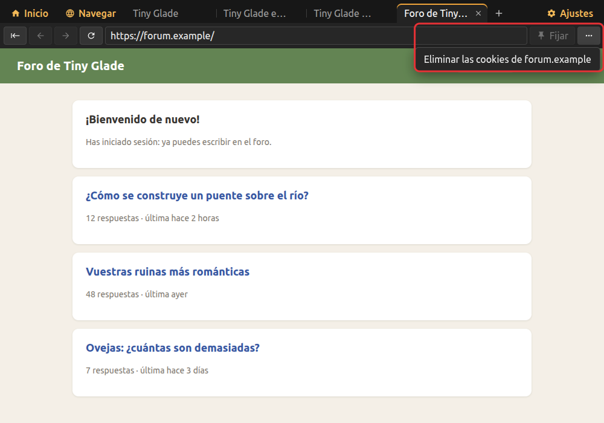
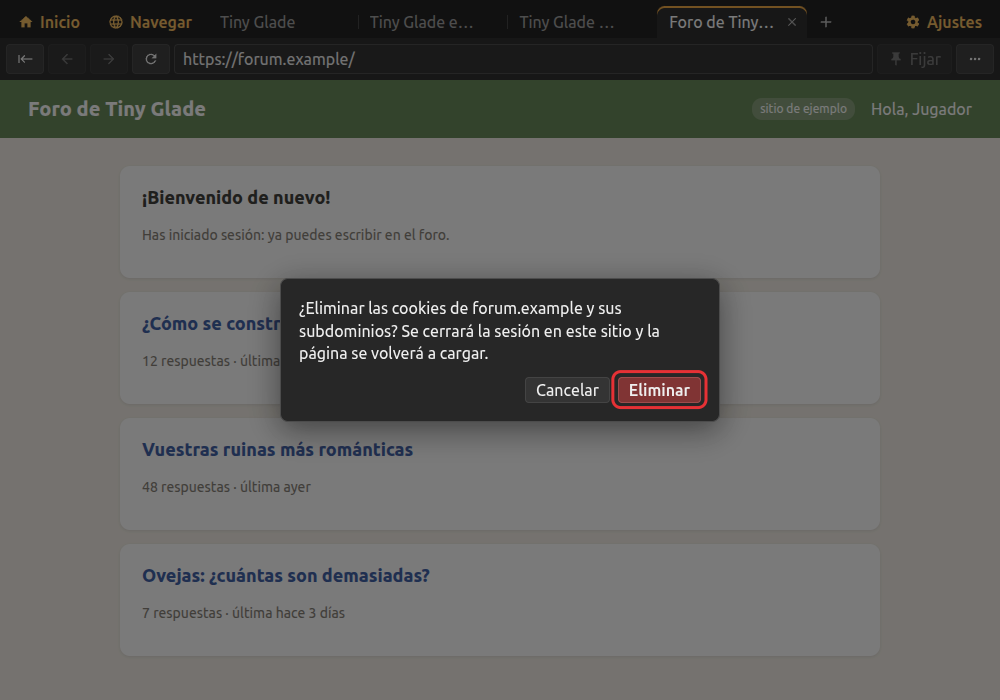
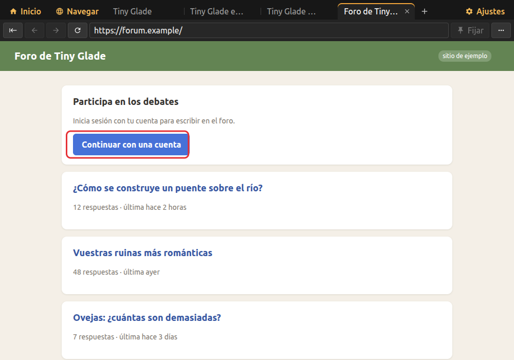

# Iniciar sesión en un sitio y eliminar sus cookies

Muchos sitios de juegos, como foros, wikis o herramientas para planificar configuraciones, funcionan mejor con una cuenta o exigen iniciar sesión. En el overlay inicias sesión como en un navegador y la sesión queda guardada. Si el sitio deja de funcionar bien o quieres cerrar la sesión, puedes eliminar sus cookies.

La lista de **Tiny Glade** incluye un foro. Es un **sitio de ejemplo** creado para esta guía. El inicio de sesión funciona como en un sitio real, por ejemplo con *Continuar con Google*.

En las capturas de pantalla, los elementos citados en el texto están resaltados con un recuadro rojo; los números como ❶ en el texto indican el elemento con el mismo número en la captura.

## 1. Inicia sesión con tu cuenta

Abre la pestaña del sitio y pulsa el botón de acceso. Aquí es **Continuar con una cuenta**.

El sitio abre una **ventana de inicio de sesión** sobre el overlay. Introduce tus datos y confirma.

La ventana de inicio de sesión forma parte del overlay. Se mantiene encima y se oculta y vuelve a aparecer junto con él. Puedes pasar de una ventana a otra sin que se oculten. Al cerrar la ventana de inicio de sesión, el overlay vuelve a estar activo.

## 2. La sesión queda guardada

Una vez iniciada la sesión, la ventana se cierra y el sitio muestra tu **cuenta**.

La sesión se mantiene aunque cierres el overlay o reinicies la aplicación. Se comparte entre todas las listas que contengan el mismo sitio.

## 3. Elimina las cookies de un sitio

Las cookies son datos que el sitio guarda para recordarte, incluida la sesión. Puedes eliminarlas para **cerrar sesión**, por ejemplo si quieres usar otra cuenta, o cuando **un sitio deja de funcionar bien**.

En la pestaña del sitio, pulsa **…** (*Más acciones*) a la derecha de la dirección y elige **Eliminar las cookies de forum.example**.

Cuando el overlay pida confirmación, pulsa **Eliminar**. Se eliminan las cookies del sitio y sus subdominios. Los demás sitios conservan las suyas.

## 4. La página se vuelve a cargar

Al eliminar las cookies, la página se recarga. La sesión se ha cerrado y el sitio vuelve a ofrecerte **iniciar sesión**.

