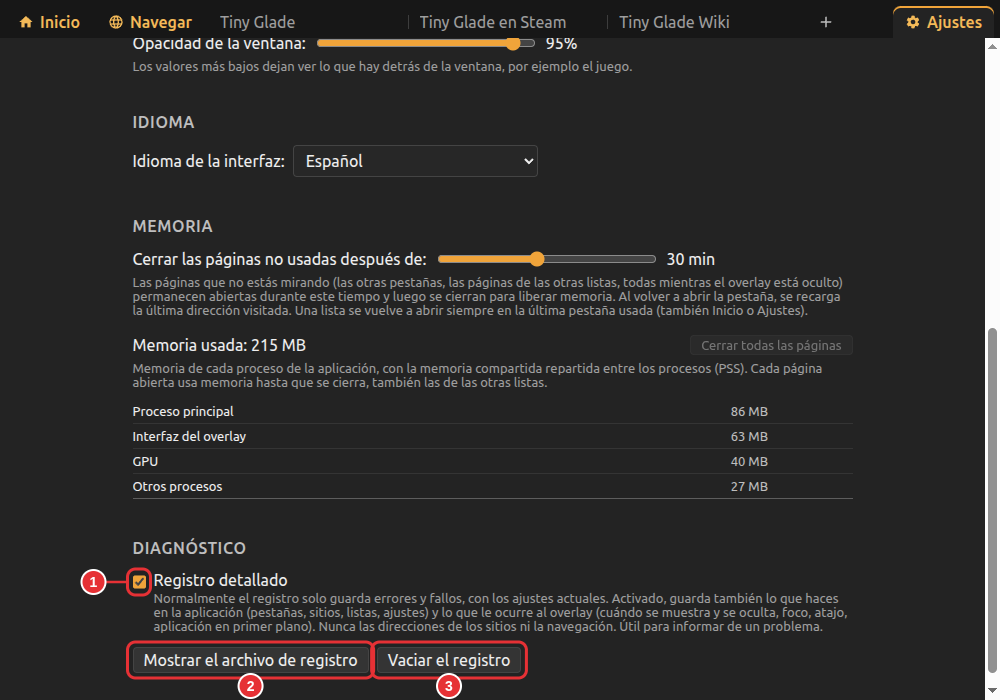
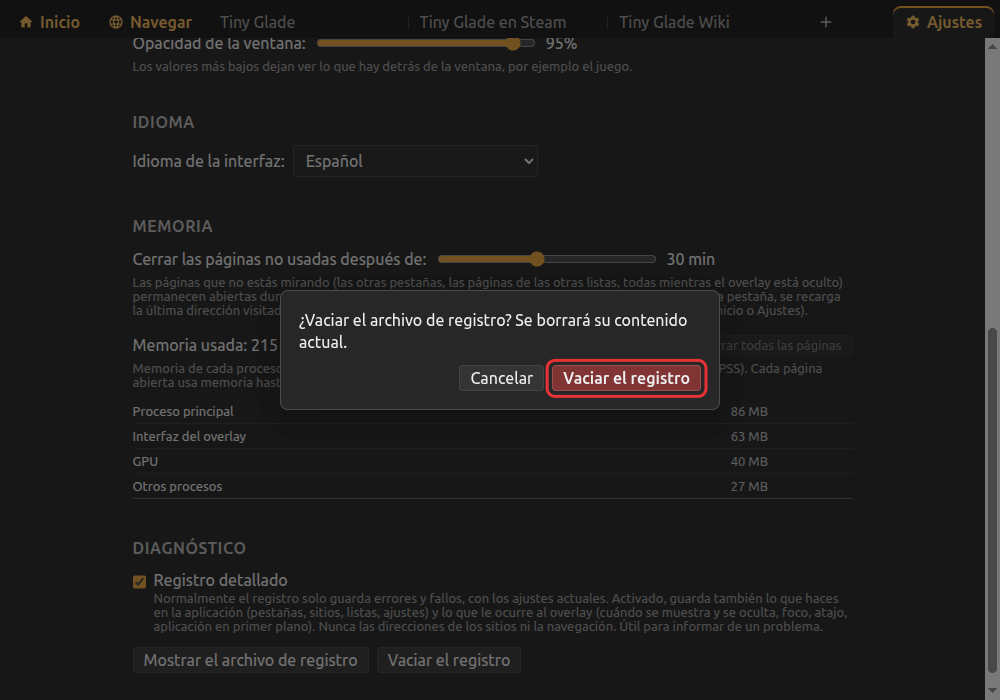

# Solución de problemas

Aquí verás cómo resolver problemas habituales y recopilar información para comunicarlos. Consulta el [README](../../README.md) para los detalles de Windows, Linux y macOS.

En las capturas de pantalla, los elementos citados en el texto están resaltados con un recuadro rojo; los números como ❶ en el texto indican el elemento con el mismo número en la captura.

## 1. La combinación de teclas no funciona

- **Ya la usa otro programa.** Si la eliges en Ajustes, el overlay indica «combinación no válida o ya en uso» y conserva la anterior. Elige otra. Consulta [Personaliza el overlay](customizing.md).
- **El juego la usa para un comando.** La combinación también llega al juego. Elige una que no ejecute nada en él.
- **Linux con Wayland.** La combinación no se detecta si hay una ventana nativa de Wayland activa. Usa una sesión X11. Consulta *Linux* en el [README](../../README.md#linux).
- **Teclas de función en macOS.** Por defecto, F1 a F12 controlan el brillo, el volumen y otros ajustes. Púlsalas junto con **fn** o cambia los ajustes del teclado. Consulta *macOS* en el [README](../../README.md#macos).

También puedes mostrar el overlay desde el icono del área de notificación.

## 2. No encuentro el icono

La aplicación está en el área de notificación, cerca del reloj. No aparece en la barra de tareas ni en Alt+Tab.

- **Windows**. Si no ves el icono, pulsa **^** y arrástralo a la barra de tareas para que quede visible.
- **Linux con GNOME**. Necesitas la extensión *AppIndicator and KStatusNotifierItem Support*. Si al hacer clic en el icono se abre el menú, elige *Mostrar*.
- **macOS**. El icono está arriba a la derecha, en la barra de menús.

## 3. El overlay no aparece sobre el juego o es opaco

- **El juego tapa el overlay.** Algunos juegos a pantalla completa exclusiva cubren todas las ventanas. Cambia a modo *ventana sin bordes*.
- **La ventana es opaca en Linux.** La transparencia requiere un gestor de ventanas con composición activa, como Cinnamon, KDE, GNOME o Xfce con composición activada.

## 4. Un sitio falla o una página se vuelve a cargar

- **Un sitio deja de funcionar bien o quieres cerrar sesión.** Borra sus cookies desde el menú **…**. Consulta [Iniciar sesión en un sitio y eliminar sus cookies](signing-in.md).
- **La página se recarga al volver a su pestaña.** Las páginas que no usas se cierran al cabo de un tiempo para liberar memoria. Consulta [Memoria y páginas cerradas](memory.md).
- **Quieres empezar de cero.** Sal de la aplicación y borra el archivo de preferencias. Consulta *Preferences and uninstalling* en el [README](../../README.md#preferences-and-uninstalling).

## 5. Recopila información para informar de un problema

Si el problema persiste, puedes comunicarlo en la [página de incidencias del proyecto](https://github.com/siculo/overlay-browser/issues). El archivo de registro ayuda a entender qué ocurrió.

Abre *Diagnóstico* en **Ajustes**.

- **Registro detallado** ❶ guarda habitualmente los errores y cierres inesperados con los ajustes actuales. Al activarlo, también registra las acciones en la aplicación (pestañas, sitios, listas y ajustes) y lo que le ocurre al overlay (visibilidad, foco, combinación de teclas y aplicación en primer plano). Actívalo y repite lo que provoca el problema.
- **Mostrar el archivo de registro** ❷ abre la carpeta que contiene `overlay.log` para que puedas adjuntarlo al informe.
- **Vaciar el registro** ❸ borra su contenido, por ejemplo para registrar únicamente el problema que quieres comunicar.

El registro no guarda las teclas que pulsas ni tu navegación, incluidas direcciones y títulos de páginas. Solo identifica los sitios por su posición en la lista.

**Vaciar el registro** te pide confirmación antes de borrar el contenido.

