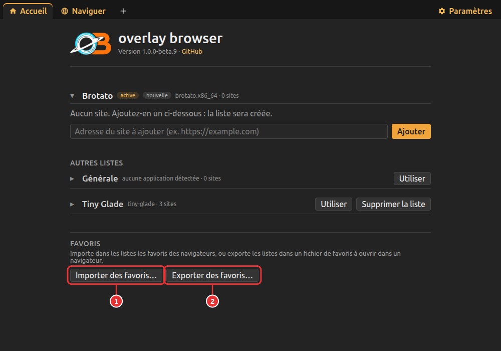
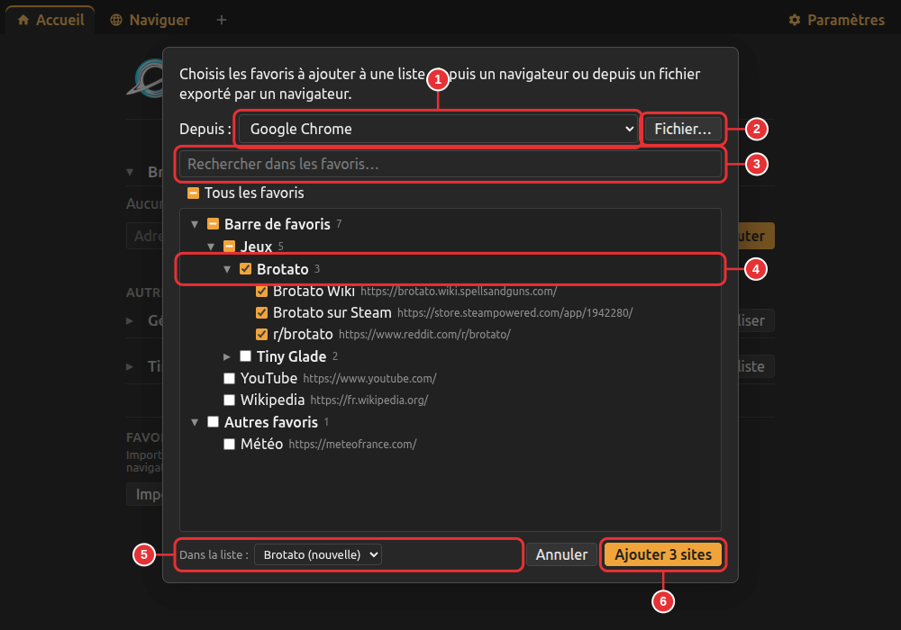
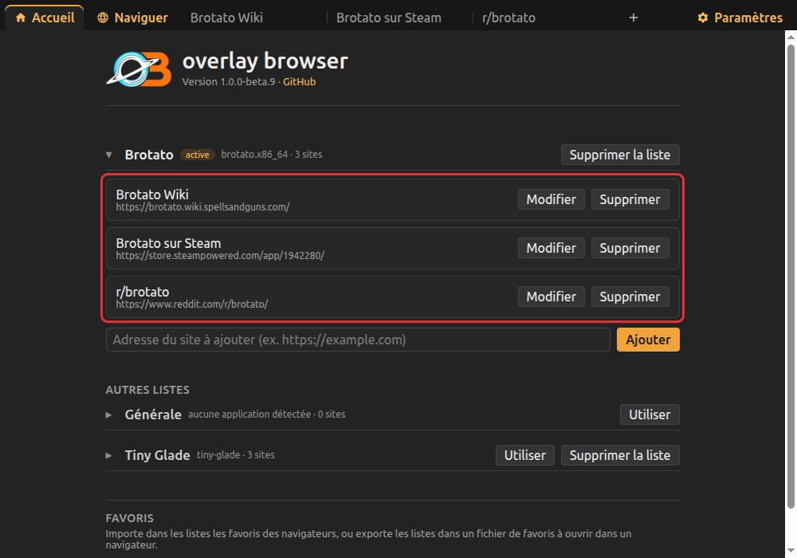
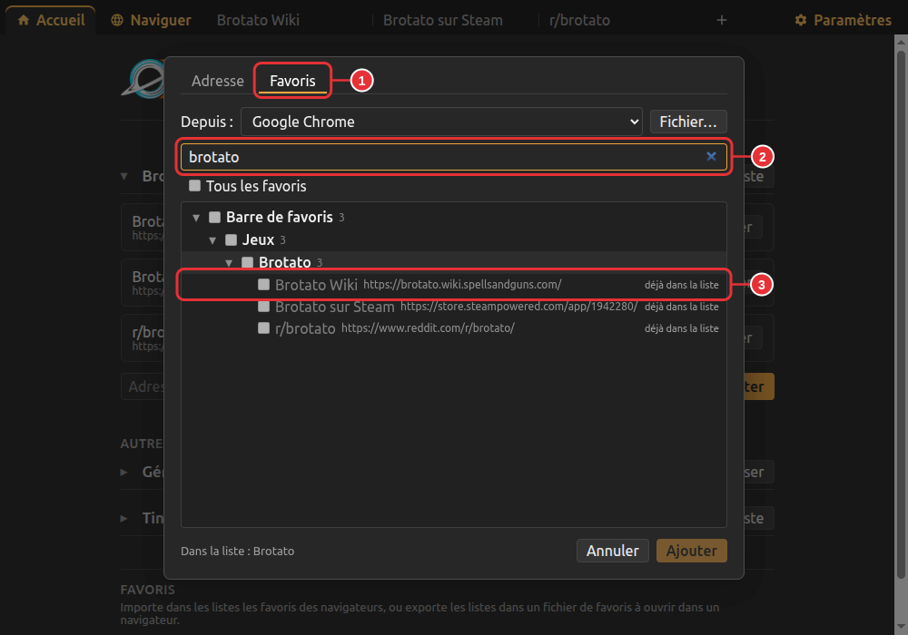
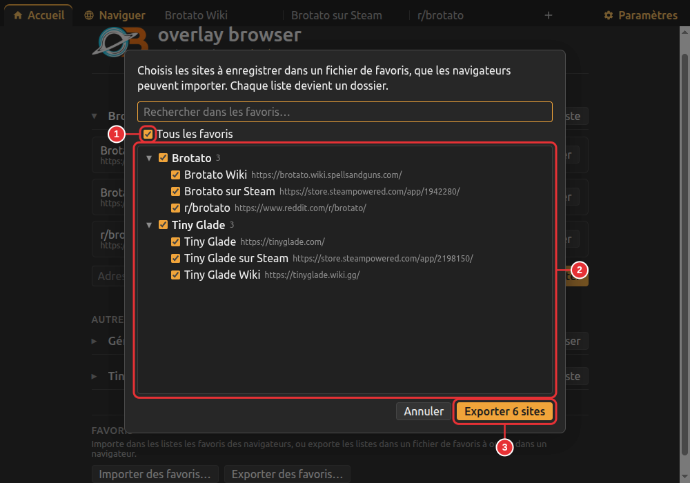

# Importer et exporter les favoris

Tu as déjà les sites de tes jeux dans les favoris de ton navigateur ? Tu peux les importer dans les listes d’Overlay Browser sans les ressaisir, et exporter les listes dans un fichier de favoris à ouvrir dans n’importe quel navigateur.

Ici l’overlay est ouvert par-dessus **Brotato**, dont la liste est encore vide, et la liste de **Tiny Glade** a déjà trois sites (voir [Une liste par jeu](lists-per-game.md)).

Dans les captures d’écran, les éléments cités dans le texte sont mis en évidence en rouge ; les numéros comme ❶ dans le texte indiquent l’élément portant le même numéro dans la capture.

## 1. La section Favoris de l’Accueil

En bas de l’**Accueil** se trouve la section *Favoris*, avec **Importer des favoris…** ❶ et **Exporter des favoris…** ❷.

## 2. Choisis les favoris à importer

Clique sur **Importer des favoris…**. Dans la fenêtre :

- **Depuis** ❶ : le navigateur dont lire les favoris, un par profil. L’overlay les trouve tout seul : Chrome, Edge, Brave, Opera, Vivaldi, Chromium, Firefox, LibreWolf et d’autres navigateurs similaires ; Firefox peut rester ouvert. La fois suivante, il repropose le dernier navigateur choisi.
- **Fichier…** ❷ : importe plutôt un fichier HTML de favoris, exporté depuis le gestionnaire de favoris de n’importe quel navigateur. Sous macOS c’est le seul moyen : exporte d’abord les favoris depuis le navigateur.
- **Rechercher** ❸ : trouve des favoris et des dossiers par nom ou par adresse.
- **Les cases** ❹ : coche des favoris un par un ou des dossiers entiers ; *Tous les favoris* les sélectionne tous. Ici nous cochons le dossier *Brotato*.
- **Dans la liste** ❺ : la liste où les ajouter, au départ la liste active. Si elle est encore *nouvelle*, comme ici celle de Brotato, elle est créée avec les sites importés.
- **Ajouter** ❻ : le bouton indique combien de sites tu vas ajouter.

Les favoris deviennent des sites de la liste, avec leur nom :

## 3. Importer depuis le « + »

Tu peux aussi importer depuis le **+** de la barre du haut, dans l’onglet **Favoris** ❶, à côté d’*Adresse* : ici les sites vont toujours dans la liste active. La **recherche** ❷ trouve les favoris ; ceux dont l’adresse est **déjà dans la liste** ❸ sont grisés et ne peuvent pas être choisis, donc importer deux fois ne crée pas de doublons.

## 4. Exporter les listes

**Exporter des favoris…**, dans la section *Favoris* de l’Accueil, enregistre les sites des listes dans un fichier HTML de favoris que n’importe quel navigateur peut importer. Chaque liste devient un dossier. Au départ **tous les favoris** ❶ sont choisis ; dans la **liste** ❷ tu peux retirer des listes ou des sites. **Exporter** ❸ demande où enregistrer le fichier.

