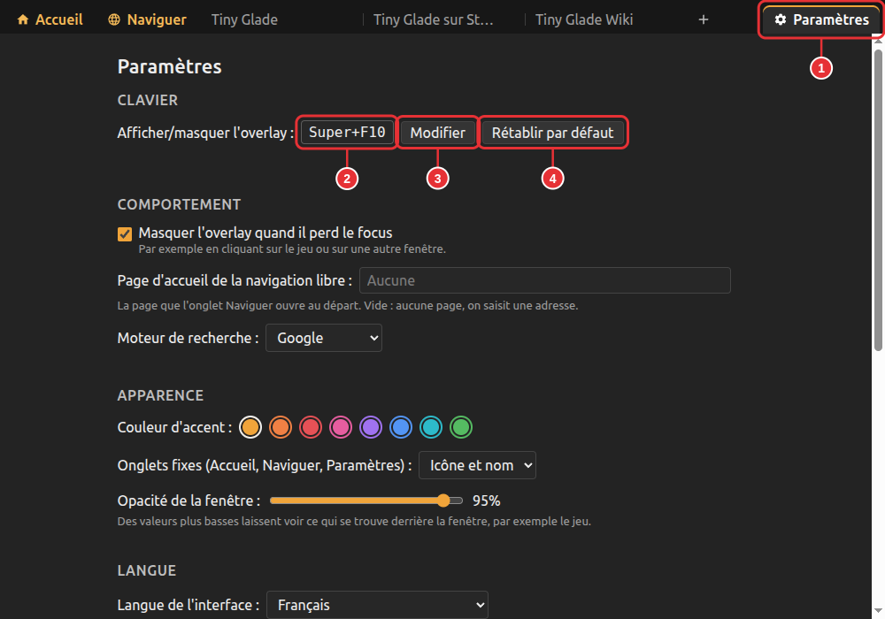
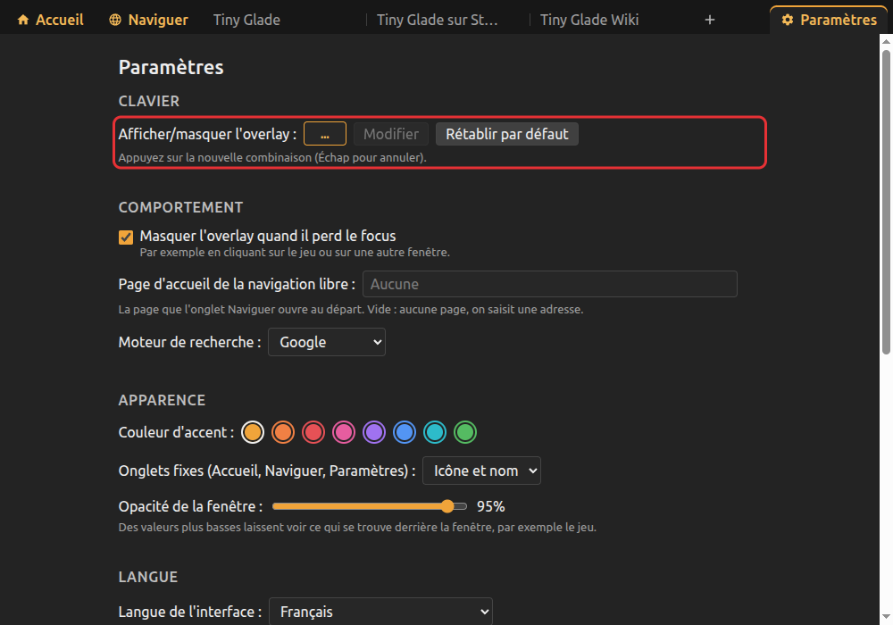
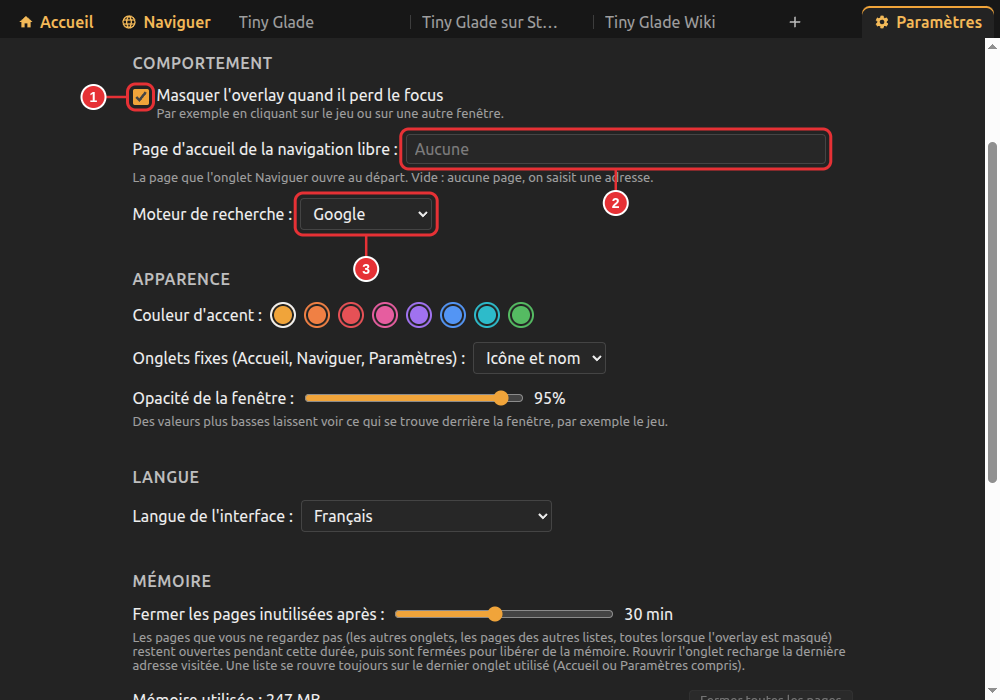
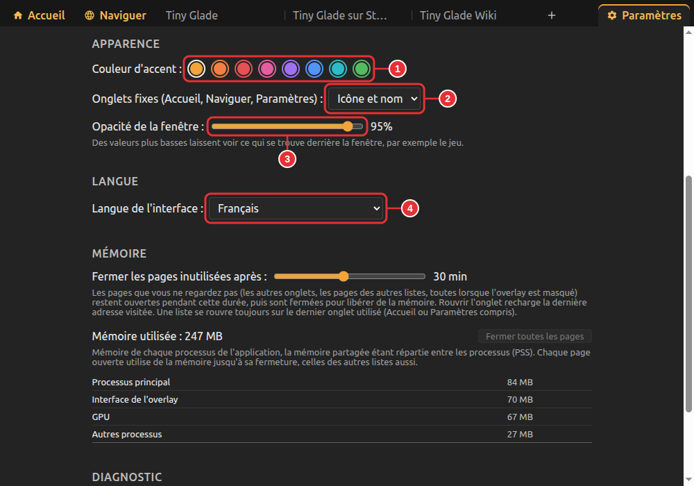
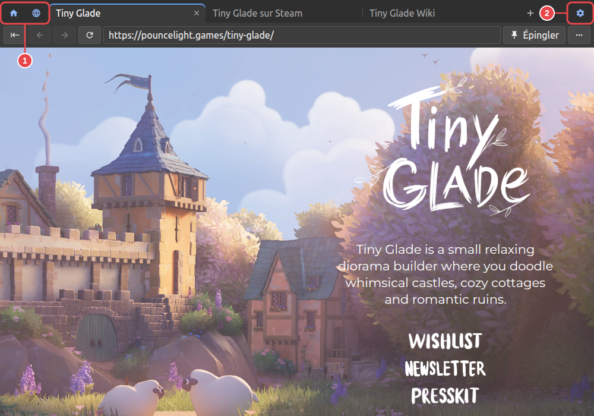

# Personnaliser l’overlay

Depuis la page **Paramètres**, tu choisis la combinaison de touches, le comportement de l’overlay, son apparence et sa langue. Chaque modification s’applique aussitôt et est mémorisée.

Dans les captures d’écran, les éléments cités dans le texte sont mis en évidence en rouge ; les numéros comme ❶ dans le texte indiquent l’élément portant le même numéro dans la capture.

## 1. La combinaison de touches

Ouvre l’onglet **Paramètres** ❶, en haut à droite (ou *Paramètres* dans le menu de l’icône de la zone de notification). Dans la section *Clavier*, tu vois la **combinaison actuelle** ❷ qui affiche et masque l’overlay. **Modifier** ❸ en enregistre une nouvelle ; **Rétablir par défaut** ❹ revient à celle par défaut (Win+F10, Super+F10 sous Linux, Cmd+Shift+Espace sous macOS).

Après **Modifier**, appuie sur la combinaison que tu préfères, par exemple `Ctrl+Shift+O` ; Échap annule.

Les touches F1–F24 sont acceptées seules, sinon n’importe quelle touche avec Ctrl, Alt, Shift ou Win (Super sous Linux, Cmd sous macOS). Si la combinaison est déjà utilisée par un autre programme, un message apparaît et la précédente reste.

> **Attention en jeu :** la combinaison arrive aussi au jeu, pas seulement à l’overlay. Choisis-en une que le jeu n’attribue à aucune commande, sinon en ouvrant l’overlay tu déclencheras aussi cette commande.

## 2. Le comportement

Dans la section *Comportement* :

- **Masquer l’overlay quand il perd le focus** ❶ : activé par défaut, l’overlay se masque tout seul quand tu cliques sur le jeu ou sur une autre fenêtre. Désactive-le si tu veux le garder visible pendant que tu joues ; il ne se masque alors qu’avec la combinaison de touches. La même option se trouve aussi dans le menu de l’icône de la zone de notification.
- **Page d’accueil de la navigation libre** ❷ : la page que l’onglet Naviguer ouvre au départ. Vide : aucune page (voir [Navigation libre](free-browsing.md)).
- **Moteur de recherche** ❸ : celui que l’onglet Naviguer utilise pour les textes qui ne sont pas des adresses : Google, Bing, DuckDuckGo, Brave Search, Ecosia, Startpage, ou *Personnalisé*, une adresse de recherche avec `%s` à la place du texte cherché.

Ici se trouve aussi *Rechercher les nouvelles versions*, qui signale sur l’Accueil quand une nouvelle version sort (absent de la version du Microsoft Store, qui se met à jour toute seule).

## 3. L’apparence et la langue

Dans la section *Apparence* :

- **Couleur d’accent** ❶ : la couleur des onglets fixes, des boutons principaux et des détails de l’interface.
- **Onglets fixes** ❷ : Accueil, Naviguer et Paramètres avec icône et nom, ou *Icône seule* pour laisser plus de place aux onglets des sites.
- **Opacité de la fenêtre** ❸ : avec des valeurs plus basses, la fenêtre devient transparente et tu vois le jeu derrière (de 30 % à 100 %, c’est-à-dire opaque).

Dans la section *Langue*, **Langue de l’interface** ❹ : par défaut *Langue du système*, c’est-à-dire celle du système si l’application l’a (italien, anglais, français, portugais, russe, espagnol et allemand), sinon l’anglais.

Voici l’overlay avec la couleur d’accent bleue et les **onglets fixes avec l’icône seule** ❶ ❷. L’opacité ne se voit pas dans la capture, qui ne montre que la fenêtre et pas le jeu derrière.

## Les autres sections

Plus bas, la section *Mémoire* indique combien de mémoire l’application utilise et au bout de combien de temps fermer les pages que tu ne regardes pas ; la section *Diagnostic* sert à recueillir des informations à joindre à un signalement de problème.
