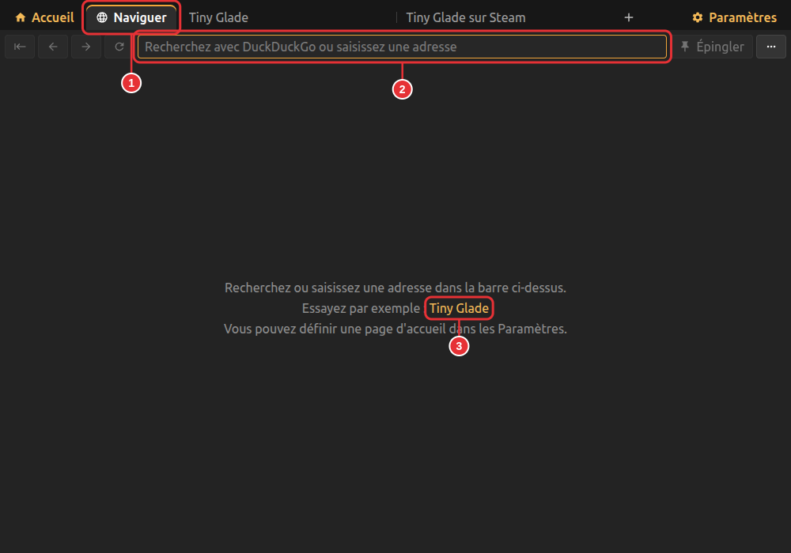
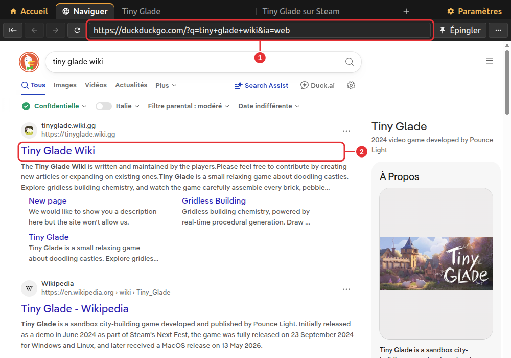
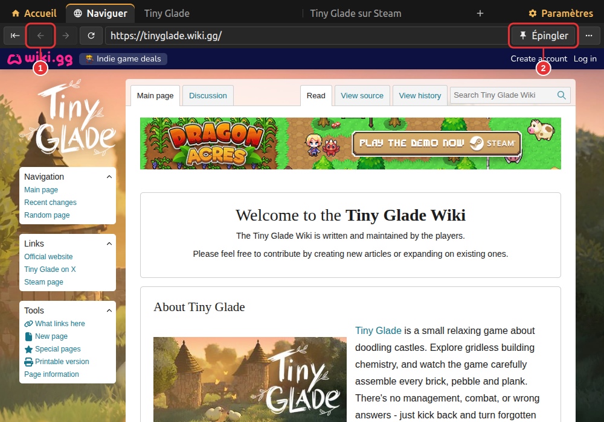
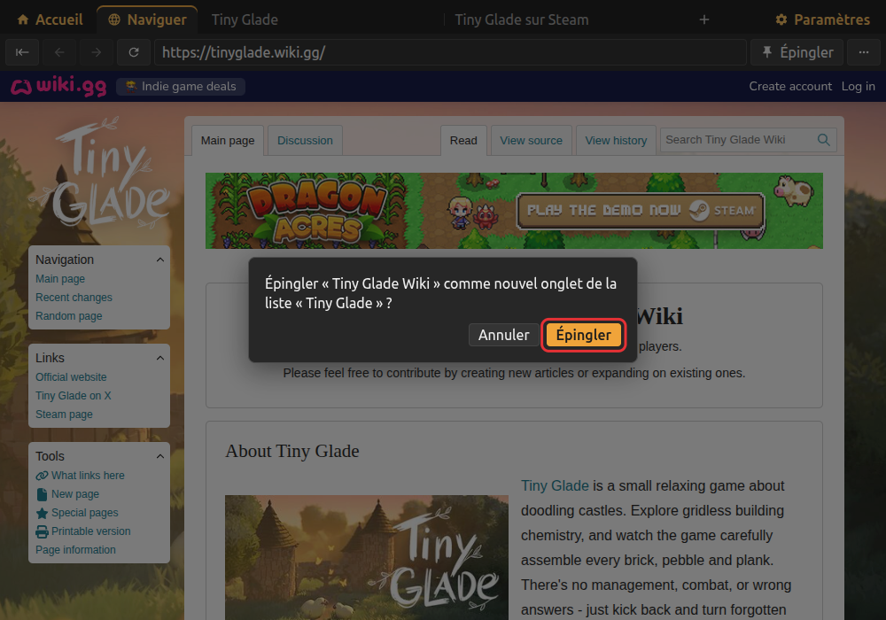
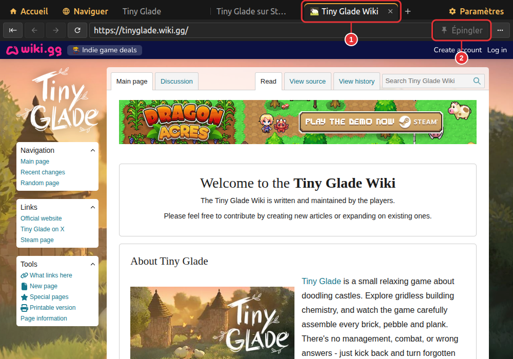
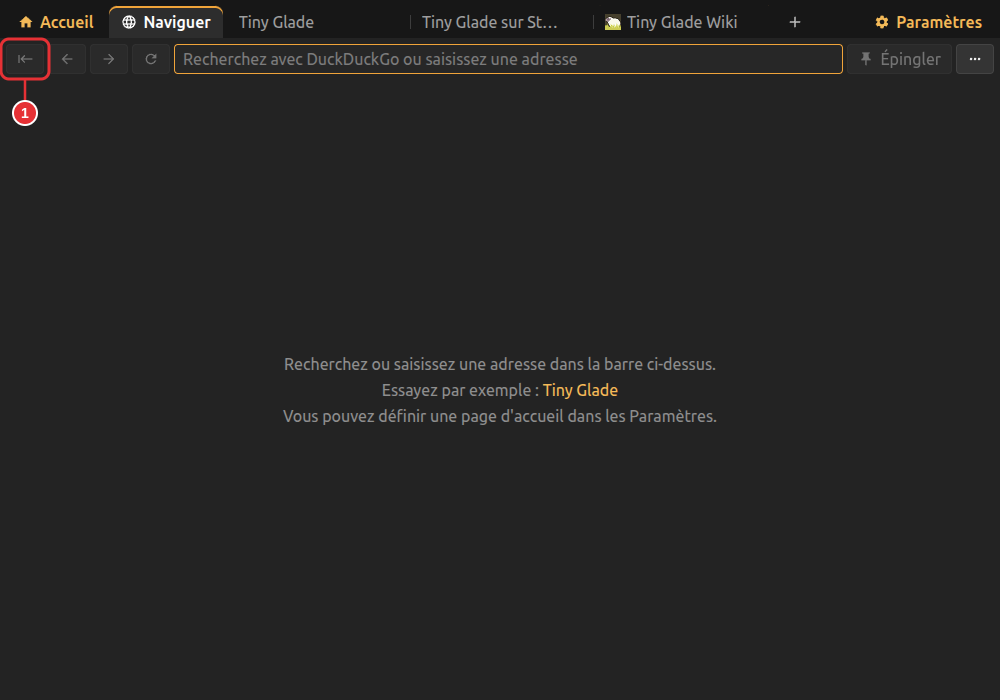

# Navigation libre : chercher, trouver, épingler

L’onglet **Naviguer** sert à chercher et ouvrir n’importe quelle page sans l’ajouter à la liste. Quand tu trouves une page que tu veux garder, **Épingler** la transforme en onglet de la liste du jeu.

Ici nous continuons l’exemple de [Premiers pas](getting-started.md) : l’overlay est ouvert par-dessus **Tiny Glade**, dont la liste a déjà deux sites, et nous cherchons un wiki du jeu.

Dans les captures d’écran, les éléments cités dans le texte sont mis en évidence en rouge ; les numéros comme ❶ dans le texte indiquent l’élément portant le même numéro dans la capture.

## 1. Ouvre l’onglet Naviguer

Clique sur **Naviguer** ❶, juste après Accueil. Dans le **champ d’adresse** ❷ tu peux saisir une adresse (`example.com` suffit) ou n’importe quel texte à chercher. Comme exemple, l’overlay propose le **nom du jeu** ❸ : clique dessus pour le chercher.

## 2. Cherche

Saisis `tiny glade wiki` et appuie sur Entrée. La recherche s’ouvre dans l’onglet, et le **champ d’adresse** ❶ affiche l’adresse de la page des résultats.

Le moteur de recherche se choisit dans les Paramètres (section *Comportement*) : Google, Bing, DuckDuckGo, Brave Search, Ecosia, Startpage ou une adresse personnalisée. Ici nous utilisons DuckDuckGo.

Clique sur le résultat qui t’intéresse, ici **Tiny Glade Wiki** ❷.

## 3. Épingle la page

La page s’ouvre dans l’onglet Naviguer et tu peux l’utiliser comme dans un navigateur : **Précédent** ❶ te ramène aux résultats de la recherche. Pour la garder, clique sur **Épingler** ❷.

L’overlay demande une confirmation : clique sur **Épingler**.

## 4. La page est un onglet de la liste

La page, avec son historique, devient un **nouvel onglet** ❶ à la fin de la liste de Tiny Glade, et désormais tu la retrouves chaque fois que tu ouvres l’overlay par-dessus le jeu. **Épingler** ❷ est maintenant désactivé : la page est déjà dans la liste.

Épingler fonctionne aussi dans les onglets des sites : si depuis un site tu atteins une page que tu veux garder à part, Épingler l’ajoute comme nouvel onglet juste après celui du site. Quand une page est déjà l’un des onglets de la liste, cet onglet est mis en évidence et Épingler est désactivé.

## 5. L’onglet Naviguer est de nouveau libre

En revenant sur **Naviguer**, tu le retrouves vide, prêt pour une nouvelle recherche : la page épinglée est passée dans son onglet. Pendant que tu navigues, le bouton **Revenir à la page d’accueil** ❶ ferme la page ouverte et revient à la page vide.

Dans les Paramètres (section *Comportement*), tu peux aussi choisir une **page d’accueil** pour l’onglet Naviguer, ouverte à la place de la page vide.

## Adresses d’autres sites depuis les onglets des sites

Tu peux aussi saisir une adresse dans le champ d’adresse des onglets des sites. Une adresse du même site s’ouvre dans l’onglet ; une adresse d’un autre site, ou une recherche, s’ouvre plutôt dans l’onglet Naviguer, après une confirmation, pour que l’onglet du site garde sa page.
