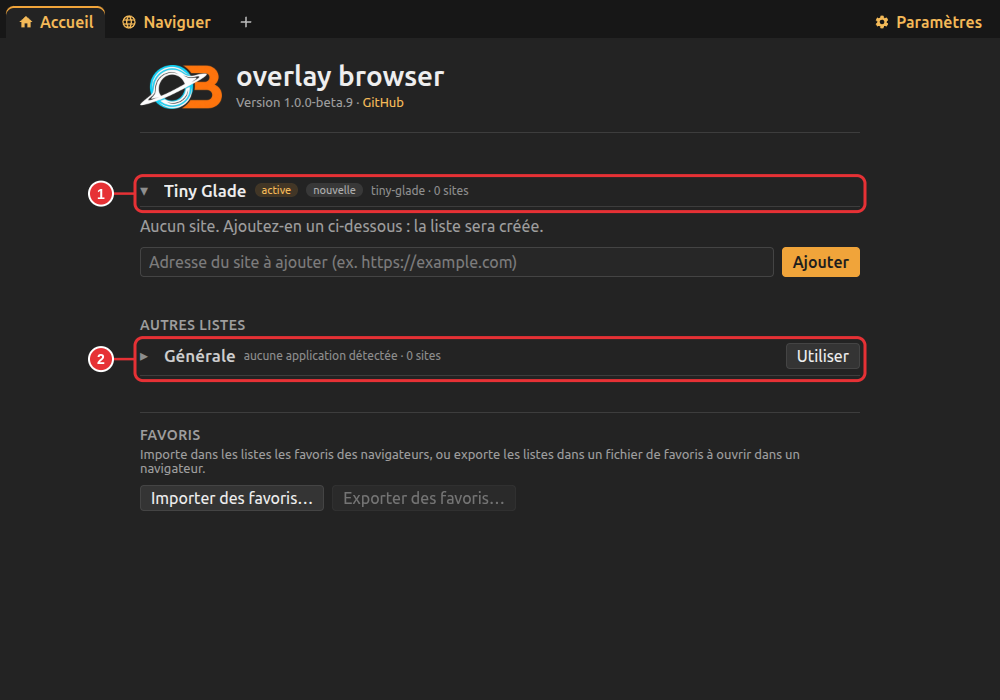
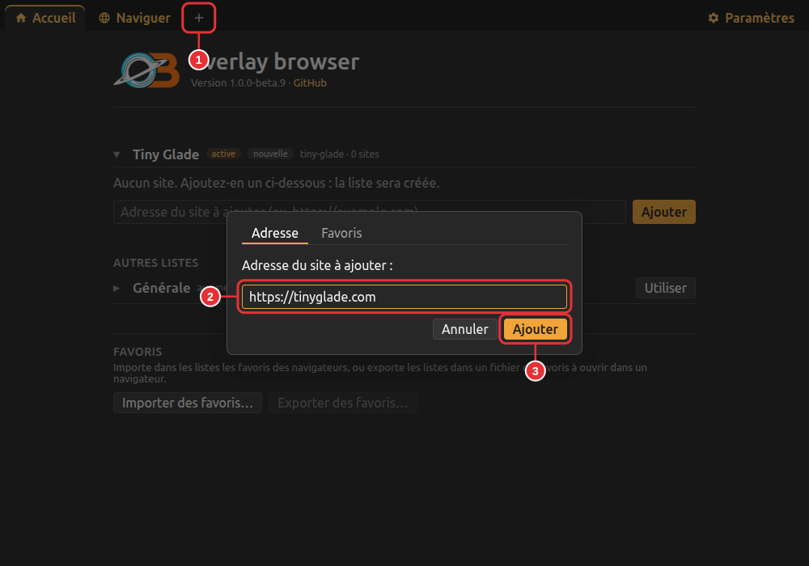
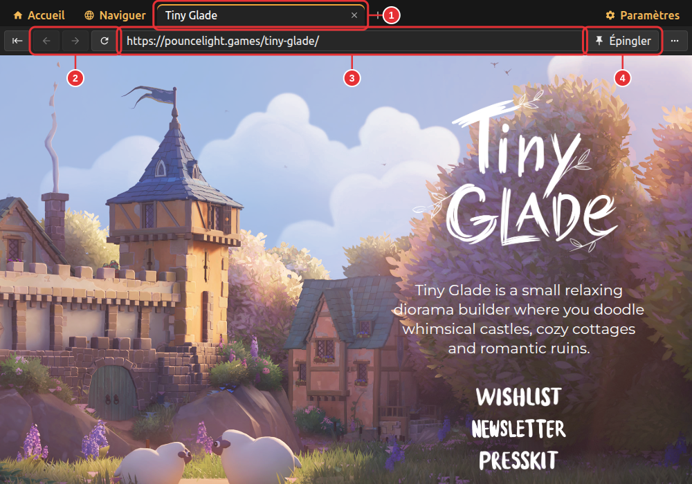
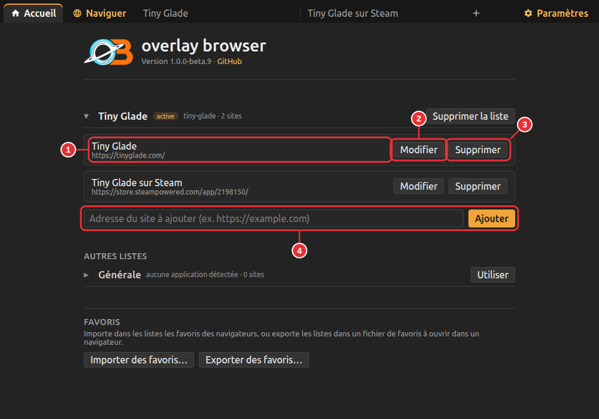
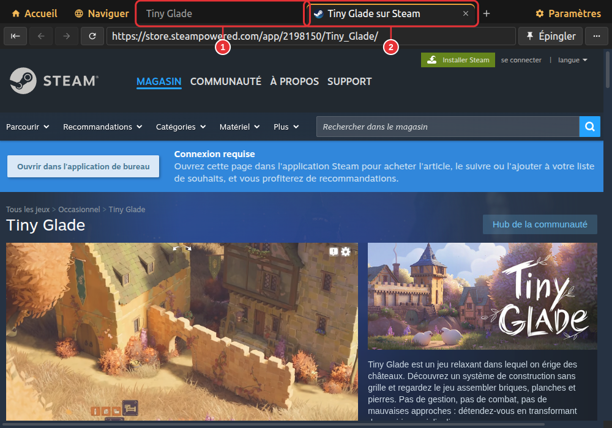

# Premiers pas : les sites de ton jeu à portée de main

Dans ce guide, tu ouvres Overlay Browser pendant que tu joues (ici à **Tiny Glade**), tu ajoutes quelques sites utiles et tu apprends à les afficher et à les masquer sans quitter le jeu.

Dans les captures d’écran, les éléments cités dans le texte sont mis en évidence en rouge ; les numéros comme ❶ dans le texte indiquent l’élément portant le même numéro dans la capture.

## 1. Lance l’application

Lance Overlay Browser : la fenêtre **reste masquée** et l’application attend dans la zone de notification, près de l’horloge. Elle n’apparaît ni dans la barre des tâches ni dans Alt+Tab.

Lance ensuite le jeu, en mode fenêtré ou fenêtre sans bordure.

## 2. Ouvre l’overlay par-dessus le jeu

Pendant que tu joues, appuie sur **Win+F10** (Super+F10 sous Linux, Cmd+Shift+Espace sous macOS). L’overlay apparaît par-dessus le jeu et s’ouvre sur l’**Accueil**.

L’overlay a reconnu le jeu : en haut se trouve la liste **Tiny Glade** ❶, *active* et encore *nouvelle*. Chaque jeu a sa propre liste de sites, créée quand tu y ajoutes le premier site. Parmi les *Autres listes* se trouve la liste **Générale** ❷, utilisée quand aucun jeu n’est ouvert ; **Utiliser** la rend active à la main.

## 3. Ajoute un site

Clique sur **+** ❶ dans la barre du haut, saisis l’adresse du site ❷ (`tinyglade.com` suffit) et appuie sur **Ajouter** ❸.

Le site s’ouvre aussitôt dans son **onglet** ❶, qui prend le nom du titre de la page ; le **×** le ferme. En dessous se trouve la barre de navigation, comme dans un navigateur : **précédent, suivant et actualiser** ❷, l’**adresse** de la page ❸ (tu peux en saisir une autre et appuyer sur Entrée) et **Épingler** ❹, qui transforme en nouvel onglet une page atteinte en naviguant.

## 4. Ajoutes-en d’autres depuis l’Accueil

Reviens à l’**Accueil** : tu y vois les sites de la liste. Clique sur le **nom d’un site** ❶ pour l’ouvrir, sur **Modifier** ❷ pour changer son adresse (Entrée pour enregistrer, Échap pour annuler) ou sur **Supprimer** ❸ pour le retirer de la liste. Pour ajouter un site, saisis son adresse dans le **champ sous la liste** ❹ et appuie sur *Ajouter* : ici nous avons ajouté la page Steam du jeu.

## 5. Passe d’un site à l’autre

Chaque site a son onglet dans la barre : ici le **site officiel** ❶ et la **page Steam** ❷, celle qui est ouverte. Quand tu changes d’onglet puis reviens, tu retrouves la page exactement où tu l’avais laissée.

## 6. Retourne au jeu

Appuie de nouveau sur **Win+F10** pour masquer l’overlay, ou clique sur la fenêtre du jeu : par défaut l’overlay se masque tout seul quand il perd le focus (tu peux le désactiver dans les Paramètres).

La prochaine fois que tu ouvres l’overlay par-dessus Tiny Glade, tu retrouves sa liste, ouverte sur le dernier onglet que tu regardais. Par-dessus un autre jeu, tu verras la liste de ce jeu.
