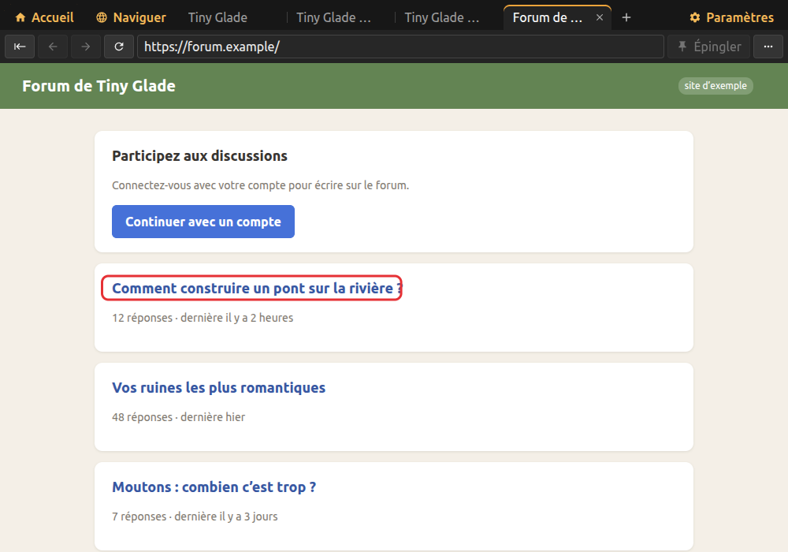
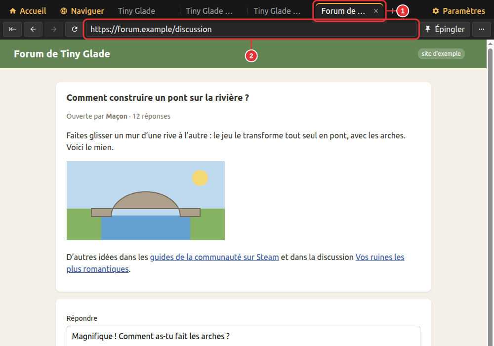
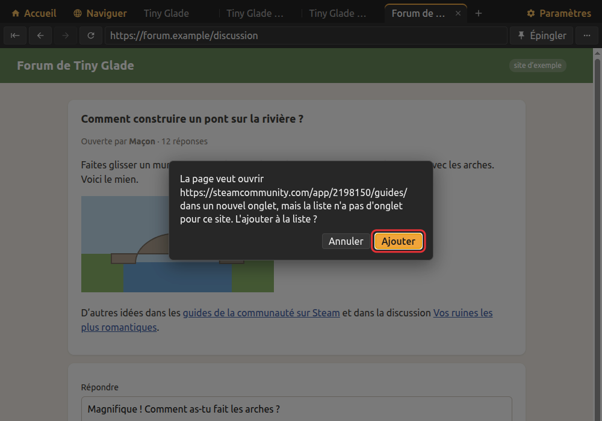
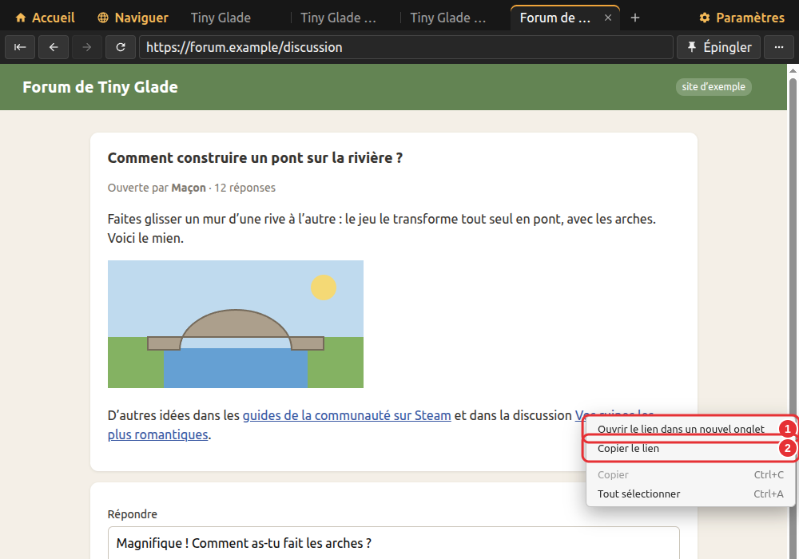
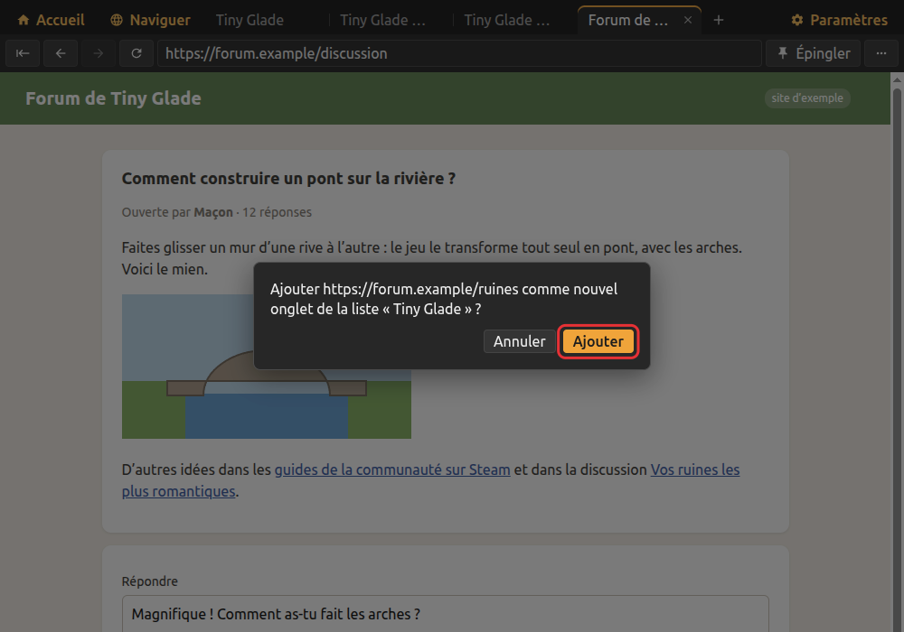
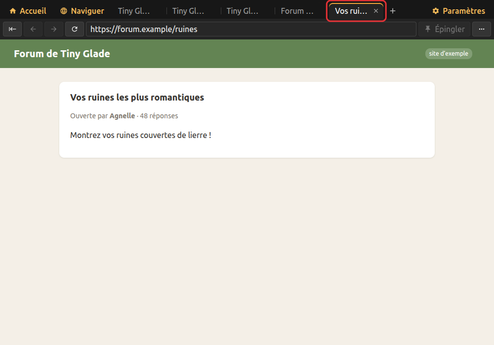
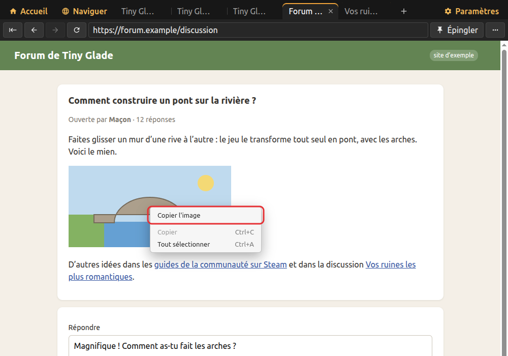
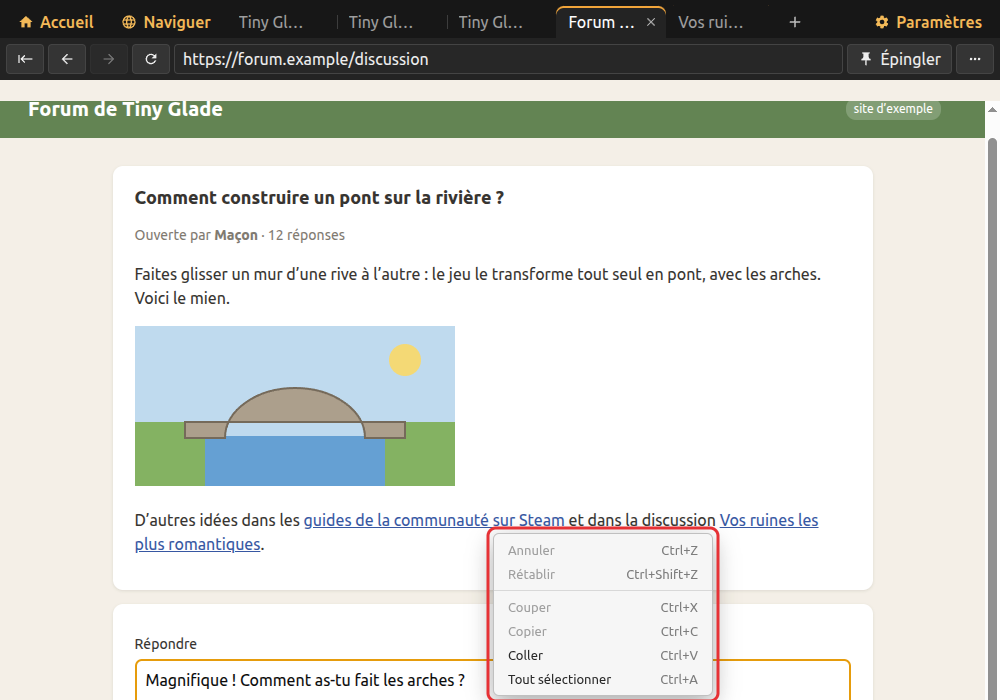

# Liens, nouveaux onglets et menu contextuel

Dans un navigateur, beaucoup de liens s’ouvrent dans un nouvel onglet. Dans l’overlay, les onglets sont les sites de la liste, donc ces liens vont là où ils sont utiles : dans l’onglet du site d’où ils viennent, ou, après une question, dans un nouvel onglet. Le clic droit ouvre le menu pour ouvrir un lien dans un nouvel onglet et copier liens, images et texte.

Ici la liste de **Tiny Glade** a aussi un forum, un **site d’exemple** créé pour ce guide (voir [Se connecter à un site et les cookies](signing-in.md)).

Dans les captures d’écran, les éléments cités dans le texte sont mis en évidence en rouge ; les numéros comme ❶ dans le texte indiquent l’élément portant le même numéro dans la capture.

## 1. Un lien que le site ouvre dans un nouvel onglet

Certains liens sont faits pour s’ouvrir dans un nouvel onglet, comme cette discussion du forum. C’est pareil pour les liens cliqués avec Ctrl ou avec le bouton du milieu de la souris.

## 2. Le même site : dans son onglet

Si le lien mène au même site, il s’ouvre dans l’**onglet du site** ❶, à la place de la page précédente : l’**adresse** ❷ est maintenant celle de la discussion. Avec **Précédent**, tu reviens à la page précédente.

Si la liste a plusieurs onglets du même site, le lien s’ouvre dans celui d’où il vient.

## 3. Un autre site : la question

Si le lien mène à un site qui n’a pas d’onglet dans la liste, ici les guides de la communauté sur Steam, l’overlay demande s’il faut l’ajouter à la liste : **Ajouter** l’ajoute comme nouveau site et l’ouvre ; **Annuler** laisse tout tel quel.

Les liens ouverts depuis l’onglet **Naviguer** restent en revanche dans l’onglet Naviguer (voir [Navigation libre](free-browsing.md)).

## 4. Clic droit sur un lien

Un clic droit sur un lien ouvre le menu avec **Ouvrir le lien dans un nouvel onglet** ❶ et **Copier le lien** ❷, qui copie l’adresse du lien.

**Ouvrir le lien dans un nouvel onglet** demande une confirmation avant d’ajouter le lien à la liste : clique sur **Ajouter**.

Le lien devient un **nouvel onglet**, juste après celui d’où il vient, et s’ouvre. Si un onglet de la liste est déjà sur cette adresse, l’overlay affiche cet onglet au lieu d’en ajouter un autre.

## 5. Clic droit sur les images et le texte

Sur une image, le menu propose **Copier l’image**, pour la coller ailleurs, par exemple dans une discussion. Sur le texte d’une page, il y a **Copier**, pour le texte sélectionné, et **Tout sélectionner**.

Dans les champs de texte, comme celui de réponse du forum ou l’adresse des onglets, le menu propose **Annuler**, **Rétablir**, **Couper**, **Copier**, **Coller** et **Tout sélectionner**. Les éléments inutiles à ce moment-là, par exemple *Copier* sans texte sélectionné, sont grisés.

