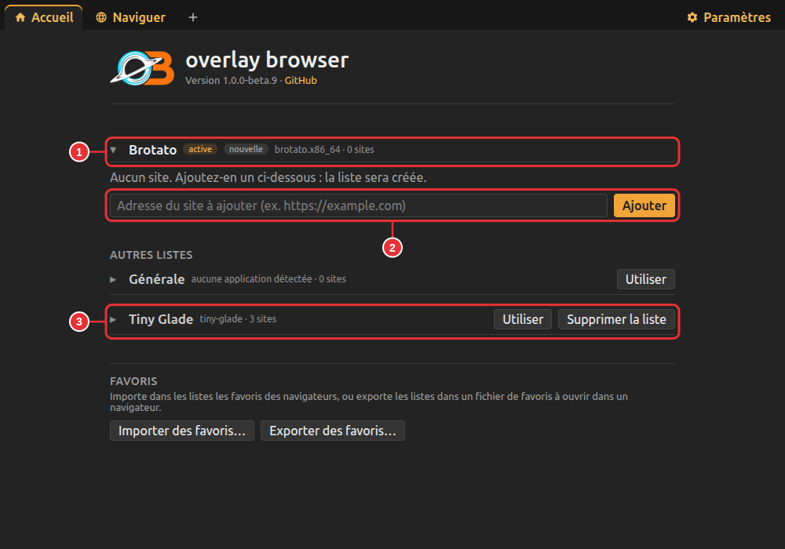
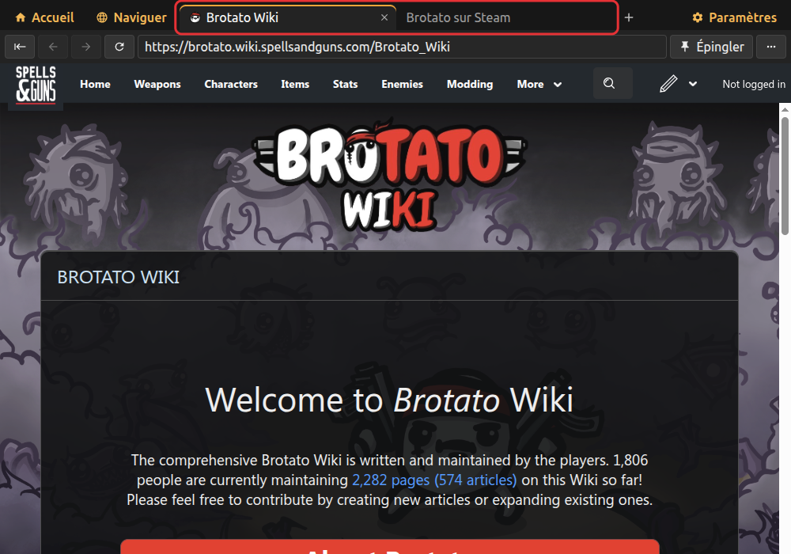
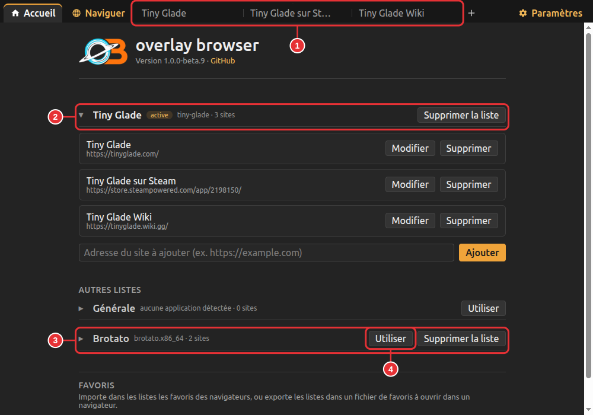
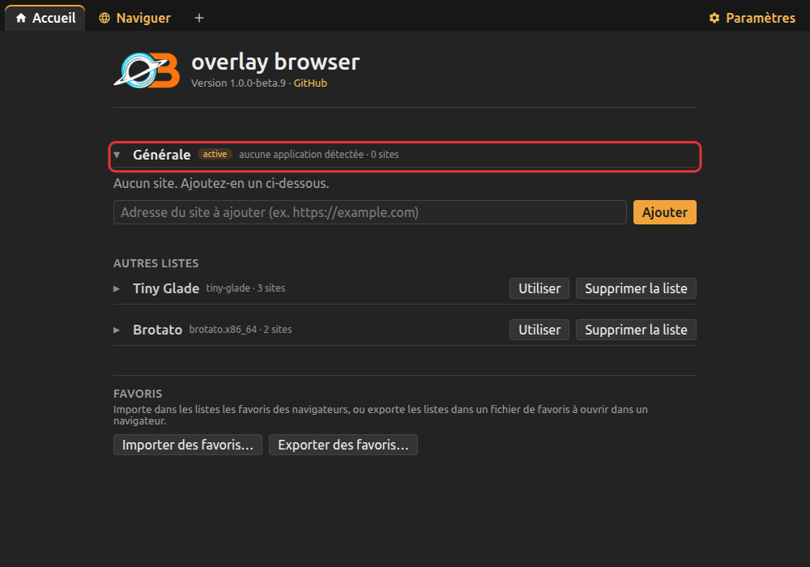
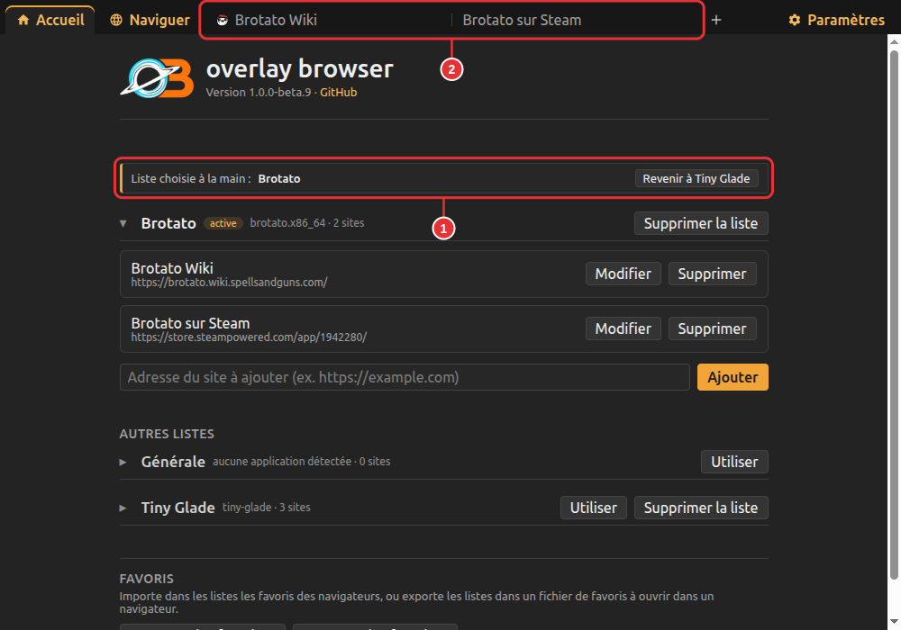
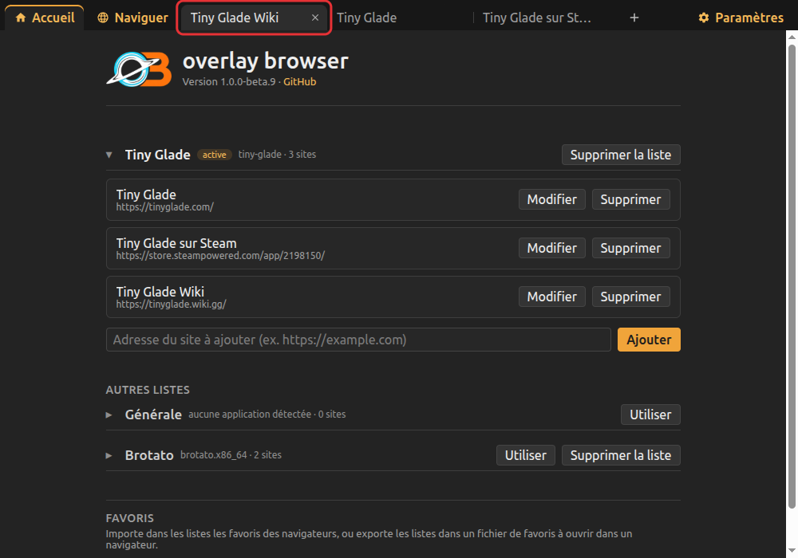
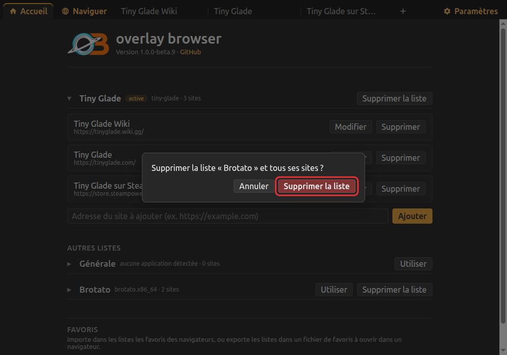

# Une liste par jeu

Overlay Browser reconnaît le jeu par-dessus lequel tu l’ouvres et affiche les sites de ce jeu : chaque jeu a sa propre **liste**. Dans ce guide, après [Premiers pas](getting-started.md) et [Navigation libre](free-browsing.md), la liste de **Tiny Glade** a déjà trois sites ; maintenant nous jouons à **Brotato**.

Dans les captures d’écran, les éléments cités dans le texte sont mis en évidence en rouge ; les numéros comme ❶ dans le texte indiquent l’élément portant le même numéro dans la capture.

## 1. Un nouveau jeu, une nouvelle liste

Ouvre l’overlay pendant que tu joues à Brotato. En haut de l’Accueil se trouve la **liste de Brotato** ❶, *active* et encore *nouvelle* : à côté de son nom tu vois le programme reconnu et le nombre de sites. Ajoute un site dans le **champ sous la liste** ❷ (ou avec le **+** de la barre du haut) : la liste est créée avec son premier site. La **liste de Tiny Glade** ❸ est parmi les *Autres listes*, repliée : clique dessus pour voir ses sites.

Ici nous ajoutons le wiki de Brotato et sa page Steam. La barre contient maintenant leurs onglets, et seulement eux : les sites de Tiny Glade n’apparaissent pas.

## 2. Chaque jeu retrouve ses sites

Retourne à Tiny Glade et ouvre l’overlay : la barre contient les **onglets de Tiny Glade** ❶, et la **liste de Tiny Glade** ❷ est la liste active. La **liste de Brotato** ❸ est passée parmi les *Autres listes* ; **Utiliser** ❹ la rendrait active à la main (voir l’étape 4). Chaque liste se rouvre sur le dernier onglet que tu regardais.

## 3. La liste Générale

Les listes ne sont pas seulement pour les jeux : l’overlay propose une liste pour n’importe quel programme par-dessus lequel tu l’ouvres. Quand il ne reconnaît aucune application, c’est la **liste Générale** qui est active, un endroit pour les sites qui ne concernent pas un programme en particulier. Elle fonctionne comme les autres, mais ne peut pas être supprimée.

## 4. Choisir une liste à la main

Parfois tu veux les sites d’un autre jeu : par exemple tu lis le wiki de Brotato alors que Tiny Glade est ouvert. Clique sur **Utiliser** à côté de la liste que tu veux (❹ dans la capture de l’étape 2).

La liste devient active et reste celle **choisie à la main** ❶ même quand tu ouvres l’overlay par-dessus d’autres jeux, jusqu’à ce que tu cliques sur **Revenir à Tiny Glade**, où Tiny Glade est le jeu par-dessus lequel l’overlay est ouvert à ce moment-là. La barre contient les **onglets de la liste choisie** ❷.

## 5. Réordonner les onglets et les sites

Fais glisser un onglet dans la barre pour le déplacer : ici le Tiny Glade Wiki est mis à la première place.

De la même façon, tu peux faire glisser les sites dans l’Accueil : l’ordre de l’Accueil et celui des onglets sont les mêmes.

## 6. Supprimer une liste

**Supprimer la liste**, à côté du nom d’une liste, la supprime avec tous ses sites, après une confirmation :

Si tu ajoutes ensuite un site en jouant de nouveau à Brotato, sa liste est recréée.
