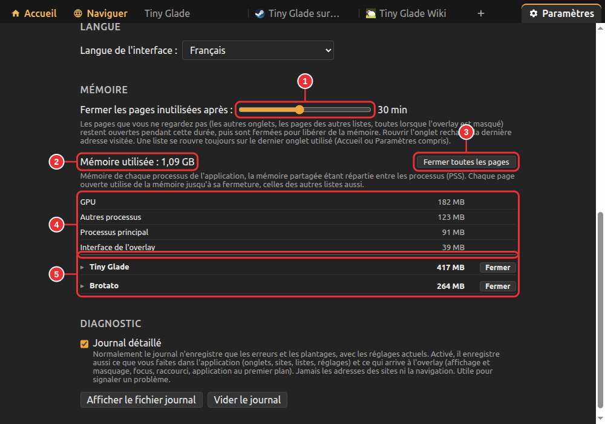
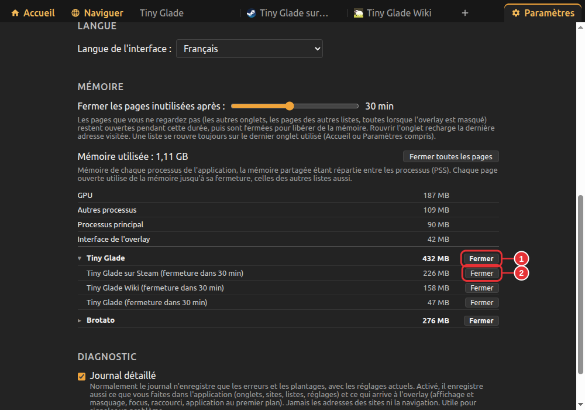
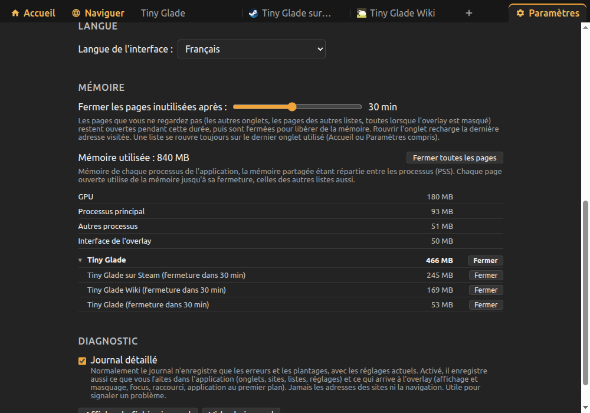

# Mémoire et pages fermées

Chaque page ouverte dans Overlay Browser occupe de la mémoire, comme dans un navigateur, même quand tu ne la regardes pas : les pages des autres listes restent ouvertes jusqu’à ce qu’elles soient fermées. Pour ne pas prendre de mémoire au jeu, l’overlay **ferme tout seul les pages que tu n’utilises plus depuis un moment**, et dans les Paramètres tu peux voir combien de mémoire il utilise et les fermer à la main.

Ici les listes de **Tiny Glade** et de **Brotato** ont plusieurs pages ouvertes (voir [Une liste par jeu](lists-per-game.md)).

Dans les captures d’écran, les éléments cités dans le texte sont mis en évidence en rouge ; les numéros comme ❶ dans le texte indiquent l’élément portant le même numéro dans la capture.

## 1. Pourquoi une page se recharge

Les pages que tu ne regardes pas (les autres onglets, les pages des autres listes, et toutes lorsque l’overlay est masqué) restent ouvertes un certain temps, puis elles sont fermées. Quand tu rouvres l’onglet, la page **se recharge depuis la dernière adresse visitée** : tu retrouves la page, mais par exemple pas l’endroit où tu l’avais fait défiler ni un formulaire à moitié rempli.

La page que tu regardes n’est jamais fermée.

## 2. La section Mémoire

Ouvre les **Paramètres** et fais défiler jusqu’à la section *Mémoire* :

- **Fermer les pages inutilisées après** ❶ : le temps au bout duquel une page inutilisée est fermée, de 5 à 60 minutes (30 par défaut). Avec moins de mémoire libre, ou avec des jeux gourmands, un temps plus court est préférable.
- **Mémoire utilisée** ❷ : la mémoire de toute l’application.
- **Fermer toutes les pages** ❸ : ferme aussitôt toutes les pages ouvertes, de toutes les listes.
- **Les processus de l’application** ❹ : l’interface de l’overlay, le processus principal, le graphisme (GPU) et les autres processus. Cette mémoire est toujours là.
- **Les pages, regroupées par liste** ❺ : pour chaque liste, la mémoire de ses pages ouvertes. **Fermer** ferme toutes les pages de cette liste.

## 3. Les pages d’une liste

Clique sur le nom d’une liste pour voir ses pages ouvertes, chacune avec la mémoire qu’elle utilise et le temps restant avant sa fermeture. **Fermer** à côté de la liste ❶ ferme toutes ses pages ; **Fermer** à côté d’une page ❷ ferme seulement celle-ci.

Certaines pages partagent le même processus, par exemple des pages du même site dans des listes différentes : elles apparaissent sur une seule ligne, hors des groupes, et se ferment ensemble, car la mémoire n’est libérée qu’en les fermant toutes.

## 4. Après la fermeture

Ici nous avons fermé les pages de Brotato : son groupe a disparu et la mémoire utilisée a baissé. Les onglets de Brotato restent dans sa liste : la prochaine fois que tu les ouvres, les pages se rechargent.

