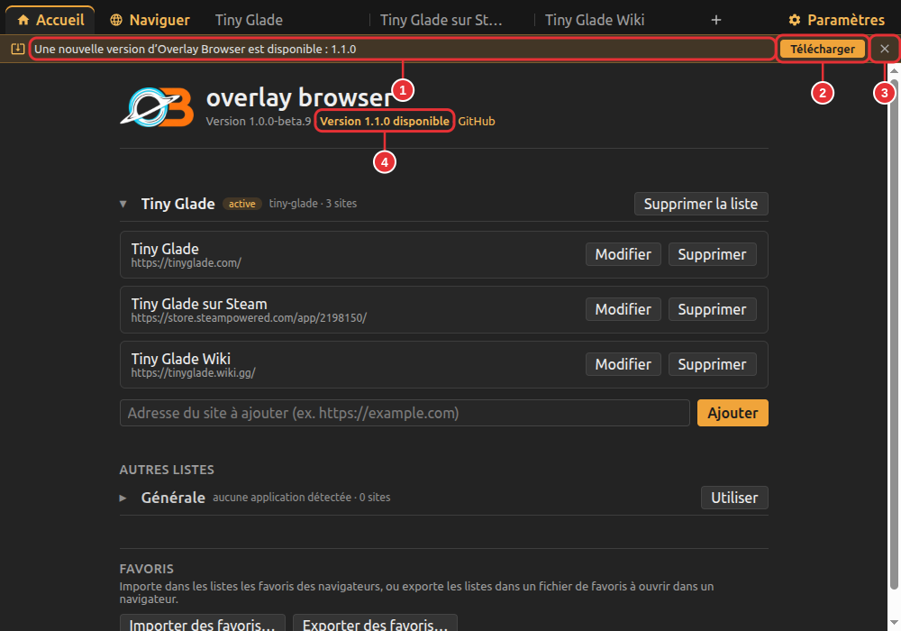
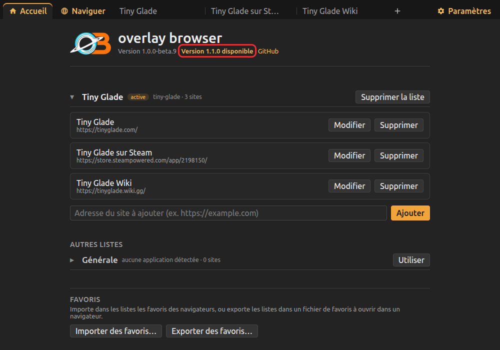
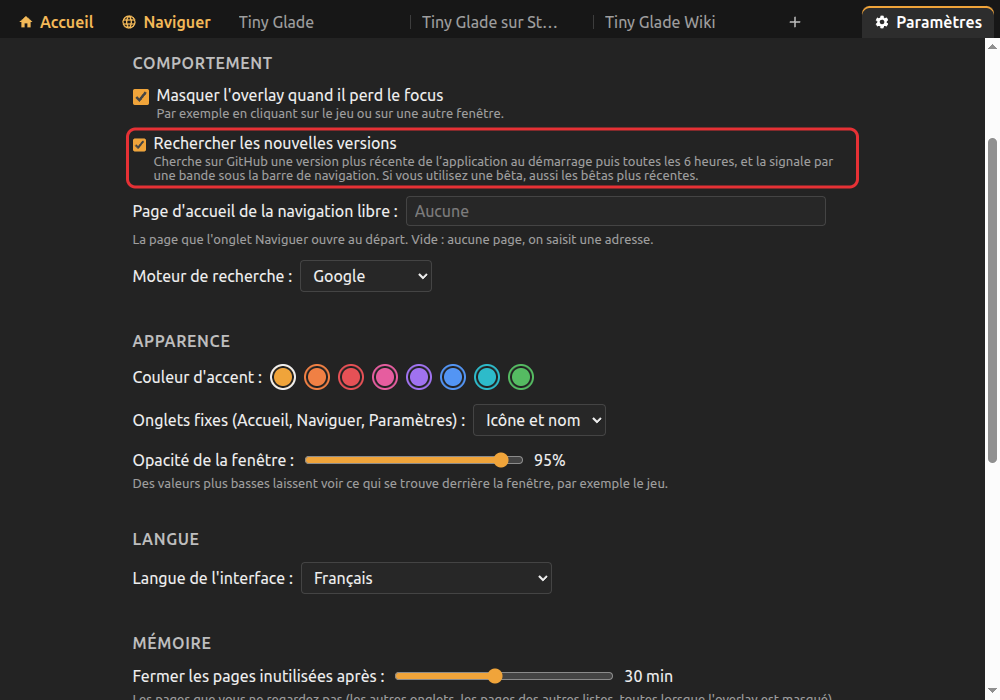

# Nouvelles versions

Overlay Browser vérifie tout seul si une nouvelle version est sortie et te la signale ; il ne se met pas à jour tout seul : c’est toi qui télécharges la nouvelle version quand tu veux.

Dans les captures d’écran, les éléments cités dans le texte sont mis en évidence en rouge ; les numéros comme ❶ dans le texte indiquent l’élément portant le même numéro dans la capture.

## 1. L’avis d’une nouvelle version

Quand une nouvelle version sort, un **bandeau** ❶ avec son numéro apparaît sous la barre du haut. **Télécharger** ❷ ouvre dans le navigateur du système la page de la nouvelle version, d’où télécharger le fichier pour ton système (voir l’installation dans le [README](../../README.md)). Le **×** ❸ ferme le bandeau : pour cette version il ne revient plus.

La nouvelle version est aussi indiquée en haut de l’**Accueil** ❹, à côté de la version que tu utilises : clique dessus pour ouvrir la même page.

Après la fermeture du bandeau, la nouvelle version reste sur l’Accueil jusqu’à ce que tu installes la mise à jour :

## 2. Quand il vérifie

L’application vérifie peu après le démarrage, puis toutes les 6 heures, sur les versions publiées du projet sur GitHub. Si tu utilises une version bêta, elle te signale aussi les bêtas plus récentes ; sinon seulement les versions définitives.

Pour ne plus recevoir les avis, désactive **Rechercher les nouvelles versions** dans les **Paramètres**, section *Comportement*. La version du Microsoft Store n’a pas cette option : ses mises à jour viennent du Store.

