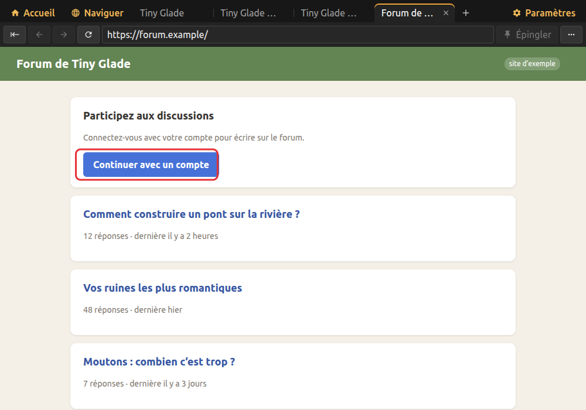
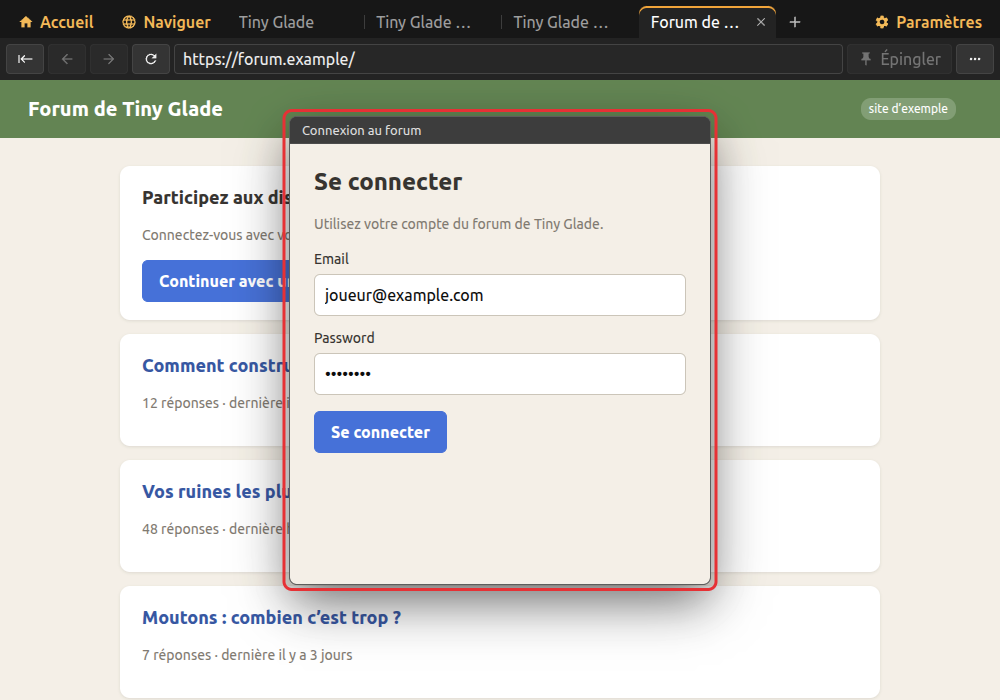
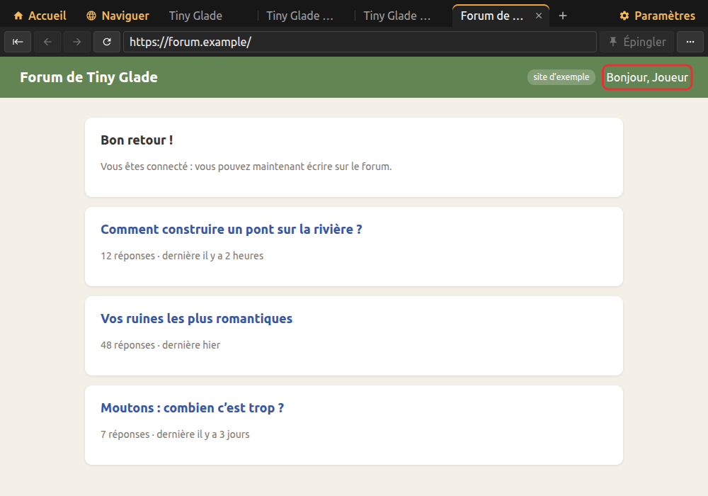
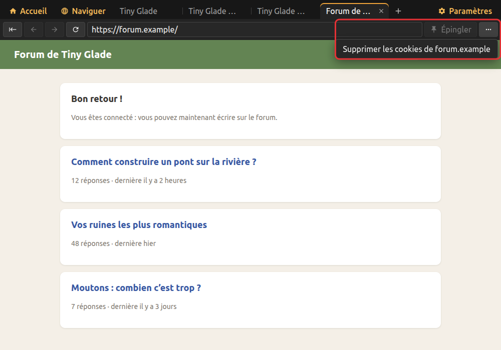
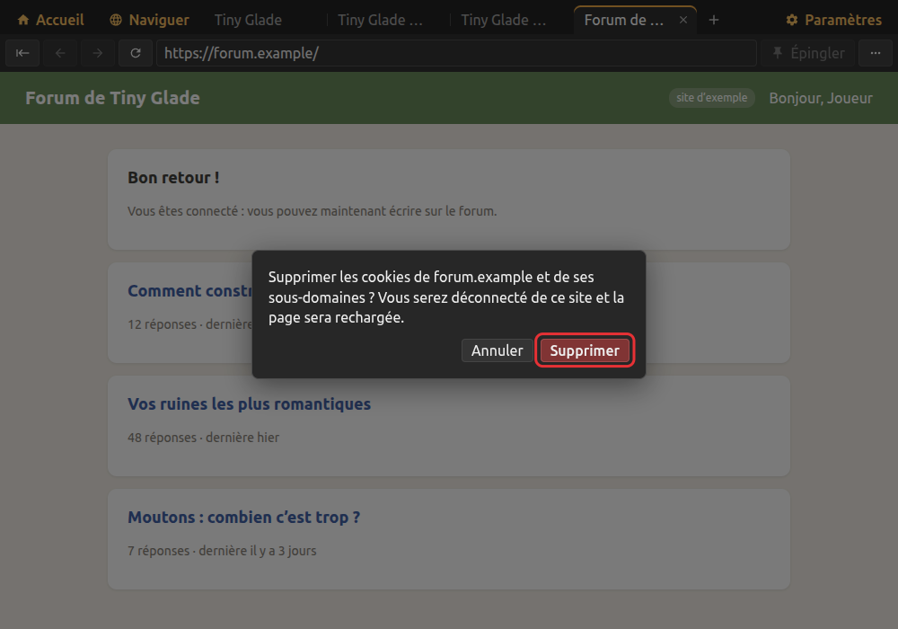

# Se connecter à un site et les cookies

Beaucoup de sites de jeux (forums, wikis, outils de builds) fonctionnent mieux, ou seulement, si tu te connectes avec ton compte. Dans l’overlay, on se connecte comme dans un navigateur, et la connexion est mémorisée. Si un site ne fonctionne plus bien, ou si tu veux te déconnecter du compte, tu peux supprimer ses cookies.

Ici la liste de **Tiny Glade** a aussi un forum. Le forum est un **site d’exemple**, créé pour ce guide : sa connexion fonctionne comme celle des vrais sites, par exemple *Continuer avec Google*.

Dans les captures d’écran, les éléments cités dans le texte sont mis en évidence en rouge ; les numéros comme ❶ dans le texte indiquent l’élément portant le même numéro dans la capture.

## 1. Connecte-toi avec ton compte

Ouvre l’onglet du site et clique sur le bouton pour te connecter, ici **Continuer avec un compte**.

Le site ouvre sa **fenêtre de connexion** par-dessus l’overlay, comme dans un navigateur. Saisis tes informations et confirme.

La fenêtre de connexion fait partie de l’overlay : elle reste par-dessus, se masque et réapparaît avec l’overlay, et passer de l’une à l’autre ne le masque pas. Quand elle se ferme, à la fin de la connexion, l’overlay redevient actif.

## 2. La connexion est mémorisée

Une fois connecté, la fenêtre se ferme et le site affiche ton **compte**.

La connexion reste même quand tu fermes l’overlay ou redémarres l’application, comme dans un navigateur. Les sites sont les mêmes pour toutes les listes : si tu te connectes à un site dans la liste d’un jeu, tu es déjà connecté aussi dans les autres listes qui ont ce site.

## 3. Supprime les cookies d’un site

Les cookies sont les données qu’un site enregistre pour se souvenir de toi, dont la connexion. Les supprimer sert à **te déconnecter d’un compte** (par exemple pour te connecter avec un autre) ou quand un site **ne fonctionne plus bien**.

Dans l’onglet du site, clique sur **…** (*Autres actions*), à droite de l’adresse, et choisis **Supprimer les cookies de forum.example**.

L’overlay demande une confirmation : clique sur **Supprimer**. Les cookies du site et de ses sous-domaines sont supprimés, pas ceux des autres sites.

## 4. La page se recharge

Après la suppression, la page se recharge : tu n’es plus connecté et le site propose de nouveau de **te connecter**.

