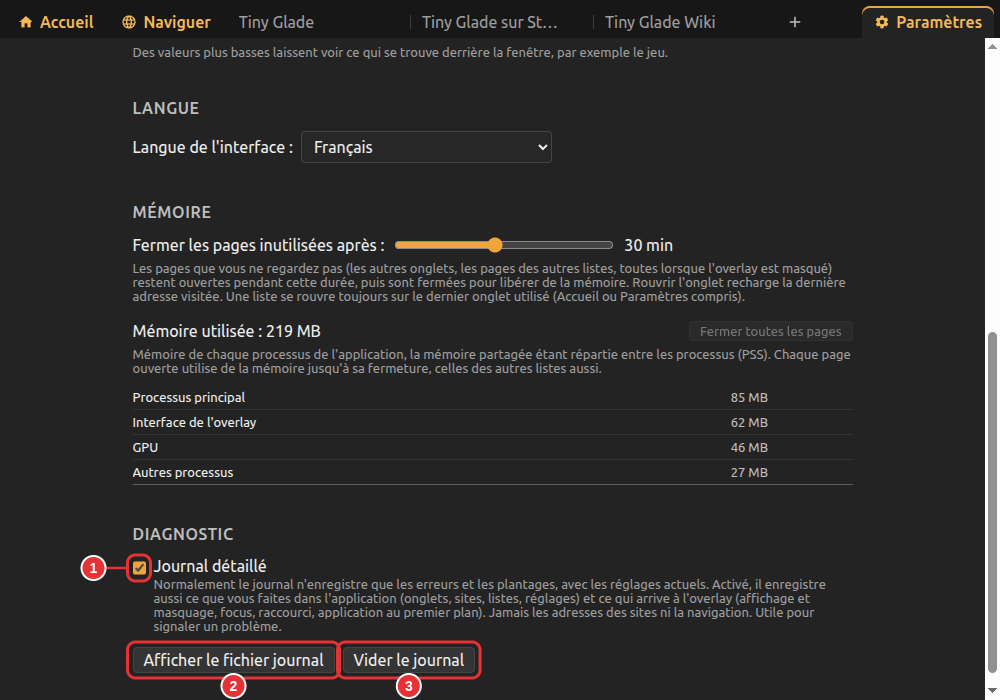
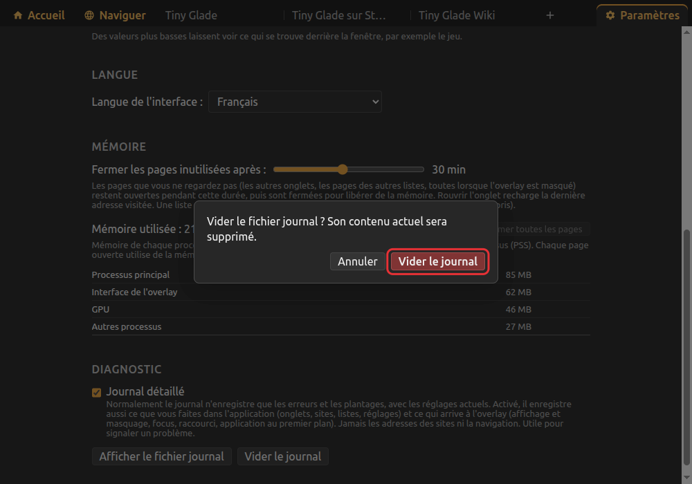

# Résolution des problèmes

Tu trouveras ici les solutions aux problèmes les plus courants et comment recueillir les informations utiles pour en signaler un. Pour les détails de chaque système (Windows, Linux, macOS), le guide renvoie au [README](../../README.md) (en anglais).

Dans les captures d’écran, les éléments cités dans le texte sont mis en évidence en rouge ; les numéros comme ❶ dans le texte indiquent l’élément portant le même numéro dans la capture.

## 1. La combinaison de touches ne fonctionne pas

- **Elle est déjà utilisée par un autre programme.** Si tu la choisis dans les Paramètres, l’overlay te le dit (« combinaison non valide ou déjà utilisée ») et la précédente reste : choisis-en une autre (voir [Personnaliser l’overlay](customizing.md)).
- **Le jeu l’utilise pour une de ses commandes.** La combinaison arrive aussi au jeu : choisis-en une qui ne fait rien dans le jeu.
- **Linux avec Wayland.** La combinaison n’est pas vue tant qu’une fenêtre Wayland native est active : il faut une session X11 (voir *Linux* dans le [README](../../README.md#linux)).
- **macOS et touches de fonction.** Par défaut F1–F12 règlent la luminosité, le volume, etc. : appuie dessus avec **fn**, ou change le réglage du clavier (voir *macOS* dans le [README](../../README.md#macos)).

Tu peux toujours afficher l’overlay aussi depuis l’icône de la zone de notification.

## 2. Je ne trouve pas l’icône de l’application

L’application n’apparaît ni dans la barre des tâches ni dans Alt+Tab : elle est dans la zone de notification, près de l’horloge.

- **Windows :** si tu ne la vois pas, clique sur la flèche **^** et fais glisser l’icône sur la barre des tâches pour la garder toujours visible.
- **Linux avec GNOME :** l’extension *AppIndicator and KStatusNotifierItem Support* est nécessaire. Dans certains environnements, le clic sur l’icône ouvre le menu au lieu d’afficher la fenêtre : utilise l’élément *Afficher*.
- **macOS :** l’icône est dans la barre des menus, en haut à droite.

## 3. L’overlay n’apparaît pas par-dessus le jeu, ou n’est pas transparent

- **Le jeu recouvre l’overlay.** Certains jeux en plein écran « exclusif » recouvrent toutes les fenêtres : mets le jeu en mode *fenêtre sans bordure* (borderless).
- **La fenêtre n’est pas transparente (Linux).** La transparence demande un gestionnaire de fenêtres avec la composition activée (Cinnamon, KDE, GNOME, Xfce avec la composition) : sans elle, la fenêtre reste opaque.

## 4. Un site ne fonctionne pas bien ou une page se recharge

- **Un site ne fonctionne plus bien, ou tu veux te déconnecter d’un compte :** supprime les cookies du site depuis le menu **…** (voir [Se connecter à un site et les cookies](signing-in.md)).
- **Une page se recharge quand tu reviens à son onglet :** les pages inutilisées sont fermées au bout d’un moment pour libérer de la mémoire (voir [Mémoire et pages fermées](memory.md)).
- **Tu veux repartir de zéro :** quitte l’application et supprime le fichier des préférences (voir *Preferences and uninstalling* dans le [README](../../README.md#preferences-and-uninstalling)).

## 5. Recueille les informations pour un signalement

Si un problème persiste, tu peux le signaler sur la [page des signalements du projet](https://github.com/siculo/overlay-browser/issues). Le fichier journal de l’application aide à comprendre ce qui s’est passé.

Dans les **Paramètres**, section *Diagnostic* :

- **Journal détaillé** ❶ : normalement le journal n’enregistre que les erreurs et les plantages, avec les réglages actuels. Activé, il enregistre aussi ce que tu fais dans l’application (onglets, sites, listes, réglages) et ce qui arrive à l’overlay (affichage et masquage, focus, combinaison de touches, application au premier plan). Active-le, puis refais ce qui cause le problème.
- **Afficher le fichier journal** ❷ : ouvre le dossier avec le fichier `overlay.log`, à joindre au signalement.
- **Vider le journal** ❸ : efface le contenu du journal, par exemple pour n’enregistrer que le problème à signaler.

Le journal ne contient jamais les touches que tu appuies ni ta navigation : aucune adresse ni aucun titre de page. Les sites ne sont indiqués que par leur position dans la liste.

**Vider le journal** demande une confirmation avant de l’effacer :

