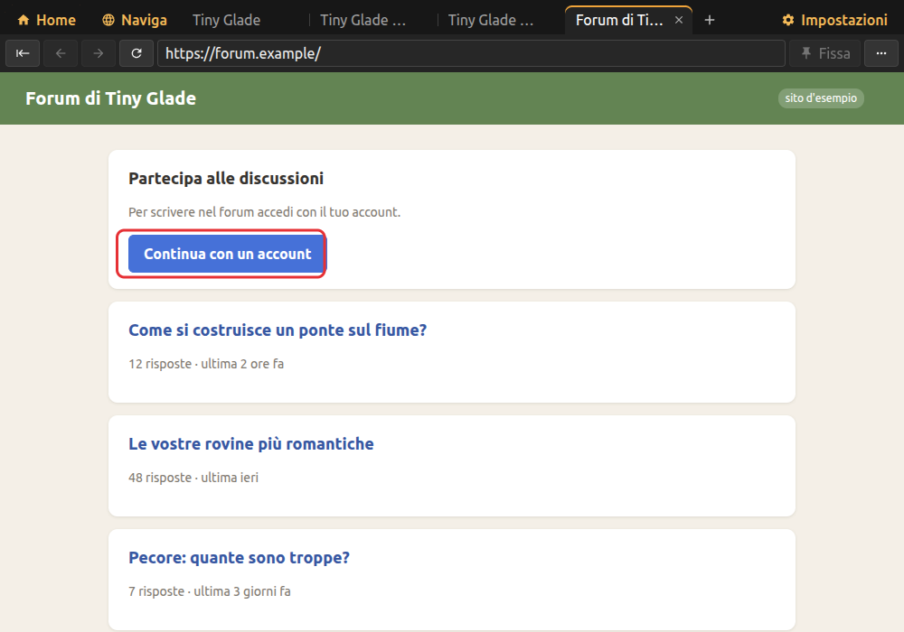
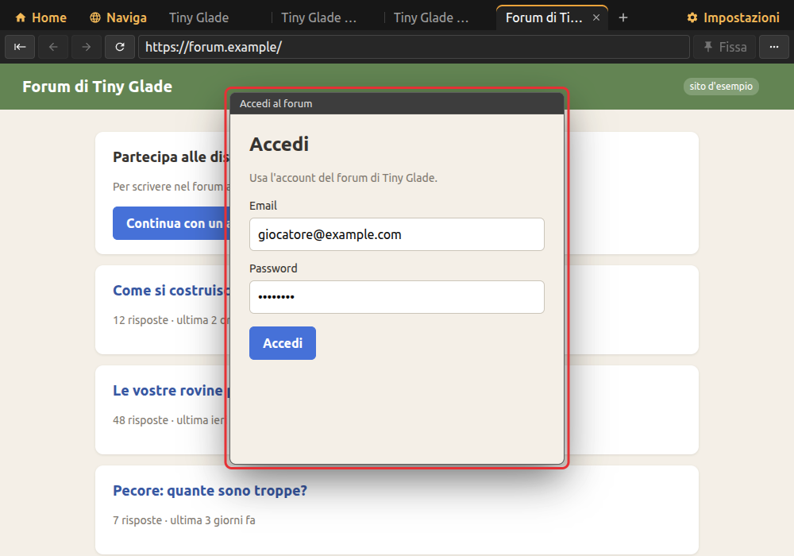
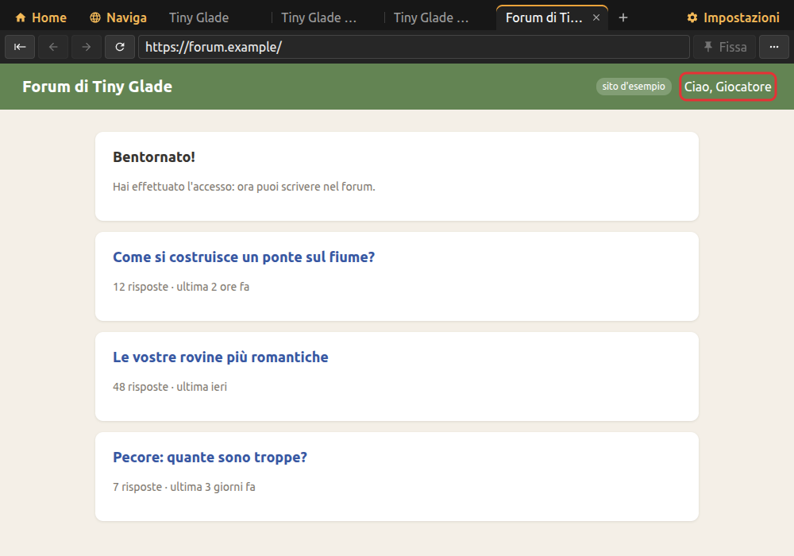
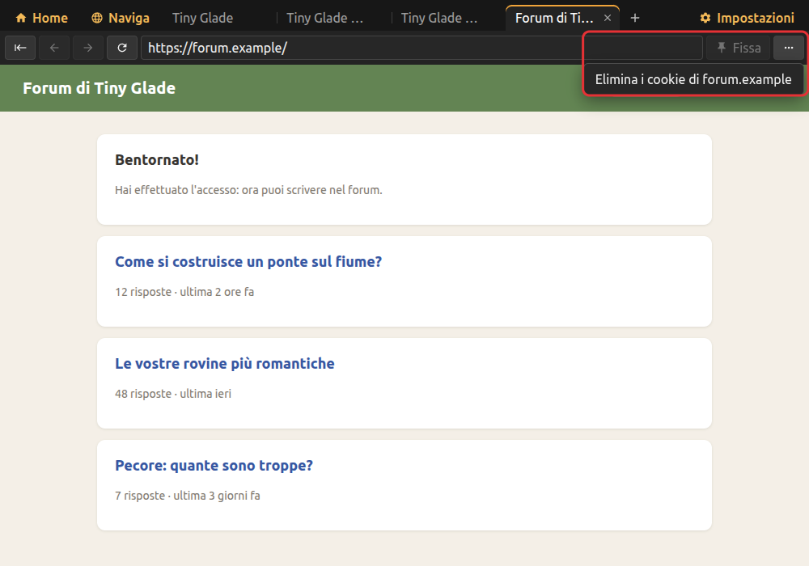
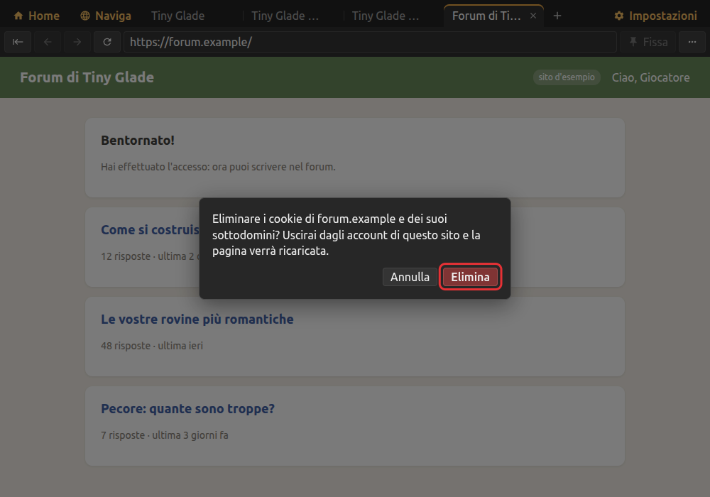

# Accedere a un sito e i cookie

Molti siti dei giochi (forum, wiki, strumenti per le build) funzionano meglio, o solo, se accedi con il tuo account. Nell'overlay si accede come in un browser, e l'accesso viene ricordato. Se un sito non funziona più bene, o vuoi uscire dall'account, puoi eliminarne i cookie.

Qui la lista di **Tiny Glade** ha anche un forum. Il forum è un **sito d'esempio**, creato per questa guida: l'accesso funziona come quello dei siti veri, ad esempio con *Continua con Google*.

Nelle schermate gli elementi citati nel testo sono evidenziati in rosso; i numeri come ❶ nel testo indicano l'elemento con lo stesso numero nella schermata.

## 1. Accedi con il tuo account

Apri il tab del sito e clicca il pulsante per accedere, qui **Continua con un account**.

Il sito apre la sua **finestra di accesso** sopra l'overlay, come in un browser. Inserisci i tuoi dati e conferma.

La finestra di accesso fa parte dell'overlay: resta sopra di esso, si nasconde e ricompare insieme all'overlay, e passare dall'una all'altro non lo nasconde. Quando si chiude, alla fine dell'accesso, l'overlay torna attivo.

## 2. L'accesso viene ricordato

Finito l'accesso, la finestra si chiude e il sito mostra il tuo **account**.

L'accesso resta anche quando chiudi l'overlay o riavvii l'app, come in un browser. I siti sono gli stessi per tutte le liste: se accedi a un sito nella lista di un gioco, risulti già dentro anche nelle altre liste che hanno quel sito.

## 3. Elimina i cookie di un sito

I cookie sono i dati che un sito salva per ricordarsi di te, tra cui l'accesso. Eliminarli serve per **uscire da un account** (ad esempio per accedere con un altro) o quando un sito **non funziona più bene**.

Nel tab del sito clicca **…** (*Altre operazioni*), a destra dell'indirizzo, e scegli **Elimina i cookie di forum.example**.

L'overlay chiede conferma: clicca **Elimina**. Vengono eliminati i cookie del sito e dei suoi sottodomini, non quelli degli altri siti.

## 4. La pagina si ricarica

Dopo l'eliminazione la pagina si ricarica: non sei più dentro all'account e il sito propone di nuovo di **accedere**.

