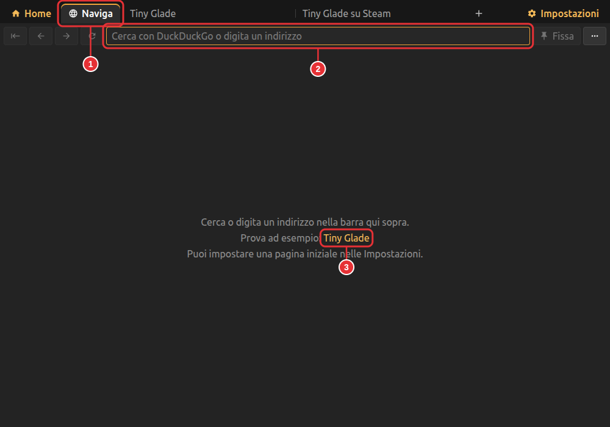
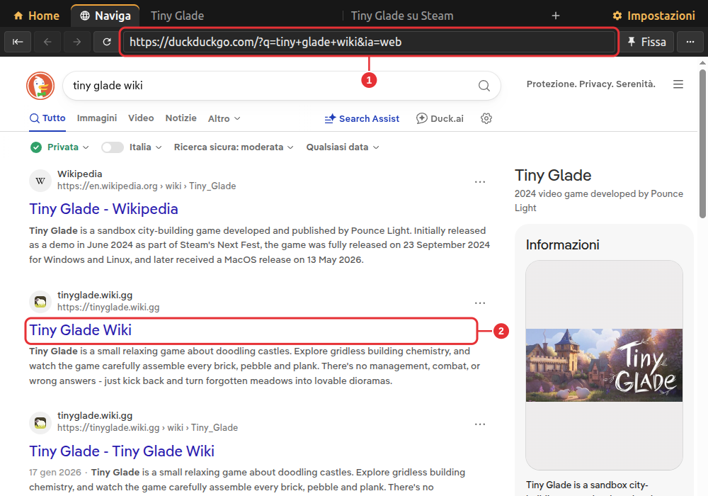
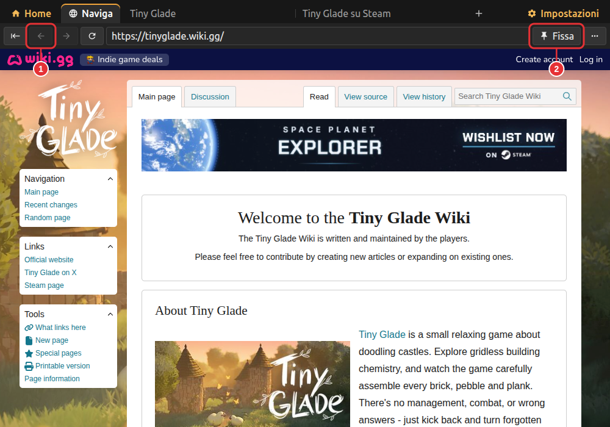
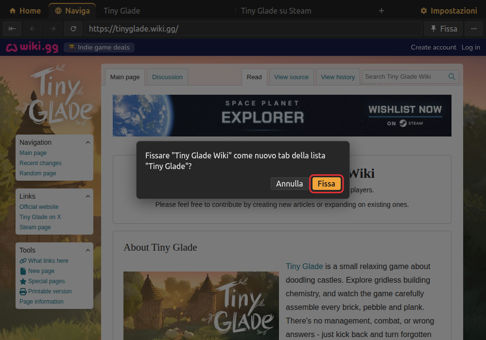
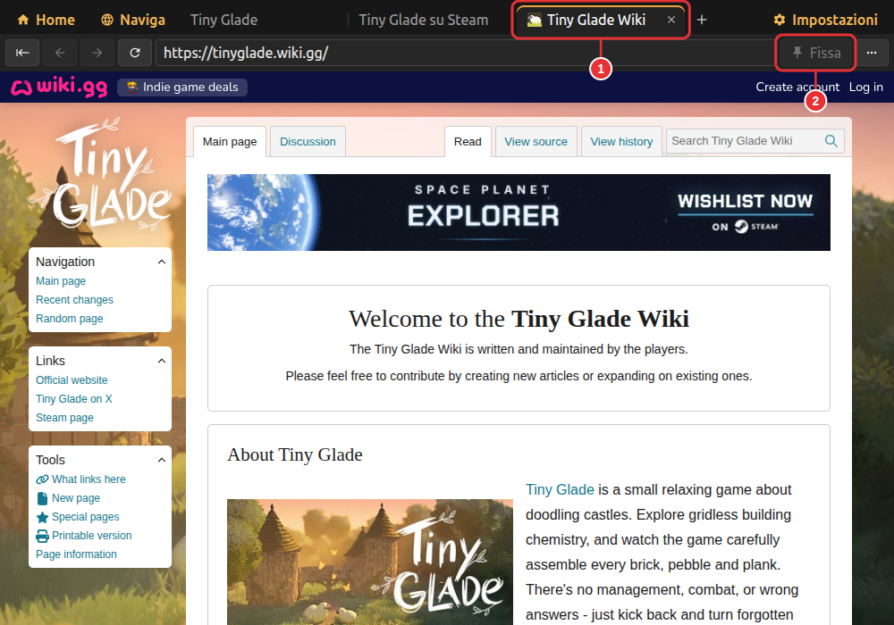
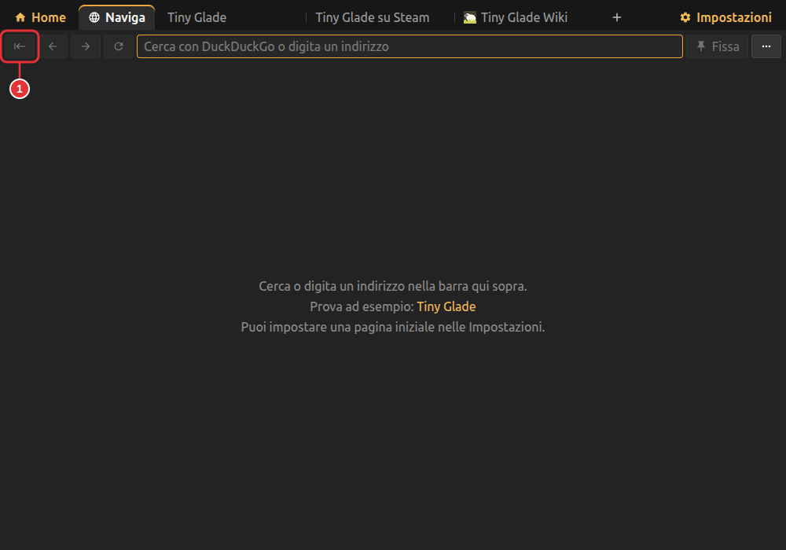

# Navigazione libera: cerca, trova, fissa

Il tab **Naviga** serve per cercare e aprire qualsiasi pagina senza aggiungerla alla lista. Quando trovi una pagina che vuoi tenere, **Fissa** la trasforma in un tab della lista del gioco.

Qui continuiamo l'esempio di [Primo avvio](getting-started.md): l'overlay è aperto sopra **Tiny Glade**, la cui lista ha già due siti, e cerchiamo una wiki del gioco.

Nelle schermate gli elementi citati nel testo sono evidenziati in rosso; i numeri come ❶ nel testo indicano l'elemento con lo stesso numero nella schermata.

## 1. Apri il tab Naviga

Clicca **Naviga** ❶, subito dopo Home. Nel **campo indirizzo** ❷ puoi scrivere un indirizzo (basta anche `example.com`) oppure un testo qualsiasi da cercare. Come esempio l'overlay propone il **nome del gioco** ❸: cliccalo per cercarlo.

## 2. Cerca

Scrivi `tiny glade wiki` e premi Invio. La ricerca si apre nel tab, e nel **campo indirizzo** ❶ compare l'indirizzo della pagina dei risultati.

Il motore di ricerca si sceglie nelle Impostazioni (sezione *Comportamento*): Google, Bing, DuckDuckGo, Brave Search, Ecosia, Startpage o un indirizzo personalizzato. Qui usiamo DuckDuckGo.

Clicca il risultato che ti interessa, qui **Tiny Glade Wiki** ❷.

## 3. Fissa la pagina

La pagina si apre nel tab Naviga e puoi usarla come in un browser: **Indietro** ❶ ti riporta ai risultati della ricerca. Per tenerla, clicca **Fissa** ❷.

L'overlay chiede conferma: clicca **Fissa**.

## 4. La pagina è un tab della lista

La pagina, con la sua cronologia, diventa un **nuovo tab** ❶ in fondo alla lista di Tiny Glade, e da ora la trovi ogni volta che apri l'overlay sopra il gioco. **Fissa** ❷ ora è disattivato: la pagina è già nella lista.

Fissa funziona anche nei tab dei siti: se da un sito raggiungi una pagina che vuoi tenere a parte, Fissa la aggiunge come nuovo tab subito dopo quello del sito. Quando una pagina è già uno dei tab della lista, quel tab viene evidenziato e Fissa è disattivato.

## 5. Il tab Naviga è di nuovo libero

Tornando su **Naviga** lo ritrovi vuoto, pronto per una nuova ricerca: la pagina fissata si è spostata nel suo tab. Mentre navighi, il pulsante **Ritorna alla pagina iniziale** ❶ chiude la pagina aperta e torna alla pagina vuota.

Nelle Impostazioni (sezione *Comportamento*) puoi anche scegliere una **pagina iniziale** per il tab Naviga, aperta al posto della pagina vuota.

## Indirizzi di altri siti dai tab dei siti

Anche nei tab dei siti puoi scrivere nel campo indirizzo. Un indirizzo dello stesso sito si apre nel tab; un indirizzo di un altro sito, o una ricerca, si apre invece nel tab Naviga, dopo una conferma, così il tab del sito resta sulla sua pagina.
