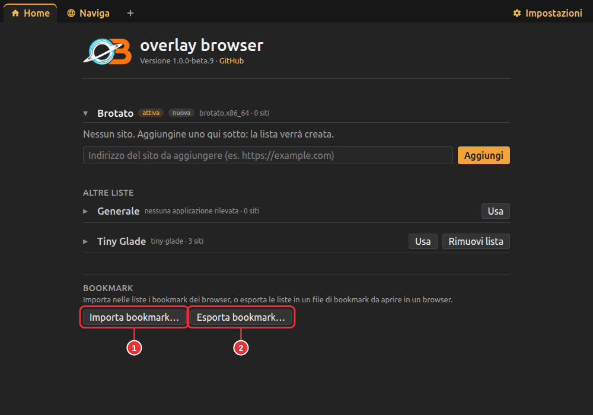
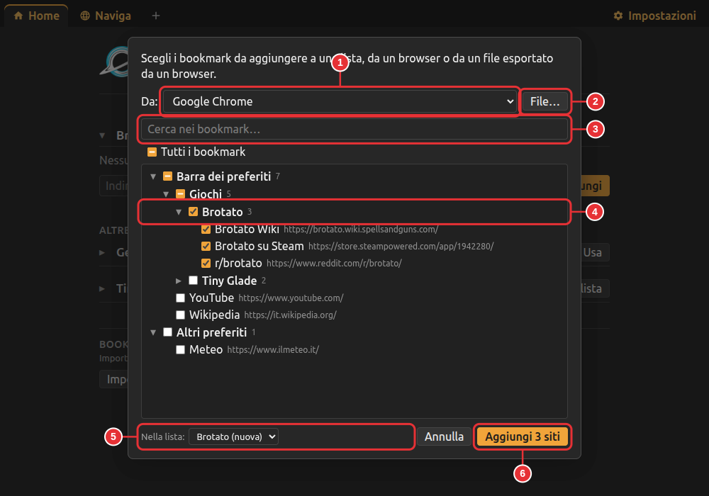
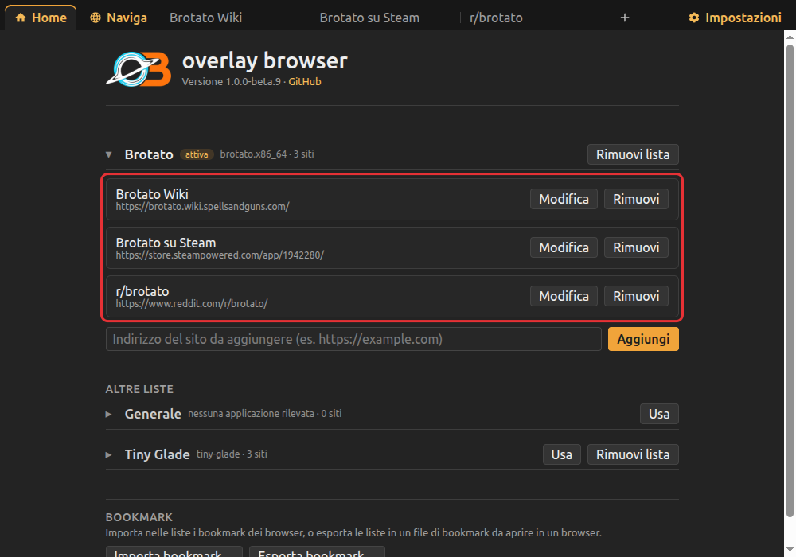
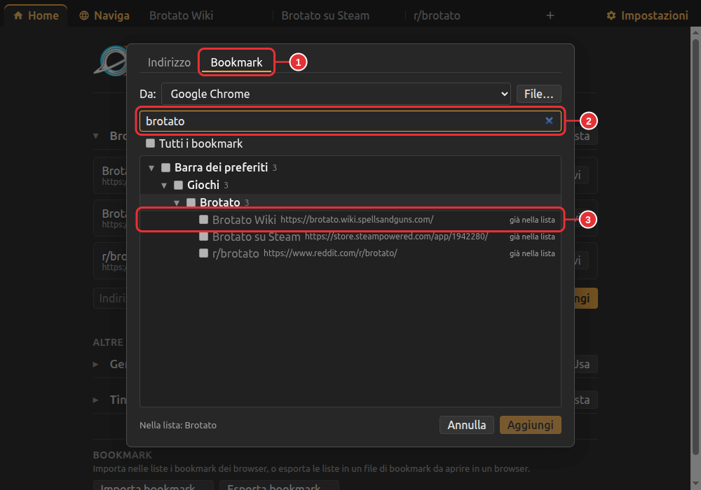
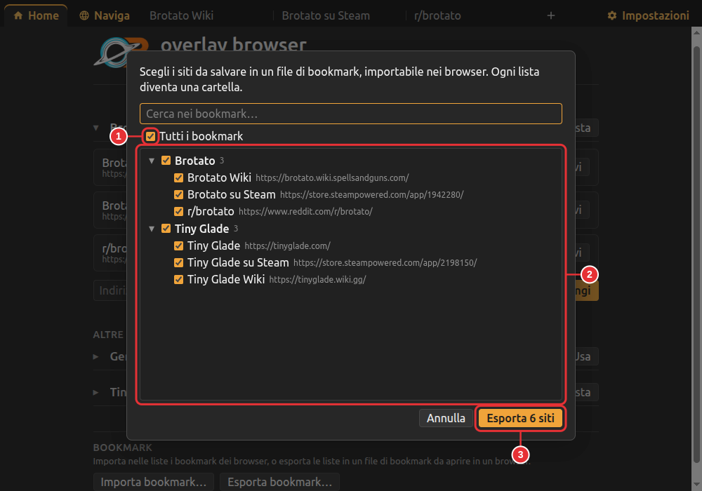

# Importare ed esportare i bookmark

Hai già i siti dei tuoi giochi tra i bookmark del browser? Puoi importarli nelle liste di Overlay Browser senza riscriverli, ed esportare le liste in un file di bookmark da aprire in qualsiasi browser.

Qui l'overlay è aperto sopra **Brotato**, la cui lista è ancora vuota, e la lista di **Tiny Glade** ha già tre siti (vedi [Una lista per ogni gioco](liste-per-gioco.md)).

Nelle schermate gli elementi citati nel testo sono evidenziati in rosso; i numeri come ❶ nel testo indicano l'elemento con lo stesso numero nella schermata.

## 1. La sezione Bookmark della Home

In fondo alla **Home** c'è la sezione *Bookmark*, con **Importa bookmark…** ❶ ed **Esporta bookmark…** ❷.

## 2. Scegli i bookmark da importare

Clicca **Importa bookmark…**. Nella finestra:

- **Da** ❶: il browser da cui leggere i bookmark, uno per ogni profilo. L'overlay li trova da solo: Chrome, Edge, Brave, Opera, Vivaldi, Chromium, Firefox, LibreWolf e altri browser simili; Firefox può restare aperto. La volta successiva ripropone il browser scelto l'ultima volta.
- **File…** ❷: importa invece un file HTML di bookmark, esportato da qualsiasi browser dal suo gestore dei bookmark. Su macOS è l'unico modo: esporta prima i bookmark dal browser.
- **Cerca** ❸: trova bookmark e cartelle per nome o indirizzo.
- **Le caselle** ❹: spunta i singoli bookmark o intere cartelle; *Tutti i bookmark* li seleziona tutti. Qui spuntiamo la cartella *Brotato*.
- **Nella lista** ❺: la lista in cui aggiungerli, all'inizio quella attiva. Se è ancora *nuova*, come qui quella di Brotato, viene creata con i siti importati.
- **Aggiungi** ❻: il pulsante dice quanti siti aggiungerai.

I bookmark diventano siti della lista, con il loro nome:

## 3. Importare dal "+"

Puoi importare anche dal **+** nella barra in alto, nella scheda **Bookmark** ❶, accanto a *Indirizzo*: qui i siti vanno sempre nella lista attiva. La **ricerca** ❷ trova i bookmark; quelli il cui indirizzo è **già nella lista** ❸ sono grigi e non si possono scegliere, quindi importare due volte non crea doppioni.

## 4. Esportare le liste

**Esporta bookmark…**, nella sezione *Bookmark* della Home, salva i siti delle liste in un file HTML di bookmark, che qualsiasi browser può importare. Ogni lista diventa una cartella. All'inizio sono scelti **tutti i bookmark** ❶; nell'**elenco** ❷ puoi togliere liste o siti. **Esporta** ❸ chiede dove salvare il file.

