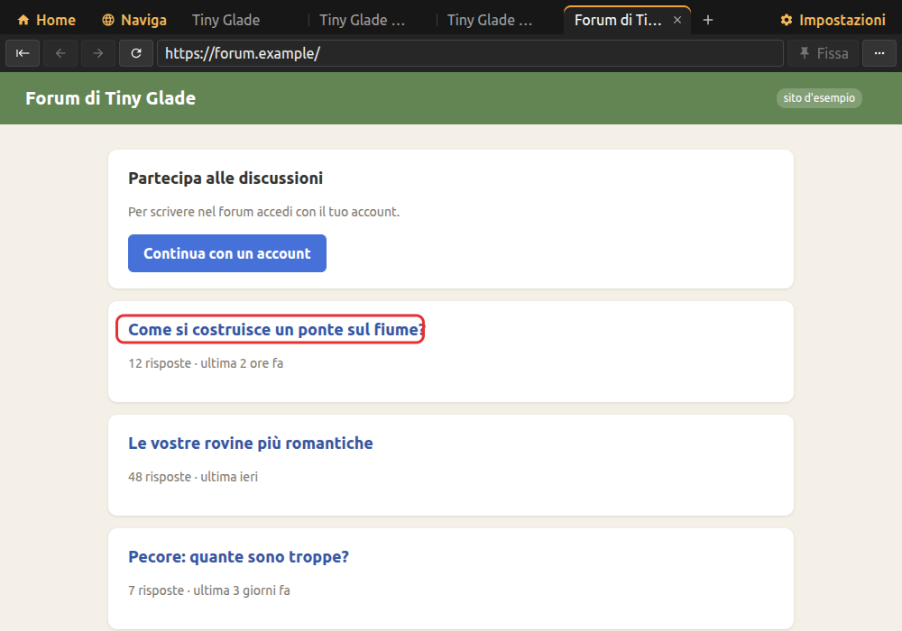
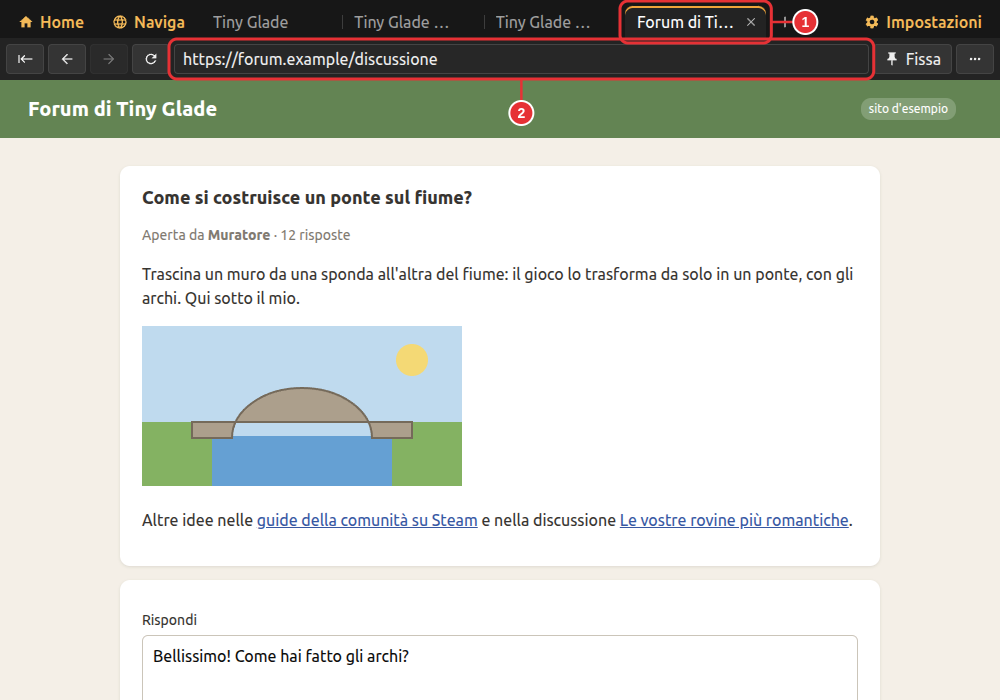
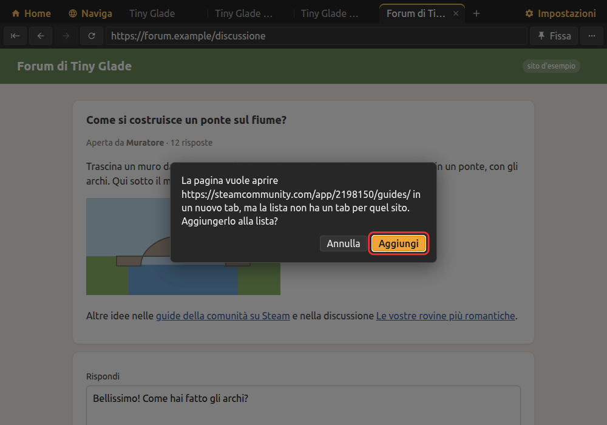
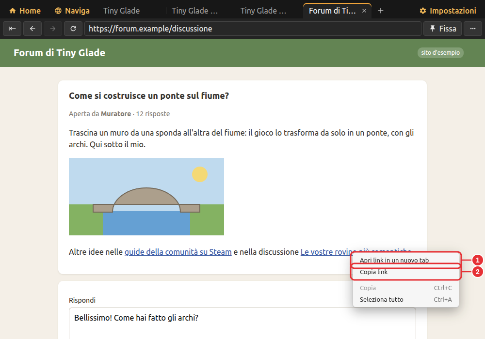
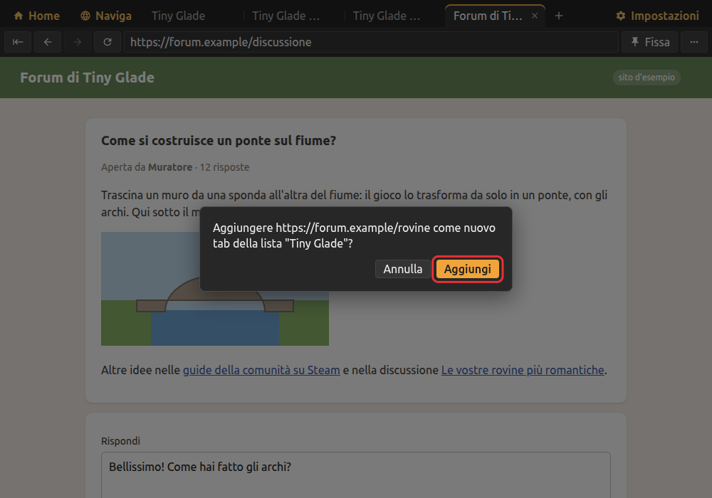
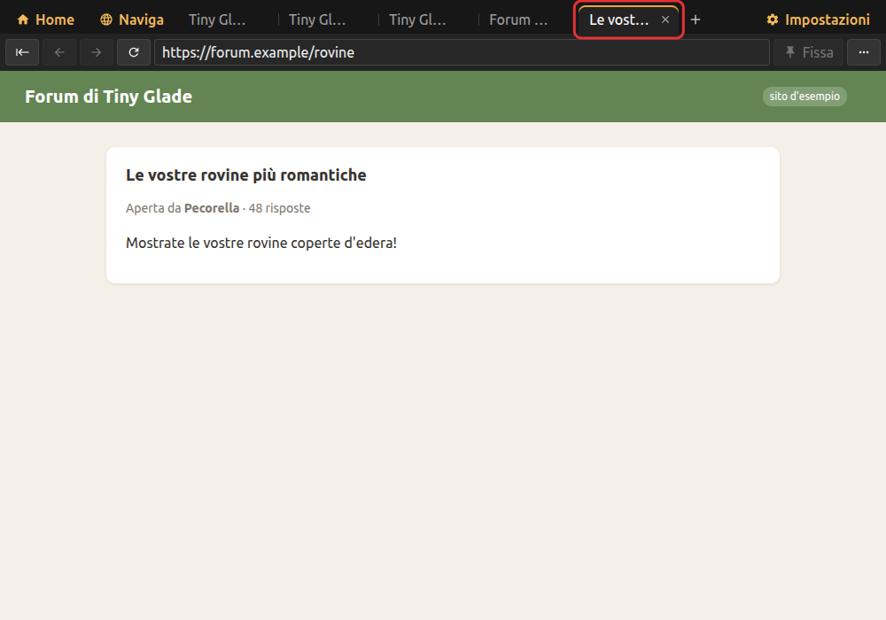
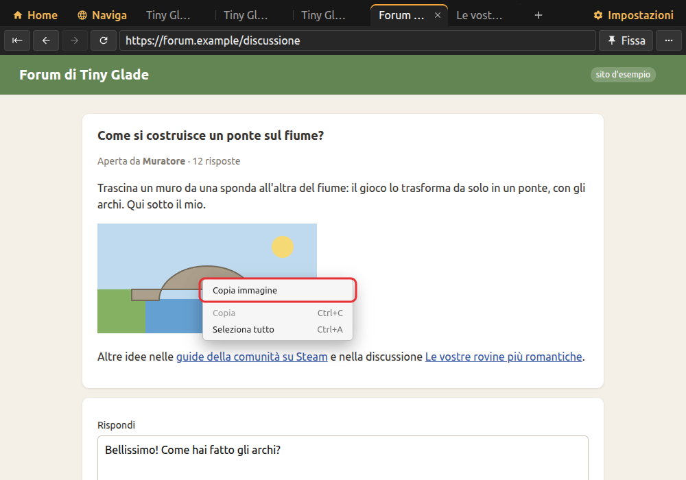
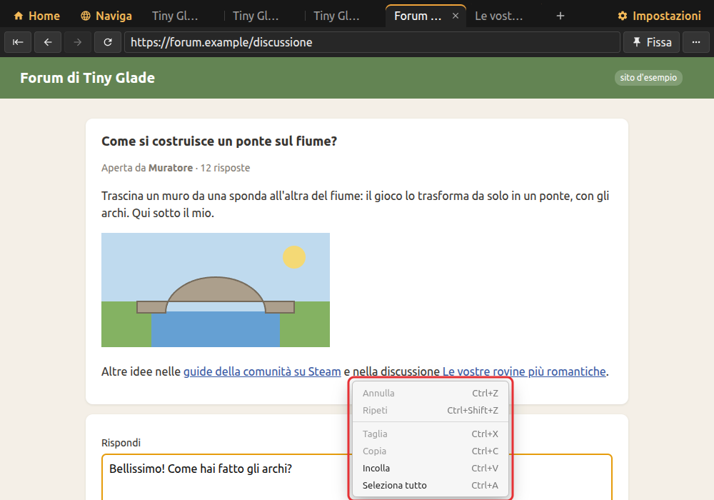

# Link, nuovi tab e menu contestuale

In un browser molti link si aprono in un nuovo tab. Nell'overlay i tab sono i siti della lista, quindi questi link vanno dove servono: nel tab del sito da cui vengono, oppure, dopo una domanda, in un nuovo tab. Il tasto destro apre il menu per aprire un link in un nuovo tab, copiare link, immagini e testo.

Qui la lista di **Tiny Glade** ha anche un forum, un **sito d'esempio** creato per questa guida (vedi [Accedere a un sito e i cookie](signing-in.md)).

Nelle schermate gli elementi citati nel testo sono evidenziati in rosso; i numeri come ❶ nel testo indicano l'elemento con lo stesso numero nella schermata.

## 1. Un link che il sito apre in un nuovo tab

Alcuni link sono fatti per aprirsi in un nuovo tab, come questa discussione del forum. Lo stesso vale per i link cliccati con Ctrl o con il tasto centrale del mouse.

## 2. Lo stesso sito: nel suo tab

Se il link porta allo stesso sito, si apre nel **tab del sito** ❶, al posto della pagina di prima: nell'**indirizzo** ❷ ora c'è quello della discussione. Con **Indietro** torni alla pagina precedente.

Se la lista ha più tab dello stesso sito, il link si apre in quello da cui viene.

## 3. Un altro sito: la domanda

Se il link porta a un sito che non ha un tab nella lista, qui le guide della comunità su Steam, l'overlay chiede se aggiungerlo alla lista: **Aggiungi** lo aggiunge come nuovo sito e lo apre; **Annulla** lascia tutto com'è.

I link aperti dal tab **Naviga** restano invece nel tab Naviga (vedi [Navigazione libera](free-browsing.md)).

## 4. Il tasto destro su un link

Il tasto destro su un link apre il menu con **Apri link in un nuovo tab** ❶ e **Copia link** ❷, che copia l'indirizzo del link.

**Apri link in un nuovo tab** chiede conferma prima di aggiungere il link alla lista: clicca **Aggiungi**.

Il link diventa un **nuovo tab**, subito dopo quello da cui viene, e si apre. Se un tab della lista è già su quell'indirizzo, l'overlay mostra quel tab invece di aggiungerne un altro.

## 5. Il tasto destro su immagini e testo

Su un'immagine il menu ha **Copia immagine**, per incollarla altrove, ad esempio in una chat. Sul testo di una pagina ci sono **Copia**, per il testo selezionato, e **Seleziona tutto**.

Nei campi di testo, come quello per rispondere nel forum o l'indirizzo dei tab, il menu ha **Annulla**, **Ripeti**, **Taglia**, **Copia**, **Incolla** e **Seleziona tutto**. Le voci che in quel momento non servono, ad esempio *Copia* senza testo selezionato, sono in grigio.

