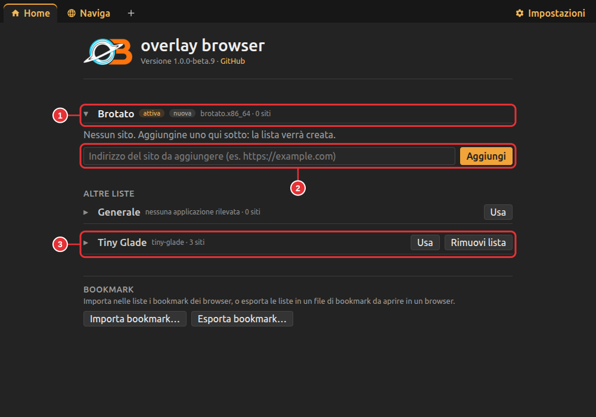
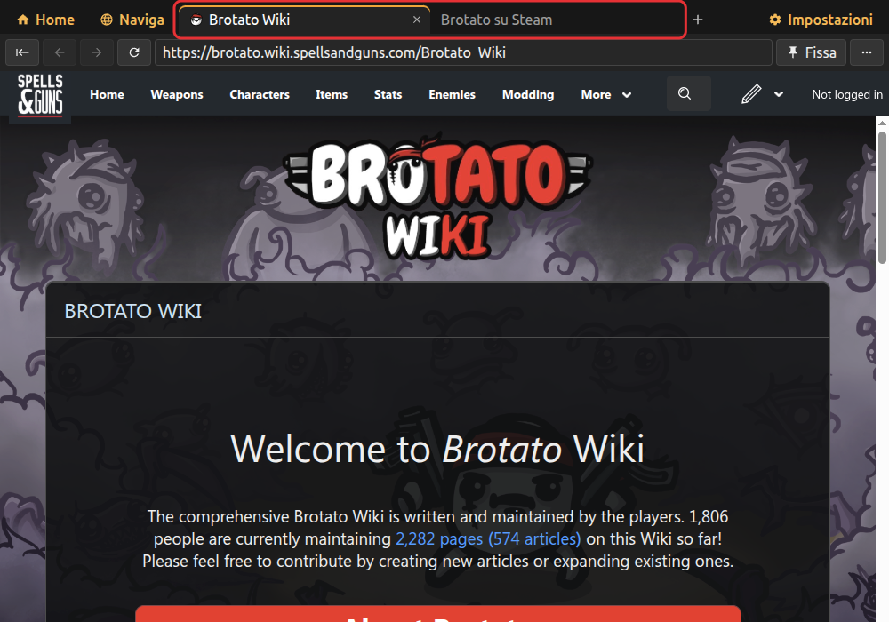
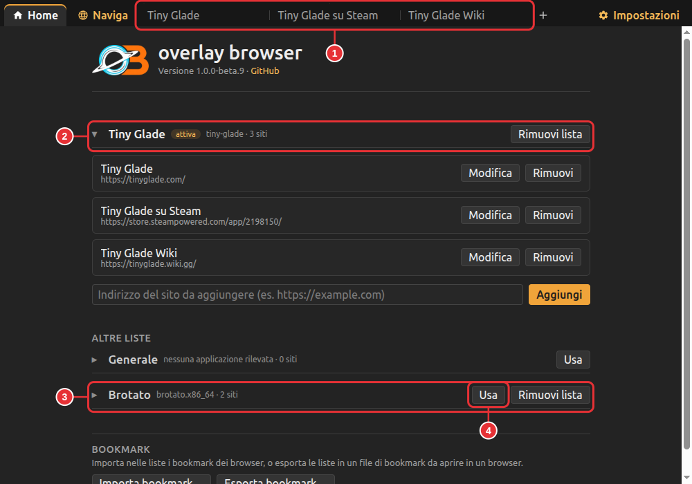
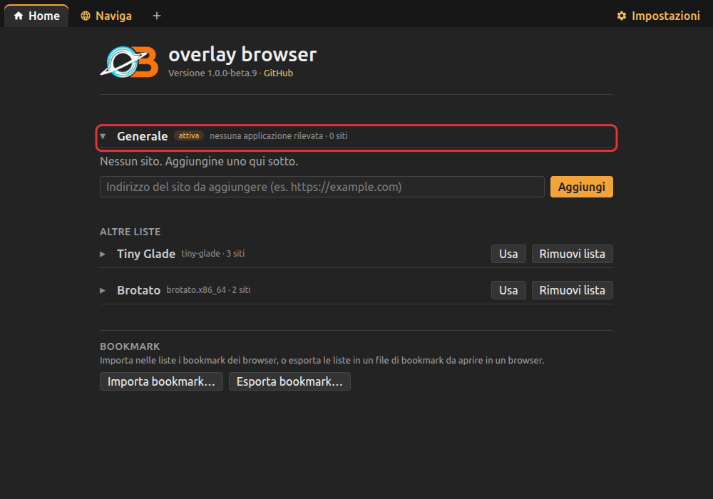
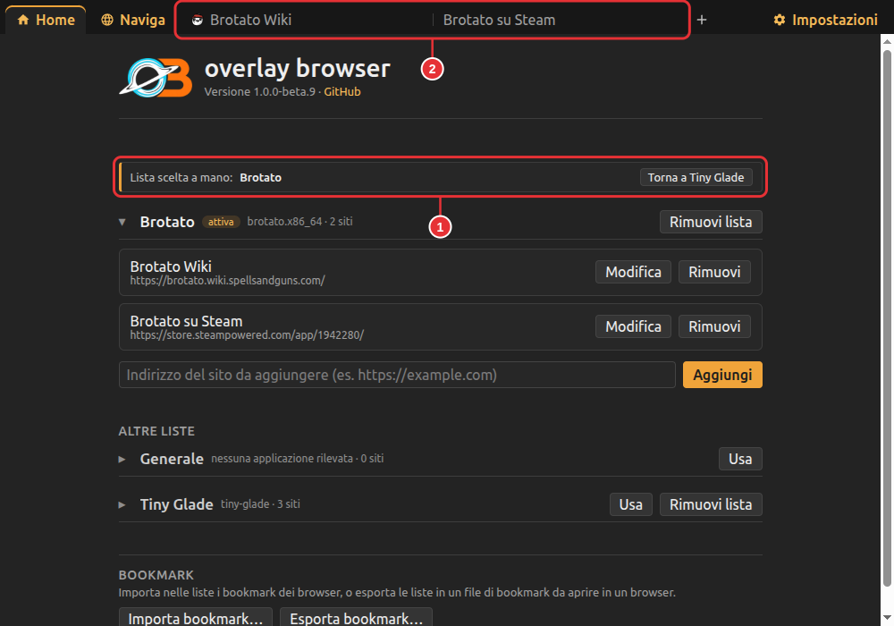
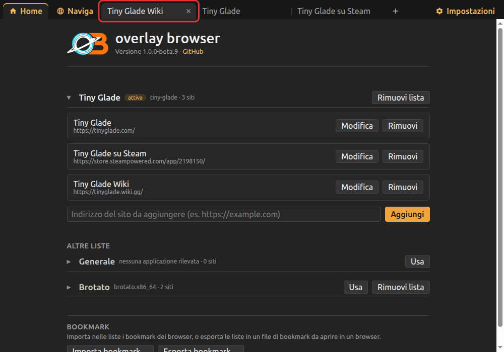
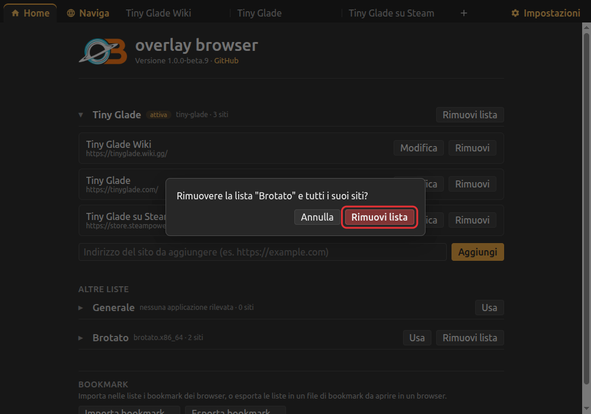

# Una lista per ogni gioco

Overlay Browser riconosce il gioco sopra cui lo apri e mostra i siti di quel gioco: ogni gioco ha la sua **lista**. In questa guida, dopo [Primo avvio](primo-avvio.md) e [Navigazione libera](navigazione-libera.md), la lista di **Tiny Glade** ha già tre siti; ora giochiamo a **Brotato**.

Nelle schermate gli elementi citati nel testo sono evidenziati in rosso; i numeri come ❶ nel testo indicano l'elemento con lo stesso numero nella schermata.

## 1. Un nuovo gioco, una nuova lista

Apri l'overlay mentre giochi a Brotato. In cima alla Home c'è la **lista di Brotato** ❶, *attiva* e ancora *nuova*: accanto al nome vedi il programma riconosciuto e il numero di siti. Aggiungi un sito nel **campo sotto la lista** ❷ (o con il **+** nella barra in alto): la lista viene creata con il primo sito. La **lista di Tiny Glade** ❸ è tra le *Altre liste*, chiusa: cliccala per vederne i siti.

Qui aggiungiamo la wiki di Brotato e la sua pagina Steam. Nella barra ora ci sono i loro tab, e solo quelli: i siti di Tiny Glade non compaiono.

## 2. Ogni gioco ritrova i suoi siti

Torna a Tiny Glade e apri l'overlay: nella barra ci sono i **tab di Tiny Glade** ❶, e la **lista di Tiny Glade** ❷ è quella attiva. La **lista di Brotato** ❸ è passata tra le *Altre liste*; **Usa** ❹ la renderebbe attiva a mano (vedi il passo 4). Ogni lista si riapre sull'ultimo tab che stavi guardando.

## 3. La lista Generale

Le liste non sono solo per i giochi: l'overlay propone una lista per qualsiasi programma sopra cui lo apri. Quando non riconosce nessuna applicazione è attiva la **lista Generale**, un posto per i siti che non riguardano un programma in particolare. Funziona come le altre, ma non si può rimuovere.

## 4. Scegliere una lista a mano

A volte vuoi i siti di un altro gioco: ad esempio stai guardando la wiki di Brotato mentre è aperto Tiny Glade. Clicca **Usa** accanto alla lista che vuoi (❹ nella schermata del passo 2).

La lista diventa attiva e resta quella **scelta a mano** ❶ anche quando apri l'overlay sopra altri giochi, finché non clicchi **Torna a Tiny Glade**, dove Tiny Glade è il gioco sopra cui è aperto l'overlay in quel momento. Nella barra ci sono i **tab della lista scelta** ❷.

## 5. Riordinare tab e siti

Trascina un tab nella barra per spostarlo: qui la Tiny Glade Wiki viene portata al primo posto.

Allo stesso modo puoi trascinare i siti nella Home: l'ordine della Home e quello dei tab sono lo stesso.

## 6. Rimuovere una lista

**Rimuovi lista**, accanto al nome di una lista, la elimina con tutti i suoi siti, dopo una conferma:

Se poi aggiungi un sito mentre giochi di nuovo a Brotato, la sua lista viene creata da capo.
