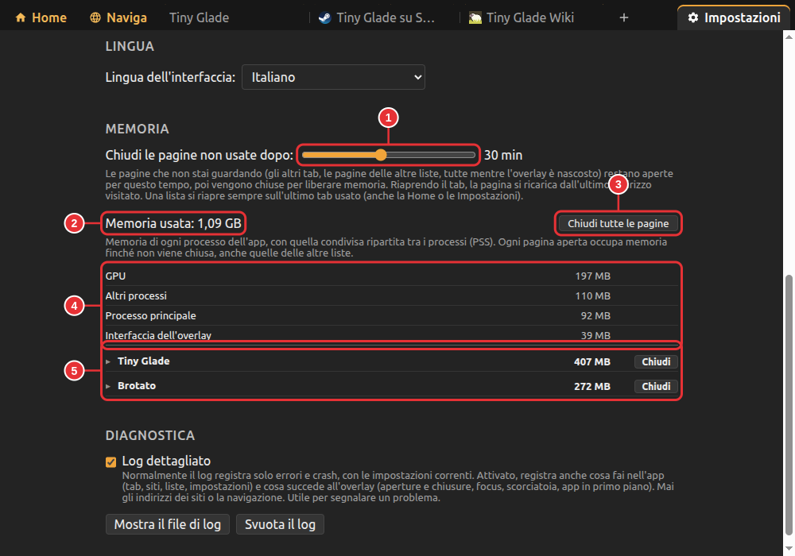
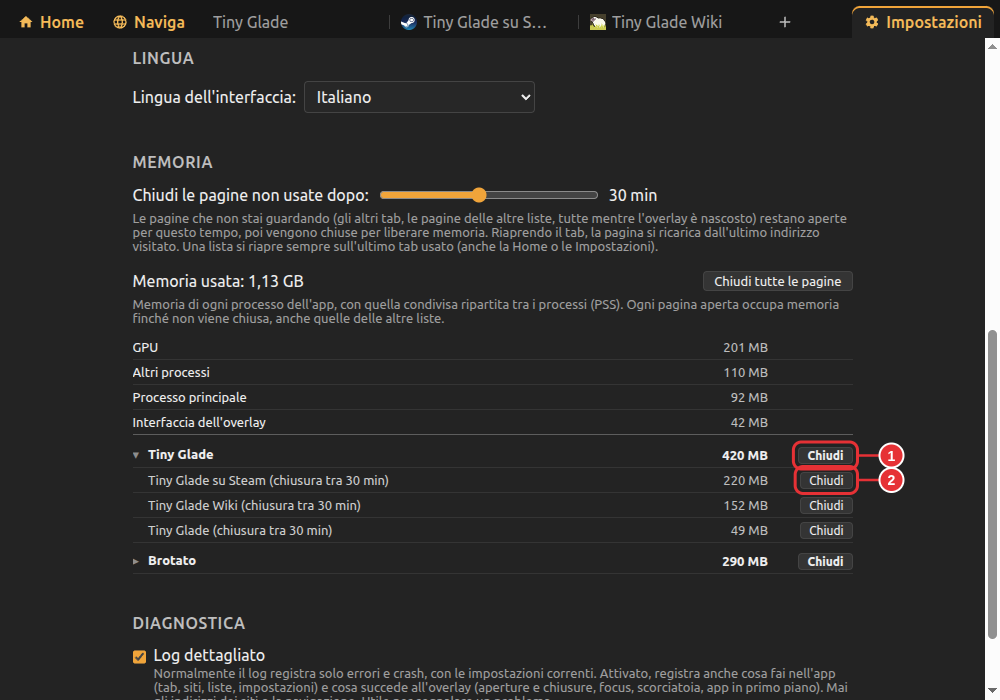
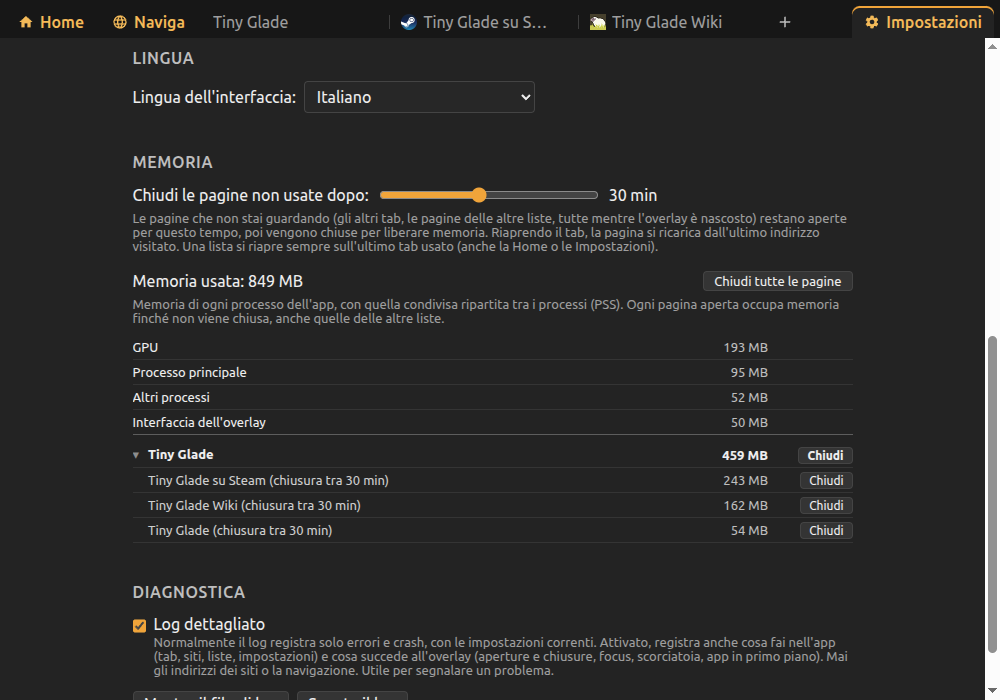

# Memoria e pagine chiuse

Ogni pagina aperta in Overlay Browser occupa memoria, come in un browser, anche quando non la stai guardando: le pagine delle altre liste restano aperte finché non vengono chiuse. Per non sottrarre memoria al gioco, l'overlay **chiude da solo le pagine che non usi da un po'**, e dalle Impostazioni puoi vedere quanta memoria usa e chiuderle a mano.

Qui le liste di **Tiny Glade** e di **Brotato** hanno diverse pagine aperte (vedi [Una lista per ogni gioco](lists-per-game.md)).

Nelle schermate gli elementi citati nel testo sono evidenziati in rosso; i numeri come ❶ nel testo indicano l'elemento con lo stesso numero nella schermata.

## 1. Perché una pagina si ricarica

Le pagine che non stai guardando (gli altri tab, le pagine delle altre liste, e tutte mentre l'overlay è nascosto) restano aperte per un certo tempo, poi vengono chiuse. Riaprendo il tab, la pagina **si ricarica dall'ultimo indirizzo visitato**: ritrovi la pagina, ma ad esempio non il punto in cui l'avevi scorsa né un modulo compilato a metà.

La pagina che stai guardando non viene mai chiusa.

## 2. La sezione Memoria

Apri le **Impostazioni** e scorri fino alla sezione *Memoria*:

- **Chiudi le pagine non usate dopo** ❶: il tempo dopo cui una pagina non usata viene chiusa, da 5 a 60 minuti (di default 30). Con meno memoria libera, o con giochi pesanti, conviene un tempo più breve.
- **Memoria usata** ❷: la memoria di tutta l'app.
- **Chiudi tutte le pagine** ❸: chiude subito tutte le pagine aperte, di tutte le liste.
- **I processi dell'app** ❹: l'interfaccia dell'overlay, il processo principale, la grafica (GPU) e gli altri processi. Questa memoria c'è sempre.
- **Le pagine, raggruppate per lista** ❺: per ogni lista, la memoria delle sue pagine aperte. **Chiudi** chiude tutte le pagine di quella lista.

## 3. Le pagine di una lista

Clicca il nome di una lista per vederne le pagine aperte, ognuna con la memoria che usa e il tempo che manca alla sua chiusura. **Chiudi** accanto alla lista ❶ chiude tutte le sue pagine; **Chiudi** accanto a una pagina ❷ chiude solo quella.

Alcune pagine condividono lo stesso processo, ad esempio pagine dello stesso sito in liste diverse: compaiono in una riga sola, fuori dai gruppi, e si chiudono insieme, perché la memoria si libera solo chiudendole tutte.

## 4. Dopo la chiusura

Qui abbiamo chiuso le pagine di Brotato: il suo gruppo è sparito e la memoria usata è scesa. I tab di Brotato restano nella sua lista: la prossima volta che li apri, le pagine si ricaricano.

