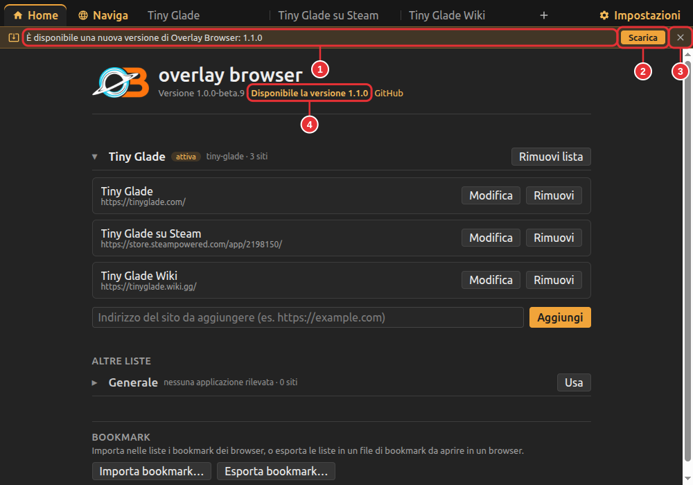
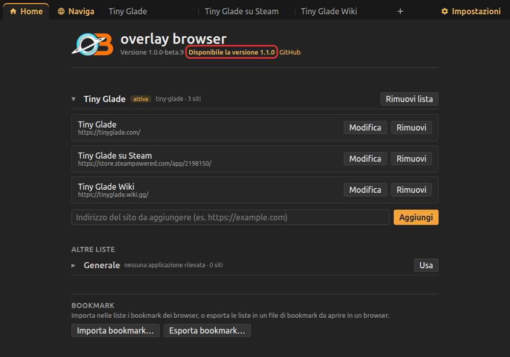
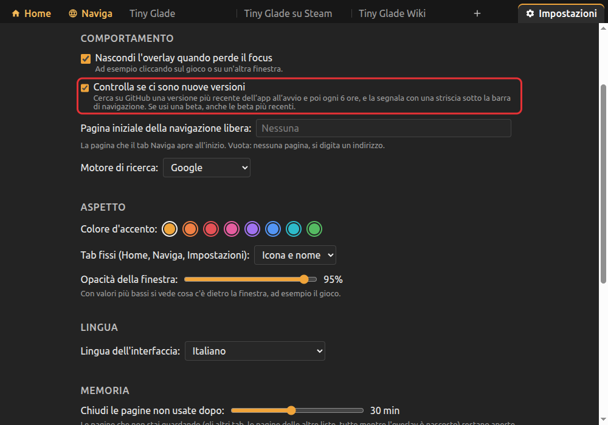

# Nuove versioni

Overlay Browser controlla da solo se è uscita una nuova versione e te la segnala; non si aggiorna da solo: scarichi tu la nuova versione quando vuoi.

Nelle schermate gli elementi citati nel testo sono evidenziati in rosso; i numeri come ❶ nel testo indicano l'elemento con lo stesso numero nella schermata.

## 1. L'avviso di una nuova versione

Quando esce una nuova versione, sotto la barra in alto compare una **striscia** ❶ con il suo numero. **Scarica** ❷ apre nel browser del sistema la pagina della nuova versione, da cui scaricare il file per il tuo sistema (vedi l'installazione nel [README](../../README-it.md)). La **×** ❸ chiude la striscia: per quella versione non ricompare.

La nuova versione resta indicata anche in cima alla **Home** ❹, accanto alla versione che stai usando: cliccala per aprire la stessa pagina.

Dopo aver chiuso la striscia, la nuova versione resta nella Home finché non installi l'aggiornamento:

## 2. Quando controlla

L'app controlla poco dopo l'avvio e poi ogni 6 ore, sulle release del progetto su GitHub. Se usi una versione beta, ti segnala anche le beta più recenti; altrimenti solo le versioni definitive.

Per non ricevere gli avvisi, disattiva **Controlla se ci sono nuove versioni** nelle **Impostazioni**, sezione *Comportamento*. Nella versione del Microsoft Store l'opzione non c'è: gli aggiornamenti arrivano dallo Store.

