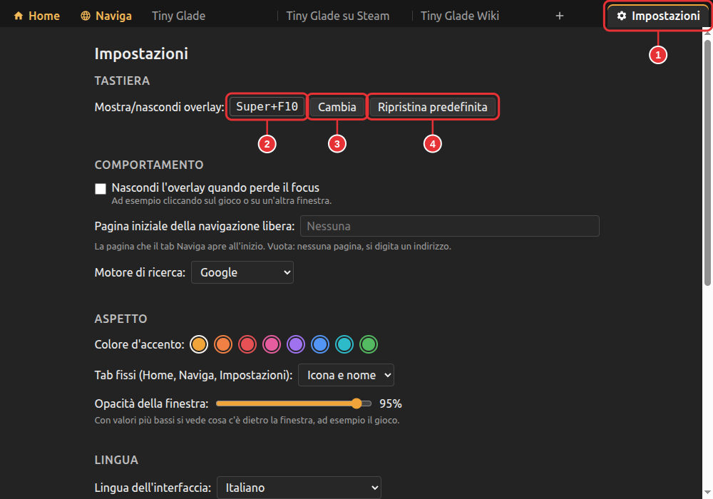
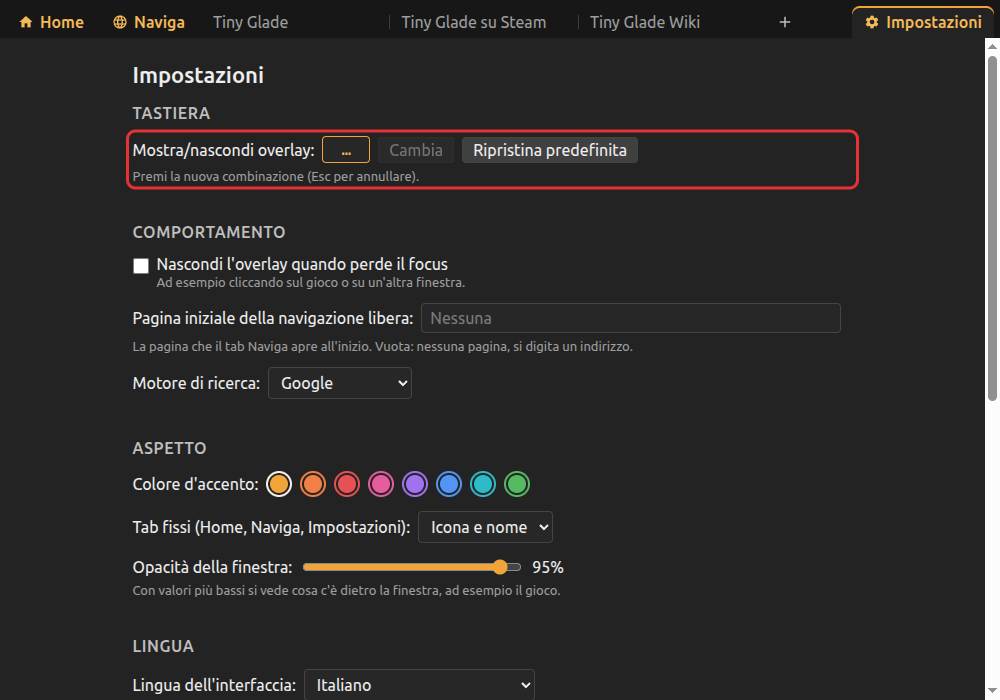
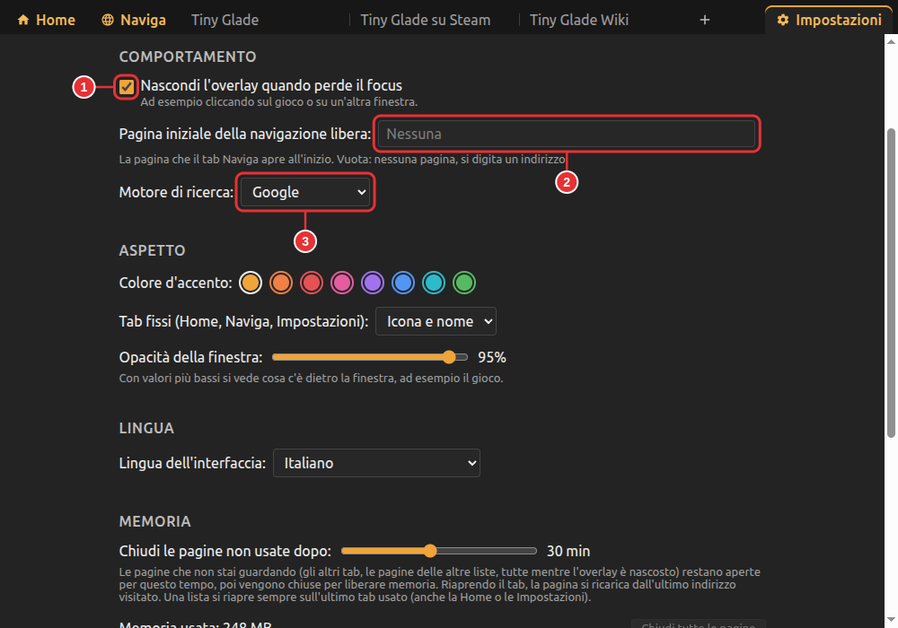
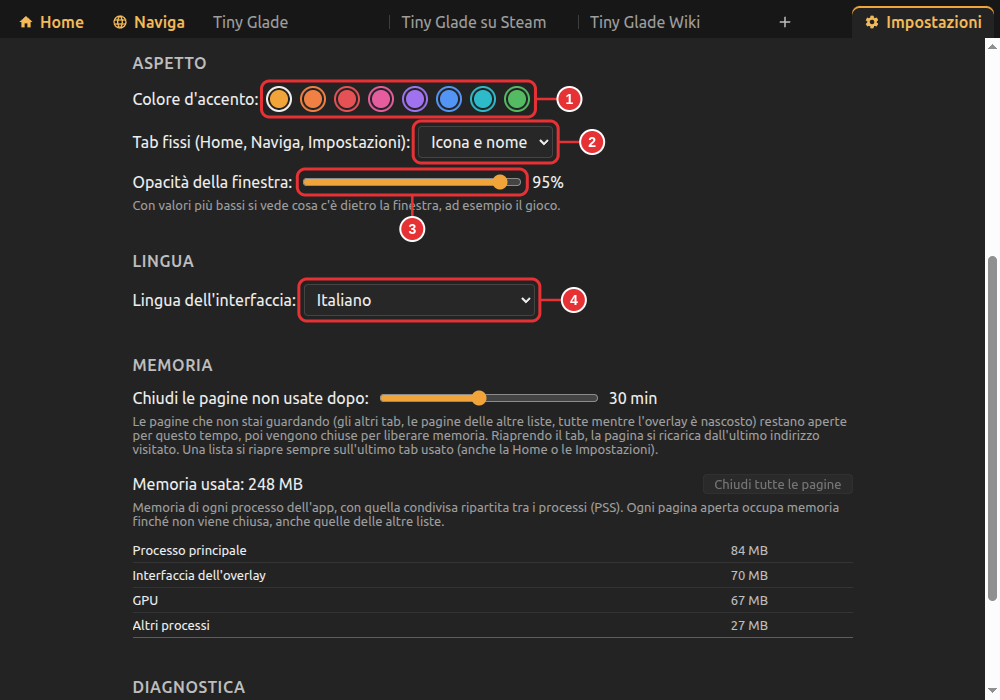
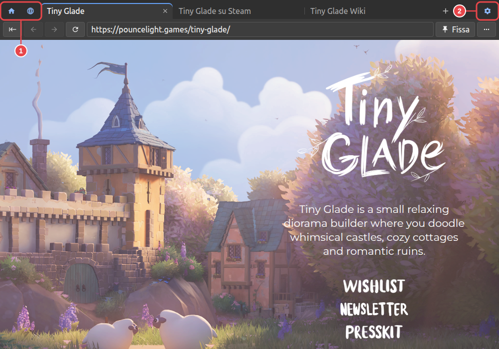

# Personalizzare l'overlay

Dalla pagina **Impostazioni** scegli la combinazione di tasti, come si comporta l'overlay, il suo aspetto e la lingua. Ogni modifica si applica subito e viene ricordata.

Nelle schermate gli elementi citati nel testo sono evidenziati in rosso; i numeri come ❶ nel testo indicano l'elemento con lo stesso numero nella schermata.

## 1. La combinazione di tasti

Apri il tab **Impostazioni** ❶, in alto a destra (oppure *Impostazioni* dal menu dell'icona nell'area di notifica). Nella sezione *Tastiera* vedi la **combinazione attuale** ❷ che mostra e nasconde l'overlay. **Cambia** ❸ ne registra una nuova; **Ripristina predefinita** ❹ torna a quella di default (Win+F10, Super+F10 su Linux, Cmd+Shift+Spazio su macOS).

Dopo **Cambia**, premi la combinazione che preferisci, ad esempio `Ctrl+Shift+O`; Esc annulla.

Sono ammessi i tasti F1–F24 da soli, oppure qualunque tasto insieme a Ctrl, Alt, Shift o Win (Super su Linux, Cmd su macOS). Se la combinazione è già usata da un altro programma compare un messaggio e resta quella precedente.

> **Attenzione in gioco:** la combinazione arriva anche al gioco, oltre che all'overlay. Scegline una che nel gioco non è assegnata a nessun comando, altrimenti aprendo l'overlay attiverai anche quel comando.

## 2. Il comportamento

Nella sezione *Comportamento*:

- **Nascondi l'overlay quando perde il focus** ❶: attivo di default, l'overlay si nasconde da solo quando clicchi sul gioco o su un'altra finestra. Disattivalo se vuoi tenerlo visibile mentre giochi; in quel caso si nasconde solo con la combinazione di tasti. La stessa opzione è anche nel menu dell'icona nell'area di notifica.
- **Pagina iniziale della navigazione libera** ❷: la pagina che il tab Naviga apre all'inizio. Vuota: nessuna pagina (vedi [Navigazione libera](navigazione-libera.md)).
- **Motore di ricerca** ❸: quello usato dal tab Naviga per i testi che non sono indirizzi: Google, Bing, DuckDuckGo, Brave Search, Ecosia, Startpage, oppure *Personalizzato*, un indirizzo di ricerca con `%s` al posto del testo cercato.

Qui c'è anche *Controlla se ci sono nuove versioni*, che segnala nella Home quando esce una nuova versione (non c'è nella versione del Microsoft Store, che si aggiorna da sola).

## 3. L'aspetto e la lingua

Nella sezione *Aspetto*:

- **Colore d'accento** ❶: il colore dei tab fissi, dei pulsanti principali e dei dettagli dell'interfaccia.
- **Tab fissi** ❷: Home, Naviga e Impostazioni con icona e nome, oppure *Solo icona* per lasciare più spazio ai tab dei siti.
- **Opacità della finestra** ❸: con valori più bassi la finestra diventa trasparente e si intravede il gioco dietro (dal 30% al 100%, cioè opaca).

Nella sezione *Lingua*, **Lingua dell'interfaccia** ❹: di default *Lingua di sistema*, cioè quella del sistema se è tra quelle dell'app (italiano, inglese, francese, portoghese, russo, spagnolo e tedesco), altrimenti l'inglese.

Ecco l'overlay con il colore d'accento blu e i **tab fissi solo con l'icona** ❶ ❷. L'opacità non si vede nella schermata, che riprende solo la finestra e non il gioco dietro.

## Le altre sezioni

Più in basso, la sezione *Memoria* dice quanta memoria usa l'app e dopo quanto tempo chiudere le pagine che non stai guardando; la sezione *Diagnostica* serve a raccogliere informazioni da allegare a una segnalazione di problemi.
