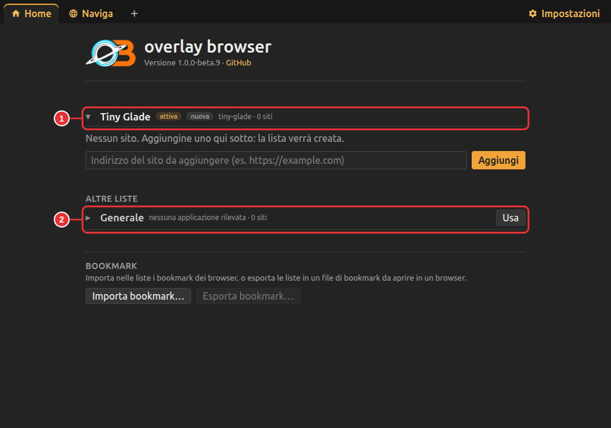
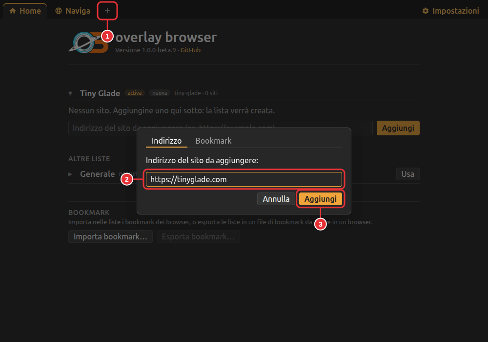
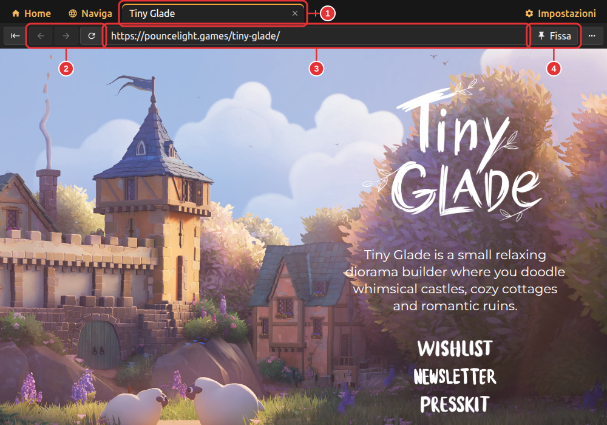
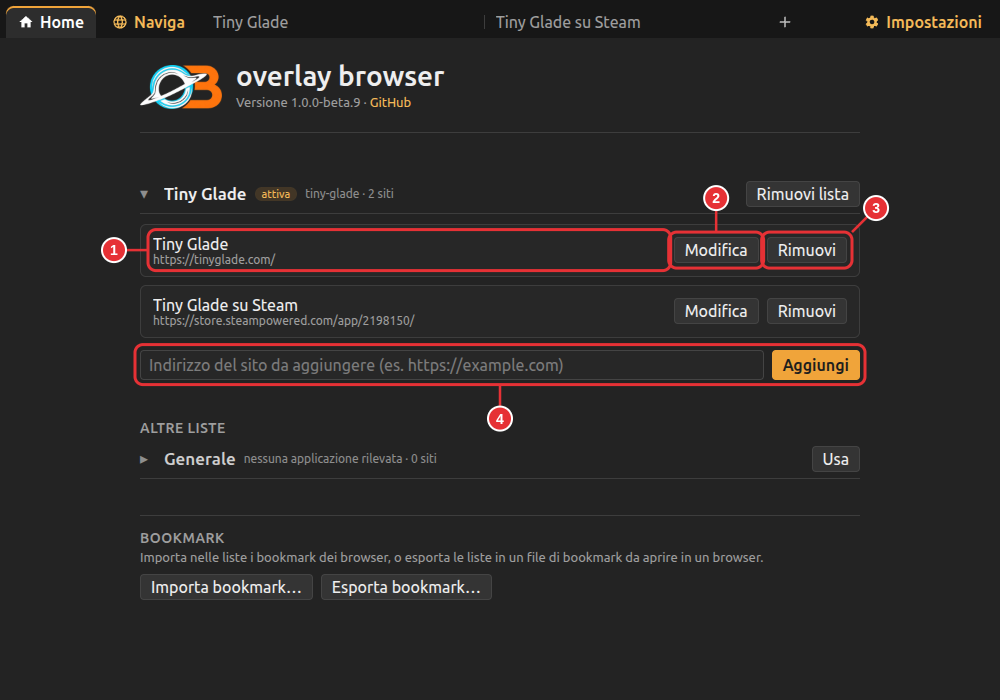
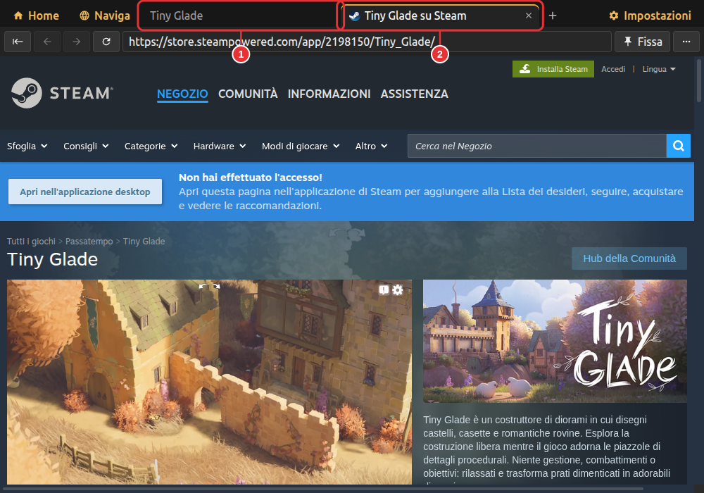

# Primo avvio: i siti del tuo gioco a portata di mano

In questa guida apri Overlay Browser mentre giochi (qui con **Tiny Glade**), aggiungi un paio di siti utili e impari a mostrarli e nasconderli senza lasciare il gioco.

Nelle schermate gli elementi citati nel testo sono evidenziati in rosso; i numeri come ❶ nel testo indicano l'elemento con lo stesso numero nella schermata.

## 1. Avvia l'app

Avvia Overlay Browser: la finestra **resta nascosta** e l'app si mette in attesa nell'area di notifica, vicino all'orologio. Non compare nella barra delle applicazioni né in Alt+Tab.

Poi avvia il gioco, in modalità finestra o finestra senza bordi.

## 2. Apri l'overlay sopra il gioco

Mentre giochi premi **Win+F10** (Super+F10 su Linux, Cmd+Shift+Spazio su macOS). L'overlay compare sopra il gioco e si apre sulla **Home**.

L'overlay ha riconosciuto il gioco: in cima c'è la lista **Tiny Glade** ❶, *attiva* e ancora *nuova*. Ogni gioco ha la sua lista di siti, creata quando ci aggiungi il primo sito. Tra le *Altre liste* c'è la lista **Generale** ❷, usata quando non è aperto nessun gioco; **Usa** la rende attiva a mano.

## 3. Aggiungi un sito

Clicca **+** ❶ nella barra in alto, scrivi l'indirizzo del sito ❷ (basta anche `tinyglade.com`) e premi **Aggiungi** ❸.

Il sito si apre subito nel suo **tab** ❶, che prende il nome dal titolo della pagina; la **×** lo chiude. Sotto c'è la barra di navigazione, come in un browser: **indietro, avanti e ricarica** ❷, l'**indirizzo** della pagina ❸ (puoi scriverne un altro e premere Invio) e **Fissa** ❹, che trasforma in un nuovo tab una pagina che hai raggiunto navigando.

## 4. Aggiungine altri dalla Home

Torna alla **Home**: qui vedi i siti della lista. Clicca il **nome di un sito** ❶ per aprirlo, **Modifica** ❷ per cambiarne l'indirizzo (Invio per salvare, Esc per annullare) o **Rimuovi** ❸ per toglierlo dalla lista. Per aggiungere un sito scrivi l'indirizzo nel **campo sotto la lista** ❹ e premi *Aggiungi*: qui abbiamo aggiunto la pagina Steam del gioco.

## 5. Passa da un sito all'altro

Ogni sito ha il suo tab nella barra: qui il **sito ufficiale** ❶ e la **pagina Steam** ❷, quella aperta adesso. Cambiando tab e tornando indietro ritrovi la pagina esattamente dove l'avevi lasciata.

## 6. Torna a giocare

Premi di nuovo **Win+F10** per nascondere l'overlay, oppure clicca sulla finestra del gioco: di default l'overlay si nasconde da solo quando perde il focus (si può disattivare dalle Impostazioni).

La prossima volta che apri l'overlay sopra Tiny Glade ritrovi la sua lista, aperta sull'ultimo tab che stavi guardando. Sopra un altro gioco vedrai invece la lista di quel gioco.
