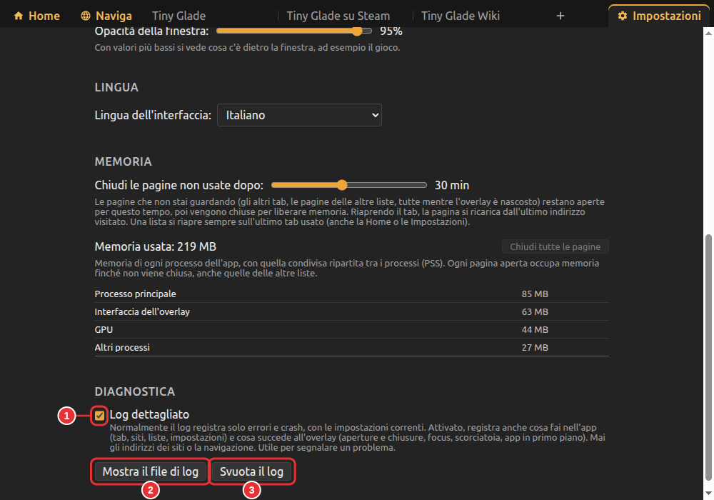
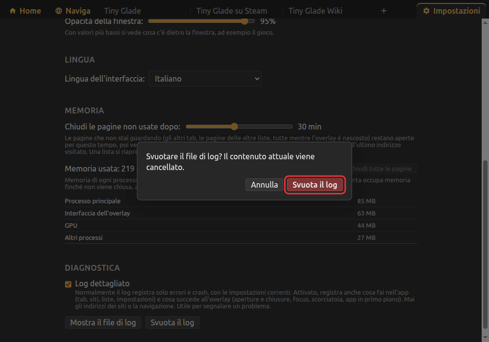

# Risoluzione dei problemi

Qui trovi le soluzioni ai problemi più comuni e come raccogliere le informazioni utili per segnalarne uno. Per i dettagli di ogni sistema (Windows, Linux, macOS) la guida rimanda al [README](../../README-it.md).

Nelle schermate gli elementi citati nel testo sono evidenziati in rosso; i numeri come ❶ nel testo indicano l'elemento con lo stesso numero nella schermata.

## 1. La combinazione di tasti non funziona

- **È già usata da un altro programma.** Se la scegli nelle Impostazioni, l'overlay te lo dice («combinazione non valida o già in uso») e resta quella precedente: scegline un'altra (vedi [Personalizzare l'overlay](customizing.md)).
- **Il gioco la usa per un suo comando.** La combinazione arriva anche al gioco: scegline una che nel gioco non fa nulla.
- **Linux con Wayland.** La combinazione non viene vista mentre è attiva una finestra Wayland nativa: serve una sessione X11 (vedi *Linux* nel [README](../../README-it.md#linux)).
- **macOS e tasti funzione.** Di default F1–F12 regolano luminosità, volume e così via: premili insieme a **fn**, oppure cambia l'impostazione della tastiera (vedi *macOS* nel [README](../../README-it.md#macos)).

Puoi sempre mostrare l'overlay anche dall'icona nell'area di notifica.

## 2. Non trovo l'icona dell'app

L'app non compare nella barra delle applicazioni né in Alt+Tab: sta nell'area di notifica, vicino all'orologio.

- **Windows:** se non la vedi, clicca sulla freccia **^** e trascina l'icona sulla barra per tenerla sempre visibile.
- **Linux con GNOME:** serve l'estensione *AppIndicator and KStatusNotifierItem Support*. In alcuni ambienti il clic sull'icona apre il menu invece di mostrare la finestra: usa la voce *Mostra*.
- **macOS:** l'icona è nella barra dei menu, in alto a destra.

## 3. L'overlay non compare sopra il gioco, o non è trasparente

- **Il gioco copre l'overlay.** Alcuni giochi a schermo intero "esclusivo" coprono qualsiasi finestra: imposta il gioco in modalità *finestra senza bordi* (borderless).
- **La finestra non è trasparente (Linux).** La trasparenza richiede un window manager con il compositing attivo (Cinnamon, KDE, GNOME, Xfce con il compositing): senza, la finestra resta opaca.

## 4. Un sito non funziona bene o una pagina si ricarica

- **Un sito non funziona più bene, o vuoi uscire da un account:** elimina i cookie del sito dal menu **…** (vedi [Accedere a un sito e i cookie](signing-in.md)).
- **Una pagina si ricarica quando torni al suo tab:** le pagine non usate vengono chiuse dopo un po' per liberare memoria (vedi [Memoria e pagine chiuse](memory.md)).
- **Vuoi ripartire da zero:** chiudi l'app ed elimina il file delle preferenze (vedi *Preferenze e disinstallazione* nel [README](../../README-it.md#preferenze-e-disinstallazione)).

## 5. Raccogli le informazioni per una segnalazione

Se un problema resta, puoi segnalarlo nella pagina delle [segnalazioni del progetto](https://github.com/siculo/overlay-browser/issues). Il file di log dell'app aiuta a capire cosa è successo.

Nelle **Impostazioni**, sezione *Diagnostica*:

- **Log dettagliato** ❶: normalmente il log registra solo errori e crash, con le impostazioni correnti. Attivato, registra anche cosa fai nell'app (tab, siti, liste, impostazioni) e cosa succede all'overlay (aperture e chiusure, focus, combinazione di tasti, app in primo piano). Attivalo, poi ripeti quello che causa il problema.
- **Mostra il file di log** ❷: apre la cartella con il file `overlay.log`, da allegare alla segnalazione.
- **Svuota il log** ❸: cancella il contenuto del log, ad esempio per registrare solo il problema da segnalare.

Il log non contiene mai i tasti che premi né la tua navigazione: niente indirizzi o titoli delle pagine. I siti sono indicati solo con la loro posizione nella lista.

**Svuota il log** chiede conferma prima di cancellarlo:

